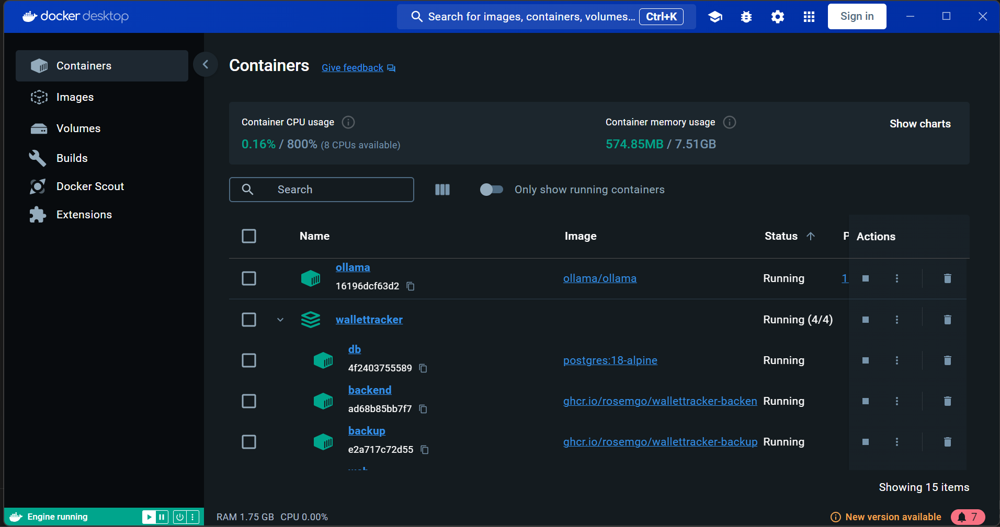
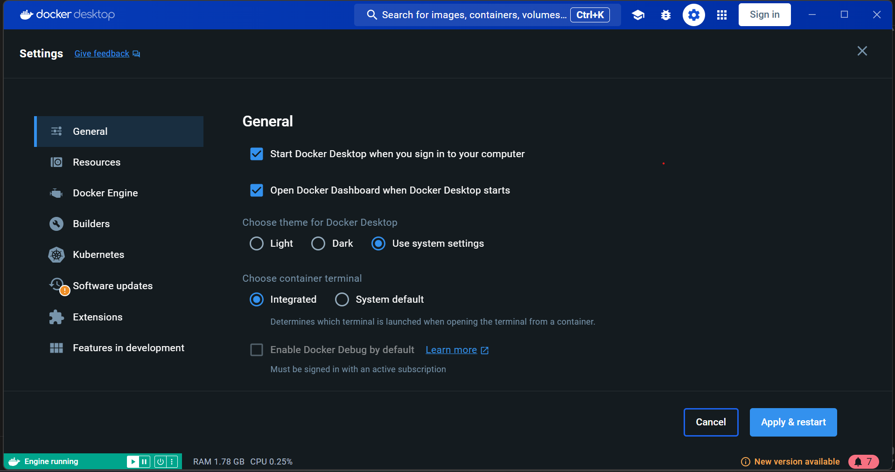
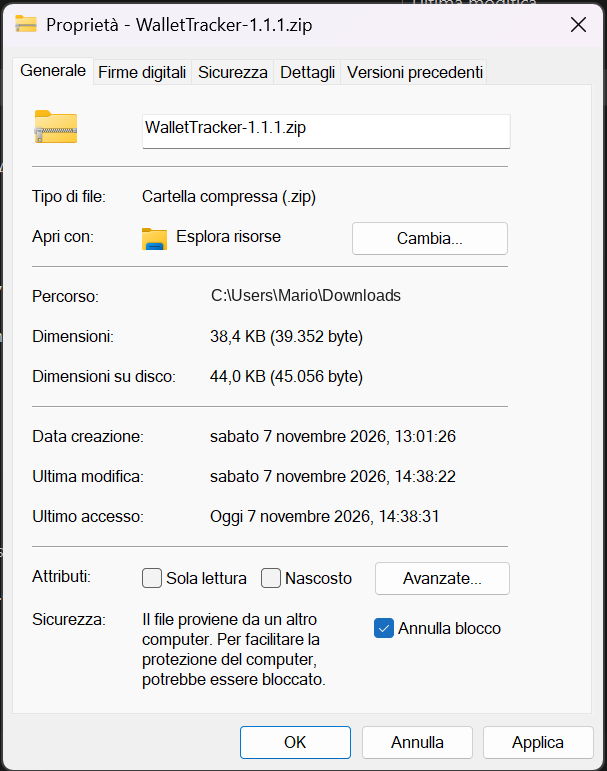
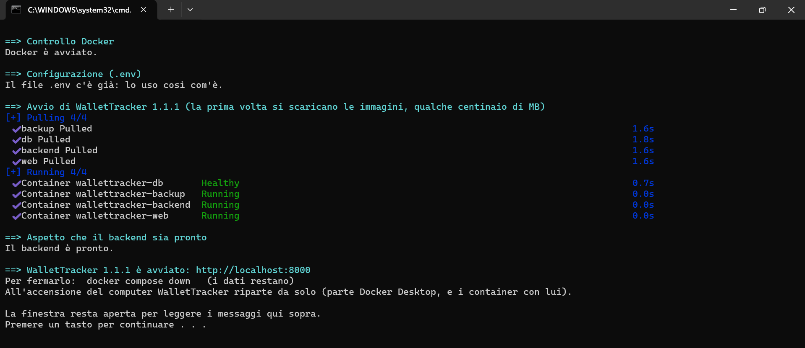

# WalletTracker: come installarlo e usarlo

Questa guida è pensata per chi non ha mai installato un programma "da informatici". Non dovrai scrivere comandi, se
non in un paio di casi che spiego passo per passo: quasi tutto si fa con un doppio clic. Se a un certo punto quello che
vedi non corrisponde a quello che c'è scritto, guarda l'ultimo capitolo, "Se qualcosa non va".

WalletTracker tiene in ordine i tuoi conti. Legge i movimenti dalle banche (oppure da un file), li mette in categorie e
ti fa vedere quanto spendi, come vanno i budget, quali abbonamenti paghi e com'è messo chi investe. Gira sul tuo
computer e i dati restano lì: nessuna azienda li vede.

**Indice**
1. [Che cosa serve](#1-che-cosa-serve)
2. [Installare Docker Desktop](#2-installare-docker-desktop)
3. [Scaricare WalletTracker](#3-scaricare-wallettracker)
4. [Il primo avvio](#4-il-primo-avvio)
5. [Il PIN](#5-il-pin)
6. [Tailscale: dal telefono, e per collegare le banche](#6-tailscale-dal-telefono-e-per-collegare-le-banche)
7. [Collegare le banche](#7-collegare-le-banche)
8. [I backup](#8-i-backup)
9. [Aggiornare](#9-aggiornare)
10. [Tenerlo acceso](#10-tenerlo-acceso)
11. [Se qualcosa non va](#11-se-qualcosa-non-va)

---

## 1. Che cosa serve

Ti serve un computer con Windows 10 o 11, oppure un Mac. Nel resto della guida lo chiamo **server**, perché è lì che
WalletTracker gira e da lì risponde anche al telefono. Va bene il computer di casa, meglio ancora uno che resta acceso
spesso (ne parlo nel capitolo 10).

Il computer dovrebbe avere almeno 8 GB di memoria e una decina di GB liberi sul disco. Serve anche la connessione a
Internet, sia per scaricare l'app sia per leggere i conti. La prima volta mettiti in conto una mezz'ora.

## 2. Installare Docker Desktop

WalletTracker non è un programma unico: è fatto di alcuni pezzi (il database, la parte che parla con le banche, le
pagine che vedi nel browser) che girano dentro **Docker Desktop**. Docker Desktop è gratuito, si installa una volta e
poi si occupa lui di accendere e tenere accesi quei pezzi.

1. Scaricalo da **docker.com/products/docker-desktop** e installalo lasciando le opzioni che propone. Su Windows
   potrebbe chiederti di riavviare il computer. Sul Mac scegli la versione "Apple Silicon" se il Mac ha un chip M1, M2,
   M3 e così via, altrimenti "Intel" (te lo dice  → Informazioni su questo Mac). Se ti serve una mano, sul sito di
   Docker ci sono le istruzioni con le immagini.
2. Apri Docker Desktop. La prima volta ti fa accettare le condizioni d'uso. L'account Docker non serve: quando te lo
   propone puoi andare avanti con **Skip** (o "Continue without signing in").
3. Aspetta che in basso a sinistra compaia la scritta verde **Engine running**. Quando c'è, Docker è pronto.

   

   Nell'elenco dei container, dopo il primo avvio, troverai anche **wallettracker**: è l'app, con i suoi pezzi.

4. Fai in modo che Docker Desktop parta da solo quando accendi il computer, così riparte anche WalletTracker. Clicca
   l'ingranaggio in alto (Settings), resta su **General** e spunta **Start Docker Desktop when you sign in to your
   computer**. Poi **Apply & restart**.

   

   La casella sotto, "Open Docker Dashboard when Docker Desktop starts", apre la finestra di Docker a ogni accensione.
   Non serve a WalletTracker: se ti dà fastidio, toglila pure.

## 3. Scaricare WalletTracker

1. Vai su **github.com/rosemgo/WalletTracker/releases**. È la pagina con tutte le versioni uscite.
2. Prendi quella più in alto, segnata con **Latest**. In fondo, sotto **Assets**, scarica il file
   **WalletTracker-X.Y.Z.zip**, dove X.Y.Z è il numero della versione.
3. Se usi Windows, prima di aprire lo ZIP fai clic destro sul file, poi **Proprietà**. In basso, accanto a
   "Sicurezza", spunta **Annulla blocco** (su Windows 10 si chiama **Sblocca**) e premi **OK**.

   

   Windows segna tutto quello che arriva da Internet. Se togli il segno adesso, allo ZIP, vale per tutti i file che ci
   sono dentro, e al primo avvio Windows non ti farà domande.

4. Estrai lo ZIP in una cartella da cui non lo sposterai più, per esempio Documenti. Su Windows: clic destro sul file,
   **Estrai tutto…**, **Estrai**. Sul Mac basta un doppio clic. Ottieni la cartella **WalletTracker-X.Y.Z**, che puoi
   rinominare semplicemente **WalletTracker**.

Dentro trovi tre file da usare con il doppio clic (su Windows finiscono con `.cmd`, sul Mac con `.command`):

| File | A che cosa serve |
|---|---|
| **Avvia WalletTracker** | avvia l'app e la apre nel browser |
| **Aggiorna WalletTracker** | passa all'ultima versione (capitolo 9) |
| **Backup WalletTracker** | fa subito un backup (capitolo 8) |

Gli altri file (`installa.ps1`, `installa.sh`, `docker-compose.yml` e così via) li usano questi tre. Lasciali dove
sono e non modificarli.

## 4. Il primo avvio

1. Fai doppio clic su **Avvia WalletTracker**.

   Se allo ZIP avevi tolto il blocco (capitolo 3), parte subito. Altrimenti Windows mostra una finestra blu, "Windows
   ha protetto il PC": clicca **Ulteriori informazioni** e poi **Esegui comunque**. Può comparire anche
   "Impossibile verificare l'autore": in quel caso premi **Esegui**. Succede perché il file viene da Internet e non è
   firmato da un'azienda, non perché ci sia qualcosa che non va.

   Sul Mac il messaggio è "non può essere aperto perché proviene da uno sviluppatore non identificato". Premi **OK**,
   poi fai clic destro sul file e scegli **Apri**, e ancora **Apri**. Sui Mac più recenti a volte non basta: vai in
   Impostazioni di Sistema → Privacy e sicurezza, scorri fino in fondo e premi **Apri comunque**.

2. Si apre una finestra nera piena di scritte. È lo script che prepara tutto: crea la configurazione, scarica l'app
   (qualche centinaio di MB, quindi la prima volta ci vuole qualche minuto) e la avvia. Se Docker Desktop era spento,
   lo accende lui.
3. A un certo punto ti chiede dove salvare i backup. Lo chiede solo la prima volta. Se non sai cosa rispondere premi
   Invio: i backup andranno nella cartella **backup**, dentro quella di WalletTracker, e potrai cambiarla quando vuoi
   (capitolo 8).
4. Quando ha finito, la finestra scrive "WalletTracker … è avviato: http://localhost:8000" e il browser si apre da
   solo su quell'indirizzo.

   

   La finestra resta aperta così puoi leggere con calma. Per chiuderla premi un tasto qualsiasi (Invio sul Mac). L'app
   resta accesa anche dopo.

Salva **http://localhost:8000** tra i preferiti del browser: è l'indirizzo dell'app. "localhost" vuol dire "questo
computer", quindi funziona solo sul server. Per aprire l'app dal telefono c'è il capitolo 6.

## 5. Il PIN

La prima cosa che l'app ti chiede è come vuoi proteggerla.


Puoi scegliere un **PIN** da 6 a 10 cifre, che l'app chiederà per entrare da qualunque dispositivo. Se pensi di usarla
dal telefono, o di collegare le banche, il PIN ti serve (capitolo 6). Scegline uno nuovo: non quello del bancomat, e
nemmeno una data di nascita.

Oppure puoi andare avanti **senza PIN**: chi usa il server entra direttamente, ma dal telefono non si entra e le banche
non si possono collegare. Il PIN si può sempre creare dopo, da **Impostazioni → Accesso**.

Quando crei il PIN l'app ti mostra un **codice di recupero**, e lo mostra una volta sola. Scrivilo su un foglio, o
salvalo in un gestore di password: se un giorno dimentichi il PIN, è l'unico modo per rientrare.

## 6. Tailscale: dal telefono, e per collegare le banche

**Tailscale** collega tra loro i tuoi dispositivi (il server, il telefono, magari un portatile) come se fossero sulla
stessa rete, anche quando sei fuori casa. In più dà al server un indirizzo https vero, del tipo
`https://nome-del-server.….ts.net`, senza aprire nulla verso Internet.

A WalletTracker serve per due motivi. Il primo è ovvio: aprire l'app dal telefono. Il secondo lo è meno: quando colleghi
una banca, alla fine la banca deve rimandarti a un indirizzo https dell'app, perché Enable Banking non ne accetta altri,
e quell'indirizzo lo fornisce Tailscale. Quindi Tailscale ti serve anche se l'app la usi solo dal server.

Prima di cominciare devi aver creato il PIN (capitolo 5), perché dall'indirizzo di Tailscale l'app senza PIN non si
apre. Poi, una volta sola:

1. crea un account gratuito su **tailscale.com**, installa Tailscale sul server e sul telefono ed entra in tutti e due
   con lo stesso account;
2. apri il pannello di Tailscale (**login.tailscale.com/admin**), vai nella scheda **DNS** e attiva **MagicDNS** e
   **HTTPS Certificates**;
3. sul server, apri la cartella di WalletTracker in Esplora file, clicca sulla barra dell'indirizzo in alto, scrivi
   `powershell` e premi Invio. Si apre una finestra blu già nella cartella giusta. Lì scrivi questo e premi Invio:

   ```
   powershell -ExecutionPolicy Bypass -File installa.ps1 -Tailscale
   ```

   Sul Mac: clic destro sulla cartella, Servizi, **Nuovo Terminale nella cartella**, e poi `./installa.sh --tailscale`;
4. alla fine lo script ti dice quale indirizzo aprire sul telefono. Lo stesso indirizzo, con `/callback` in fondo, lo
   trovi in **Impostazioni → Enable Banking**: è quello da registrare su Enable Banking (capitolo 7).

Sul server continui ad aprire l'app da **http://localhost:8000** come prima. Tailscale entra in gioco da solo quando
serve. Se vuoi i dettagli, con le schermate di Tailscale, sono nella `docs/47`.

## 7. Collegare le banche

WalletTracker legge i conti attraverso **Enable Banking**, un servizio autorizzato dalle banche europee secondo le
regole PSD2. È la stessa strada che usano le app che "collegano la banca", e per uso personale è gratuito.

Ti serve Tailscale già pronto (capitolo 6). Poi apri **Impostazioni** (in basso **Altro → Impostazioni**, oppure dalla
striscia azzurra "Per iniziare…"): la sezione **Enable Banking** ti accompagna in tre passi. Crei il tuo account e la
tua applicazione su enablebanking.com, ci copi l'indirizzo di ritorno che la pagina ti mostra (quello di Tailscale, che
finisce con `/callback`) e infine carichi il file della chiave, il `.pem` che Enable Banking ti fa scaricare. Se
Tailscale non è ancora pronto, al posto dell'indirizzo la pagina ti dice di prepararlo prima.


Fatto questo, per ogni banca vai su **Altro → Collega una banca** e scegli la tua. Entri con le tue credenziali sul
sito della banca (WalletTracker non le vede mai), dai il consenso e torni nell'app, dove arrivano i movimenti. Se hai
cominciato dal server, al ritorno il browser apre l'indirizzo di Tailscale: l'app ti chiede il PIN e poi finisce il
collegamento da sola. Non è un errore, la pagina te lo anticipa.

**Un conto nuovo, la prima volta.** La tua applicazione Enable Banking è in *modalità ristretta* (gratuita, per uso
personale): passa all'app solo i conti della sua lista. Per questo, la prima volta che colleghi un conto (anche un conto
aperto dopo, nella stessa banca), prima aggiungilo lì:

1. apri il pannello di Enable Banking (enablebanking.com, *API applications*) e accedi;
2. nella tua applicazione premi **Link accounts**;
3. scegli la banca, accedi e seleziona i conti;
4. torna in WalletTracker e collega la banca, selezionando gli stessi conti.

Basta una volta per conto; i passi sono anche nella pagina **Collega una banca**. Se un conto manca, l'app te lo dice
al ritorno dalla banca.

Di solito il collegamento dura 180 giorni. Quando sta per scadere l'app ti avvisa, e per rinnovarlo basta
**Ricollega**.

Se la tua banca non c'è su Enable Banking (Trade Republic, per esempio), puoi importare i movimenti da un file CSV, da
**Altro → Importa**.

Da quel momento WalletTracker aggiorna i conti da solo, fino a quattro volte al giorno (di più le banche non
permettono), e mette ogni movimento in una categoria. Se sbaglia, la correggi toccando il movimento, e con le
**Regole** gli insegni a farlo giusto la volta dopo.

 

## 8. I backup

Un backup è una copia di tutti i tuoi dati in un unico file, cifrato con una password che scegli tu. Senza quella
password il file è illeggibile, per chiunque.

La prima volta fai doppio clic su **Backup WalletTracker**. Ti chiede di scegliere la **password dei backup**, di
almeno 12 caratteri. Scrivila anche da un'altra parte, su carta o in un gestore di password: se la perdi, i backup non
li apri più nemmeno tu.

Da quel momento WalletTracker fa un backup ogni notte da solo e tiene gli ultimi 14, nella cartella che hai scelto al
primo avvio. In **Impostazioni → Backup** vedi quando è stato fatto l'ultimo, dove si trovano e, se vuoi, ne fai uno
subito con **Fai un backup adesso**. Se qualcosa non va, l'app te lo segnala con una striscia in alto.


Una cosa importante: tieni sempre una copia fuori dal server. Se il computer si rompe o viene rubato, i backup che
stanno sul suo disco spariscono con lui. Le strade sono due: scegli come cartella dei backup un disco esterno o una
cartella di Google Drive, così la copia fuori casa si fa da sola, oppure ogni tanto copi un backup su una chiavetta (dal
server, con **Scarica** accanto al backup).

**Con Google Drive.** Installa **Google Drive per desktop** sul server e, nelle sue preferenze, scegli **Esegui il
mirroring dei file** e non "Streaming dei file". Con il mirroring i file stanno davvero sul disco, ed è quello che serve
a Docker per vederli. Poi crea una cartella dentro "Il mio Drive", per esempio "Backup WalletTracker", e indicala come
cartella dei backup (qui sotto). Su Google Drive i backup restano cifrati e nessuno può leggerli, ma la password non
metterla nella stessa cartella.

**Cambiare la cartella dei backup.** Apri la cartella di WalletTracker, clicca sulla barra dell'indirizzo di Esplora
file, scrivi `powershell` e premi Invio. Nella finestra blu scrivi:

```
powershell -ExecutionPolicy Bypass -File installa.ps1 -CartellaBackup
```

Lo script ti chiede la cartella nuova: incolla il suo percorso (in Esplora file, clic destro sulla cartella e **Copia
come percorso**) e premi Invio. Sul Mac il comando è `./installa.sh --cartella-backup`, da un Terminale aperto nella
cartella. I backup già fatti restano dov'erano: se li vuoi nella cartella nuova, spostali tu. Chi vuole sapere tutti i
dettagli li trova nella `docs/48`, parte F.

**Rimettere i dati da un backup** (il ripristino) sostituisce tutti i dati di adesso con quelli del backup. È l'unica
operazione che richiede di scrivere un comando un po' più delicato: è spiegata nella `docs/48`, parte I, e la prima
volta conviene farla con qualcuno che se ne intende.

## 9. Aggiornare

Quando esce una versione nuova, l'app te lo dice con una striscia in alto, "È disponibile WalletTracker …". In
**Impostazioni → Informazioni** puoi leggere che cosa cambia.

Per aggiornare fai doppio clic su **Aggiorna WalletTracker**. Lo script ti mostra le novità e ti chiede se vuoi
procedere: scrivi **s** e premi Invio. Prima di toccare qualunque cosa fa un backup, poi scarica la versione nuova,
controlla che il file sia integro e riavvia l'app. Se la versione nuova per qualche motivo non parte, torna da solo
a quella di prima, con i dati com'erano.

I tuoi dati, la configurazione e i backup restano dove sono: l'aggiornamento non li tocca.

> Se hai ancora la 1.0.0, la primissima versione, "Aggiorna" lì non c'era. Quella volta si aggiorna a mano, come
> spiegato nella `docs/50`, parte S4. Dalla versione successiva basta il doppio clic.

## 10. Tenerlo acceso

WalletTracker funziona finché il server è acceso e Docker Desktop è aperto. Se il server è spento, il telefono non
trova l'app, e il backup della notte aspetta la prossima accensione.

Se hai spuntato la casella del capitolo 2, all'accensione del computer riparte tutto da solo. La finestra di "Avvia" te
lo ricorda ogni volta in fondo: "All'accensione del computer WalletTracker riparte da solo". Se invece trovi scritto
"AVVIO AUTOMATICO SPENTO", torna al capitolo 2, punto 4.

Conviene anche evitare che il server vada in sospensione. Su Windows: Impostazioni → Sistema → Alimentazione, e alla
voce "Sospensione" scegli **Mai** quando è collegato alla corrente. Sul Mac: Impostazioni di Sistema → Batteria (o
Risparmio energia) → **Evita lo stop automatico** con l'alimentatore collegato.

Per spegnere WalletTracker apri Docker Desktop e premi il quadratino ■ sulla riga **wallettracker**. Resta spento anche
se riaccendi il computer, finché non fai di nuovo doppio clic su **Avvia WalletTracker**.

## 11. Se qualcosa non va

| Che cosa succede | Che cosa fare |
|---|---|
| fai doppio clic e la finestra si chiude subito | probabilmente hai aperto il file da dentro lo ZIP: estrailo (capitolo 3) e riprova dalla cartella estratta |
| "Windows ha protetto il PC" o "sviluppatore non identificato" | è normale se allo ZIP non avevi tolto il blocco: capitolo 4, punto 1 |
| "Docker non è installato" | installa Docker Desktop (capitolo 2) |
| "Docker Desktop non risponde dopo 3 minuti" | apri Docker Desktop: di solito sta aspettando una tua risposta, per un aggiornamento o per le condizioni d'uso. Poi rifai il doppio clic |
| il browser dice "Impossibile raggiungere il sito" su localhost:8000 | fai doppio clic su **Avvia WalletTracker** e aspetta che scriva "è avviato" |
| "AVVIO AUTOMATICO SPENTO" | capitolo 2, punto 4 |
| dal telefono l'app non si apre | controlla che il server sia acceso e che sul telefono Tailscale sia attivo, con lo stesso account del server |
| "Per collegare una banca serve un indirizzo https" | prepara Tailscale (capitolo 6), registra su Enable Banking l'indirizzo che vedi in Impostazioni e riprova |
| dopo il consenso alla banca, "Impossibile raggiungere il sito" | l'indirizzo di ritorno non risponde: controlla che quello in **Impostazioni → Enable Banking** sia registrato identico su Enable Banking (capitolo 7) |
| hai dimenticato il PIN | nella pagina del PIN c'è "Ho dimenticato il PIN": ti serve il codice di recupero (capitolo 5). Se hai perso anche quello, vedi la `docs/46`, parte K |
| una striscia in alto dice che i backup hanno un problema | apri **Impostazioni → Backup**: lì trovi che cosa non va |
| dopo un aggiornamento, "Sono tornato a WalletTracker …" | l'aggiornamento non è andato a buon fine e l'app è tornata com'era, senza perdere dati. Riprova più tardi |

Chi vuole capire come è fatto WalletTracker dentro trova le guide complete nella cartella **docs** del progetto.
L'elenco è nel `README.md`.
