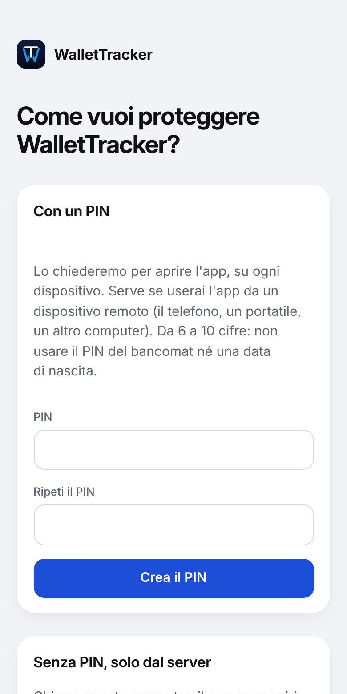
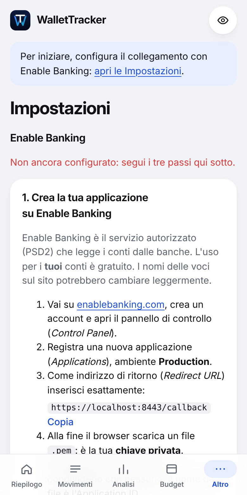
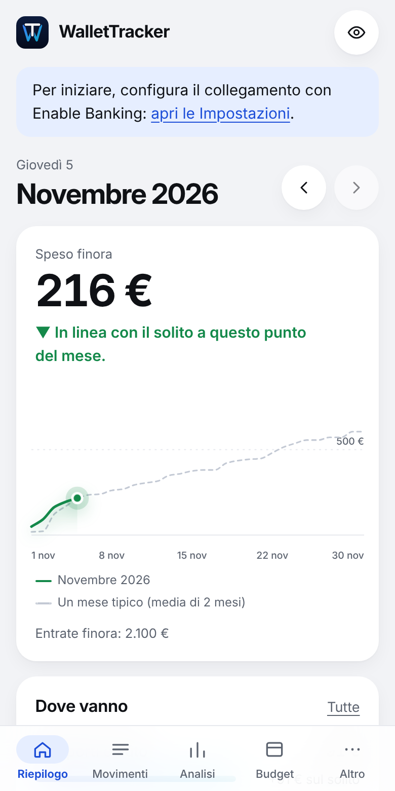
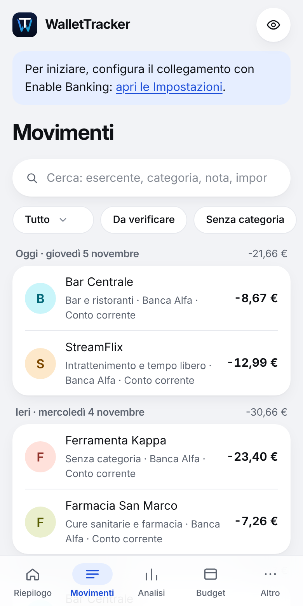
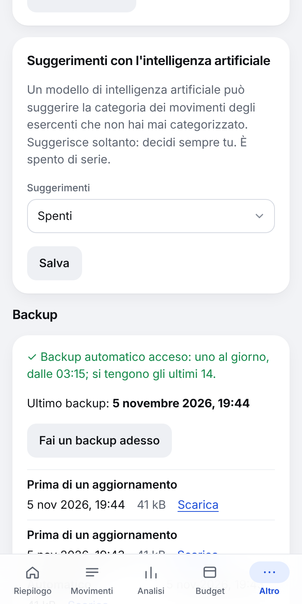

# WalletTracker: la guida per installarlo e usarlo

Questa guida è per chi **non è informatico**: niente comandi da scrivere, solo doppi clic. Se qualcosa non va come
scritto qui, in fondo c'è "Se qualcosa non va".

WalletTracker è un'app per i **tuoi conti**: legge i movimenti dalle banche (o da un file), li divide in categorie e
ti mostra quanto spendi, i budget, gli abbonamenti, gli investimenti. Tutto resta **sul tuo computer**: nessuna
azienda vede i tuoi dati.

**Indice**
1. [Che cosa serve](#1-che-cosa-serve)
2. [Installare Docker Desktop](#2-installare-docker-desktop)
3. [Scaricare WalletTracker](#3-scaricare-wallettracker)
4. [Il primo avvio](#4-il-primo-avvio)
5. [Il PIN](#5-il-pin)
6. [Collegare le banche](#6-collegare-le-banche)
7. [I backup](#7-i-backup)
8. [Dal telefono](#8-dal-telefono)
9. [Aggiornare](#9-aggiornare)
10. [Tenerlo acceso](#10-tenerlo-acceso)
11. [Se qualcosa non va](#11-se-qualcosa-non-va)

---

## 1. Che cosa serve

- **Un computer** con Windows 10 o 11, oppure un Mac. È il **server**: il computer su cui WalletTracker gira. Meglio
  uno che resta acceso (vedi il capitolo 10).
- **8 GB di memoria** (RAM) o più, e **10 GB liberi** sul disco.
- **Internet**, per scaricare l'app e per leggere i conti dalle banche.
- **Mezz'ora**, la prima volta.

## 2. Installare Docker Desktop

WalletTracker è fatto di alcuni pezzi (il database, il programma che legge le banche, le pagine che vedi nel browser)
che girano dentro **Docker**. Docker Desktop è il programma gratuito che li accende e li tiene accesi. Si installa una
volta sola.

1. Vai su **docker.com/products/docker-desktop** e scarica **Docker Desktop** per il tuo sistema. Su un Mac scegli
   "Apple Silicon" se il Mac ha un chip M1, M2, M3…, altrimenti "Intel" (lo vedi in  → Informazioni su questo Mac).
2. Apri il file scaricato e segui l'installazione lasciando le scelte proposte. Su Windows, se lo chiede, riavvia il
   computer.

   > 📷 *Schermata da aggiungere: l'installazione di Docker Desktop su Windows.*

3. Apri **Docker Desktop**. La prima volta chiede di accettare le condizioni d'uso (**Accept**). L'account Docker
   **non serve**: puoi saltare con **Skip** (o "Continue without signing in").
4. Aspetta che in basso a sinistra compaia **Engine running** (il pallino verde).

   > 📷 *Schermata da aggiungere: Docker Desktop con "Engine running".*

5. **Fallo partire da solo all'accensione**: in Docker Desktop, l'ingranaggio in alto (**Settings**) → **General** →
   spunta **Start Docker Desktop when you sign in to your computer** → **Apply**. Così, ogni volta che accendi il
   computer, riparte anche WalletTracker.

   > 📷 *Schermata da aggiungere: Settings → General, con la casella spuntata.*

## 3. Scaricare WalletTracker

1. Vai sulla pagina delle versioni: **github.com/rosemgo/WalletTracker/releases**.
2. Nella versione più in alto (con la scritta **Latest**), sotto **Assets**, clicca **WalletTracker-X.Y.Z.zip** (X.Y.Z
   è il numero della versione).
3. **Solo su Windows, prima di aprirlo**: tasto destro sul file ZIP → **Proprietà** → in basso spunta **Sblocca** →
   **OK**. Così Windows non farà domande su ogni file (capitolo 4).

   > 📷 *Schermata da aggiungere: le Proprietà dello ZIP con "Sblocca".*

4. **Estrai** lo ZIP in una cartella che non sposterai più, per esempio **Documenti**: su Windows tasto destro →
   **Estrai tutto…** → **Estrai**; sul Mac basta un doppio clic. Nasce la cartella **WalletTracker-X.Y.Z**: puoi
   rinominarla **WalletTracker**.

Dentro ci sono:

| File | A che cosa serve |
|---|---|
| **Avvia WalletTracker** (`.cmd` su Windows, `.command` sul Mac) | avvia l'app e la apre nel browser |
| **Aggiorna WalletTracker** | passa all'ultima versione (capitolo 9) |
| **Backup WalletTracker** | fa un backup adesso (capitolo 7) |
| `installa.ps1`, `installa.sh`, `docker-compose.yml`… | i file che usano i tre qui sopra: non toccarli |

## 4. Il primo avvio

1. Fai **doppio clic** su **Avvia WalletTracker**.
2. **La prima volta il sistema diffida**, perché il file arriva da Internet e non ha una "firma" di un'azienda
   conosciuta:
   - **Windows**: "Windows ha protetto il PC" → **Ulteriori informazioni** → **Esegui comunque**. Se compare
     "Impossibile verificare l'autore", **Esegui**;
   - **Mac**: "non può essere aperto perché proviene da uno sviluppatore non identificato" → **OK**, poi **tasto
     destro** sul file → **Apri** → **Apri**. Su un Mac recente, se non basta: Impostazioni di Sistema → Privacy e
     sicurezza → in fondo, **Apri comunque**.

   > 📷 *Schermate da aggiungere: l'avviso di Windows ("Windows ha protetto il PC") e quello del Mac.*

3. Si apre una **finestra con delle scritte**: è lo script che prepara tutto. La prima volta **scarica l'app**
   (qualche centinaio di MB: qualche minuto). Se Docker Desktop era spento, lo accende lui.
4. Alla fine la finestra dice **"WalletTracker … è avviato: http://localhost:8000"** e il browser si apre da solo su
   quell'indirizzo. La finestra resta aperta perché tu possa leggere: **premi un tasto** (Invio sul Mac) per chiuderla.
   L'app resta accesa lo stesso.

   > 📷 *Schermata da aggiungere: la finestra alla fine del primo avvio.*

**L'indirizzo dell'app è http://localhost:8000**: salvalo tra i preferiti del browser. "localhost" vuol dire "questo
computer": funziona solo dal server (dal telefono, vedi il capitolo 8).

## 5. Il PIN

La prima pagina chiede come proteggere l'app:

- **Con un PIN** (da 6 a 10 cifre): lo chiede per aprire l'app, su ogni dispositivo. **Serve se userai l'app dal
  telefono.** Non usare il PIN del bancomat né una data di nascita.
- **Senza PIN, solo dal server**: chi usa questo computer entra direttamente. Dal telefono non si potrà entrare
  finché non crei un PIN (lo puoi fare dopo, dalle Impostazioni).

Creando il PIN, l'app mostra un **codice di recupero**, una volta sola: **scrivilo su carta**, o in un gestore di
password. Serve se dimentichi il PIN.

## 6. Collegare le banche

WalletTracker legge i conti con **Enable Banking**, un servizio autorizzato dalle banche europee (PSD2): è la stessa
strada delle app che "collegano la banca". Per i tuoi conti è gratuito.

**Una volta sola**, in **Impostazioni** (in basso **Altro → Impostazioni**, o la striscia azzurra "Per iniziare…"),
la sezione **Enable Banking** ti guida in tre passi: creare il tuo account e la tua applicazione su enablebanking.com,
copiare l'indirizzo di ritorno che la pagina ti mostra, caricare il file della chiave (`.pem`) che Enable Banking ti
fa scaricare.

Poi, per ogni banca: **Altro → Collega una banca** → scegli la banca → accedi con le tue credenziali **sul sito della
banca** (WalletTracker non le vede mai) → torni nell'app, e i movimenti arrivano. Il collegamento dura di solito
**180 giorni**: quando sta per scadere, l'app te lo dice e basta un clic su **Ricollega**.

Una banca che Enable Banking non ha (per esempio Trade Republic)? Si possono **importare i movimenti da un file CSV**:
**Altro → Importa**.

Da lì in poi WalletTracker aggiorna i conti da solo, fino a quattro volte al giorno (il limite delle banche), e li
divide in categorie: le correggi con un tocco sul movimento, e con le **Regole** gli insegni a farlo da solo.

 

## 7. I backup

Un **backup** è una copia di tutti i tuoi dati in un file solo, **cifrato con una password tua**: chi trova il file
senza la password non legge niente.

1. **La prima volta**: doppio clic su **Backup WalletTracker**. Chiede di scegliere la **password dei backup** (almeno
   12 caratteri). **Scrivila anche fuori da questo computer** (su carta, o in un gestore di password): **senza, i
   backup non si aprono**, nemmeno per te.
2. Da quel momento WalletTracker fa **un backup ogni notte da solo** (e tiene gli ultimi 14), nella cartella
   **backup** dentro la cartella di WalletTracker.
3. In **Impostazioni → Backup** vedi com'è andato l'ultimo, e puoi farne uno subito con **Fai un backup adesso**. Se
   qualcosa non va, una striscia in alto nell'app te lo dice.

4. **Copia ogni tanto un backup fuori dal computer** (una chiavetta, un disco esterno, il cloud): se il computer si
   rompe, i backup dentro di lui si rompono con lui. Dal server, **Scarica** accanto a un backup lo salva dove vuoi.

**Rimettere i dati di un backup** (un ripristino) cancella i dati di adesso, ed è l'unica operazione che si fa
scrivendo un comando: è spiegata nella `docs/48`, parte I, ed è meglio farla con l'aiuto di qualcuno la prima volta.

## 8. Dal telefono

Per aprire WalletTracker dal telefono (o da un altro computer), ovunque tu sia, si usa **Tailscale**: crea una rete
privata solo tra i tuoi dispositivi, con un indirizzo https vero. Niente porte aperte su Internet.

Servono un PIN (capitolo 5) e una volta sola, sul server:
1. crea un account gratuito su **tailscale.com** e installa **Tailscale** sul server e sul telefono, entrando con lo
   stesso account;
2. nel pannello di Tailscale (**login.tailscale.com/admin**), scheda **DNS**: accendi **MagicDNS** e **HTTPS
   Certificates**;
3. nella cartella di WalletTracker, sul server: su Windows, nella barra dell'indirizzo di Esplora file scrivi
   `powershell` e premi Invio; nella finestra che si apre scrivi
   `powershell -ExecutionPolicy Bypass -File installa.ps1 -Tailscale` e premi Invio (sul Mac, nel Terminale:
   `./installa.sh --tailscale`);
4. alla fine lo script ti dice l'indirizzo da aprire sul telefono (`https://nome-del-server.….ts.net`) e quello da
   aggiungere su Enable Banking per collegare le banche anche dal telefono.

I dettagli, con le schermate di Tailscale, sono nella `docs/47`.

## 9. Aggiornare

Quando esce una versione nuova, l'app te lo dice con una striscia in alto: **"È disponibile WalletTracker …"**. In
**Impostazioni → Informazioni** leggi che cosa cambia.

Per aggiornare: doppio clic su **Aggiorna WalletTracker**. Lo script:
1. ti mostra le novità e chiede conferma (scrivi **s** e premi Invio);
2. **fa un backup**;
3. scarica la versione nuova, controlla che non sia rovinata, e riavvia l'app;
4. se la versione nuova non parte, **torna da solo a quella di prima**, con i dati di prima.

I tuoi dati, la configurazione e i backup non si toccano mai.

> Se hai la **1.0.0**, la prima versione, "Aggiorna" non c'è ancora: la prima volta si aggiorna a mano, come spiegato
> nella `docs/50`, parte S4. Dalla versione dopo, basta il doppio clic.

## 10. Tenerlo acceso

- WalletTracker funziona **finché il server è acceso** (e Docker Desktop è aperto): dal telefono risponde solo se il
  server è acceso, e il backup di ogni notte aspetta che lo sia.
- **All'accensione riparte da solo**, se in Docker Desktop c'è la casella del capitolo 2, punto 5. Alla fine di ogni
  avvio la finestra te lo ricorda: "All'accensione del computer WalletTracker riparte da solo", oppure "AVVIO
  AUTOMATICO SPENTO" con dove cliccare.
- **Niente sospensione**: su Windows, Impostazioni → Sistema → Alimentazione → "Sospensione": **Mai** con
  l'alimentatore collegato. Sul Mac, Impostazioni di Sistema → Batteria (o Risparmio energia) → **Evita lo stop
  automatico** con l'alimentatore.
- **Per fermarlo**: in Docker Desktop, il quadratino ■ sulla riga **wallettracker**. Resta fermo anche se riaccendi il
  computer, finché non fai doppio clic su **Avvia WalletTracker**.

## 11. Se qualcosa non va

| Che cosa vedi | Che cosa fare |
|---|---|
| doppio clic e la finestra si chiude subito | hai aperto il file da dentro lo ZIP: estrai lo ZIP (capitolo 3) e riprova dalla cartella estratta |
| "Windows ha protetto il PC" / "sviluppatore non identificato" | è normale la prima volta: capitolo 4, punto 2 |
| "Docker non è installato" | installa Docker Desktop (capitolo 2) |
| "Docker Desktop non risponde dopo 3 minuti" | apri Docker Desktop: di solito aspetta una tua risposta (un aggiornamento, le condizioni d'uso). Poi rifai il doppio clic |
| il browser dice "Impossibile raggiungere il sito" su localhost:8000 | fai doppio clic su **Avvia WalletTracker** e aspetta che dica "è avviato" |
| "AVVIO AUTOMATICO SPENTO" | capitolo 2, punto 5 |
| dal telefono non si apre | il server è acceso? Tailscale è acceso sul telefono, con lo stesso account? |
| hai dimenticato il PIN | nella pagina del PIN, "Ho dimenticato il PIN", con il codice di recupero (capitolo 5). Persi tutti e due: `docs/46`, parte K |
| una striscia in alto dice che i backup hanno un problema | **Impostazioni → Backup**: lì c'è che cosa |
| "Sono tornato a WalletTracker …" dopo un aggiornamento | l'aggiornamento non è riuscito e l'app è com'era prima: nessun dato perso. Riprova più tardi |

Per tutto il resto, le guide complete (per chi vuole capire come è fatto) sono nella cartella **docs** del progetto:
l'elenco è nel `README.md`.
