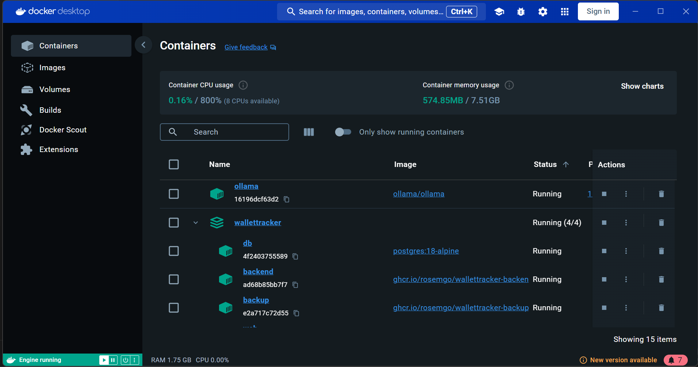
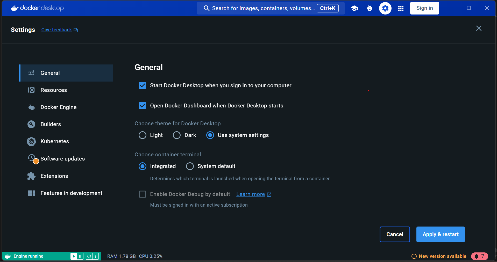
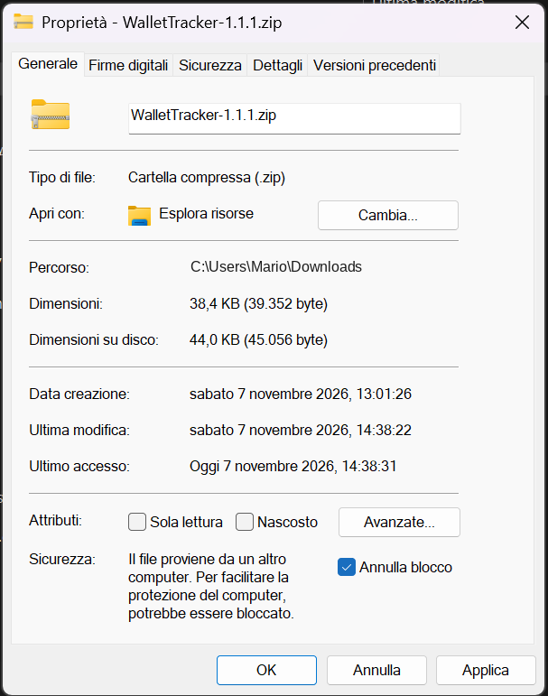
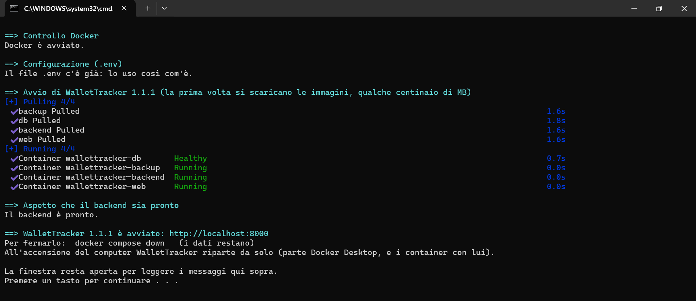
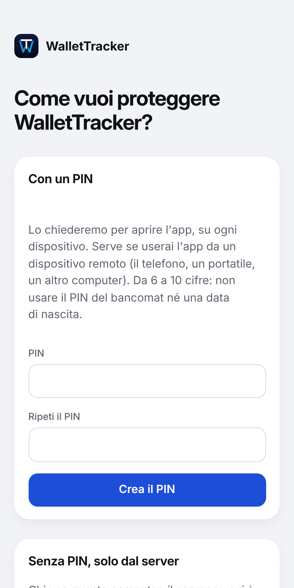
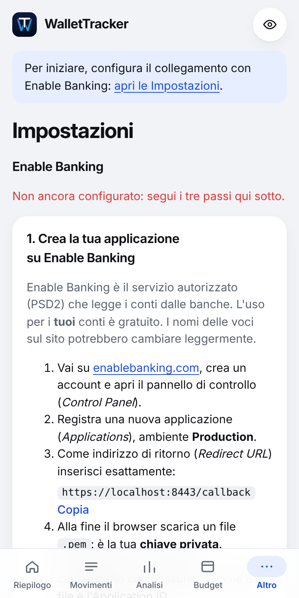
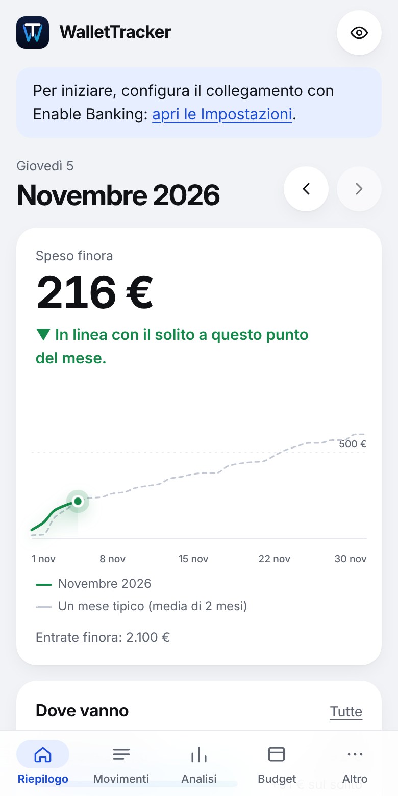
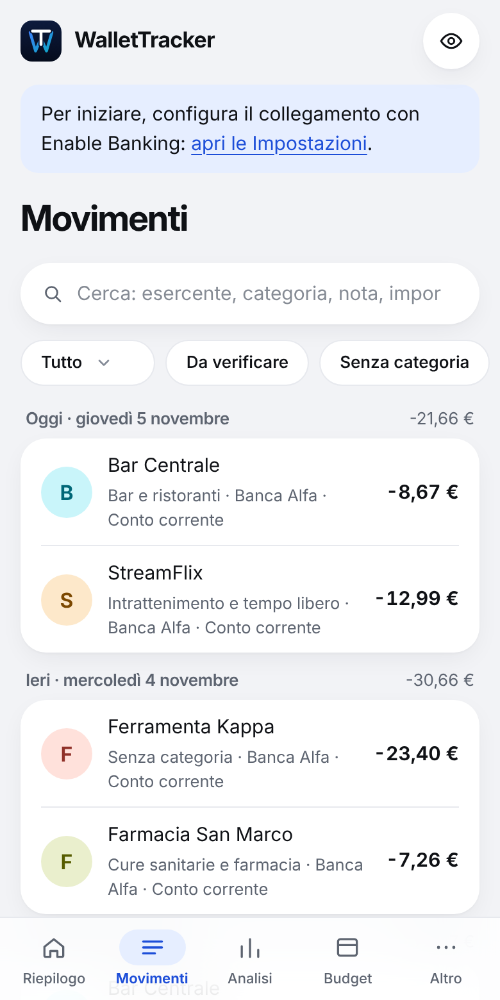
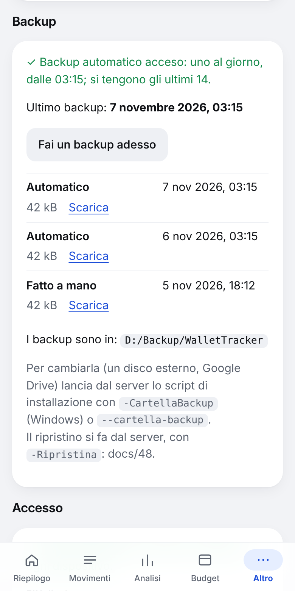

# WalletTracker: how to install and use it

*Questa guida in italiano: [GUIDA.md](GUIDA.md).*

This guide is meant for people who have never installed a "techie" program. You will not have to type commands,
except in a couple of cases that I explain step by step: almost everything is done with a double click. If at some
point what you see does not match what is written here, look at the last chapter, "If something goes wrong".

WalletTracker keeps your accounts in order. It reads the transactions from the banks (or from a file), puts them into
categories and shows you how much you spend, how the budgets are going, which subscriptions you pay and how your
investments are doing. It runs on your computer and the data stays there: no company sees it.

The app speaks Italian and English, and so does the installation. The screenshots in this guide were taken with the
app in Italian: the pages are the same, with the labels in the other language.

**Contents**
1. [What you need](#1-what-you-need)
2. [Installing Docker Desktop](#2-installing-docker-desktop)
3. [Downloading WalletTracker](#3-downloading-wallettracker)
4. [The first start](#4-the-first-start)
5. [The PIN](#5-the-pin)
6. [Tailscale: from the phone, and to link the banks](#6-tailscale-from-the-phone-and-to-link-the-banks)
7. [Linking the banks](#7-linking-the-banks)
8. [The backups](#8-the-backups)
9. [Updating](#9-updating)
10. [Keeping it running](#10-keeping-it-running)
11. [If something goes wrong](#11-if-something-goes-wrong)

---

## 1. What you need

You need a computer with Windows 10 or 11, or a Mac. In the rest of the guide I call it the **server**, because that
is where WalletTracker runs and from there it also answers the phone. The home computer is fine, even better one that
is often left on (I talk about it in chapter 10).

The computer should have at least 8 GB of memory and about ten GB free on the disk. You also need an Internet
connection, both to download the app and to read the accounts. The first time, allow half an hour.

## 2. Installing Docker Desktop

WalletTracker is not a single program: it is made of a few pieces (the database, the part that talks to the banks,
the pages you see in the browser) that run inside **Docker Desktop**. Docker Desktop is free, you install it once and
then it takes care of starting those pieces and keeping them running.

1. Download it from **docker.com/products/docker-desktop** and install it leaving the options it proposes. On Windows
   it may ask you to restart the computer. On a Mac choose the "Apple Silicon" version if the Mac has an M1, M2, M3
   chip and so on, otherwise "Intel" ( → About This Mac tells you). If you need a hand, the Docker site has
   instructions with pictures.
2. Open Docker Desktop. The first time it makes you accept the terms of use. You do not need a Docker account: when
   it proposes one you can go on with **Skip** (or "Continue without signing in").
3. Wait until the green **Engine running** appears at the bottom left. When it is there, Docker is ready.

   

   In the list of containers, after the first start, you will also find **wallettracker**: it is the app, with its
   pieces.

4. Make Docker Desktop start by itself when you turn the computer on, so that WalletTracker restarts too. Click the
   gear at the top (Settings), stay on **General** and tick **Start Docker Desktop when you sign in to your
   computer**. Then **Apply & restart**.

   

   The box below, "Open Docker Dashboard when Docker Desktop starts", opens the Docker window every time the computer
   is turned on. WalletTracker does not need it: if it bothers you, untick it.

## 3. Downloading WalletTracker

1. Go to **github.com/rosemgo/WalletTracker/releases**. It is the page with all the versions released.
2. Take the one at the top, marked **Latest**. At the bottom, under **Assets**, download the file
   **WalletTracker-X.Y.Z.zip**, where X.Y.Z is the version number.
3. If you use Windows, before opening the ZIP right-click the file, then **Properties**. At the bottom, next to
   "Security", tick **Unblock** and press **OK**.

   

   Windows marks everything that comes from the Internet. If you remove the mark now, on the ZIP, it applies to all
   the files inside, and at the first start Windows will not ask you questions.

4. Extract the ZIP into a folder you will not move any more, for example Documents. On Windows: right-click the file,
   **Extract All…**, **Extract**. On a Mac a double click is enough. You get the folder **WalletTracker-X.Y.Z**, which
   you can simply rename **WalletTracker**.

Inside, open the **English** folder: there you find three files to use with a double click (on Windows they end with
`.cmd`, on a Mac with `.command`), and `README.txt` with these same first steps:

| File | What it is for |
|---|---|
| **Start WalletTracker** | starts the app and opens it in the browser |
| **Update WalletTracker** | moves to the latest version (chapter 9) |
| **Backup WalletTracker** | makes a backup right away (chapter 8) |

The files with Italian names in the main folder (**Avvia**, **Aggiorna**, **Backup WalletTracker**) do exactly the
same things: use whichever you like. The other files (`installa.ps1`, `installa.sh`, `docker-compose.yml` and so on)
are used by these. Leave them where they are and do not change them.

## 4. The first start

1. Double-click **Start WalletTracker**.

   If you had unblocked the ZIP (chapter 3), it starts at once. Otherwise Windows shows a blue window, "Windows
   protected your PC": click **More info** and then **Run anyway**. "The publisher could not be verified" may also
   appear: in that case press **Run**. It happens because the file comes from the Internet and is not signed by a
   company, not because something is wrong.

   On a Mac the message is "cannot be opened because it is from an unidentified developer". Press **OK**, then
   right-click the file and choose **Open**, and **Open** again. On the most recent Macs sometimes that is not
   enough: go to System Settings → Privacy & Security, scroll to the bottom and press **Open Anyway**.

2. A black window full of text opens. The first thing it asks is the language:

   ```
   Lingua / Language
     1) Italiano
     2) English
   ```

   Type **2** and press Enter. It asks only this first time: from then on the script speaks English only, and the app
   opens in English.
3. Then the script prepares everything: it creates the configuration, downloads the app (a few hundred MB, so the
   first time it takes a few minutes) and starts it. If Docker Desktop was off, the script starts it.
4. At some point it asks where to save the backups. It asks only the first time. If you do not know what to answer
   press Enter: the backups will go to the **backup** folder, inside the WalletTracker one, and you can change it
   whenever you like (chapter 8).
5. When it has finished, the window writes "WalletTracker … is running: http://localhost:8000" and the browser opens
   by itself on that address.

   

   The window stays open so you can read calmly. To close it press any key (Enter on a Mac). The app keeps running
   afterwards.

Save **http://localhost:8000** in the browser's bookmarks: it is the address of the app. "localhost" means "this
computer", so it works only on the server. To open the app from the phone there is chapter 6.

**Changing language later.** The language of the app is changed from the app, at any time and in both directions:
**More → Settings → Language**. It applies to the whole installation, the computer and the phone. The starter
categories you have not renamed take their name in the new language; the texts of the transactions sent by the banks,
the starter rules and everything you wrote yourself stay as they are. The language of the black windows (Start,
Update, Backup) is the one you chose at the first start: to change that one too, run the script with the
`-Language it` option (`./installa.sh --language it` on a Mac), as shown for `-Tailscale` in chapter 6.

## 5. The PIN

The first thing the app asks you is how you want to protect it.



You can choose a **PIN** of 6 to 10 digits, which the app will ask for to get in from any device. If you plan to use
it from the phone, or to link the banks, you need the PIN (chapter 6). Choose a new one: not the one of your bank
card, and not a date of birth either.

Or you can go on **without a PIN**: whoever uses the server gets in directly, but you cannot get in from the phone
and the banks cannot be linked. The PIN can always be created later, from **Settings → Access**.

When you create the PIN the app shows you a **recovery code**, and shows it only once. Write it on a sheet of paper,
or save it in a password manager: if one day you forget the PIN, it is the only way to get back in.

## 6. Tailscale: from the phone, and to link the banks

**Tailscale** connects your devices to each other (the server, the phone, maybe a laptop) as if they were on the same
network, even when you are away from home. It also gives the server a real https address, like
`https://name-of-the-server.….ts.net`, without opening anything towards the Internet.

WalletTracker needs it for two reasons. The first is obvious: opening the app from the phone. The second less so:
when you link a bank, at the end the bank must send you back to an https address of the app, because Enable Banking
accepts no others, and that address is provided by Tailscale. So you need Tailscale even if you use the app only from
the server.

Before starting you must have created the PIN (chapter 5), because from the Tailscale address the app without a PIN
does not open.

You do not need to type commands: when you start WalletTracker with **Start WalletTracker**, the script asks whether
you want to turn on Tailscale. Answer **1** and it guides you step by step:

1. it opens the page to download Tailscale: install it like any program;
2. it asks you to sign in to Tailscale with an account of yours (Google, Microsoft or Apple are fine). Then install
   the Tailscale app on the phone too and sign in with **the same account**;
3. it prepares the rest by itself. The first time Tailscale may ask you to enable HTTPS for your network: open the
   link shown in the window, confirm, and the script goes on;
4. at the end it tells you which address to open on the phone. The same address, with `/callback` at the end, is in
   **Settings → Enable Banking**: it is the one to register on Enable Banking (chapter 7).

If you answer **2** (later) it asks again at the next start; with **3** it does not ask any more. To turn it on later,
or if you changed computer, double-click **Enable Tailscale**, in the "English" folder. If something is wrong (for
example "MagicDNS"), the script tells you what to do and the app starts anyway.

On the server you keep opening the app from **http://localhost:8000** as before. Tailscale comes into play by itself
when needed. The details, with the Tailscale screens, are in `docs/47` (in Italian).

## 7. Linking the banks

WalletTracker reads the accounts through **Enable Banking**, a service authorised by the European banks under the
PSD2 rules. It is the same road used by the apps that "connect your bank", and for personal use it is free.

You need Tailscale ready (chapter 6). Then open **Settings** (at the bottom **More → Settings**, or from the blue
strip "To get started…"): the **Enable Banking** section guides you in three steps. You create your account and your
application on enablebanking.com, copy into it the redirect URL that the page shows you (the Tailscale one, which ends
with `/callback`) and finally upload the key file, the `.pem` that Enable Banking makes you download. If Tailscale is
not ready yet, instead of the address the page tells you to set it up first.



Once this is done, for each bank go to **More → Link a bank** and choose yours. You sign in with your credentials on
the bank's site (WalletTracker never sees them), give the consent and come back to the app, where the transactions
arrive. If you started from the server, on the way back the browser opens the Tailscale address: the app asks you for
the PIN and then finishes the connection by itself. It is not an error, the page tells you in advance.

**A new account, the first time.** Your Enable Banking application is in *restricted mode* (free, for personal use):
it passes to the app only the accounts of its list. For this reason, the first time you link an account (even an
account opened later, in the same bank), first add it there:

1. open the Enable Banking panel (enablebanking.com, *API applications*) and sign in;
2. in your application press **Link accounts**;
3. choose the bank, sign in and select the accounts;
4. go back to WalletTracker and link the bank, selecting the same accounts.

Once per account is enough; the steps are also in the **Link a bank** page. If an account is missing, the app tells
you on the way back from the bank.

Usually the connection lasts 180 days. When it is about to expire the app warns you, and to renew it you just link
the bank again from the notice.

If your bank is not on Enable Banking (Trade Republic, for example), you can import the transactions from a CSV file,
from **More → Import**. The Trade Republic file (in its app: Profile → Documents → Transaction export, CSV format) is
recognised by the app and read by itself, without choosing the columns.

From that moment WalletTracker updates the accounts by itself, up to four times a day (the banks do not allow more),
and puts every transaction in a category. If it gets one wrong, you correct it by tapping the transaction, and with
the **Rules** you teach it to get it right the next time.

 

## 8. The backups

A backup is a copy of all your data in a single file, encrypted with a password that you choose. Without that
password the file is unreadable, for anyone.

The first time double-click **Backup WalletTracker**. It asks you to choose the **backup password**, of at least 12
characters. Write it down somewhere else too, on paper or in a password manager: if you lose it, not even you can
open the backups any more.

From that moment WalletTracker makes a backup every night by itself and keeps the last 14, in the folder you chose at
the first start. In **Settings → Backup** you see when the last one was made, where they are and, if you like, you
make one right away with **Make a backup now**. If something is wrong, the app tells you with a strip at the top.



One important thing: always keep a copy outside the server. If the computer breaks or is stolen, the backups on its
disk disappear with it. There are two ways: choose an external disk or a Google Drive folder as the backup folder, so
that the copy away from home is made by itself, or every now and then copy a backup to a USB stick (from the server,
with **Download** next to the backup).

**With Google Drive.** Install **Google Drive for desktop** on the server and, in its preferences, choose **Mirror
files** and not "Stream files". With mirroring the files are really on the disk, and that is what Docker needs to see
them. Then create a folder inside "My Drive", for example "WalletTracker Backup", and give it as the backup folder
(below). On Google Drive the backups stay encrypted and nobody can read them, but do not put the password in the same
folder.

**Changing the backup folder.** Open the WalletTracker folder, click the address bar of File Explorer, type
`powershell` and press Enter. In the blue window type:

```
powershell -ExecutionPolicy Bypass -File installa.ps1 -BackupFolder
```

The script asks you for the new folder: paste its path (in File Explorer, right-click the folder and **Copy as
path**) and press Enter. On a Mac the command is `./installa.sh --backup-folder`, from a Terminal opened in the
folder. The backups already made stay where they were: if you want them in the new folder, move them yourself. All
the details are in `docs/48`, part F (in Italian).

**Putting the data back from a backup** (the restore) replaces all the current data with the data of the backup. It
is the only operation that requires typing a slightly more delicate command:

```
powershell -ExecutionPolicy Bypass -File installa.ps1 -Restore "path of the backup file"
```

(on a Mac `./installa.sh --restore "path of the backup file"`). The script first makes a safety copy of the current
data and asks you to type **RESTORE** to confirm. The first time it is better to do it with someone who knows their
way around; the details are in `docs/48`, part I (in Italian).

## 9. Updating

When a new version is out, the app tells you with a strip at the top, "WalletTracker … is available". In
**Settings → About** you can read what changes.

To update double-click **Update WalletTracker**. The script shows you what is new and asks whether you want to go
ahead: type **y** and press Enter. Before touching anything it makes a backup, then it downloads the new version,
checks that the file is intact and restarts the app. If for some reason the new version does not start, it goes back
by itself to the previous one, with the data as it was.

Your data, the configuration and the backups stay where they are: the update does not touch them.

## 10. Keeping it running

WalletTracker works as long as the server is on and Docker Desktop is open. If the server is off, the phone does not
find the app, and the night backup waits for the next time the computer is turned on.

If you ticked the box of chapter 2, when the computer is turned on everything restarts by itself. The "Start" window
reminds you every time at the bottom: "When the computer is turned on WalletTracker restarts by itself". If instead
you find "AUTOMATIC START OFF", go back to chapter 2, step 4.

It is also worth preventing the server from going to sleep. On Windows: Settings → System → Power, and under "Sleep"
choose **Never** when plugged in. On a Mac: System Settings → Battery (or Energy Saver) → **Prevent automatic
sleeping** when the power adapter is connected.

To turn WalletTracker off open Docker Desktop and press the small square ■ on the **wallettracker** row. It stays off
even if you turn the computer on again, until you double-click **Start WalletTracker** again.

## 11. If something goes wrong

| What happens | What to do |
|---|---|
| you double-click and the window closes at once | you probably opened the file from inside the ZIP: extract it (chapter 3) and try again from the extracted folder |
| "Windows protected your PC" or "unidentified developer" | it is normal if you had not unblocked the ZIP: chapter 4, step 1 |
| the black window speaks Italian | the language was chosen at the first start: run the script with `-Language en` (`./installa.sh --language en` on a Mac), see the end of chapter 4 |
| the app is in Italian | **Altro → Impostazioni → Lingua**, and choose English |
| "Docker is not installed" | install Docker Desktop (chapter 2) |
| "Docker Desktop does not answer after 3 minutes" | open Docker Desktop: usually it is waiting for an answer from you, for an update or for the terms of use. Then double-click again |
| the browser says "This site can't be reached" on localhost:8000 | double-click **Start WalletTracker** and wait until it writes "is running" |
| "AUTOMATIC START OFF" | chapter 2, step 4 |
| the app does not open from the phone | check that the server is on and that Tailscale is active on the phone, with the same account as the server |
| "Linking a bank needs an https address" | set up Tailscale (chapter 6), register on Enable Banking the address you see in Settings and try again |
| after the consent at the bank, "This site can't be reached" | the redirect URL does not answer: check that the one in **Settings → Enable Banking** is registered identically on Enable Banking (chapter 7) |
| you forgot the PIN | in the PIN page there is "I forgot the PIN": you need the recovery code (chapter 5). If you lost that too, from the server run the script with `-ResetPin` (`./installa.sh --reset-pin` on a Mac): it deletes the PIN, and you choose again from the server |
| a strip at the top says the backups have a problem | open **Settings → Backup**: there you find what is wrong |
| after an update, "I went back to WalletTracker …" | the update did not go through and the app went back to how it was, without losing data. Try again later |

Those who want to understand how WalletTracker is made inside find the complete guides in the **docs** folder of the
project (in Italian). The list is in `README.md`.
