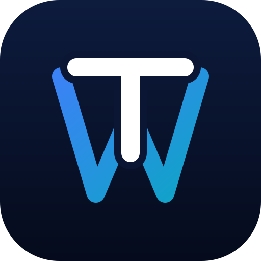

<p align="center">
  
</p>

<h1 align="center">WalletTracker</h1>

<p align="center">
  Le finanze personali in un'unica dashboard, con i movimenti letti direttamente dalle banche.<br>
  <em>Self-hosted: gira sul tuo computer e i dati restano lì.</em>
</p>

<p align="center">
  <a href="https://github.com/rosemgo/WalletTracker/actions/workflows/ci.yml"></a>
  <a href="https://github.com/rosemgo/WalletTracker/releases/latest"></a>
  
  
  
  
  <a href="LICENSE"></a>
</p>

> **English.** WalletTracker is a self-hosted personal finance app: it reads your transactions from the banks through
> European open banking (PSD2), or from a file, and shows them in a dashboard with categories, budgets, subscriptions
> and investments. It runs on your own computer with Docker, and the data stays there. The app and the installation
> are available in Italian and English: the installer asks for the language at the first start. To install and use
> it, read **[GUIDE.md](GUIDE.md)**; what is new in each version is in [CHANGELOG.md](CHANGELOG.md). The rest of this
> page and the developer documentation in `docs/` are in Italian.

WalletTracker raccoglie i movimenti di tutti i conti (Revolut, ING, Fineco, Trade Republic e le altre banche
europee raggiungibili tramite l'open banking PSD2), li classifica in automatico e mostra in una dashboard dove vanno i
soldi: spese per categoria, budget, abbonamenti, saldi e investimenti. Non c'è un servizio in cloud: ognuno installa la
propria copia con Docker, sul proprio PC o su un piccolo server, e la usa dal browser o dal telefono.

<p align="center">
  
  &nbsp;&nbsp;
  
</p>

## Funzionalità

- **Movimenti dalle banche, in automatico**: collegamento tramite [Enable Banking](https://enablebanking.com)
  (fornitore autorizzato PSD2), aggiornamento ogni 6 ore e pulsante "Aggiorna ora", senza doppioni.
- **Import da file**: CSV ed Excel esportati dalla banca, per i conti non collegabili o per completare lo storico di
  quelli collegati; riconoscimento automatico dell'esportazione di Trade Republic.
- **Classificazione**: motore a regole configurabile dalla dashboard, giroconti tra i propri conti e saldo della carta di
  credito riconosciuti (non contano come spese), correzione manuale che vince sempre, suggerimenti dalla storia.
- **Intelligenza artificiale facoltativa**: suggerimenti di categoria per gli esercenti mai visti con un modello locale
  (Ollama) o nel cloud (Google Gemini, con chiave cifrata e consenso esplicito).
- **Analisi**: riepilogo del mese rispetto al solito, spese per categoria, grafici interattivi, ricerca per testo,
  categoria e importo, note sui movimenti.
- **Budget, abbonamenti e avvisi**: budget mensili con il ritmo di spesa, abbonamenti ricorrenti riconosciuti (con
  rincari e disdette), avvisi per consenso in scadenza, sincronizzazioni fallite e budget superati.
- **Saldi e investimenti**: liquidità complessiva, plafond della carta, versamenti, cedole, dividendi e interessi.
- **Pensata per il telefono**: app installabile (PWA), tema chiaro e scuro, modalità discreta che nasconde gli importi.
- **Sicurezza e manutenzione**: PIN, accesso remoto solo via [Tailscale](https://tailscale.com), backup cifrati ogni
  notte con ripristino, aggiornamento con un doppio clic e ritorno automatico alla versione precedente se qualcosa va
  storto.
- **Italiano e inglese**, sia nell'app sia nell'installazione.

## Installazione

Per installare e usare WalletTracker senza essere informatici c'è la guida passo passo:
**[GUIDA.md](GUIDA.md)** (in inglese: [GUIDE.md](GUIDE.md)).

In breve: serve [Docker Desktop](https://www.docker.com/products/docker-desktop/); si scarica lo ZIP
dell'[ultima versione](https://github.com/rosemgo/WalletTracker/releases/latest), si fa doppio clic su **Avvia WalletTracker** e si apre l'app nel browser. Per leggere i movimenti dalle banche serve anche un'applicazione
(gratuita per uso personale) su Enable Banking: la pagina Impostazioni guida la configurazione.

Le novità di ogni versione sono in [NOVITA.md](NOVITA.md) (in inglese: [CHANGELOG.md](CHANGELOG.md)).

## Architettura

<p align="center">
  
</p>

L'app è composta da container avviati con Docker Compose:

- **backend** (Spring Boot): legge i conti tramite Enable Banking, normalizza i movimenti, elimina i doppioni, li
  classifica e riconosce i giroconti; espone le API REST usate dalla dashboard.
- **db** (PostgreSQL): l'unico posto in cui stanno i dati; lo schema è gestito con migrazioni Flyway.
- **web** (nginx): serve la dashboard Angular e inoltra le chiamate `/api` al backend.
- **backup**: ogni notte esporta il database in un file cifrato e tiene gli ultimi 14.
- **ollama** (facoltativo): il modello di intelligenza artificiale locale.

Dal computer su cui gira, l'app si apre nel browser; dagli altri dispositivi si raggiunge solo attraverso la VPN
Tailscale, con https e senza porte aperte su Internet.

## Tecnologie

| Livello | Tecnologia |
|---|---|
| Backend | Java 21, Spring Boot 4, Spring Security, Spring AI, Maven |
| Database | PostgreSQL 18, migrazioni con Flyway |
| Frontend | Angular 22, TypeScript, PWA |
| Accesso alle banche | [Enable Banking](https://enablebanking.com) (PSD2), modalità gratuita per uso personale |
| Intelligenza artificiale | [Ollama](https://ollama.com) in locale oppure Google Gemini (entrambi facoltativi) |
| Esecuzione | Docker Compose, nginx, immagini su GitHub Container Registry (PC e Mac con chip Apple) |
| Accesso remoto | [Tailscale](https://tailscale.com) (`tailscale serve`) |
| Test e CI | JUnit, Testcontainers, Vitest, GitHub Actions |

Note sulle scelte:
- **Spring Boot** è lo standard di fatto per i backend Java: sicurezza, accesso ai dati, programmazione delle attività e
  integrazione con i modelli di IA (Spring AI) sono già disponibili e ben documentati.
- **Enable Banking** è un fornitore autorizzato PSD2: senza un intermediario del genere un privato non può collegarsi
  alle API delle banche. La modalità gratuita è riservata ai conti del titolare dell'applicazione, ed è per questo che
  ogni utente ha la propria installazione.

## Il modello: un'installazione per persona

Come Firefly III e Actual Budget, WalletTracker è *self-hosted*: chi vuole usarlo scarica il progetto da GitHub, crea
la propria applicazione (gratuita) su Enable Banking e lo avvia sul proprio computer o server. Ognuno ha i propri conti,
le proprie regole e il proprio database. Nel codice non ci sono nomi di banche né abitudini personali: conti, regole e
correzioni stanno nel database e si modificano dalla dashboard. I principi sono descritti in
[`docs/03-modello-e-regole.md`](docs/03-modello-e-regole.md).

## Struttura del repository

```
.github/    integrazione continua (GitHub Actions): build e test a ogni push, rilascio delle versioni
English/    il LEGGIMI in inglese e i file da doppio clic con i nomi inglesi
backend/    applicazione Spring Boot (con il suo Dockerfile)
frontend/   dashboard Angular e configurazione di nginx (con il suo Dockerfile)
docker/     il container dei backup
docs/       documentazione tecnica, passo per passo
secrets/    chiave privata di Enable Banking (ignorata da Git)
.env        configurazione personale (ignorato da Git; si parte da .env.example)
```

`docker-compose.yml` avvia l'app completa: database, backend, nginx con la dashboard, backup e, se richiesto, Ollama.
`docker-compose.build.yml` costruisce le immagini dal codice; `docker-compose.dev.yml` espone la porta del database
per lo sviluppo.

## Documentazione tecnica

Il progetto è stato sviluppato per passi, e ogni passo ha un documento in `docs/` che spiega le scelte fatte, il codice
e i concetti alla base (Spring, JPA, Angular, Docker, sicurezza, reti). Per orientarsi:

- [Modello e regole](docs/03-modello-e-regole.md): come ragiona WalletTracker (conti, ruoli, tipi di movimento,
  classificazione).
- [La sicurezza](docs/17-sicurezza.md): modello delle minacce, protezioni attive, piano.
- [Comandi per lo sviluppo](docs/sviluppo-comandi.md) e [la CI su GitHub](docs/ci-github.md).

<details>
<summary><strong>Tutti i documenti, in ordine</strong></summary>

1. [Installazione e setup dell'ambiente](docs/01-installazione-e-setup.md)
2. [Fase 0: collegamento alla banca](docs/02-fase-0-collegamento-banca.md)
3. [Modello e regole: le decisioni prese](docs/03-modello-e-regole.md)
4. [Fase 1, passo 1: PostgreSQL con Docker](docs/04-fase-1-passo-1-postgres-docker.md)
5. [Fase 1, passo 2: Spring Boot + PostgreSQL + Flyway](docs/05-fase-1-passo-2-spring-jpa-flyway.md)
6. [Fase 1, passo 3: i movimenti, senza doppioni](docs/06-fase-1-passo-3-movimenti.md)
7. [Fase 1, passo 4: la classificazione automatica](docs/07-fase-1-passo-4-classificazione.md)
8. [Fase 1, passo 5: la sincronizzazione automatica](docs/08-fase-1-passo-5-sincronizzazione.md)
9. [Fase 2, passo 1: il server web e le API REST](docs/09-fase-2-passo-1-api-rest.md)
10. [La carta di credito: il saldo non è una spesa](docs/10-carta-di-credito.md)
11. [Integrazione continua con GitHub Actions](docs/11-ci-github-actions.md)
12. [Fase 2, passo 2: la dashboard Angular](docs/12-fase-2-passo-2-dashboard-angular.md)
13. [Fase 2, passo 3: collegare le banche dalla dashboard e "Aggiorna ora"](docs/13-fase-2-passo-3-collega-banca.md)
14. [Angular da zero: capire il frontend di WalletTracker](docs/14-guida-angular-da-zero.md)
15. [Fase 2, passo 4: le regole dalla dashboard](docs/15-fase-2-passo-4-regole.md)
16. [Fase 2, passo 5: la configurazione guidata di Enable Banking](docs/16-fase-2-passo-5-configurazione-guidata.md)
17. [La sicurezza di WalletTracker: modello, protezioni, piano](docs/17-sicurezza.md)
18. [Fase 3, passo 1: il riepilogo mensile e il primo grafico](docs/18-fase-3-passo-1-riepilogo.md)
19. [Fase 3, passo 2: le categorie, le regole dalle correzioni e i rimborsi](docs/19-fase-3-passo-2-categorie.md)
20. [Fase 3, passo 3: i budget mensili](docs/20-fase-3-passo-3-budget.md)
21. [Fase 3, passo 4: gli avvisi (consenso in scadenza, sincronizzazioni fallite, budget superati)](docs/21-fase-3-passo-4-avvisi.md)
22. [Fase 3, passo 5: gli abbonamenti ricorrenti](docs/22-fase-3-passo-5-abbonamenti.md)
23. [Fase 3, passo 5b: l'elenco delle categorie (menu a discesa, rinomina a cascata)](docs/23-categorie-standard.md)
24. [Le categorie collegate per id: normalizzazione, `@ManyToOne`, `JOIN FETCH`](docs/24-categorie-per-id.md)
25. [Fase 3, passo 6: l'import CSV e i conti manuali (es. Trade Republic)](docs/25-fase-3-passo-6-import-csv.md)
26. [Fase 3, passo 7a: i suggerimenti di categoria dalla tua storia](docs/26-fase-3-passo-7a-suggerimenti.md)
27. [Fase 3, passo 7b: l'intelligenza artificiale con Spring AI e Ollama](docs/27-fase-3-passo-7b-ia-spring-ai.md)
28. [Fase 3, passo 7b.2: il modello che sceglie la categoria con Spring AI, e la misura](docs/28-fase-3-passo-7b2-modello-e-misura.md)
29. [Fase 3, passo 7b.3: "Chiedi all'IA", i suggerimenti dell'intelligenza artificiale nei Movimenti](docs/29-fase-3-passo-7b3-chiedi-all-ia.md)
30. [Fase 3, passo 7c: l'IA nel cloud, con Google Gemini (chiave cifrata, consenso)](docs/30-fase-3-passo-7c-ia-nel-cloud.md)
31. [Fase 3: completare i movimenti di Trade Republic con il suo file](docs/31-fase-3-trade-republic-completa-movimenti.md)
32. [La ricerca nei movimenti: testo, categoria, importo](docs/32-ricerca-movimenti.md)
33. [Fase grafica, passo 1: il progetto (funzionalità, schermate, grafici, stile)](docs/33-fase-grafica-progetto.md)
34. [La nota di un movimento (scriverla, vederla, ritrovarla con la ricerca)](docs/34-note-movimenti.md)
35. [Fase grafica, passo 2: le basi (carattere, temi giorno e notte, navigazione per telefono e PC)](docs/35-fase-grafica-le-basi.md)
36. [Fase grafica, passo 3: il Riepilogo (il mese rispetto al solito, Analisi nella barra, lazy loading)](docs/36-fase-grafica-riepilogo.md)
37. [Fase grafica, passo 4: i Movimenti per giorno e il dettaglio di un movimento (simili, Annulla)](docs/37-fase-grafica-movimenti.md)
38. [Fase grafica, passo 5: Analisi, l'esploratore e la pagina di una categoria (budget con il ritmo)](docs/38-fase-grafica-analisi.md)
39. [Fase grafica, passo 6: il Budget e le pagine di "Altro" (tabelle come schede sul telefono, errori in parole)](docs/39-fase-grafica-budget-e-altro.md)
40. [L'esercente scritto nella causale: bonifici e addebiti diretti riconosciuti dal nome (migrazione V28)](docs/40-esercente-nella-causale.md)
41. [Fase grafica: un aspetto moderno, grafici vivi (Inter, campi, scelta del file, grafici animati e da scorrere)](docs/41-fase-grafica-aspetto-moderno.md)
42. [Fase grafica, passo 7: l'app installabile (PWA) e la modalità discreta](docs/42-fase-grafica-pwa-e-modalita-discreta.md)
43. [Ritocchi: "Senza categoria" porta ai movimenti, la categoria tra spese ed entrate, i menu aperti](docs/43-analisi-senza-categoria-e-menu.md)
44. [Fase 4, passo 1: l'app in tre container (Dockerfile multi-stage, nginx, Docker Compose)](docs/44-fase-4-passo-1-docker-nginx.md)
45. [Fase 4, passo 2: lo script di installazione, la password del database generata e come cambiarla](docs/45-fase-4-passo-2-installazione-e-segreti.md)
46. [Fase 4, passo 3: il PIN per aprire l'app, facoltativo dal PC (Spring Security dalle basi: filtri, sessione, CSRF, hash, blocco, codice di recupero)](docs/46-fase-4-passo-3-pin.md)
47. [Fase 4, passo 4: Tailscale, l'app dal telefono con https vero (reti, VPN e certificati dalle basi; `tailscale serve`; più indirizzi di ritorno per Enable Banking)](docs/47-fase-4-passo-4-tailscale.md)
48. [Fase 4, passo 5: backup e ripristino (pg_dump, cifratura con password, backup automatico ogni notte, ripristino provato davvero, spostare l'app su un altro computer)](docs/48-fase-4-passo-5-backup.md)
49. [Il server in cloud: WalletTracker sempre acceso su Oracle Cloud "Always Free" (VM ARM gratuita, Docker, Tailscale senza porte aperte, i limiti dimezzati nel 2026, il recupero delle VM inattive, i backup fuori da Oracle)](docs/49-server-in-cloud-oracle.md)
50. [Fase 4, passo 6: le versioni e le immagini già pronte (6a: GitHub Container Registry, immagini per PC e Mac, versione semantica, tag e release con lo ZIP); "Aggiorna" con backup e ritorno da solo, e l'avviso della versione nuova nell'app (6b); il doppio clic e l'avvio automatico (6c)](docs/50-fase-4-passo-6-versioni-e-aggiornamenti.md)
**Approfondimenti tematici**

- Lingue: [1. messaggi del backend come codici, plurali e date](docs/lingue-1-messaggi-e-formati.md) ·
  [2. l'app in inglese](docs/lingue-2-inglese.md) · [3. l'installazione in due lingue](docs/lingue-3-installazione.md)
- [Investimenti: versato, cedole, dividendi e interessi](docs/investimenti.md)
- [Tinaba: un CSV senza segno](docs/tinaba.md)
- [Importa da un file: Excel, conti collegati e manuali](docs/importa-file.md)
- [Enable Banking in modalità ristretta: un conto nuovo va prima nella lista](docs/modalita-ristretta.md)
- [Rimuovere un collegamento, tenendo la storia](docs/rimuovere-un-collegamento.md)
- [I loghi delle banche accanto ai movimenti](docs/loghi.md)
- [Il logo, il tema Blu oceano e i colori dei grafici](docs/tema-blu-oceano.md)
- [Il tocco sulle barre dei grafici](docs/grafici-tocco.md)
- ["Aggiorna ora": che cosa è arrivato, conto per conto](docs/aggiorna-ora.md)
- [Le maiuscole, il riquadro dopo un clic e le azioni spezzate](docs/maiuscole-e-contorni.md)
- [I saldi dei conti, il plafond della carta e la liquidità](docs/saldi.md)
- [Da ogni riepilogo ai suoi movimenti: i collegamenti](docs/collegamenti.md)

</details>

## Piano di lavoro

| Fase | Contenuto | Stato |
|---|---|---|
| 0 | Prova di collegamento con ING, Revolut, Fineco e Trade Republic | ✅ |
| 1 | Modello dati, PostgreSQL, movimenti senza doppioni, classificazione, sincronizzazione automatica | ✅ |
| 2 | API REST e dashboard Angular: conti, movimenti, regole, collegamento delle banche | ✅ |
| 3 | Riepilogo e grafici, categorie, budget, avvisi, abbonamenti, import CSV, suggerimenti e IA | ✅ |
| Grafica | App pensata per il telefono: temi, Riepilogo, Movimenti, Analisi, PWA, modalità discreta | ✅ |
| 4 | Container, script di installazione, PIN, Tailscale, backup, versioni e aggiornamenti | 🚧 guida per non informatici e prova su Windows in corso |

<details>
<summary><strong>Dettaglio dei passi</strong></summary>

- [x] **Fase 0**: prova di collegamento con ING, Revolut, Fineco e Trade Republic (programma a riga di comando)
- [x] **Fase 1**: modello dati, PostgreSQL in Docker, sincronizzazione automatica
  - [x] passo 1: PostgreSQL con Docker Compose
  - [x] passo 2: Spring Boot + Flyway + collegamenti e conti salvati nel database
  - [x] passo 3: movimenti e importazione senza doppioni
  - [x] passo 4: classificazione automatica (motore generico + regole configurabili)
  - [x] passo 5: sincronizzazione automatica programmata
- [x] **Fase 2**: server web, API REST e dashboard Angular
  - [x] passo 1: server web e API REST (conti, movimenti, ruoli, correzioni manuali)
  - [x] passo 2: dashboard Angular: conti, ruoli, elenco movimenti con correzione del tipo
  - [x] passo 3: collegamento delle banche dalla dashboard e pulsante "Aggiorna ora"
  - [x] passo 4: gestione delle regole dalla dashboard (con prova prima di salvare)
  - [x] passo 5: configurazione guidata delle credenziali Enable Banking (pagina Impostazioni)
- [x] **Fase 3**: grafici, budget, abbonamenti, avvisi, import CSV (`docs/18`)
  - [x] riepilogo mensile con grafico entrate/spese
  - [x] categorie: scelta a mano, "crea una regola da questa correzione", rimborsi, spese per categoria
  - [x] budget mensili per categoria, con stato e ritmo di spesa
  - [x] avvisi: consenso in scadenza o scaduto (con "Ricollega"), sincronizzazioni fallite, budget superati
  - [x] abbonamenti ricorrenti: suggeriti dal programma, confermati dall'utente, con rincari e disdette
  - [x] elenco delle categorie: di partenza e modificabile, integrità garantita dal database
  - [x] categorie collegate per id (soluzione normalizzata), senza query N+1
  - [x] import CSV nei conti manuali: mappatura proposta e anteprima, tutto o niente, senza doppioni
  - [x] file di Trade Republic anche per il conto collegato: completa causale e controparte e aggiunge i mesi prima
    dello storico della banca (`docs/31`)
  - [x] suggerimenti di categoria dalla storia: stesso esercente, stessa categoria (passo 7a)
  - [x] suggerimenti con l'intelligenza artificiale tramite Spring AI: modello locale con Ollama (passo 7b) e servizio
    cloud con Google Gemini (passo 7c)
- [x] **Fase grafica**: app pensata per il telefono, a colpo d'occhio (`docs/33`–`docs/42`)
- [ ] **Fase 4**: installazione con un solo comando, guida per chi non è informatico, accesso via Tailscale
  - [x] passo 1: tre container (`db`, `backend`, `web` con nginx) più Ollama facoltativo (`docs/44`)
  - [x] passo 2: script di installazione (`installa.ps1` / `installa.sh`) con password del database generata (`docs/45`)
  - [x] passo 3: PIN con Spring Security, facoltativo dal PC: codice di recupero, sessione di 12 ore, blocco dopo 5
    errori, CSRF (`docs/46`)
  - [x] passo 4: Tailscale, l'app dal telefono con https vero tramite `tailscale serve` (`docs/47`)
  - [x] passo 5: backup e ripristino: file cifrato (AES-256, PBKDF2), backup automatico ogni notte, ripristino provato
    nella CI (`docs/48`)
  - [ ] passo 6: versioni e aggiornamenti (`docs/50`)
    - [x] 6a: numero di versione, immagini su GitHub Container Registry (PC e Mac con chip Apple), release con lo ZIP
    - [x] 6b: "Aggiorna" con controllo SHA-256, backup prima e ritorno automatico alla versione precedente; avviso
      della versione nuova nell'app
    - [x] 6c: avvio, aggiornamento e backup con un doppio clic (`.cmd` per Windows, `.command` per il Mac)
    - [ ] 6d: la guida per chi non è informatico (`GUIDA.md`), la prova su Windows e la versione 1.1.0 — in corso
  - da valutare: la firma delle release, così "Aggiorna" riconoscerebbe uno ZIP falso anche se l'account GitHub fosse
    compromesso (`docs/50`, parte K)
  - da valutare: l'accesso remoto con una VPN già esistente al posto di Tailscale

</details>

## Sviluppo

Dalla radice del progetto:

```bash
./installa.sh                                 # primo avvio e avvii successivi: crea il .env se manca e avvia (docs/45)
./installa.sh --aggiorna                      # dalla cartella di una versione scaricata: passa all'ultima (docs/50, parte I)
./installa.sh --lingua en                     # lo script in inglese (--lingua it per tornare)
                                              # su Windows: powershell -ExecutionPolicy Bypass -File installa.ps1
docker compose down                           # ferma tutto (i dati restano)

# A mano, senza lo script, costruendo le immagini dal codice (docs/50, parte C):
docker compose -f docker-compose.yml -f docker-compose.build.yml up -d --build                 # l'app completa su http://localhost:8000
docker compose -f docker-compose.yml -f docker-compose.build.yml --profile ia up -d --build    # la stessa, con anche Ollama

# Solo il database, raggiungibile dal PC (poi backend con ./mvnw e dashboard con npm start).
# Non insieme all'app completa: due backend leggerebbero due volte le banche.
docker compose -f docker-compose.yml -f docker-compose.dev.yml up -d db

# Pubblicare una versione (docs/50, parte E): prima la sezione "## x.y.z" in NOVITA.md e in CHANGELOG.md, poi
git tag -a v1.0.0 -m "WalletTracker 1.0.0" && git push origin v1.0.0
```

I test del backend non richiedono Compose (usano Testcontainers), ma Docker deve essere in esecuzione.

Dalla cartella `backend/` (su Windows `mvnw.cmd` al posto di `./mvnw`):

```bash
./mvnw test                                           # esegue i test
./mvnw spring-boot:run -Dspring-boot.run.profiles=poc # collega una banca o riusa un collegamento salvato
./mvnw spring-boot:run                                # API su http://localhost:8080 e sincronizzazione automatica
```

Dalla cartella `frontend/` (richiede Node.js 24 LTS):

```bash
npm install                    # la prima volta, e dopo ogni modifica a package.json
npm start                      # la dashboard su https://localhost:8443 (con il backend avviato)
npm run pwa                    # la build di produzione su http://localhost:4300, installabile come app (docs/42)
npm test -- --watch=false      # esegue i test una volta
```

Il flusso di lavoro con Git (rami, pull request, `main` protetto) è descritto in
[`docs/sviluppo-comandi.md`](docs/sviluppo-comandi.md).

## Sicurezza

La sicurezza ha la precedenza su ogni funzione: modello, protezioni attive e piano sono in
[`docs/17-sicurezza.md`](docs/17-sicurezza.md). Per segnalare una vulnerabilità vedi [`SECURITY.md`](SECURITY.md).

`.env`, la cartella `secrets/` e i file `.pem` non vanno mai inclusi in un commit: il `.gitignore` li esclude, ma
conviene sempre controllare con `git status` prima di un commit.

## Licenza

WalletTracker è distribuito con licenza [MIT](LICENSE). © 2026 Rosario Goglia.
