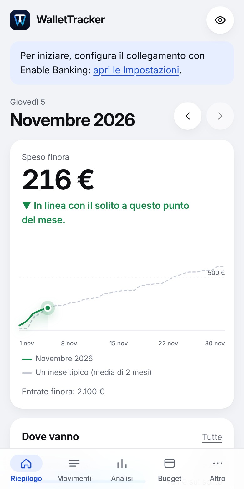
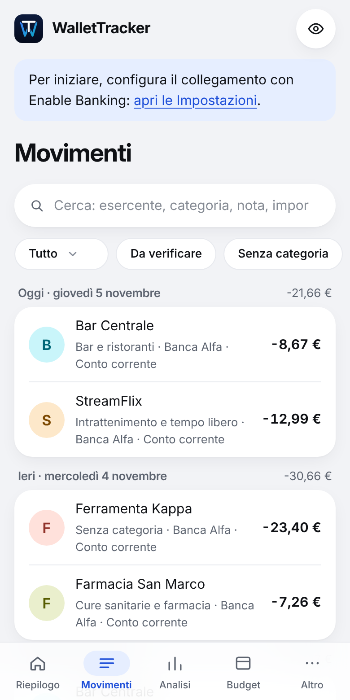
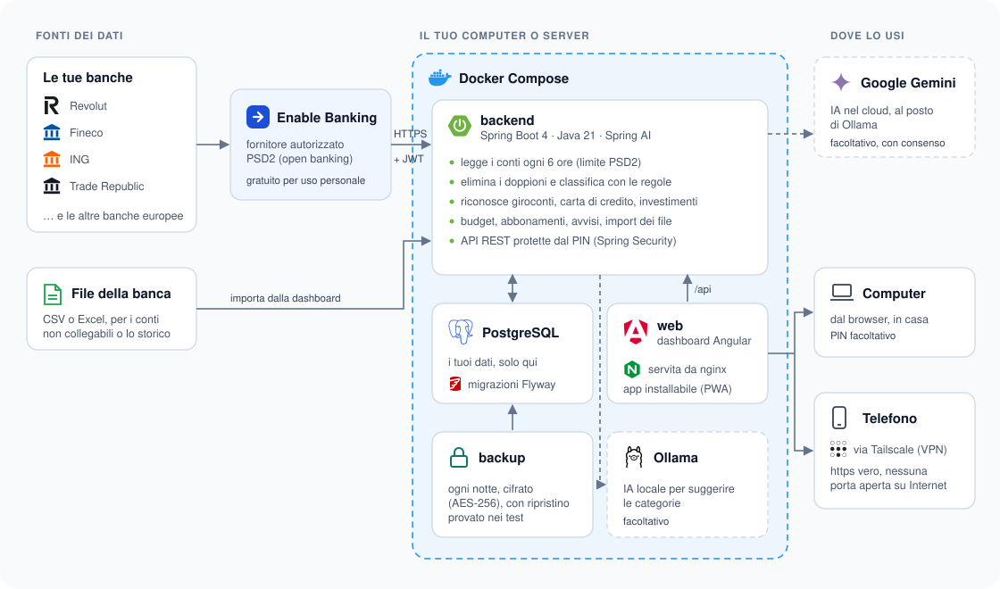

<p align="center">
  
</p>

<h1 align="center">WalletTracker</h1>

<p align="center">
  Le finanze personali in un'unica dashboard, con i movimenti letti direttamente dalle banche.<br>
  <em>Self-hosted: gira sul tuo computer e i dati restano lì.</em>
</p>

<p align="center">
  <a href="https://github.com/rosemgo/WalletTracker/actions/workflows/ci.yml"></a>
  <a href="https://github.com/rosemgo/WalletTracker/releases/latest"></a>
  
  
  
  
  <a href="LICENSE"></a>
</p>

> **English.** WalletTracker is a self-hosted personal finance app: it reads your transactions from the banks through
> European open banking (PSD2), or from a file, and shows them in a dashboard with categories, budgets, subscriptions
> and investments. It runs on your own computer with Docker, and the data stays there. The app and the installation
> are available in Italian and English: the installer asks for the language at the first start. To install and use
> it, read **[GUIDE.md](GUIDE.md)**; what is new in each version is in [CHANGELOG.md](CHANGELOG.md). The rest of this
> page and the developer documentation in `docs/` are in Italian.

WalletTracker raccoglie i movimenti di tutti i conti (Revolut, ING, Fineco, Trade Republic e le altre banche
europee raggiungibili tramite l'open banking PSD2), li classifica in automatico e mostra in una dashboard dove vanno i
soldi: spese per categoria, budget, abbonamenti, saldi e investimenti. Non c'è un servizio in cloud: ognuno installa la
propria copia con Docker, sul proprio PC o su un piccolo server, e la usa dal browser o dal telefono.

<p align="center">
  
  &nbsp;&nbsp;
  
</p>

## Funzionalità

- **Movimenti dalle banche, in automatico**: collegamento tramite [Enable Banking](https://enablebanking.com)
  (fornitore autorizzato PSD2), aggiornamento ogni 6 ore e pulsante "Aggiorna ora", senza doppioni.
- **Import da file**: CSV ed Excel esportati dalla banca, per i conti non collegabili o per completare lo storico di
  quelli collegati; riconoscimento automatico dell'esportazione di Trade Republic.
- **Classificazione**: motore a regole configurabile dalla dashboard, giroconti tra i propri conti e saldo della carta di
  credito riconosciuti (non contano come spese), correzione manuale che vince sempre, suggerimenti dalla storia.
- **Intelligenza artificiale facoltativa**: suggerimenti di categoria per gli esercenti mai visti con un modello locale
  (Ollama) o nel cloud (Google Gemini, con chiave cifrata e consenso esplicito).
- **Analisi**: riepilogo del mese rispetto al solito, spese per categoria, grafici interattivi, ricerca per testo,
  categoria e importo, note sui movimenti.
- **Budget, abbonamenti e avvisi**: budget mensili con il ritmo di spesa, abbonamenti ricorrenti riconosciuti (con
  rincari e disdette), avvisi per consenso in scadenza, sincronizzazioni fallite e budget superati.
- **Saldi e investimenti**: liquidità complessiva, plafond della carta, versamenti, cedole, dividendi e interessi.
- **Pensata per il telefono**: app installabile (PWA), tema chiaro e scuro, modalità discreta che nasconde gli importi.
- **Sicurezza e manutenzione**: PIN, accesso remoto solo via [Tailscale](https://tailscale.com), backup cifrati ogni
  notte con ripristino, aggiornamento con un doppio clic e ritorno automatico alla versione precedente se qualcosa va
  storto.
- **Italiano e inglese**, sia nell'app sia nell'installazione.

## Installazione

Per installare e usare WalletTracker senza essere informatici c'è la guida passo passo:
**[GUIDA.md](GUIDA.md)** (in inglese: [GUIDE.md](GUIDE.md)).

In breve: serve [Docker Desktop](https://www.docker.com/products/docker-desktop/); si scarica lo ZIP
dell'[ultima versione](https://github.com/rosemgo/WalletTracker/releases/latest), si fa doppio clic su **Avvia WalletTracker** e si apre l'app nel browser. Per leggere i movimenti dalle banche serve anche un'applicazione
(gratuita per uso personale) su Enable Banking: la pagina Impostazioni guida la configurazione.

Le novità di ogni versione sono in [NOVITA.md](NOVITA.md) (in inglese: [CHANGELOG.md](CHANGELOG.md)).

## Architettura

<p align="center">
  
</p>

L'app è composta da container avviati con Docker Compose:

- **backend** (Spring Boot): legge i conti tramite Enable Banking, normalizza i movimenti, elimina i doppioni, li
  classifica e riconosce i giroconti; espone le API REST usate dalla dashboard.
- **db** (PostgreSQL): l'unico posto in cui stanno i dati; lo schema è gestito con migrazioni Flyway.
- **web** (nginx): serve la dashboard Angular e inoltra le chiamate `/api` al backend.
- **backup**: ogni notte esporta il database in un file cifrato e tiene gli ultimi 14.
- **ollama** (facoltativo): il modello di intelligenza artificiale locale.

Dal computer su cui gira, l'app si apre nel browser; dagli altri dispositivi si raggiunge solo attraverso la VPN
Tailscale, con https e senza porte aperte su Internet.

## Tecnologie

| Livello | Tecnologia |
|---|---|
| Backend | Java 21, Spring Boot 4, Spring Security, Spring AI, Maven |
| Database | PostgreSQL 18, migrazioni con Flyway |
| Frontend | Angular 22, TypeScript, PWA |
| Accesso alle banche | [Enable Banking](https://enablebanking.com) (PSD2), modalità gratuita per uso personale |
| Intelligenza artificiale | [Ollama](https://ollama.com) in locale oppure Google Gemini (entrambi facoltativi) |
| Esecuzione | Docker Compose, nginx, immagini su GitHub Container Registry (PC e Mac con chip Apple) |
| Accesso remoto | [Tailscale](https://tailscale.com) (`tailscale serve`) |
| Test e CI | JUnit, Testcontainers, Vitest, GitHub Actions |

Note sulle scelte:
- **Spring Boot** è lo standard di fatto per i backend Java: sicurezza, accesso ai dati, programmazione delle attività e
  integrazione con i modelli di IA (Spring AI) sono già disponibili e ben documentati.
- **Enable Banking** è un fornitore autorizzato PSD2: senza un intermediario del genere un privato non può collegarsi
  alle API delle banche. La modalità gratuita è riservata ai conti del titolare dell'applicazione, ed è per questo che
  ogni utente ha la propria installazione.

## Il modello: un'installazione per persona

Come Firefly III e Actual Budget, WalletTracker è *self-hosted*: chi vuole usarlo scarica il progetto da GitHub, crea
la propria applicazione (gratuita) su Enable Banking e lo avvia sul proprio computer o server. Ognuno ha i propri conti,
le proprie regole e il proprio database. Nel codice non ci sono nomi di banche né abitudini personali: conti, regole e
correzioni stanno nel database e si modificano dalla dashboard. I principi sono descritti in
[`docs/03-modello-e-regole.md`](docs/03-modello-e-regole.md).

## Struttura del repository

```
.github/    integrazione continua (GitHub Actions): build e test a ogni push, rilascio delle versioni
English/    il LEGGIMI in inglese e i file da doppio clic con i nomi inglesi
backend/    applicazione Spring Boot (con il suo Dockerfile)
frontend/   dashboard Angular e configurazione di nginx (con il suo Dockerfile)
docker/     il container dei backup
docs/       documentazione tecnica, passo per passo
secrets/    chiave privata di Enable Banking (ignorata da Git)
.env        configurazione personale (ignorato da Git; si parte da .env.example)
```

`docker-compose.yml` avvia l'app completa: database, backend, nginx con la dashboard, backup e, se richiesto, Ollama.
`docker-compose.build.yml` costruisce le immagini dal codice; `docker-compose.dev.yml` espone la porta del database
per lo sviluppo.

## Documentazione tecnica

Il progetto è stato sviluppato per passi, e ogni passo ha un documento in `docs/` che spiega le scelte fatte, il codice
e i concetti alla base (Spring, JPA, Angular, Docker, sicurezza, reti). Per orientarsi:

- [Modello e regole](docs/03-modello-e-regole.md): come ragiona WalletTracker (conti, ruoli, tipi di movimento,
  classificazione).
- [La sicurezza](docs/17-sicurezza.md): modello delle minacce, protezioni attive, piano.
- [Comandi per lo sviluppo](docs/sviluppo-comandi.md) e [la CI su GitHub](docs/ci-github.md).

## Sviluppo

Dalla radice del progetto:

```bash
./installa.sh                                 # primo avvio e avvii successivi: crea il .env se manca e avvia (docs/45)
./installa.sh --aggiorna                      # dalla cartella di una versione scaricata: passa all'ultima (docs/50, parte I)
./installa.sh --lingua en                     # lo script in inglese (--lingua it per tornare)
                                              # su Windows: powershell -ExecutionPolicy Bypass -File installa.ps1
docker compose down                           # ferma tutto (i dati restano)

# A mano, senza lo script, costruendo le immagini dal codice (docs/50, parte C):
docker compose -f docker-compose.yml -f docker-compose.build.yml up -d --build                 # l'app completa su http://localhost:8000
docker compose -f docker-compose.yml -f docker-compose.build.yml --profile ia up -d --build    # la stessa, con anche Ollama

# Solo il database, raggiungibile dal PC (poi backend con ./mvnw e dashboard con npm start).
# Non insieme all'app completa: due backend leggerebbero due volte le banche.
docker compose -f docker-compose.yml -f docker-compose.dev.yml up -d db

# Pubblicare una versione (docs/50, parte E): prima la sezione "## x.y.z" in NOVITA.md e in CHANGELOG.md, poi
git tag -a v1.0.0 -m "WalletTracker 1.0.0" && git push origin v1.0.0
```

I test del backend non richiedono Compose (usano Testcontainers), ma Docker deve essere in esecuzione.

Dalla cartella `backend/` (su Windows `mvnw.cmd` al posto di `./mvnw`):

```bash
./mvnw test                                           # esegue i test
./mvnw spring-boot:run -Dspring-boot.run.profiles=poc # collega una banca o riusa un collegamento salvato
./mvnw spring-boot:run                                # API su http://localhost:8080 e sincronizzazione automatica
```

Dalla cartella `frontend/` (richiede Node.js 24 LTS):

```bash
npm install                    # la prima volta, e dopo ogni modifica a package.json
npm start                      # la dashboard su https://localhost:8443 (con il backend avviato)
npm run pwa                    # la build di produzione su http://localhost:4300, installabile come app (docs/42)
npm test -- --watch=false      # esegue i test una volta
```

Il flusso di lavoro con Git (rami, pull request, `main` protetto) è descritto in
[`docs/sviluppo-comandi.md`](docs/sviluppo-comandi.md).

## Sicurezza

La sicurezza ha la precedenza su ogni funzione: modello, protezioni attive e piano sono in
[`docs/17-sicurezza.md`](docs/17-sicurezza.md). Per segnalare una vulnerabilità vedi [`SECURITY.md`](SECURITY.md).

`.env`, la cartella `secrets/` e i file `.pem` non vanno mai inclusi in un commit: il `.gitignore` li esclude, ma
conviene sempre controllare con `git status` prima di un commit.

## Licenza

WalletTracker è distribuito con licenza [MIT](LICENSE). © 2026 Rosario Goglia.
