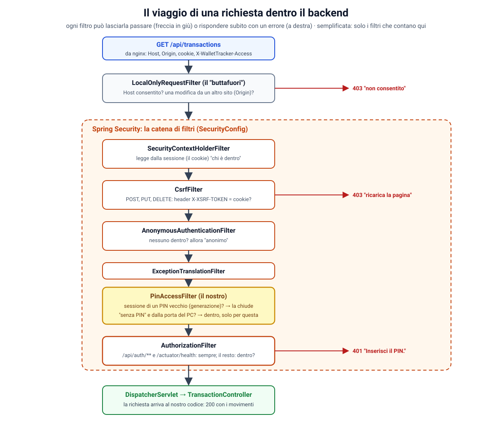
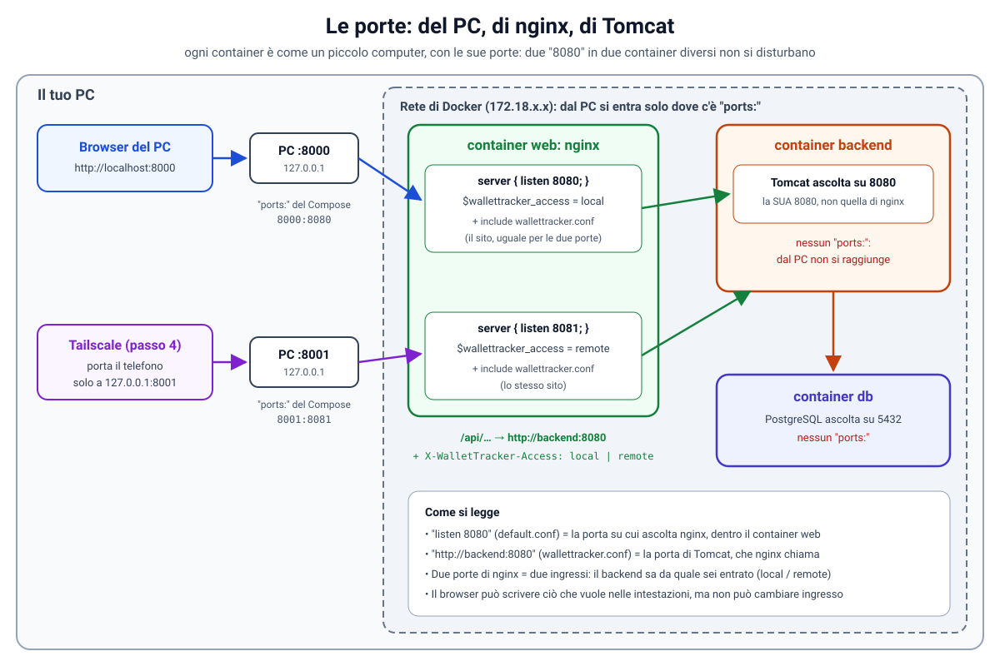
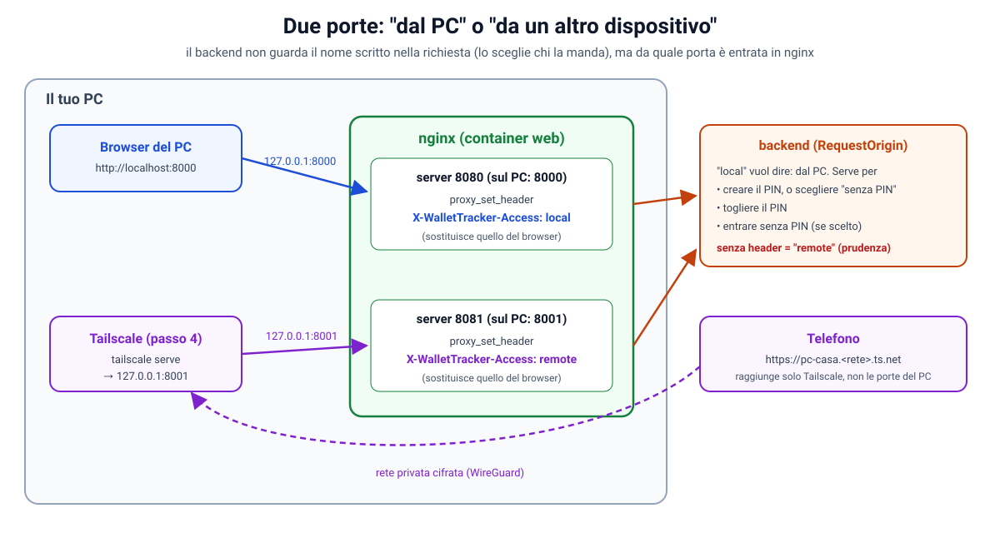
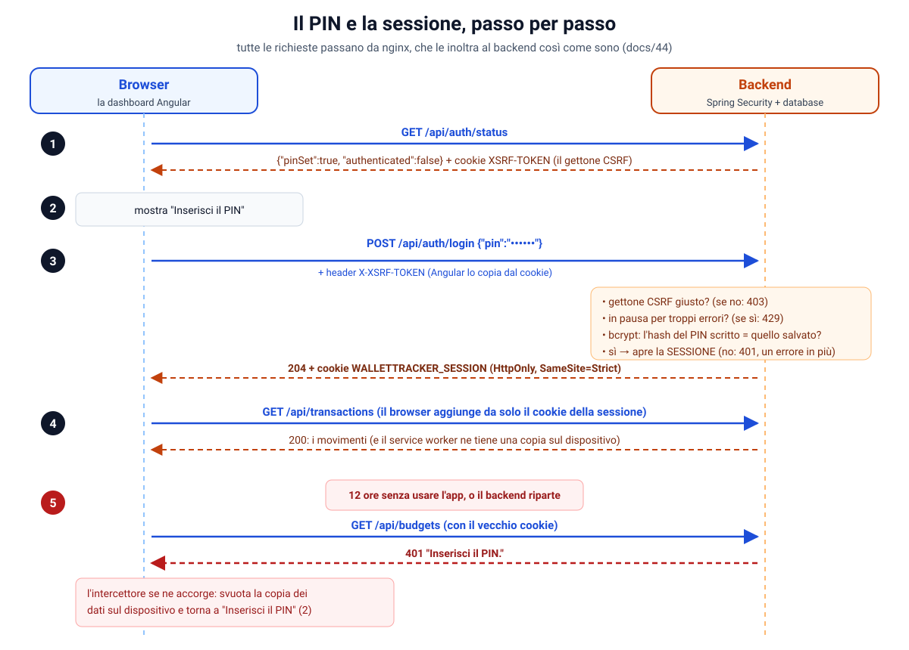
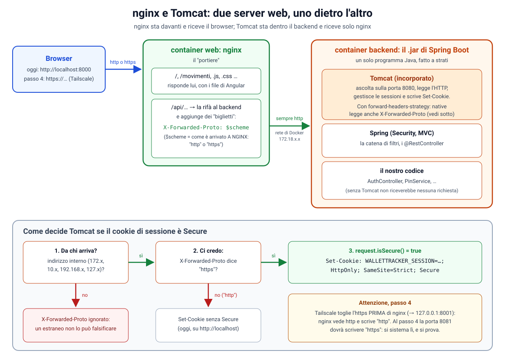
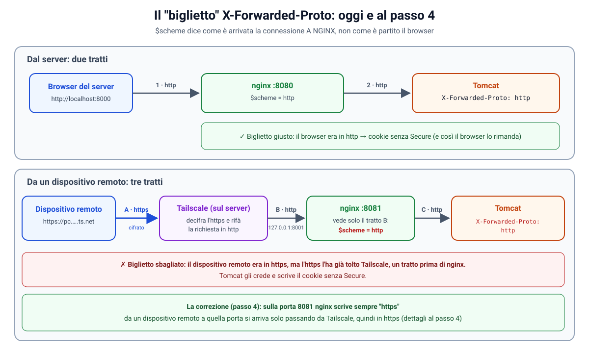
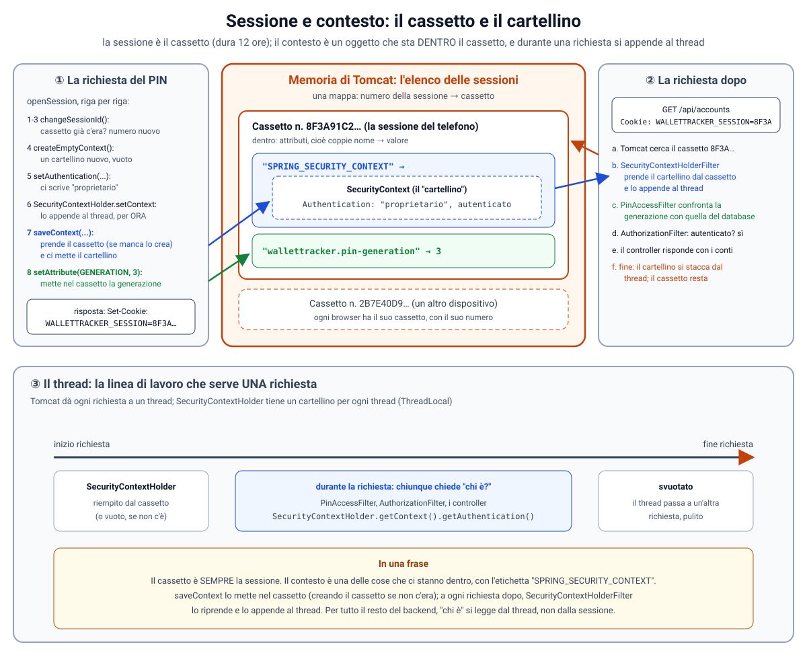
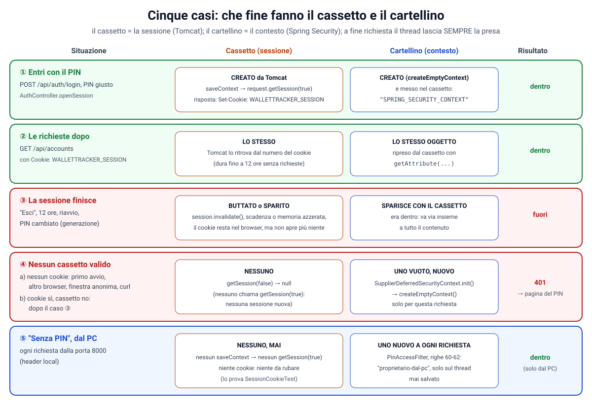

# 46. Fase 4, passo 3: entrare nell'app (PIN facoltativo, codice di recupero) e la sicurezza con Spring Security

**Obiettivo di questo passo:** prima di rendere l'app raggiungibile dal telefono (passo 4, Tailscale), decidere
**chi può entrare, e da dove**.
- Alla prima apertura, **dal PC**, scegli: **con un PIN** o **senza PIN**.
- **Senza PIN** si entra subito, ma **solo dal PC**. Da un altro dispositivo (il telefono) non si entra finché non
  crei un PIN.
- **Con il PIN**, l'app lo chiede su ogni dispositivo, PC compreso. Vale 12 ore: dopo 12 ore senza usare l'app, o
  dopo un riavvio del backend, lo richiede.
- Dopo **5 errori** di fila, le prove si fermano per un po'.
- Se dimentichi il PIN, c'è il **codice di recupero**, mostrato una volta sola quando crei il PIN. Se perdi anche
  quello, lo **script** di installazione azzera tutto, ma solo dal PC.

È anche il passo in cui si studia la sicurezza di un'applicazione web Java: questa guida spiega **Spring Security
dalle basi**, con i pezzi di WalletTracker come esempi.

| Passo | Che cosa | Stato |
|---|---|---|
| 1 | tre container + Ollama facoltativo, nginx (`docs/44`) | fatto |
| 2 | lo script di installazione, la password del database (`docs/45`) | fatto |
| **3** | **entrare nell'app: PIN facoltativo, codice di recupero** | **questa guida** |
| 4 | Tailscale: l'app dal telefono con https vero, redirect di Enable Banking | da fare |
| 5 | backup e ripristino, provato davvero | da fare |
| 6 | aggiornamenti, la guida per chi non è informatico, il doppio clic | da fare |

> Prerequisiti: i passi 1 e 2 e `git pull`. Al primo avvio Flyway applica le migrazioni **V29** e **V30**. Poi
> lancia lo script come sempre (`docs/45`): le immagini si ricostruiscono da sole.

**Le scelte fatte insieme:**

| Domanda | Scelta |
|---|---|
| il PIN è obbligatorio? | no: **facoltativo, ma solo dal PC**. Dal telefono serve sempre |
| quanto è lungo il PIN | da 6 a 10 cifre |
| ogni quanto lo richiede | dopo 12 ore senza usare l'app (e dopo un riavvio del backend) |
| se lo dimentico | il **codice di recupero**; niente email |
| la copia dei dati sul telefono | solo a sessione aperta: si cancella quando si esce o la sessione scade |

**Indice**
- Parte A: le idee di base (autenticazione, autorizzazione, da chi ci difendiamo)
- Parte B: Spring Security dalle basi
- Parte C: "dal PC" o "da un altro dispositivo": le due porte
- Parte D: le tre situazioni e le API
- Parte E: PIN, hash e codice di recupero
- Parte F: il blocco dopo gli errori
- Parte G: la sessione e il suo cookie
- Parte H: CSRF, il gettone
- Parte I: il frontend
- Parte J: la copia dei dati sul telefono
- Parte K: il PIN dimenticato
- Parte L: i test
- Parte M: verifiche fatte e difetti trovati
- Parte N: la sicurezza di questo passo, e i limiti
- Parte O: prova
- Parte P: problemi comuni
- Esercizi guidati

---

## Parte A: le idee di base

### A1. Autenticazione e autorizzazione

Due parole che si confondono, e che Spring Security tiene ben separate:

| | Domanda | Da noi |
|---|---|---|
| **autenticazione** (*authentication*) | **chi sei?** | hai inserito il PIN giusto? (o: sei sul PC e hai scelto "senza PIN"?) |
| **autorizzazione** (*authorization*) | **che cosa puoi fare?** | le API dei movimenti solo a chi è "dentro"; creare o togliere il PIN solo dal PC |

Negli errori HTTP si vedono così:
- **401 Unauthorized** vuol dire, nonostante il nome, "**non so chi sei**": manca l'autenticazione. Da noi:
  "Inserisci il PIN.";
- **403 Forbidden** vuol dire "**so chi sei** (o non importa), **ma questo no**". Da noi: una modifica senza
  gettone CSRF, o creare il PIN da un altro dispositivo.

### A2. Da chi ci difendiamo (il modello di minaccia)

La sicurezza comincia dalla domanda "contro chi?". Per WalletTracker, dopo questo passo e il prossimo:

| Chi | Da dove arriva | Che cosa lo ferma |
|---|---|---|
| un sito malevolo aperto nel tuo browser | il tuo browser stesso | il buttafuori (`Host`, `Origin`), il gettone CSRF, `SameSite` (parte H) |
| chi trova il tuo telefono sbloccato | il telefono, via Tailscale | il PIN, la sessione che scade, il recupero che lo chiude fuori (parte G6) |
| un dispositivo della tua rete Tailscale (un vecchio tablet, un PC infetto) | la rete Tailscale | il PIN; la porta "remota" che non può fingersi il PC (parte C) |
| chi ruba il database (un backup copiato) | — | gli hash bcrypt di PIN e codice (parte E), la cifratura dei segreti (`docs/17`) |
| chi è seduto davanti al tuo PC sbloccato | il PC | la password del tuo account di Windows, il blocco dello schermo, BitLocker. **Non il PIN** |

L'ultima riga è il motivo della scelta "senza PIN dal PC": chi è già dentro il PC può leggere il database
direttamente, quindi lì il PIN protegge poco, ed è giusto lasciarlo facoltativo. Dalla rete invece il PIN è la porta.

### A3. La difesa in profondità

Nessuna protezione è perfetta: ognuna ha casi limite (un browser vecchio, una configurazione sbagliata, un errore nel
codice). Per questo se ne mettono diverse, una sopra l'altra, in modo che se una cede ci sia ancora l'altra. In
questa guida lo vedrai più volte: per esempio contro CSRF ci sono tre difese (parte H), e contro chi prova i PIN ci
sono l'hash lento e le pause.

---

## Parte B: Spring Security dalle basi

### B1. Che cos'è

È la libreria standard di Spring per la sicurezza delle applicazioni web. Si aggiunge con una dipendenza:

```xml
<dependency>
    <groupId>org.springframework.boot</groupId>
    <artifactId>spring-boot-starter-security</artifactId>
</dependency>
```

Appena aggiunta, Spring Security **chiude tutto**: ogni richiesta riceve 401, e compare una pagina di login di Spring
con una password stampata nei log. È la scelta prudente: si parte chiusi, e si apre solo quello che si decide. Poi
gli si dice che cosa fare in una classe di configurazione, `auth/SecurityConfig.java`.

### B2. La catena di filtri

Spring Security è una **catena di filtri**: oggetti che guardano ogni richiesta HTTP **prima** che arrivi ai
controller. Ognuno fa un controllo e poi, o lascia passare la richiesta al filtro successivo (`chain.doFilter`), o
risponde subito con un errore. È lo stesso meccanismo del nostro "buttafuori" `LocalOnlyRequestFilter` (`docs/17`).



L'elenco vero dei filtri di WalletTracker, nell'ordine in cui lavorano. L'abbiamo stampato chiedendolo a Spring
stesso (`FilterChainProxy.getFilterChains()`):

| # | Filtro | Che cosa fa |
|---|---|---|
| 1 | `DisableEncodeUrlFilter` | impedisce che il numero di sessione finisca negli indirizzi (`;jsessionid=...`) |
| 2 | `WebAsyncManagerIntegrationFilter` | porta "chi è dentro" anche nelle richieste asincrone |
| 3 | **`SecurityContextHolderFilter`** | **legge dalla sessione** chi è dentro (il cookie dice quale sessione) |
| 4 | `HeaderWriterFilter` | aggiunge intestazioni di sicurezza alle risposte (`X-Content-Type-Options`, `Cache-Control`…) |
| 5 | **`CsrfFilter`** | per le richieste che modificano: **controlla il gettone CSRF** (parte H). Se manca: 403 |
| 6 | `RequestCacheAwareFilter` | ricorderebbe una pagina da riaprire dopo il login (con la sua pagina di login, che non usiamo) |
| 7 | `SecurityContextHolderAwareRequestFilter` | fa rispondere `request.isUserInRole(...)` e simili |
| 8 | `AnonymousAuthenticationFilter` | se nessuno è dentro, mette un "anonimo": così i filtri dopo trovano sempre qualcuno |
| 9 | `ExceptionTranslationFilter` | trasforma gli errori di sicurezza nelle risposte giuste (401 o 403) |
| 10 | **`PinAccessFilter`** | **il nostro** (parte B5): chiude le sessioni di un PIN vecchio; senza PIN, dal PC, fa entrare |
| 11 | **`AuthorizationFilter`** | l'ultimo: **decide** se la richiesta può passare, secondo le regole di `SecurityConfig` |

Mancano i filtri della pagina di login e di "logout" di Spring, perché li abbiamo spenti (parte B4).

### B3. `SecurityContext`, `Authentication`, sessione

Tre oggetti da conoscere:

- **`Authentication`**: "chi è dentro" (il *principal*, cioè il nome, e i suoi permessi). Da noi c'è una persona
  sola: si chiama `"proprietario"` (con il PIN) o `"proprietario-dal-pc"` (senza PIN, dal PC). Un
  `AnonymousAuthenticationToken` vuol dire "nessuno";
- **`SecurityContext`**: la scatola che contiene l'`Authentication` della richiesta in corso. Si legge e si scrive
  con `SecurityContextHolder.getContext()`, da qualsiasi punto del codice, perché è legata al thread della richiesta;
- **la sessione** (`HttpSession`): dove il `SecurityContext` si conserva **tra una richiesta e l'altra**. La salva e
  la rilegge un `SecurityContextRepository`, da noi un `HttpSessionSecurityContextRepository`.

Il percorso, in pratica:
1. **login**: il nostro `AuthController` crea un `Authentication`, lo mette in un `SecurityContext` e lo **salva**
   nella sessione (`saveContext`). Il browser riceve il cookie della sessione;
2. **richieste successive**: il filtro n. 3 rilegge il `SecurityContext` dalla sessione indicata dal cookie;
3. **il filtro n. 11** guarda se c'è un `Authentication` vero (non anonimo): sì → avanti; no → 401.

**Le richieste "senza PIN dal PC" non hanno sessione.** Il nostro filtro mette l'`Authentication` nel
`SecurityContext` **solo per quella richiesta**, senza salvarlo. Dalla versione 6, Spring Security non salva più da
solo il `SecurityContext` a fine richiesta: lo salva solo chi chiama `saveContext`, cioè il login. Quindi niente
cookie di sessione da rubare. Lo prova `SessionCookieTest`.

### B4. `SecurityConfig`, riga per riga

```java
@Bean
SecurityFilterChain securityFilterChain(HttpSecurity http, SecurityContextRepository contextRepository,
        PinService pins) throws Exception {
    http
        .authorizeHttpRequests(requests -> requests
            .dispatcherTypeMatchers(DispatcherType.ERROR).permitAll()
            .requestMatchers("/api/auth/**").permitAll()
            .requestMatchers("/actuator/health", "/actuator/health/**").permitAll()
            .anyRequest().authenticated())
        .csrf(csrf -> csrf.spa())
        .securityContext(context -> context.securityContextRepository(contextRepository))
        .addFilterBefore(new PinAccessFilter(pins), AuthorizationFilter.class)
        .formLogin(AbstractHttpConfigurer::disable)
        .httpBasic(AbstractHttpConfigurer::disable)
        .logout(AbstractHttpConfigurer::disable)
        .exceptionHandling(errors -> errors
            .authenticationEntryPoint((request, response, e) -> problem(response, 401, "Inserisci il PIN."))
            .accessDeniedHandler((request, response, e) -> problem(response, 403,
                    "Richiesta rifiutata: ricarica la pagina e riprova.")));
    return http.build();
}
```

| Riga | Che cosa vuol dire |
|---|---|
| `@Bean SecurityFilterChain` | la catena di filtri è un bean: Spring la costruisce da questa descrizione |
| `HttpSecurity http` | il "costruttore" della catena: ogni metodo aggiunge o configura un filtro |
| `authorizeHttpRequests(...)` | le regole del filtro n. 11, **in ordine**: vince la prima che corrisponde |
| `.dispatcherTypeMatchers(DispatcherType.ERROR).permitAll()` | quando una richiesta già controllata finisce in errore (es. file troppo grande, 413), Spring la "rigira" a una pagina di errore interna: senza questa riga, l'errore vero diventerebbe un 401 |
| `.requestMatchers("/api/auth/**").permitAll()` | le richieste per entrare sono aperte a tutti: senza, non si potrebbe nemmeno inserire il PIN |
| `.requestMatchers("/actuator/health", ...).permitAll()` | il controllo di salute di Docker (`docs/44`, parte C3) non ha un PIN |
| `.anyRequest().authenticated()` | **tutto il resto** solo a chi è "dentro"; altrimenti 401 |
| `.csrf(csrf -> csrf.spa())` | la protezione CSRF pensata per le app con il frontend separato (parte H) |
| `.securityContext(...)` | dove si conserva "chi è dentro": nella sessione. È lo stesso oggetto che usa `AuthController` per il login |
| `.addFilterBefore(new PinAccessFilter(pins), AuthorizationFilter.class)` | aggiunge il nostro filtro **subito prima** di `AuthorizationFilter` (parte B5) |
| `.formLogin(...disable)` | niente pagina di login di Spring: il PIN lo chiede la dashboard |
| `.httpBasic(...disable)` | niente login "Basic" (la finestrella grigia del browser con utente e password) |
| `.logout(...disable)` | niente `/logout` di Spring: c'è il nostro, `POST /api/auth/logout` |
| `.exceptionHandling(...)` | che cosa rispondere quando manca l'autenticazione (401) o qualcosa è rifiutato (403): un JSON con il motivo in `detail`, come gli altri errori delle API (`docs/09`) |

Due altri bean nella stessa classe:
- **`PasswordEncoder`**: come si calcola l'hash del PIN (parte E3);
- **`Clock`**: l'orologio, un bean perché i test possano usarne uno finto (parte L3).

### B5. Il nostro filtro: `PinAccessFilter`

```java
class PinAccessFilter extends OncePerRequestFilter {

    @Override
    protected void doFilterInternal(HttpServletRequest request, HttpServletResponse response, FilterChain chain)
            throws ServletException, IOException {
        PinService.State state = pins.state();

        HttpSession session = request.getSession(false);
        Object opened = session == null ? null : session.getAttribute(GENERATION);
        if (opened instanceof Integer generation && generation != state.generation()) {
            session.invalidate();
            SecurityContextHolder.clearContext();
        }

        if (state.mode() == PinService.Mode.WITHOUT_PIN && RequestOrigin.isLocal(request) && !isAuthenticated()) {
            SecurityContext context = SecurityContextHolder.createEmptyContext();
            context.setAuthentication(UsernamePasswordAuthenticationToken.authenticated(LOCAL_OWNER, null, List.of()));
            SecurityContextHolder.setContext(context);
        }

        chain.doFilter(request, response);
    }
}
```

- **`OncePerRequestFilter`** è la classe di Spring da cui partire per scrivere un filtro: garantisce che giri una
  volta sola per richiesta, anche quando la richiesta viene "rigirata" all'interno del server;
- **la prima parte chiude le sessioni vecchie** (la *generazione*, parte G6);
- **la seconda fa entrare "senza PIN"**: solo se il proprietario l'ha scelto, la richiesta arriva dalla porta del
  PC (parte C) e nessuno è già dentro;
- **`chain.doFilter(...)`** passa la richiesta al filtro successivo, `AuthorizationFilter`, che troverà (o non
  troverà) qualcuno dentro e deciderà.

**Perché subito prima di `AuthorizationFilter`?** Perché deve lavorare **dopo** che il filtro n. 3 ha riletto la
sessione (altrimenti non saprebbe se c'è una sessione da controllare), e **prima** della decisione finale.

**Perché non è un `@Component`?** Spring Boot registra da solo ogni `Filter` che trova come bean, come filtro
"normale" del server. Lo troverebbe due volte: nella catena di Spring Security **e** fuori. Lo crea
`SecurityConfig` con `new`, e così sta solo nella catena.

**Una lettura del database per richiesta.** `pins.state()` legge la riga del PIN a ogni richiesta. È una ricerca per
chiave primaria su una tabella di una riga: costa una frazione di millisecondo. In cambio non c'è nessuna copia in
memoria che potrebbe restare vecchia, per esempio dopo che lo script ha azzerato il PIN direttamente nel database.
È una scelta voluta: la semplicità e la correttezza prima di un'ottimizzazione che non serve.

### B6. Il buttafuori viene prima

`LocalOnlyRequestFilter` (il controllo di `Host` e `Origin`, `docs/17`) non fa parte di Spring Security: è un filtro
normale del server. Ha `@Order(Ordered.HIGHEST_PRECEDENCE + 50)`, quindi lavora **prima** di tutta la catena di Spring
Security, che sta a -100. Una richiesta con un nome falso (DNS rebinding) viene rifiutata prima di tutto il resto.

---

## Parte C: "dal PC" o "da un altro dispositivo": le due porte

### C0. Prima le basi: porte, container e blocchi `server`

Guardando `default.conf` viene spontaneo pensare che `listen 8080` sia il backend, perché anche Tomcat ascolta
sulla 8080. **Non è così**: è la porta di nginx. Le due 8080 non si disturbano perché stanno in due container
diversi. Vediamo perché, dall'inizio.



#### C0.1 Che cos'è una porta

Un computer ha un indirizzo (l'IP) e ci possono girare molti programmi che ricevono connessioni. Per sapere a quale
programma è destinata una connessione si usa un numero, la **porta** (da 1 a 65535). È come un condominio:
l'**indirizzo** è la via e il civico (il computer), la **porta** è il numero dell'interno (il programma).

- Un programma che **ascolta su una porta** (*listen*) dice: "le connessioni che arrivano a questo numero le
  prendo io".
- Nello stesso computer, su una porta può ascoltare **un solo programma** alla volta.
- Per collegarsi servono indirizzo **e** porta: `localhost:8000` vuol dire "questo PC, interno 8000".

#### C0.2 Ogni container è come un computer a sé

Per la rete, un container Docker è un **piccolo computer separato**: ha il suo indirizzo nella rete di Docker
(`172.18.0.x`) e le sue porte, tutte sue.

| Container | Programma | Porta su cui ascolta, **dentro il suo container** |
|---|---|---|
| `db` | PostgreSQL | 5432 |
| `backend` | Tomcat (Spring Boot) | **8080** (`SERVER_PORT: 8080` nel Compose) |
| `web` | nginx | **8080** e **8081** (`listen` in `default.conf`) |

Tomcat e nginx usano tutti e due la 8080, ma **in due computer diversi**: due condomini diversi possono avere
entrambi un "interno 8".

Perché proprio 8080 anche per nginx? L'immagine è `nginx-unprivileged`, che gira senza root, e le porte sotto la
1024 le può aprire solo root: niente 80, la porta "classica" del web. 8080 è la scelta abituale in questi casi; con
9000 non cambierebbe niente.

#### C0.3 Il PC vede solo quello che il Compose "pubblica"

Di serie le porte dei container si raggiungono **solo dalla rete di Docker**, non dal browser. Per aprirne una
verso il PC serve la sezione `ports:` di `docker-compose.yml`, e ce l'ha solo `web`:

```yaml
ports:
  - "127.0.0.1:${WEB_PORT:-8000}:8080"
  - "127.0.0.1:${REMOTE_PORT:-8001}:8081"
```

Ogni riga si legge **`indirizzo del PC : porta del PC : porta del container`**:
- `127.0.0.1:8000:8080`: quello che arriva al **PC** sulla **8000** va al container `web`, sulla sua **8080**;
- `127.0.0.1:8001:8081`: quello che arriva al PC sulla **8001** va a `web`, sulla **8081**;
- `127.0.0.1`: lo accetta **solo dal PC stesso**, non dalla rete di casa.

È come un centralino: da fuori si chiama il numero 8000, dentro squilla l'interno 8080 di nginx.

Il `backend` e il `db` **non hanno `ports:`**: dal PC non si raggiungono, solo dalla rete di Docker. Per questo nel
browser si scrive `localhost:8000` e mai `localhost:8080`.

#### C0.4 Il percorso di una richiesta

`http://localhost:8000/api/accounts`, dal browser del PC:

1. il browser si collega al **PC, porta 8000**;
2. Docker la passa al container `web`, **porta 8080**;
3. nginx ascolta lì (`listen 8080`): la richiesta entra nel **primo** blocco `server`;
4. è un `/api/...`, quindi nginx la rifà al backend, verso `http://backend:8080` (la riga
   `set $backend http://backend:8080;` in `wallettracker.conf`). `backend` è il **nome del container**, che Docker
   traduce nel suo indirizzo; `8080` è la porta di **Tomcat**;
5. Tomcat risponde, e nginx passa la risposta al browser.

Le due 8080 compaiono in due file diversi, con due significati diversi:
- `listen 8080` in `default.conf` → "**nginx** ascolta qui";
- `http://backend:8080` in `wallettracker.conf` → "**nginx chiama Tomcat** qui".

#### C0.5 Che cos'è un blocco `server`

Per nginx un blocco `server { ... }` è **un sito**: "per le connessioni che arrivano su questa porta, comportati
così". Due blocchi vogliono dire due porte, ciascuna con le sue regole:

```nginx
server {
    listen 8080;                                     # la porta
    set $wallettracker_access local;                 # per questa porta, la variabile vale "local"
    include /etc/nginx/snippets/wallettracker.conf;  # e poi tutte le regole del sito
}
```

- **`listen 8080;`**: il blocco riguarda la porta 8080 del container (la 8000 del PC).
- **`set $wallettracker_access local;`**: crea una **variabile** di nginx (una scatolina con un nome) e ci mette
  `local`. Il nome l'abbiamo scelto noi; il `$` iniziale è il modo in cui nginx riconosce le variabili.
- **`include ...;`**: "incolla qui il contenuto di quel file". Le regole del sito (file di Angular, cache, `/api/`,
  intestazioni di sicurezza) sono lunghe: così si scrivono **una volta sola**. Il file è
  `frontend/nginx/wallettracker.conf`; il Dockerfile lo copia in `/etc/nginx/snippets/`.

Il secondo blocco è **identico**, tranne due cose: `listen 8081` e la variabile che vale `remote`. Dentro
`wallettracker.conf`, nella parte `/api/`, la variabile si usa così:

```nginx
proxy_set_header X-WalletTracker-Access $wallettracker_access;
```

"Quando rifai la richiesta a Tomcat, aggiungi l'intestazione `X-WalletTracker-Access` con il valore della
variabile". Tomcat riceve quindi `local` se la richiesta era entrata dalla 8080, `remote` se dalla 8081.

#### C0.6 Perché due porte, in una frase

È lo **stesso sito**, ma il backend deve sapere **da quale ingresso** è arrivata la richiesta, e questo, a
differenza di un'intestazione, il browser non lo può falsificare. È come un condominio con due ingressi, uno che si
raggiunge solo dal tuo appartamento e il portone sulla strada: il portiere non chiede "chi sei?" (chiunque può
mentire), guarda **da dove sei entrato** e lo scrive sul biglietto per l'ufficio. I dettagli sono nelle parti
qui sotto.

Sul PC si possono aprire tutte e due le porte (sono entrambe su `127.0.0.1`): da `localhost:8001` l'app ti tratta
"come un telefono" e chiede il PIN. Serve a provare come si comporterà il telefono, prima di avere Tailscale.

#### C0.7 Le porte devono coincidere (e non vanno scambiate)

Nella riga `ports:` il numero **a destra** (porta del container) deve essere proprio quello su cui nginx fa
`listen`; il numero **a sinistra** (porta del PC) invece è libero:

```
"127.0.0.1:${WEB_PORT:-8000}:8080"
            └── a sinistra ──┘ └ a destra ┘
            porta del PC:       porta del container:
            libera (.env)       deve coincidere con "listen 8080"
```

**Se non coincidono.** Docker non sa che cosa c'è dentro il container: inoltra e basta. Con
`127.0.0.1:8000:9000` porterebbe le connessioni alla porta 9000 di `web`, dove non ascolta nessuno: nel browser
"connessione interrotta" o "risposta vuota". Nessuno avvisa prima, né Docker né nginx.

**Se le scambi: il caso più pericoloso**, perché l'app sembra funzionare:

```yaml
- "127.0.0.1:8000:8081"   # sbagliato
- "127.0.0.1:8001:8080"   # sbagliato
```

Il browser del PC entrerebbe dal blocco `remote`, e Tailscale (cioè il telefono) dal blocco `local`: il telefono
potrebbe entrare senza PIN (se si è scelto "senza PIN") o creare il PIN al posto tuo. Il backend non se ne
accorgerebbe, perché si fida di ciò che scrive nginx (C4). Per questo la CI prova a ogni push che dalla porta 8001
risulti `local:false` (parte L4): chi scambiasse le righe lo scoprirebbe subito.

**Gli altri posti con la stessa porta.** La porta di nginx dentro il container compare anche qui:

| Dove | Che cosa | Conta? |
|---|---|---|
| `docker-compose.yml`, `healthcheck` | `wget http://127.0.0.1:8080/`: il controllo di salute chiede a nginx **dall'interno** del container | sì: con una porta sbagliata il container sarebbe sempre "unhealthy" |
| `frontend/Dockerfile`, `EXPOSE 8080 8081` | dichiara quali porte usa l'immagine | no: è documentazione, Docker non apre né chiude niente per questo |

Per cambiare la 8080 di nginx bisognerebbe cambiarla in tutti e quattro i posti (`listen`, `ports:`, `healthcheck`,
`EXPOSE`), ma non c'è motivo di farlo. Se sul PC la 8000 è già occupata, si cambia **quella a sinistra**:
`WEB_PORT=9000` nel `.env`, senza toccare nginx.

### C1. Il problema

"Senza PIN, solo dal PC" e "il PIN si crea solo dal PC" hanno bisogno di una cosa: **sapere da dove arriva una
richiesta**. Sembra facile, e non lo è.

- **L'header `Host`** (`localhost` o `pc-casa.<rete>.ts.net`) lo scrive **chi manda la richiesta**. Un dispositivo
  della rete Tailscale programmato apposta potrebbe scrivere `Host: localhost` e passare per il PC.
- **L'indirizzo di chi si collega** non aiuta: al backend arriva sempre quello di nginx; e a nginx arriva sempre dal
  PC stesso, sia dal browser del PC, sia da Tailscale, che al passo 4 girerà sul PC.

### C2. La soluzione: due porte



nginx ascolta su **due porte**, con lo stesso sito:

| Nel container | Sul PC | Chi la usa | Che cosa scrive nginx al backend |
|---|---|---|---|
| 8080 | `127.0.0.1:8000` | il browser del PC | `X-WalletTracker-Access: local` |
| 8081 | `127.0.0.1:8001` | Tailscale (passo 4), per i dispositivi della tua rete | `X-WalletTracker-Access: remote` |

Tutte e due sono pubblicate solo su `127.0.0.1`: dalla rete di casa non si raggiungono. Al passo 4, Tailscale farà
arrivare il telefono **solo** alla seconda. Il telefono non potrà mai entrare dalla prima, qualunque cosa scriva
nelle sue richieste.

In `frontend/nginx/default.conf`:

```nginx
server {
    listen 8080;
    set $wallettracker_access local;
    include /etc/nginx/snippets/wallettracker.conf;
}

server {
    listen 8081;
    set $wallettracker_access remote;
    include /etc/nginx/snippets/wallettracker.conf;
}
```

e nella parte comune, `frontend/nginx/wallettracker.conf`, dentro `location /api/`:

```nginx
proxy_set_header X-WalletTracker-Access $wallettracker_access;
```

- **`set`** crea una variabile di nginx, diversa per ciascun blocco `server`;
- **`include`** copia lì il resto della configurazione, uguale per le due porte (prima stava tutta in
  `default.conf`, `docs/44` parte D);
- **`proxy_set_header`** non **aggiunge** l'header: lo **sostituisce**. Se il browser ne avesse mandato uno suo,
  magari con "local", nginx lo butta e scrive il proprio. È il punto su cui si regge tutto; la CI lo prova a ogni
  push (parte L4).

### C3. Il backend: `RequestOrigin`

```java
static boolean isLocal(HttpServletRequest request) {
    return "local".equals(request.getHeader(HEADER));
}
```

Due regole:
1. **"local" solo se nginx l'ha scritto.** Senza header, o con un valore diverso, la richiesta conta come "da un altro
   dispositivo". Nel dubbio si sceglie la cosa più prudente (*secure by default*);
2. **"local" serve solo a tre cose**: scegliere "senza PIN" e creare il PIN la prima volta; togliere il PIN; entrare
   senza PIN, se scelto. Tutto il resto (inserire il PIN, il codice di recupero, le API) vale uguale da tutte e due le
   porte.

### C4. Il confine di fiducia

Il backend crede all'header perché **solo nginx può parlargli**: il backend non ha porte pubblicate (`docs/44`),
quindi le richieste gli arrivano solo dalla rete interna di Docker. Questo è un **confine di fiducia** (*trust
boundary*): dentro il confine (nginx → backend) un header è un'informazione affidabile, fuori (browser → nginx) no.
Conoscere i propri confini di fiducia è una delle idee più importanti della sicurezza: un'informazione vale quanto
chi l'ha scritta.

### C5. In sviluppo

Con `npm start` (ng serve) o `npm run pwa` non c'è nginx. L'header lo aggiungono loro, che girano sul PC e
ascoltano solo su `127.0.0.1`:
- `frontend/proxy.conf.json`: `"headers": { "X-WalletTracker-Access": "local" }`;
- `frontend/scripts/serve-dist.mjs`: `'x-wallettracker-access': 'local'` nelle richieste inoltrate al backend.

---

## Parte D: le tre situazioni e le API

### D1. Le tre situazioni (V30)

La riga della tabella `app_pin` dice come si entra:

| Riga | Situazione | Dal PC | Da un altro dispositivo |
|---|---|---|---|
| nessuna | prima apertura | "Come vuoi proteggere WalletTracker?" | "Crea il PIN dal PC" |
| `pin_hash` vuoto | **senza PIN** | si entra subito | "Da qui serve un PIN" |
| `pin_hash` presente | **con il PIN** | "Inserisci il PIN" | "Inserisci il PIN" |

La V30 rende `pin_hash` facoltativo e aggiunge due colonne:
- `recovery_hash`: l'hash del codice di recupero (parte E5);
- `generation`: il numero che cresce a ogni cambio del PIN (parte G6).

Le migrazioni già applicate non si modificano mai (`docs/05`): la V29 è già nel repository, quindi le modifiche
stanno in una migrazione nuova, `ALTER TABLE`.

### D2. Le API (`AuthController`)

| Richiesta | Da dove | Risposte |
|---|---|---|
| `GET /api/auth/status` | ovunque | `{"pinSet", "withoutPin", "authenticated", "local"}` più il cookie `XSRF-TOKEN` |
| `POST /api/auth/no-pin` | **solo dal PC** | 204; 409 se la scelta è già fatta |
| `POST /api/auth/pin` `{"pin"}` | **solo dal PC** | 200 `{"recoveryCode"}` e la sessione aperta; 409 se il PIN c'è già; 400 se non è di 6-10 cifre |
| `POST /api/auth/login` `{"pin"}` | ovunque | 204 e la sessione aperta; 401 sbagliato (con `attemptsLeft`); 429 in pausa (con `retryAfterSeconds` e `Retry-After`) |
| `POST /api/auth/recover` `{"code", "pin"}` | ovunque | 200 `{"recoveryCode"}` (il codice nuovo) e la sessione aperta; 401, 429 come il login; 400 se il codice non ha 16 simboli |
| `POST /api/auth/pin/remove` `{"pin"}` | **solo dal PC** | 204; 401, 429 come il login |
| `POST /api/auth/logout` | ovunque | 204: la sessione è chiusa |

`POST /api/auth/pin` serve in due momenti: alla prima apertura, e più tardi da **Impostazioni → Accesso**, per chi
aveva scelto "senza PIN".

**Il risultato di un tentativo** (`PinService.Attempt`) è una `sealed interface` con tre `record`:
`Correct`, `Wrong`, `Locked`. Il controller li distingue con uno `switch` sui tipi, e il compilatore controlla che
non ne manchi nessuno: se domani si aggiungesse un quarto caso, il codice non compilerebbe finché non lo gestisci.

---

## Parte E: PIN, hash e codice di recupero

### E1. Hash, non cifratura

| | Cifratura | Hash |
|---|---|---|
| si torna indietro? | sì, con la chiave | **no**, mai |
| a che cosa serve | conservare un segreto da **riusare** (la chiave di Enable Banking, `docs/17`) | **controllare** un segreto senza conservarlo (il PIN) |
| come si controlla | — | si rifà l'hash di quello scritto e si confrontano i risultati |

Il PIN non serve a niente, una volta controllato: quindi non lo conserviamo, nemmeno cifrato. Chi rubasse il
database troverebbe `{bcrypt}$2a$12$...`, non `135792`.

### E2. Il sale

Se l'hash di `135792` fosse sempre lo stesso, un attaccante potrebbe preparare in anticipo l'elenco "hash →
PIN" di tutti i PIN possibili (una *rainbow table*) e leggere il tuo in un attimo. Per questo bcrypt aggiunge a ogni
hash un **sale** (*salt*): un valore casuale, diverso ogni volta, salvato dentro l'hash stesso. Due installazioni con
lo stesso PIN hanno hash diversi, e gli elenchi pronti non servono più.

```
{bcrypt}$2a$12$R9h/cIPz0gi.URNNX3kh2OPST9/PgBkqquzi.Ss7KIUgO2t0jWMUW
 │        │  │  └─ 22 caratteri di sale, poi 31 di hash
 │        │  └──── il costo: 12
 │        └─────── la versione di bcrypt
 └──────────────── l'algoritmo (DelegatingPasswordEncoder)
```

### E3. bcrypt e il costo

```java
@Bean
PasswordEncoder passwordEncoder() {
    return new DelegatingPasswordEncoder("bcrypt", Map.of("bcrypt", new BCryptPasswordEncoder(12)));
}
```

- **bcrypt è lento apposta.** Un hash "veloce" come SHA-256 si calcola miliardi di volte al secondo con una scheda
  video: un milione di PIN in un istante. bcrypt con **costo 12** fa 2¹² giri di calcolo: circa un quarto di secondo
  per tentativo. Per chi entra non si nota, per chi prova un milione di PIN sono giorni di calcolo;
- **il costo si può alzare** con gli anni, quando i computer diventano più veloci;
- **`DelegatingPasswordEncoder`** scrive davanti all'hash il nome dell'algoritmo (`{bcrypt}`). Se un giorno
  passassimo ad Argon2, i PIN già salvati con bcrypt si riconoscerebbero ancora, e quelli nuovi userebbero Argon2.

### E4. Un PIN di 6 cifre basta?

Un PIN di 6 cifre ha 10⁶ = un milione di combinazioni. Contro chi **prova dall'app**, le pause (parte F) bastano:
più di cent'anni per provarle tutte. Contro chi ha **rubato il database**, il milione di combinazioni si prova "in
casa", senza pause, e bcrypt lo rallenta a qualche giorno. Per questo il PIN è "da 6 **a 10** cifre": chi vuole
dormire più tranquillo ne sceglie uno più lungo. E per questo la pagina dice "non usare il PIN del bancomat": se il
database finisse in mani sbagliate, il PIN che vale anche altrove sarebbe in pericolo.

### E5. Il codice di recupero

Quando crei il PIN, l'app mostra **una sola volta** un codice come `K7QM-2XPA-9RWD-4TNE`.

```java
private static final String RECOVERY_ALPHABET = "ABCDEFGHJKLMNPQRSTUVWXYZ23456789";
private static final int RECOVERY_LENGTH = 16;
private final SecureRandom random = new SecureRandom();
```

- **32 simboli, senza quelli che si confondono**: niente `I` e `1`, niente `O` e `0`. Chi lo ricopia a mano da un
  foglio non sbaglia;
- **16 simboli scelti tra 32** sono 32¹⁶ = 2⁸⁰ combinazioni. Impossibile da indovinare anche senza pause, quindi
  anche se qualcuno rubasse il database e lo provasse "in casa";
- **`SecureRandom`** è il generatore casuale crittografico di Java (prende la casualità dal sistema operativo):
  `Math.random()` o `new Random()` sarebbero prevedibili;
- **si salva solo l'hash**, come il PIN. Per questo l'app non può mostrarlo una seconda volta: non lo conosce più;
- **vale una volta**: dopo un recupero se ne crea un altro, da salvare di nuovo;
- **si scrive come si vuole**: maiuscole o minuscole, con i trattini, con gli spazi o tutto attaccato. Il backend lo
  "normalizza" (`normalize`) prima di confrontarlo;
- **un codice malformato** (non 16 simboli) riceve 400 e **non conta** come errore; un codice ben fatto ma
  sbagliato conta, con lo stesso conteggio del PIN.

---

## Parte F: il blocco dopo gli errori

### F1. La regola (`AppPin`)

```java
static final int FREE_ATTEMPTS = 5;
static final List<Duration> WAITS = List.of(Duration.ofMinutes(1), Duration.ofMinutes(5),
        Duration.ofMinutes(15), Duration.ofHours(1));

void failed(Instant now) {
    failedAttempts++;
    if (failedAttempts >= FREE_ATTEMPTS) {
        int step = Math.min(failedAttempts - FREE_ATTEMPTS, WAITS.size() - 1);
        lockedUntil = now.plus(WAITS.get(step));
    }
    updatedAt = now;
}
```

| Errore n. | Che cosa succede |
|---|---|
| 1, 2, 3, 4 | "PIN sbagliato. Ancora N tentativi prima di una pausa." |
| 5 | pausa di **1 minuto** |
| 6 | pausa di 5 minuti |
| 7 | pausa di 15 minuti |
| 8 e oltre | pausa di **1 ora**, ogni volta |
| il PIN (o il codice) giusto | il conteggio torna a zero |

La regola sta nella classe dell'entità, vicino ai dati che usa, ed è provata da sola, senza database
(`AppPinTest`).

### F2. Le scelte dietro la regola

- **Un conteggio solo, per tutta l'app**, non per dispositivo: chi prova i PIN da cento telefoni non ottiene cento
  volte i tentativi. Il rovescio: chi sbaglia apposta può farti aspettare. Per un'app personale dentro la tua rete
  Tailscale è il compromesso giusto;
- **PIN e codice di recupero contano insieme**: provare i codici non dà tentativi in più;
- **nel database**, non in memoria: un riavvio del backend non azzera il conteggio;
- **durante la pausa il PIN non si guarda nemmeno**: se lo controllassimo, chi prova capirebbe lo stesso, dalla
  risposta, se ha indovinato.

### F3. Due trappole evitate (`PinService`)

```java
AppPin saved = repository.findForUpdate()...;
Instant now = clock.instant();
Duration locked = saved.lockedFor(now);
if (!locked.isZero()) {
    return new Attempt.Locked(locked);
}
if (encoder.matches(value, savedHash.apply(saved))) { ... }
saved.failed(now);
```

1. **La corsa** (*race condition*). Senza precauzioni, chi prova i PIN potrebbe mandarne cento **nello stesso
   istante**: tutti leggerebbero "0 errori finora", e il blocco verrebbe scavalcato. `findForUpdate()` è un
   `SELECT ... FOR UPDATE` (`@Lock(PESSIMISTIC_WRITE)` nel repository): la riga resta bloccata fino alla fine della
   transazione, e i tentativi fanno la fila;
2. **Un solo istante** per tutto il tentativo. Leggendo l'orologio due volte, a qualche millisecondo di distanza, la
   pausa di un minuto appena iniziata risultava "59 secondi". L'abbiamo visto provando (parte M).

---

## Parte G: la sessione e il suo cookie

### G1. Il percorso



La sessione è come il braccialetto di un concerto: all'ingresso mostri il biglietto (il PIN) una volta, e ti danno
un braccialetto (il cookie). Poi ti basta il braccialetto. Scade (12 ore), si può tagliare ("Esci"), e se cambia il
biglietto valgono solo i braccialetti nuovi (la generazione, G6).

### G2. Le regole della sessione (`application.yml`)

```yaml
server:
  forward-headers-strategy: native
  servlet:
    session:
      timeout: 12h
      tracking-modes: cookie
      cookie:
        name: WALLETTRACKER_SESSION
        http-only: true
        same-site: strict
```

| Impostazione | Che cosa fa | Contro che cosa |
|---|---|---|
| `timeout: 12h` | dopo 12 ore **senza richieste** la sessione si chiude (ogni richiesta fa ripartire il conto) | un telefono perso con l'app aperta |
| sessioni in memoria | stanno nella memoria del backend: un riavvio le chiude tutte | — è una conseguenza, utile per l'azzeramento (parte K3) |
| `tracking-modes: cookie` | la sessione si riconosce **solo** dal cookie, mai da un `;jsessionid=...` nell'indirizzo | numeri di sessione nella cronologia, nei log, in un link copiato |
| `http-only: true` | il JavaScript della pagina **non può leggerlo** | uno script infilato nella pagina (XSS) che ruba il cookie |
| `same-site: strict` | il browser **non lo manda** nelle richieste partite da un altro sito | CSRF (parte H) |

### G3. Il cookie `Secure`, dalle basi

Questa parte parte da zero: ogni pezzo si appoggia su quello prima, quindi conviene leggerla in ordine.

#### G3.1 Una richiesta HTTP è un testo

Quando il browser chiede qualcosa al backend, manda un **testo**, più o meno così:

```
GET /api/accounts HTTP/1.1
Host: localhost:8000
Accept: application/json
Cookie: WALLETTRACKER_SESSION=8F3A91C2...
```

- La **prima riga** dice che cosa vuole: "dammi `/api/accounts`".
- Le righe dopo sono le **intestazioni** (*headers*), nella forma `Nome: valore`: informazioni in più che
  accompagnano la richiesta.

La risposta ha la stessa forma:

```
HTTP/1.1 200 OK
Content-Type: application/json
Set-Cookie: WALLETTRACKER_SESSION=8F3A91C2...; HttpOnly; SameSite=Strict

[ ...i conti... ]
```

**Il punto importante:** le intestazioni sono righe di testo e **le scrive chi manda la richiesta**. Il browser
ne scrive alcune da solo, ma chiunque, con un programma come `curl`, può scrivere quelle che vuole, con il valore
che vuole:

```
curl -H "X-Forwarded-Proto: https" http://localhost:8000/api/accounts
```

Quindi un server non può credere a occhi chiusi a quello che c'è scritto nelle intestazioni.

#### G3.2 Il cookie

HTTP non ha memoria: ogni richiesta arriva da sola. Il cookie serve a riconoscere il browser:

1. inserisci il PIN giusto; il server risponde con `Set-Cookie: WALLETTRACKER_SESSION=8F3A91C2...`, cioè
   "conserva questo numero";
2. il browser lo salva e lo **rimanda in ogni richiesta**, nella riga `Cookie: ...`;
3. il server vede il numero e lo riconosce: "è quello che ha già messo il PIN giusto".

Quel numero **vale quanto il PIN**: chi lo possiede è "dentro". Se qualcuno lo copiasse, potrebbe usare l'app al
posto tuo senza conoscere il PIN (*furto di sessione*).

Dopo il valore, nella riga `Set-Cookie` ci sono delle **istruzioni per il browser**, gli attributi:

| Attributo | Che cosa dice al browser |
|---|---|
| `HttpOnly` | "non far leggere questo cookie al JavaScript della pagina" |
| `SameSite=Strict` | "non mandarlo se la richiesta parte da un altro sito" |
| `Secure` | "**mandalo solo se la connessione è https**" |

#### G3.3 http, https e che cos'è `Secure`

- Con **http** il testo della richiesta viaggia **così com'è**: chi sta in mezzo (qualcuno sulla stessa Wi-Fi
  del bar, il router) lo legge tutto, compresa la riga `Cookie: WALLETTRACKER_SESSION=...`.
- Con **https** lo stesso testo viene **cifrato** prima di partire: chi sta in mezzo vede byte senza senso, e
  solo il server lo decifra.

**`Secure` vuol dire: "browser, manda questo cookie solo nelle connessioni https, mai in quelle http".** Così il
numero della sessione non viaggia mai leggibile, nemmeno aprendo per sbaglio un indirizzo `http://`.

Perché non lo mettiamo sempre? Perché oggi l'app si apre su `http://localhost:8000`, che è **http**. Con `Secure`
il browser riceverebbe il cookie, lo salverebbe, ma **non lo rimanderebbe mai**. Il server vedrebbe ogni volta un
browser senza cookie e chiederebbe di nuovo il PIN: non si entrerebbe mai. Su `localhost`, del resto, non serve:
la richiesta non esce dal PC, non c'è nessuno "in mezzo".

La regola che vogliamo:
- richiesta arrivata in **http** → cookie **senza** `Secure`;
- richiesta arrivata in **https** → cookie **con** `Secure`.

Per seguirla, chi scrive il `Set-Cookie` deve sapere come è arrivata la richiesta. Ed è qui il problema.

#### G3.4 Chi scrive il cookie: Tomcat

nginx non è l'unico server web dell'app: ce ne sono **due, uno dietro l'altro**.



- **nginx** (container `web`) sta davanti: riceve il browser, risponde da solo con i file di Angular e rifà le
  richieste `/api/…` al backend.
- **Tomcat** sta **dentro** il backend. Il `.jar` di Spring Boot non contiene solo il nostro codice: contiene
  anche un server web Java, Tomcat, "incorporato" (lo porta `spring-boot-starter-web`). Spring Boot lo avvia da
  solo dentro `main`, per questo non lo vedi. È Tomcat che apre la porta 8080 del container, legge l'HTTP, tiene
  le sessioni e scrive i `Set-Cookie`; poi passa la richiesta a Spring (filtri, controller) e al nostro codice.

Ogni freccia è una **connessione separata**: nginx riceve la richiesta del browser (connessione 1) e ne apre
**un'altra**, tutta sua, verso Tomcat (connessione 2), dove la ricopia.

- La connessione **1** è http o https, a seconda di come è arrivato il browser.
- La connessione **2** è **sempre http**: sta tutta dentro il PC, nella rete di Docker, cifrarla non servirebbe.

Il cookie lo scrive Tomcat, ma Tomcat vede solo la connessione 2. Da solo penserebbe sempre "http". È come un
impiegato in un ufficio interno: il cliente l'ha visto solo il portiere, e l'impiegato non sa se è arrivato in
macchina o a piedi, a meno che il portiere non glielo scriva.

#### G3.5 Il "biglietto": `X-Forwarded-Proto`

nginx lo sa, perché la connessione 1 l'ha ricevuta lui. Quando ricopia la richiesta verso Tomcat, **aggiunge una
riga** (`wallettracker.conf`, `docs/44` parte D3):

```nginx
proxy_set_header X-Forwarded-Proto $scheme;
```

- `X-Forwarded-Proto` ("protocollo della richiesta inoltrata") è un nome che usano tutti i proxy, non l'abbiamo
  inventato noi.
- `$scheme` è una variabile di nginx: vale `http` o `https` **a seconda di come è arrivata la connessione a
  nginx**.

A Tomcat arriva quindi:

```
GET /api/accounts HTTP/1.1
Host: localhost:8000
X-Forwarded-Proto: http        ← il biglietto di nginx
Cookie: ...
```

Il "biglietto" è solo questa riga.

#### G3.6 `forward-headers-strategy: native`: "leggi il biglietto"

Di serie Tomcat **ignora** `X-Forwarded-Proto`: leggerlo sempre sarebbe pericoloso, perché (G3.1) chiunque può
scrivere quella riga. `forward-headers-strategy: native` in `application.yml` dice a Spring Boot di accendere in
Tomcat il componente che legge quei biglietti, il `RemoteIpValve` ("valve" è il nome che Tomcat dà ai pezzi che
guardano ogni richiesta prima del resto). Ma il `RemoteIpValve` non crede a chiunque: per capire a chi crede serve
un'ultima base.

#### G3.7 "Dall'interno" o "dall'esterno": l'indirizzo di chi si collega

Ogni connessione ha **due indirizzi IP**: quello di chi chiama e quello di chi risponde. E sono una cosa diversa
dalle intestazioni:
- le **intestazioni** sono testo **dentro** la richiesta: le scrive chi chiama, come vuole;
- l'**indirizzo di chi chiama** non è scritto nella richiesta: Tomcat lo prende dalla **connessione** stessa,
  perché le risposte devono tornare proprio lì. Chi se lo inventasse non riceverebbe le risposte.

Sulla connessione 2 chi chiama Tomcat è **nginx**, che nella rete di Docker ha un indirizzo come `172.18.0.3`.

Alcuni gruppi di indirizzi sono **privati**: su Internet non esistono, si usano solo dentro le reti di casa o di
un'azienda. Sono `10.x.x.x`, `172.16-31.x.x`, `192.168.x.x`, più `127.x.x.x` (il PC stesso). La rete di Docker usa
indirizzi `172.x`. "Interno" vuol dire questo.

La regola del `RemoteIpValve`:

> **Credo al biglietto solo se chi si collega a me ha un indirizzo privato**: è probabilmente il mio proxy
> (nginx), non uno sconosciuto da Internet.

#### G3.8 I tre passi di Tomcat

Arriva una richiesta a Tomcat (la parte bassa dell'immagine in G3.4).

1. **"Chi si è collegato a me?"** Tomcat guarda l'indirizzo della connessione.
   - `172.18.0.3`, privato: "è il mio proxy, i suoi biglietti valgono". Si va al passo 2.
   - Un indirizzo pubblico, per esempio `93.40.12.7`: "sei uno sconosciuto, il tuo `X-Forwarded-Proto` lo
     ignoro". La richiesta resta "http".
2. **"Che cosa dice il biglietto?"**
   - `https` → per tutto il resto del backend la richiesta conta come https: `request.isSecure()` vale `true`.
   - `http` → non cambia niente: `isSecure()` è `false`.
3. **Scrivere il cookie.** Quando apre la sessione dopo il PIN, Tomcat guarda `isSecure()`:
   - `true` → `Set-Cookie: WALLETTRACKER_SESSION=...; HttpOnly; SameSite=Strict; Secure`
   - `false` → la stessa riga, senza `Secure`.

La protezione è **doppia**:
- nel nostro Compose il backend **non ha porte aperte verso fuori**: l'unico che può collegarsi a Tomcat è nginx.
  Il passo 1 è una sicurezza in più, per il giorno in cui qualcuno lo configurasse male;
- `proxy_set_header` **sostituisce** l'intestazione: se un browser mandasse `X-Forwarded-Proto: https` a mano,
  nginx la cancellerebbe e ci scriverebbe il valore vero.

È lo stesso confine di fiducia di `local`/`remote` (parte C4): il backend crede a un'intestazione **solo perché
sa che l'ha scritta nginx**, mai perché l'ha scritta il browser.

Lo prova `SessionCookieTest`: senza l'intestazione il cookie non è `Secure`, con `X-Forwarded-Proto: https` lo è.

#### G3.9 Al passo 4, con Tailscale, serve una riga in più



Dal telefono il percorso avrà **tre** tratti invece di due:

- **A**: il telefono si collega in **https** a Tailscale, che gira sul PC. Tailscale decifra la richiesta e la
  rifà verso nginx, su `127.0.0.1:8001`.
- **B**: questa connessione è **http** (sta dentro il PC, non serve cifrarla).
- **C**: nginx la rifà a Tomcat, come sempre.

`$scheme` (G3.5) è il protocollo con cui la connessione è arrivata **a nginx**: quella del tratto B, cioè http.
Quindi nginx scrive `X-Forwarded-Proto: http`, e il biglietto è **sbagliato**: il telefono era in https, ma l'https
l'ha già tolto Tailscale, un tratto prima. Tomcat ci crede e scrive il cookie **senza `Secure`**.

Nella prima versione di questa guida c'era scritto che al passo 4 il cookie sarebbe diventato `Secure` "senza
toccare niente": non era vero, per questo motivo. La correzione è una riga di nginx, solo per la porta 8081: lì
il biglietto dirà sempre `https`, perché dal telefono a quella porta si arriva solo passando da Tailscale. Non la
mettiamo adesso: oggi la porta 8001 si apre anche dal PC in http, e con un cookie `Secure` lì non si entrerebbe
più (né nelle tue prove, né nella CI). La sistemiamo al passo 4, insieme a Tailscale, e la proviamo dal telefono.

Quanto è grave intanto? Poco: il tratto A è cifrato due volte, dall'https e dalla rete di Tailscale. `Secure` è
una protezione in più, che impedisce al browser di mandare il cookie in chiaro se un giorno si aprisse per sbaglio
un indirizzo `http://`. Vale la pena metterla bene, ma va provata sul percorso vero.

### G4. Aprire la sessione (`AuthController.openSession`)

Prima di leggere il codice servono due idee distinte, la **sessione** e il **contesto**, e il modo in cui si
collegano.



#### G4.1 La sessione: il cassetto

La **sessione** (`HttpSession`) la gestisce **Tomcat**. È un **cassetto** nella memoria del backend:
- ha un **numero** (l'id della sessione, per esempio `8F3A91C2...`), che è proprio il valore del cookie
  `WALLETTRACKER_SESSION`;
- dentro ci sono degli **attributi**: coppie `nome → valore`, come in una `Map` di Java;
- **dura tra una richiesta e l'altra**: fino a 12 ore senza richieste, a "Esci" o al riavvio del backend.

È il guardaroba di un teatro: lasci il cappotto, ricevi un biglietto con un numero (il cookie), e il cappotto resta
lì (la sessione) finché non torni con quel biglietto.

La sessione **non sa niente di sicurezza**: è un posto dove tenere cose, qualunque cosa.

**Dove sta, fisicamente.** Nella memoria (RAM) del processo Java del backend. Tomcat tiene un elenco di tutte le
sessioni aperte, una mappa `numero → sessione` (ogni browser ha la sua, con il suo numero); ogni sessione ha a sua
volta la sua mappa di attributi. Non c'è niente nel database né su disco: per questo un riavvio del backend chiude
tutte le sessioni (parte K3).

#### G4.2 Il contesto: il cartellino

Il **contesto di sicurezza** (`SecurityContext`) è di **Spring Security**. È un oggetto piccolo che contiene una
cosa sola: l'`Authentication`, cioè **chi sta facendo questa richiesta** (o niente, se non si sa).

Durante una richiesta il contesto si trova nel `SecurityContextHolder`. Tomcat serve ogni richiesta con un *thread*
(una linea di lavoro), e il `SecurityContextHolder` tiene un contesto **per ogni thread** (un `ThreadLocal`): è un
**cartellino appeso al collo** di quella richiesta. Chiunque nel backend lo può leggere
(`SecurityContextHolder.getContext().getAuthentication()`): i filtri, l'`AuthorizationFilter`, i controller. A fine
richiesta il cartellino si stacca, e il thread passa pulito a un'altra richiesta.

#### G4.3 Il collegamento: il cartellino sta DENTRO il cassetto

Qui è facile confondersi, quindi lo diciamo chiaro: **il cassetto è sempre la sessione. Il contesto è una delle
cose che stanno dentro il cassetto.** Nel cassetto del telefono, dopo il PIN, ci sono due attributi:

| Nome dell'attributo (l'etichetta) | Valore | Chi lo mette | Chi lo legge |
|---|---|---|---|
| `SPRING_SECURITY_CONTEXT` | il `SecurityContext`, con dentro "proprietario, autenticato" | `saveContext` (riga 7) | `SecurityContextHolderFilter`, a ogni richiesta |
| `wallettracker.pin-generation` | il numero di generazione, per esempio `3` | noi (riga 8) | `PinAccessFilter` (G6) |

`SPRING_SECURITY_CONTEXT` quindi non è un posto: è il **nome dell'etichetta** con cui Spring mette il contesto nel
cassetto, così lo ritrova. È un nome fisso, scelto da Spring
(`HttpSessionSecurityContextRepository.SPRING_SECURITY_CONTEXT_KEY`).

Perché serve metterlo nel cassetto? Il cartellino da solo **sparirebbe a fine richiesta**: il PIN varrebbe per una
richiesta sola. Il ciclo è:
- **al login**: il contesto si mette nel cassetto, sotto `SPRING_SECURITY_CONTEXT`;
- **all'inizio di ogni richiesta dopo**: `SecurityContextHolderFilter` (il terzo filtro della catena, parte B)
  prende il cookie, trova il cassetto, ne tira fuori `SPRING_SECURITY_CONTEXT` e lo appende al thread;
- **a fine richiesta**: il thread si svuota, il cassetto resta.

| | Sessione (il cassetto) | Contesto (il cartellino) |
|---|---|---|
| Di chi è | Tomcat | Spring Security |
| Che cosa contiene | attributi qualsiasi, fra cui il contesto | solo "chi è" (l'`Authentication`) |
| Quanto dura | fino a 12 ore | una richiesta (sul thread); nel cassetto, quanto il cassetto |
| Dove sta | memoria di Tomcat, ritrovata dal cookie | `SecurityContextHolder`, legato al thread |
| A che cosa serve | ricordare tra una richiesta e l'altra | dire, adesso, a tutto il codice chi è |

#### G4.4 Il codice, riga per riga

Siamo in `AuthController`, dopo che `PinService` ha risposto "PIN giusto":

```java
if (request.getSession(false) != null) {                                                    // 1
    request.changeSessionId();                                                              // 2
}                                                                                           // 3
SecurityContext context = SecurityContextHolder.createEmptyContext();                        // 4
context.setAuthentication(UsernamePasswordAuthenticationToken.authenticated(OWNER, null, List.of())); // 5
SecurityContextHolder.setContext(context);                                                   // 6
contextRepository.saveContext(context, request, response);                                   // 7
request.getSession().setAttribute(PinAccessFilter.GENERATION, generation);                  // 8
```

**Righe 1-3: un numero nuovo per il cassetto.** `getSession(false)` vuol dire "dammi il cassetto di questo
browser **se c'è già**; se non c'è, **non crearlo**" (restituisce `null`). Se c'era, `changeSessionId()` gli dà un
**numero nuovo**: il contenuto resta, cambia il biglietto, e il numero vecchio non vale più.

È la difesa dalla *session fixation* ("sessione fissata"): un malintenzionato si procura un numero di sessione
valido, ancora senza PIN, e riesce a farlo usare al tuo browser; tu inserisci il PIN, e se il numero restasse lo
stesso lui, che lo conosce, sarebbe dentro con te. Cambiandolo proprio al momento del PIN, il suo resta fuori. Se
il cassetto non c'era, non c'è niente da cambiare: lo crea la riga 7, con un numero nuovo.

**Riga 4: un cartellino nuovo e vuoto.** Se ne crea uno nuovo invece di modificare quello che c'è: un oggetto
condiviso modificato a metà può fare pasticci tra richieste diverse (lo consiglia la documentazione di Spring).

**Riga 5: ci si scrive "chi è".** L'`Authentication` ha tre parti:
- **`OWNER`** (`"proprietario"`): il *principal*, chi è. C'è un solo utente, basta un nome fisso;
- **`null`**: le *credentials*, la prova (il PIN). `null` apposta: il PIN è già controllato, tenerlo in memoria
  per 12 ore sarebbe solo un rischio;
- **`List.of()`**: le *authorities* (ruoli, permessi, come `ROLE_ADMIN`). Vuote: un solo utente, che può tutto.

`authenticated(...)` crea un token già marcato come autenticato (`isAuthenticated()` è `true`).
`unauthenticated(...)` servirebbe per "uno che **chiede** di entrare, da controllare": noi abbiamo già controllato,
in `PinService`. Di solito Spring crea questo oggetto dentro un suo `AuthenticationManager`; con un PIN solo e
senza nomi utente lo creiamo noi, ed è più semplice da leggere.

**Riga 6: il cartellino al collo, per questa richiesta.** Da qui alla fine di **questa** richiesta, chi chiede
"chi è?" ha la risposta. Ma a fine richiesta si stacca: da solo non basterebbe.

**Riga 7: il cartellino nel cassetto.** È la riga che fa **durare** il login. `saveContext` di
`HttpSessionSecurityContextRepository` fa due cose:
1. **prende il cassetto** di questo browser con `request.getSession()`, e se non c'è ancora **lo crea**: Tomcat
   sceglie un numero nuovo e casuale e aggiunge il cassetto, vuoto, al suo elenco. È qui che, al primo login,
   nasce la sessione. Il cassetto è la sessione: `saveContext` non crea un "cassetto del contesto", crea (se serve)
   la sessione;
2. **ci mette dentro il contesto**, con l'etichetta `SPRING_SECURITY_CONTEXT`.

Siccome la sessione è nuova (o ha un numero nuovo), nella risposta Tomcat aggiunge
`Set-Cookie: WALLETTRACKER_SESSION=<numero>; HttpOnly; SameSite=Strict`, e il browser lo conserva.

Perché a mano? Da Spring Security 6 il contesto **non si salva più da solo** a fine richiesta: si salva solo
quando qualcuno lo chiede, perché i salvataggi automatici creavano sessioni anche quando nessuno le voleva. Il login
di Spring (`formLogin`) lo fa da sé; noi l'abbiamo spento e il login lo fa un nostro controller, quindi il
salvataggio tocca a noi. Senza questa riga il PIN varrebbe solo per la risposta al login: alla richiesta dopo, 401.

**Riga 8: una seconda cosa nel cassetto.** Nello **stesso** cassetto mettiamo il numero di generazione del PIN di
adesso, con l'etichetta `wallettracker.pin-generation`. Qui `getSession()` senza argomenti va bene: il cassetto c'è
di sicuro, l'ha appena preso o creato la riga 7. Spring Security non sa niente di questo attributo: è nostro, e lo
legge `PinAccessFilter` (G6).

#### G4.5 La richiesta dopo

Il telefono chiede `GET /api/accounts` con `Cookie: WALLETTRACKER_SESSION=<numero>` (la parte destra
dell'immagine):

1. **Tomcat** usa il numero e trova il cassetto;
2. **`SecurityContextHolderFilter`** ne tira fuori `SPRING_SECURITY_CONTEXT` e lo appende al thread: "proprietario,
   autenticato";
3. **`PinAccessFilter`** confronta la generazione nel cassetto con quella nel database: se nel frattempo il PIN è
   cambiato, butta il cassetto e svuota il cartellino;
4. **`AuthorizationFilter`** vede un contesto autenticato e fa passare (`anyRequest().authenticated()`);
5. il **controller** risponde con i conti;
6. fine: il cartellino si stacca dal thread, il cassetto resta per la prossima.

Se il cookie manca, o il cassetto non c'è più (scaduto, "Esci", riavvio), al passo 2 non si trova niente: il
cartellino resta vuoto, il passo 4 risponde **401** e il frontend mostra la pagina del PIN (parte I).

#### G4.6 Dentro Spring: dove nasce la sessione

Nella riga 7 la sessione non si vede: succede **dentro** `saveContext`, nel codice di Spring. Il collegamento è
l'argomento `request`: la sessione si chiede proprio alla richiesta, con `request.getSession(...)`, un metodo che
implementa Tomcat. Ecco il codice vero di `HttpSessionSecurityContextRepository` (Spring Security 7.1.1, senza i
log):

```java
public void saveContext(SecurityContext context, HttpServletRequest request, HttpServletResponse response) {
    ...
    saveContextInHttpSession(context, request);                     // (a)
}

private void saveContextInHttpSession(SecurityContext context, HttpServletRequest request) {
    ...
    SecurityContext emptyContext = generateNewContext();
    if (emptyContext.equals(context)) {                             // (b) contesto vuoto?
        HttpSession session = request.getSession(false);
        removeContextFromSession(context, session);                 //     lo toglie, non crea niente
    }
    else {
        boolean createSession = this.allowSessionCreation;          // (c) di serie: true
        HttpSession session = request.getSession(createSession);    // (d) ← qui: getSession(true)
        setContextInSession(context, session);                      // (e)
    }
}

private void setContextInSession(SecurityContext context, HttpSession session) {
    if (session != null) {
        session.setAttribute(this.springSecurityContextKey, context);   // (f) "SPRING_SECURITY_CONTEXT" → context
    }
}
```

- **(b)** Un contesto vuoto non ha niente da ricordare: Spring non crea nessuna sessione (anzi, toglie un contesto
  vecchio). Il nostro contiene "proprietario", quindi si va nell'`else`.
- **(c)** `allowSessionCreation` vale `true` di serie: "se serve, puoi creare la sessione".
- **(d)** La riga chiave: **`request.getSession(true)`**. Il `true` dice a Tomcat "dammi il cassetto di questo
  browser e, **se non c'è, crealo**": il contrario del `getSession(false)` delle righe 1-3.
- **(e)-(f)** `session.setAttribute("SPRING_SECURITY_CONTEXT", context)`: il contesto entra nel cassetto.

Quando riceve `getSession(true)` e il cassetto non c'è, Tomcat: sceglie un **numero nuovo e casuale**; aggiunge il
cassetto, vuoto, al suo elenco; si segna di mandare nella risposta `Set-Cookie: WALLETTRACKER_SESSION=<numero>`.
Quindi la sessione **la crea Tomcat**, su richiesta di `saveContext`, attraverso il `request` che le passiamo.

Per leggere questi file nell'editor: Ctrl+clic sul nome di una classe di Spring (per esempio
`SecurityContextHolder` in `AuthController`). IntelliJ propone "Download Sources"; VS Code con l'estensione Java li
apre da solo.

#### G4.7 Dentro Spring: il ciclo di ogni richiesta

Dopo il login, il contesto si riprende dal cassetto a ogni richiesta. Il codice è in tre classi.

**`SecurityContextHolderFilter.doFilter`** (righe 72-88): il ciclo, uguale per **ogni** richiesta.

```java
Supplier<SecurityContext> deferredContext = this.securityContextRepository.loadDeferredContext(request); // 79
try {
    this.securityContextHolderStrategy.setDeferredContext(deferredContext);                            // 81
    chain.doFilter(request, response);                                                                  // 82
}
finally {
    this.securityContextHolderStrategy.clearContext();                                                  // 85
}
```

- **79**: prepara **il modo** di prendere il contesto dal cassetto, ma non lo prende ancora (vedi sotto);
- **81**: lo affida al thread (il cartellino al collo);
- **82**: la richiesta prosegue lungo la catena, fino al controller;
- **85**: nel `finally`, eseguito **sempre** (anche dopo un errore), il thread lascia la presa.

**`ThreadLocalSecurityContextHolderStrategy`**: che cosa vuol dire "lasciare la presa".

```java
private static final ThreadLocal<Supplier<SecurityContext>> contextHolder = new ThreadLocal<>();

public void clearContext() {
    contextHolder.remove();                 // vuota la casella del thread, e basta
}

public SecurityContext createEmptyContext() {
    return new SecurityContextImpl();       // l'unico posto dove nasce un contesto nuovo
}
```

Il `ThreadLocal` è una casella che ogni thread ha per conto suo. `clearContext()` la **vuota**, ma **non distrugge**
il contesto: se è anche nel cassetto, lì resta intatto. Perché vuotarla? Tomcat **riusa** i thread: quello che ora
serve il tuo telefono tra un attimo servirà un'altra richiesta. Se la casella restasse piena, quella richiesta
erediterebbe "proprietario, autenticato" senza aver mostrato nessun cookie: un buco grave. Per questo la riga 85 sta
in un `finally`.

**`HttpSessionSecurityContextRepository` e `SupplierDeferredSecurityContext`**: da dove viene il contesto.

```java
// HttpSessionSecurityContextRepository, riga 145: chiamato dalla riga 79 del filtro
public DeferredSecurityContext loadDeferredContext(HttpServletRequest request) {
    Supplier<SecurityContext> supplier = () -> readSecurityContextFromSession(request.getSession(false));
    return new SupplierDeferredSecurityContext(supplier, this.securityContextHolderStrategy);
}

// riga 207
private SecurityContext readSecurityContextFromSession(HttpSession httpSession) {
    if (httpSession == null) {
        return null;                                                          // nessun cassetto
    }
    Object contextFromSession = httpSession.getAttribute(this.springSecurityContextKey); // "SPRING_SECURITY_CONTEXT"
    if (contextFromSession == null) {
        return null;                                                          // cassetto senza cartellino
    }
    ...
    return (SecurityContext) contextFromSession;                              // quello salvato al login
}

// SupplierDeferredSecurityContext, righe 63-76
private void init() {
    if (this.securityContext != null) {
        return;                                                    // già preso: non rifà il lavoro
    }
    this.securityContext = this.supplier.get();                    // legge dal cassetto
    this.missingContext = (this.securityContext == null);
    if (this.missingContext) {
        this.securityContext = this.strategy.createEmptyContext(); // niente nel cassetto: uno nuovo, vuoto
    }
}
```

- `readSecurityContextFromSession` è un `getAttribute("SPRING_SECURITY_CONTEXT")`: **non crea niente**, restituisce
  **lo stesso oggetto** messo nel cassetto al login. Nota il `getSession(false)`: leggere non crea mai una sessione.
- **"Deferred", cioè rimandato**: il `Supplier` (`() -> ...`, una *lambda*) è codice pronto ma non ancora
  eseguito. La sessione si legge solo **quando qualcuno chiede** il contesto: per i file statici o per
  `/actuator/health` nessuno lo chiede, e il lavoro si risparmia.
- `init()` è l'**unico** punto in cui, per una richiesta qualsiasi, nasce un contesto nuovo: solo se nel cassetto
  non c'è niente.

Chi lo chiede per primo? Il nostro `PinAccessFilter` (riga 69,
`SecurityContextHolder.getContext().getAuthentication()`); poi l'`AuthorizationFilter`, che lo trova già preso.

#### G4.8 Cinque casi: che fine fanno cassetto e cartellino



**① Entri con il PIN.** `openSession`: la riga 4 crea il contesto, la riga 7 lo mette nel cassetto e, se serve,
crea il cassetto (G4.6).

**② Le richieste dopo.** Il contesto è **lo stesso oggetto Java** per tutta la sessione: a ogni richiesta
`getAttribute` lo riprende, a fine richiesta il thread lascia la presa, e l'oggetto resta nel cassetto. Un contesto
nuovo nasce solo se rimetti il PIN: la riga 7 **sostituisce** quello nel cassetto. `changeSessionId()` non lo
tocca: cambia il numero del cassetto, non il contenuto. (Vale perché da noi le sessioni stanno nella memoria del
backend; con sessioni salvate in un database, come nelle app su più server, a ogni richiesta se ne leggerebbe una
**copia**.)

**③ La sessione finisce.** Il contesto vive quanto il cassetto, e muore con lui:

| Come | Chi la chiude |
|---|---|
| "Esci" | `AuthController.closeSession` (G5): `session.invalidate()` e `SecurityContextHolder.clearContext()` |
| 12 ore senza richieste | Tomcat, da solo (`timeout: 12h`) |
| riavvio del backend | nessuno: la memoria si azzera, e i cassetti spariscono tutti |
| PIN cambiato, tolto o recuperato | `PinAccessFilter`, alla prima richiesta dopo: generazione diversa, `invalidate()` (G6) |

`invalidate()` toglie il cassetto dall'elenco di Tomcat con tutto il contenuto. Il browser **ha ancora il
cookie**, ma quel numero non apre più niente: è il biglietto di un cappotto già ritirato.

**④ Nessun cassetto valido** (con il PIN impostato). Due situazioni diverse:
- **a) nessun cookie**: la prima volta su quel dispositivo, un altro browser, una finestra anonima, i cookie
  cancellati, qualcuno che chiama le API con `curl`;
- **b) cookie sì, cassetto no**: dopo uno dei casi ③.

In tutte e due `readSecurityContextFromSession` restituisce `null` (in (a) perché `getSession(false)` non trova
niente, in (b) perché il numero non corrisponde più a niente). `init()` crea un contesto **vuoto**, solo per quella
richiesta; l'`AuthorizationFilter` risponde **401** e il frontend mostra la pagina del PIN. Nessuno chiama
`getSession(true)`, quindi nessuna sessione nuova.

**⑤ "Senza PIN", dal PC.** `PinAccessFilter`, righe 60-62:

```java
SecurityContext context = SecurityContextHolder.createEmptyContext();
context.setAuthentication(...);               // "proprietario-dal-pc"
SecurityContextHolder.setContext(context);    // solo sul thread
```

È la riga 6 del login (il cartellino al collo) **senza la riga 7**: nessun `saveContext`. Quindi un contesto nuovo
**a ogni richiesta**, che la riga 85 di `SecurityContextHolderFilter` toglie alla fine; e, siccome nessuno chiama
`getSession(true)`, **nessuna sessione e nessun cookie**: niente da rubare. Lo prova
`SessionCookieTest.withoutPinThePcGetsNoSessionCookie`. Non serve ricordarsi di niente: ogni richiesta dal PC si
riconosce da sola, con l'header `local` (parte C).

| Situazione | Cassetto (sessione) | Cartellino (contesto) |
|---|---|---|
| ① entri con il PIN | creato da `saveContext` → `getSession(true)` | creato una volta, messo nel cassetto |
| ② richieste dopo | lo stesso, ritrovato dal cookie | **lo stesso oggetto**, ripreso dal cassetto |
| ③ "Esci", 12 ore, riavvio, PIN cambiato | buttato (`invalidate()`) o sparito | sparisce con il cassetto |
| ④ nessun cookie, o cassetto sparito | nessuno | uno vuoto a ogni richiesta → 401 |
| ⑤ "senza PIN", dal PC | **nessuno**, mai | uno nuovo a ogni richiesta, mai salvato |

In ogni caso, a fine richiesta il thread lascia la presa (`clearContext()`); il cassetto, se c'è, resta com'era.

### G5. Uscire

`POST /api/auth/logout` chiude la sessione (`session.invalidate()`) e svuota il `SecurityContext`. Il cookie che il
browser ha ancora non vale più niente: indica una sessione che non esiste. "Esci" c'è solo **con il PIN**: senza PIN,
dal PC si rientrerebbe subito, quindi non avrebbe senso.

### G6. La generazione: quando il PIN cambia, le sessioni vecchie si chiudono

Il problema: hai perso il telefono, con l'app aperta. Dal PC usi il codice di recupero e scegli un PIN nuovo. Ma il
telefono ha **una sessione già aperta**, che varrebbe ancora 12 ore.

La soluzione:
- nella riga del PIN c'è un numero, `generation`, che **cresce a ogni cambio**: PIN creato, recuperato, tolto,
  azzerato;
- ogni sessione ricorda il numero di quando è stata aperta (`openSession` lo scrive);
- `PinAccessFilter`, a ogni richiesta, confronta i due numeri: se sono diversi, la sessione si chiude e la richiesta
  riceve 401.

Il telefono perso, alla prossima richiesta, si ritrova fuori. È un'idea che si ritrova in molti sistemi: invece di
cercare e cancellare una per una le sessioni sparse, si cambia il "numero di versione" delle credenziali, e tutte le
sessioni vecchie smettono di valere insieme.

---

## Parte H: CSRF, il gettone

### H1. L'attacco

CSRF (*Cross-Site Request Forgery*, "richiesta falsificata da un altro sito"): mentre sei dentro WalletTracker,
apri in un'altra scheda un sito malevolo. Quel sito fa partire dal **tuo** browser una richiesta verso
`http://localhost:8000/api/...` per modificare qualcosa. Il browser, di suo, aggiungerebbe il cookie della sessione:
la richiesta sembrerebbe tua.

### H2. Tre difese, una sopra l'altra

| Difesa | Come funziona | Dal passo |
|---|---|---|
| `Origin` controllato | il buttafuori rifiuta le modifiche se il browser dichiara che partono da un altro sito | Fase 2 (`docs/17`, n. 3) |
| `SameSite=Strict` | il browser non manda il cookie della sessione nelle richieste partite da un altro sito | questo |
| **il gettone CSRF** | ogni modifica deve portare un valore che solo le nostre pagine possono leggere | questo |

Con "senza PIN" dal PC non c'è nemmeno un cookie di sessione: lì le difese sono l'`Origin` e il gettone.

### H3. Come funziona il gettone

```
 1. il backend manda il cookie   XSRF-TOKEN=8c1d...        (leggibile dal JavaScript: niente HttpOnly)
 2. Angular lo legge e lo rimanda come header, nelle richieste che modificano (POST, PUT, DELETE):
                                 X-XSRF-TOKEN: 8c1d...
 3. Spring Security (CsrfFilter) confronta header e cookie: diversi o mancanti → 403
```

Il trucco: un altro sito può far partire una richiesta verso di noi, ma **non può leggere i nostri cookie** (la regola
della stessa origine, `docs/44` parte D3b). Quindi non può scrivere l'header giusto.

- **`csrf().spa()`** è la configurazione di Spring Security per le *Single-Page Application*: il gettone in un cookie
  leggibile, da rimandare in un header;
- **lo stato prepara il gettone**: `GET /api/auth/status` riceve un parametro `CsrfToken csrfToken` e chiama
  `csrfToken.getToken()`, anche se non lo usa. È il modo per chiedere a Spring di preparare il gettone e mandarlo nel
  cookie: è la prima richiesta della dashboard, quindi da lì in poi Angular ce l'ha;
- **Angular lo fa da solo**: `HttpClient` ha la protezione XSRF accesa di serie, con proprio i nomi che usa Spring
  (`XSRF-TOKEN` e `X-XSRF-TOKEN`).

---

## Parte I: il frontend

### I1. L'app, o la pagina per entrare

```html
@if (auth.state() !== 'inside') {
  <app-pin-page />
} @else {
  <div class="shell"> ... l'app di sempre ... </div>
}
```

Finché non si è dentro, l'app **non c'è nemmeno**: niente navigazione, niente pagine, nessuna richiesta di dati. Il
router intanto **ricorda l'indirizzo** aperto: dopo il PIN si arriva proprio lì, per esempio un link diretto a
`/movimenti`, o il ritorno dalla banca (`/callback?code=...`, `docs/13`).

### I2. Lo stato condiviso (`AuthStore`)

| Stato | Quando | Che cosa si vede |
|---|---|---|
| `checking` | all'apertura, finché il backend non risponde | "Un attimo…" |
| `choose` | prima apertura, dal PC | "Come vuoi proteggere WalletTracker?": con un PIN, o "Continua senza PIN" |
| `elsewhere` | nessun PIN, e da un altro dispositivo | "Crea il PIN dal PC" (prima apertura) o "Da qui serve un PIN" (senza PIN) |
| `login` | il PIN c'è, e questo browser non è dentro | "Inserisci il PIN", con "Ho dimenticato il PIN" |
| `unreachable` | il backend non risponde, e non c'è una sessione recente | "Il PC non risponde" e "Riprova" |
| `inside` | dentro | l'app |

Accanto allo stato, `auth.status()` tiene l'ultima risposta del backend: serve per mostrare "Esci" solo con il PIN,
e per la sezione "Accesso" di Impostazioni.

### I3. La pagina per entrare (`auth/pin-page.ts`)

- I campi del PIN sono `type="password"` (le cifre non si vedono) con `inputmode="numeric"`: sul telefono si apre
  la **tastierina dei numeri**. `autocomplete="new-password"` alla creazione e `current-password` all'inserimento:
  i gestori di password capiscono che cosa sono;
- un PIN nuovo si scrive **due volte**, e la pagina controlla subito che sia di 6-10 cifre e che i due siano
  uguali, prima di mandarlo (lo ricontrolla comunque il backend: il frontend aiuta, ma decide il backend);
- il motivo di un errore è quello scritto dal backend; un PIN sbagliato **si cancella** dal campo;
- durante una pausa il pulsante è spento e dice quanto manca: "Aspetta 1 min", poi i secondi.

### I4. Il codice di recupero (`auth/recovery-code.ts`)

Dopo aver creato il PIN (o dopo un recupero) **non si entra subito**: prima compare "Salva il codice di recupero",
con il codice in grande, "Copia il codice" e "L'ho salvato, continua". Solo dopo si entra. È un componente a sé,
usato in tre posti: la prima apertura, il recupero, Impostazioni.

### I5. Impostazioni → Accesso (`auth/access-section.ts`)

| Situazione | Dal PC | Da un altro dispositivo |
|---|---|---|
| senza PIN | "Proteggi con un PIN" (due campi), poi il codice di recupero | — (da lì non si entra) |
| con il PIN | "Togli il PIN" (serve il PIN di adesso) | "Il PIN si toglie solo dal PC" |

Togliere il PIN dal telefono non si può: dopo, dal telefono, non si entrerebbe più.

### I6. La sessione finita: l'intercettore

```ts
export const authInterceptor: HttpInterceptorFn = (request, next) => {
  const auth = inject(AuthStore);
  return next(request).pipe(
    catchError((error: unknown) => {
      if (error instanceof HttpErrorResponse && error.status === 401
          && request.url.startsWith('/api/') && !request.url.startsWith('/api/auth/')) {
        auth.sessionLost();
        return EMPTY;
      }
      return throwError(() => error);
    }),
  );
};
```

Un **intercettore** è una funzione che HttpClient chiama per **ogni** richiesta e risposta dell'app.
- Un 401 da un'API qualsiasi vuol dire che la sessione è finita (12 ore, un riavvio, un PIN cambiato altrove):
  `sessionLost()` svuota la copia dei dati e richiede lo stato al backend, che dice che cosa mostrare;
- **`return EMPTY`**: la richiesta si chiude senza risultato e senza errore. La pagina che l'aveva fatta sta per
  sparire, sostituita da quella del PIN. Prima lasciavamo proseguire l'errore, e finiva come "errore non gestito"
  nella console del browser (parte M);
- un 401 da `/api/auth/login` **non** conta: lì vuol dire "PIN sbagliato", e lo mostra la pagina.

---

## Parte J: la copia dei dati sul telefono

Con l'app installata, il service worker tiene una **copia** delle ultime letture, fino a 7 giorni (`docs/42`), per
mostrarle a PC spento o senza rete. Ma senza rete il backend non può dire se la sessione è aperta: chi avesse in mano
il tuo telefono sbloccato potrebbe aprire l'app offline e vedere la copia, **senza PIN**. La scelta: **la copia vale
solo a sessione aperta.**

- **Quando si cancella**: con "Esci"; quando il backend risponde 401; all'apertura, se il backend dice "non sei
  dentro";
- **senza rete**, l'app si apre sulla copia **solo** se il backend ha confermato "sei dentro" nelle **ultime 12
  ore** (ricordato in `localStorage`, `wallettracker.session-seen`); altrimenti: "Il PC non risponde".

**Svuotare il cassetto, non buttarlo.** Le copie stanno nella Cache Storage del browser, in "cassetti" con un nome
(F12 → Application → Cache Storage): le risposte del gruppo "dati" in `ngsw:/:1:data:dati:cache`. Il primo
tentativo **buttava** il cassetto, ma il service worker acceso lo tiene **aperto**, e continuava a usarlo, invisibile.
La soluzione è **svuotarlo**: cancellare una per una le risposte che contiene. Accanto ci sono due cassetti di servizio
(`...:lru`, `...:age`) con gli **indirizzi** in copia, senza i dati: il service worker li riscrive dalla sua memoria,
quindi restano. Chi ha il telefono può vedere *quali* pagine hai aperto di recente, non i loro dati.

**Il rischio che resta:** telefono rubato **sbloccato**, con una sessione usata nelle ultime 12 ore, e messo subito
**senza rete**. Si vedono gli ultimi dati scaricati. Il blocco dello schermo del telefono resta la prima difesa.

---

## Parte K: il PIN dimenticato

### K1. Con il codice di recupero (il modo normale)

Da qualsiasi dispositivo, anche dal telefono:
1. **Inserisci il PIN → Ho dimenticato il PIN**;
2. scrivi il **codice di recupero** e un PIN nuovo (due volte);
3. compare il **codice nuovo**: salvalo, il vecchio non vale più;
4. sei dentro. Tutte le altre sessioni (un telefono perso) si chiudono (parte G6).

### K2. Perché niente email

L'email sembra comoda, ma per un'app che gira sul tuo PC aggiunge più problemi di quanti ne risolva:
1. **serve un server di posta**: un account SMTP, una password per spedire, un altro segreto da proteggere, messaggi
   che finiscono nello spam;
2. **è una seconda porta**: chi entra nella tua email entrerebbe nell'app. La sicurezza dell'app diventerebbe quella
   della tua casella;
3. **il link porterebbe comunque a `localhost` o alla rete Tailscale**: non aiuta proprio nel caso "sono lontano e
   l'ho dimenticato".

Il codice di recupero dà lo stesso aiuto senza nessuna di queste cose: è lo stesso schema dei codici di riserva della
verifica in due passaggi di Google o di GitHub.

### K3. Persi PIN e codice: lo script, dal PC

L'ultima strada. Lo script di installazione, sul PC:

```powershell
powershell -ExecutionPolicy Bypass -File installa.ps1 -ReimpostaPin     # Windows
```
```bash
./installa.sh --reimposta-pin                                         # macOS / Linux
```

1. cancella la riga del PIN (`DELETE FROM app_pin`) dentro il container del database: i dati restano tutti;
2. **riavvia il backend**: le sessioni, che stanno nella sua memoria, si chiudono tutte;
3. alla prossima apertura dal PC l'app chiede di nuovo "Come vuoi proteggere WalletTracker?".

**Portare lo script sul PC di un altro non serve a niente.** Lo script non contiene niente di segreto: alla fine
esegue un comando SQL dentro Docker. Per farlo bisogna già poter usare Docker su quel PC, cioè averne il controllo, e
chi ce l'ha può già leggere tutto il database. Lo script rende comoda, per il proprietario, una cosa che chi controlla
il PC può fare comunque (parte A2, ultima riga).

---

## Parte L: i test

### L1. I test di prima, con il PIN

Con Spring Security, i test delle API avrebbero ricevuto tutti 401. Invece di toccarli uno per uno, in
`IntegrationTestConfiguration` c'è una configurazione che fa partire **ogni** richiesta di MockMvc "come chi è già
dentro":

```java
@Bean
MockMvcBuilderCustomizer authenticatedRequests() {
    return builder -> builder.defaultRequest(MockMvcRequestBuilders.get("/").with(user("proprietario")).with(csrf()));
}
```

`user(...)` e `csrf()` vengono da `spring-security-test` (la dipendenza `spring-boot-starter-security-test`). I test
con il server vero (`UploadLimitTest`, `HealthEndpointTest`) aprono invece una sessione vera con `auth/TestSession`:
un piccolo "browser" che fa quello che fa la dashboard (stato, PIN dalla porta del PC, cookie, gettone).

### L2. I test nuovi

| Test | Che cosa prova |
|---|---|
| `AppPinTest` (3) | la regola del blocco: 4 errori liberi, poi 1, 5, 15 minuti, un'ora; il PIN giusto azzera il conteggio; cambiare o togliere il PIN fa crescere la generazione |
| `AuthControllerTest` (14) | la prima apertura; da un altro dispositivo non si sceglie, nemmeno scrivendo `Host: localhost`; senza PIN il PC entra (senza sessione), gli altri no; il PIN aggiunto dopo vale anche per il PC; PIN e codice salvati come hash; 6-10 cifre; senza gettone CSRF 403; 5 errori, poi pausa (429, `Retry-After: 60`) anche con il PIN giusto; la seconda pausa di 5 minuti; il numero di sessione che cambia al login; Esci; il codice di recupero (scritto in minuscolo e con gli spazi) che dà un PIN nuovo e un codice nuovo, chiude il "telefono perso" e non vale una seconda volta; il codice malformato (400, non conta); il PIN tolto solo dal PC, con il PIN, che chiude le altre sessioni; il controllo di salute aperto |
| `SessionCookieTest` (3) | con il server vero: cookie `HttpOnly` e `SameSite=Strict`, senza `Secure` su http; con `X-Forwarded-Proto: https` diventa `Secure`; senza PIN, dal PC, **nessun** cookie di sessione |
| `HealthEndpointTest` | gli endpoint di Actuator nascosti: senza PIN 401, con il PIN 404 |
| `auth-store.spec.ts` (9) | gli stati; il codice di recupero prima di entrare; "senza PIN"; il login; il recupero; senza rete, la copia solo con una conferma recente; un 401 chiude la sessione **senza arrivare alla pagina**; un 401 del PIN no; Esci |
| `pin-page.spec.ts` (6) | la scelta, i controlli del PIN, il codice mostrato prima di entrare; "Continua senza PIN"; il PIN sbagliato; la pausa; "Ho dimenticato il PIN"; i due messaggi "da un altro dispositivo" |
| `access-section.spec.ts` (3) | aggiungere il PIN dal PC (con il codice), toglierlo, niente da fare da un altro dispositivo |

### L3. L'orologio finto

In `AuthControllerTest`, `TestClock` è un `Clock` che si sposta solo quando lo dice il test
(`clock.advance(Duration.ofSeconds(61))`). È un bean `@Primary`, quindi `PinService` riceve lui invece dell'orologio
vero. Così la prova della pausa dura un istante. È il motivo per cui l'orologio è un bean (parte B4): **il codice che
dipende dal tempo si prova bene solo se il tempo si può controllare**.

### L4. La CI

Il job "Installazione con Docker" fa, con `curl`, il giro completo sulla macchina di GitHub:
1. senza PIN `/api/accounts` risponde 401;
2. la porta 8001 dice `"local":false`, **anche** se la richiesta scrive `X-WalletTracker-Access: local`: nginx lo
   sostituisce;
3. crea il PIN dalla porta 8000, con il gettone CSRF letto dal cookie, e salva il codice di recupero;
4. dalla porta 8001 ("il telefono") recupera il PIN con il codice, entra, e controlla che la sessione di prima non
   valga più;
5. cambia la password del database;
6. azzera tutto con lo script, e controlla che la sessione del "telefono" non valga più.

---

## Parte M: verifiche fatte e difetti trovati

Prove con una copia nuova del progetto installata con lo script, un anno di movimenti inventati sul conto "Banca
Alfa", e Chromium: il PC su `localhost:8000`, i "telefoni" su `localhost:8001`.

| Prova | Esito |
|---|---|
| test del backend: 342, tutti verdi (1 saltato, come prima) | ✅ |
| test del frontend: 211 verdi, Prettier, build | ✅ |
| i comandi della CI, eseguiti sullo stack vero | ✅ |
| l'ordine dei filtri chiesto a Spring (`FilterChainProxy`): `PinAccessFilter` tra `ExceptionTranslationFilter` e `AuthorizationFilter` | ✅ |
| telefono, prima apertura: "Crea il PIN dal PC" | ✅ |
| PC, prima apertura: "Come vuoi proteggere WalletTracker?"; "Continua senza PIN": dentro, senza "Esci" | ✅ |
| telefono con il PC senza PIN: "Da qui serve un PIN" | ✅ |
| PC: Impostazioni → Accesso → "Proteggi con un PIN": codice di recupero nel formato giusto; poi "protetta da un PIN" ed "Esci" | ✅ |
| telefono: "Inserisci il PIN", dentro | ✅ |
| secondo telefono: "Ho dimenticato il PIN", codice scritto in minuscolo con gli spazi, PIN nuovo: codice nuovo, diverso, e dentro | ✅ |
| dopo il recupero: il primo telefono e il PC tornano a "Inserisci il PIN"; il PIN vecchio è sbagliato | ✅ |
| PC: "Togli il PIN": "aperta senza PIN"; il secondo telefono: "Da qui serve un PIN" | ✅ |
| le prove del passo 3 di prima (pausa, riavvio, senza rete, Esci e copia vuota, cookie): rifatte con questa versione dove cambiava qualcosa | ✅ |

**Difetti trovati provando, e corretti:**
1. **"59 secondi" invece di "1 minuto"**: l'orologio letto due volte (parte F3);
2. **la copia dei dati non si cancellava davvero**: buttare il cassetto non bastava (parte J);
3. **un `.env` nuovo per un database vecchio**: lo script ora se ne accorge e si ferma (`docs/45`, parte M);
4. **errori nella console dopo una sessione scaduta**: le pagine ricevevano il 401 come errore non gestito; ora
   l'intercettore lo consuma (parte I6);
5. **un mio schema sbagliato**: la prima versione dell'immagine della catena metteva il nostro filtro prima di
   `ExceptionTranslationFilter`. L'ordine vero, chiesto a Spring, è quello della parte B2.

**Due cose capite provando, che non erano difetti dell'app:**
- dopo "Esci" sembravano restare risposte in copia: contavo anche i cassetti di servizio del service worker;
- in un test MockMvc "senza PIN" compariva una sessione: la crea il supporto ai test di Spring Security per il
  gettone CSRF (l'app vera lo tiene nel cookie). La prova "nessun cookie di sessione" l'abbiamo fatta con il server
  vero (`SessionCookieTest`).

**Non provato:** un telefono vero (arriva con il passo 4), e l'avvio da sviluppo (`npm start` con il backend avviato
a mano). Il proxy di `ng serve` passa i cookie così come sono e aggiunge l'header "local", quindi dovrebbe funzionare
uguale: se vedi qualcosa di strano, dimmelo.

---

## Parte N: la sicurezza di questo passo, e i limiti

In `docs/17` sono le righe **32-38**:
- **32: il PIN**, facoltativo solo dal PC, hash bcrypt, pause, scelta e azzeramento solo dal PC;
- **33: la sessione**: 401 senza; cookie `HttpOnly`, `SameSite=Strict`, `Secure` con https; 12 ore; *session
  fixation*; solo cookie;
- **34: CSRF con gettone**, in aggiunta a `Origin` e `SameSite`;
- **35: la copia dei dati** sul dispositivo solo a sessione aperta;
- **36: le due porte** e il confine di fiducia;
- **37: il codice di recupero**;
- **38: la generazione**, che chiude le sessioni vecchie.

**I limiti, detti chiaramente:**

| Limite | Perché lo accettiamo |
|---|---|
| "senza PIN", chi usa il tuo PC entra | è la scelta; chi usa il tuo PC può comunque leggere il database. La protezione del PC è la password di Windows |
| chi sbaglia il PIN apposta può farti aspettare | è il prezzo del conteggio unico, che ferma chi prova i PIN da tanti dispositivi |
| telefono rubato sbloccato e subito offline: gli ultimi dati | è il prezzo di "a PC spento vedi gli ultimi dati" (parte J) |
| il codice di recupero scritto su un foglio | chi trova il foglio **e** raggiunge l'app (il PC, o la tua rete Tailscale) può scegliere un PIN nuovo: conservalo come una chiave di casa |
| un PIN di 6 cifre contro chi ha rubato il database | bcrypt lo rallenta a giorni; chi vuole di più sceglie 8-10 cifre (parte E4) |

---

## Parte O: prova

1. `git pull`, poi lancia lo script come sempre:
   ```powershell
   powershell -ExecutionPolicy Bypass -File installa.ps1
   ```
   Le immagini si ricostruiscono (qualche minuto), Flyway applica V29 e V30.
2. Si apre `http://localhost:8000`: **"Come vuoi proteggere WalletTracker?"**.
3. **Prova prima "Continua senza PIN"**: entri subito, con i tuoi dati di sempre. In "Altro" non c'è "Esci".
4. Apri `http://localhost:8001` (la porta "da un altro dispositivo"): "Da qui serve un PIN".
5. Sul PC: **Impostazioni → Accesso → Proteggi con un PIN**. Compare il codice di recupero: copialo da qualche parte
   (per la prova basta un file di testo), poi "L'ho salvato, continua".
6. Su `localhost:8001`: ora "Inserisci il PIN". Entra.
7. Su `localhost:8001`, in un'altra finestra in incognito: "Ho dimenticato il PIN", il codice e un PIN nuovo. Compare
   un codice nuovo. La finestra di prima, al primo tocco, torna a "Inserisci il PIN".
8. Sbaglia il PIN cinque volte: il pulsante dice "Aspetta 1 min".
9. Dal PC: **Impostazioni → Accesso → Togli il PIN**, oppure tienilo: la scelta è tua.
10. Per curiosità, F12 → **Application → Cookies**: `WALLETTRACKER_SESSION` (HttpOnly, SameSite Strict) e
    `XSRF-TOKEN`. Con "senza PIN", dal PC, il primo non c'è.

---

## Parte P: problemi comuni

| Sintomo | Causa probabile | Che cosa fare |
|---|---|---|
| "Crea il PIN dal PC" anche sul PC | hai aperto `localhost:8001` (la porta "remota") o un altro indirizzo | apri `http://localhost:8000` |
| "Richiesta rifiutata: ricarica la pagina e riprova" | manca il gettone CSRF (cookie `XSRF-TOKEN` cancellato o scaduto) | ricarica la pagina: lo stato lo ridà |
| il PIN è giusto ma "Troppi tentativi sbagliati" | sei in una pausa: durante la pausa il PIN non si controlla | aspetta il tempo scritto sul pulsante |
| chiede il PIN dopo ogni aggiornamento | normale: le sessioni stanno nella memoria del backend | — |
| "Il PC non risponde" | backend o nginx spenti, o niente rete, e nessuna sessione nelle ultime 12 ore | `docker compose ps`; poi "Riprova" |
| ho perso il codice di recupero ma ricordo il PIN | — | Impostazioni → Accesso: togli il PIN e rimettilo, ti dà un codice nuovo |
| persi PIN e codice | — | `installa.ps1 -ReimpostaPin` (parte K3) |
| `Bind for 127.0.0.1:8001 failed: port is already allocated` | un altro programma usa la porta 8001 | nel `.env` `REMOTE_PORT=8002` (o un'altra) |
| `npm start`: 401 su tutto | normale: anche in sviluppo vale la scelta fatta (il PIN, o "senza PIN" dal PC) | inserisci il PIN, o scegli |

---

## Esercizi guidati

1. **L'hash.** Con l'app avviata e un PIN:
   `docker compose exec db psql -U wallettracker -d wallettracker -c "select pin_hash, recovery_hash, generation, failed_attempts from app_pin"`.
   Riconosci `{bcrypt}`, `$2a$`, `12`, il sale e l'hash (parte E2)? Perché i due hash sono così diversi, anche se
   sono calcolati allo stesso modo?
2. **La generazione al lavoro.** Rilancia la query dopo un recupero, e dopo "Togli il PIN". Di quanto cresce
   `generation`? Perché il telefono di prima, alla richiesta successiva, è fuori? (Parte G6.)
3. **Il confine di fiducia.** Da un terminale:
   `curl -H "X-WalletTracker-Access: local" http://localhost:8001/api/auth/status`. Che cosa dice `local`? Quale riga di
   `wallettracker.conf` lo decide? (Parte C2.) Ora pensa: che cosa succederebbe se nginx usasse `add_header` invece di
   `proxy_set_header`, o se il backend avesse una porta pubblicata?
4. **401 o 403?** `curl -i http://localhost:8000/api/accounts` (con il PIN: che cosa dice `detail`?), poi
   `curl -i -X POST http://localhost:8000/api/auth/login -H "Content-Type: application/json" -d "{\"pin\":\"123456\"}"`.
   Perché il secondo è 403 e non 401? Quale filtro della parte B2 risponde?
5. **Il gettone.** Rifai il secondo comando come la CI (`.github/workflows/ci.yml`): con un file di cookie
   (`-c biscotti -b biscotti`), prima lo stato, poi il login con l'header `X-XSRF-TOKEN`. Che cosa ottieni con un PIN
   sbagliato?
6. **Il cookie Secure.** Leggi `SessionCookieTest`: che cosa cambia tra i test? Perché Tomcat crede a
   `X-Forwarded-Proto` solo dalla rete interna?
7. **Il nostro filtro.** In `SecurityConfig`, prova a spostare `PinAccessFilter` **prima** di
   `SecurityContextHolderFilter` (`addFilterBefore(..., SecurityContextHolderFilter.class)`) e lancia
   `AuthControllerTest`. Quali test falliscono, e perché? (Suggerimento: che cosa non sa ancora il filtro, a quel
   punto?) Rimetti com'era.
8. **Un'idea per dopo: cambiare il PIN.** Oggi il PIN si cambia togliendolo e rimettendolo (dal PC), o con il codice
   di recupero. Come aggiungeresti "Cambia il PIN" in Impostazioni, anche dal telefono? Che cosa dovrebbe chiedere il
   backend, oltre al PIN nuovo? Dovrebbe far crescere la generazione?
