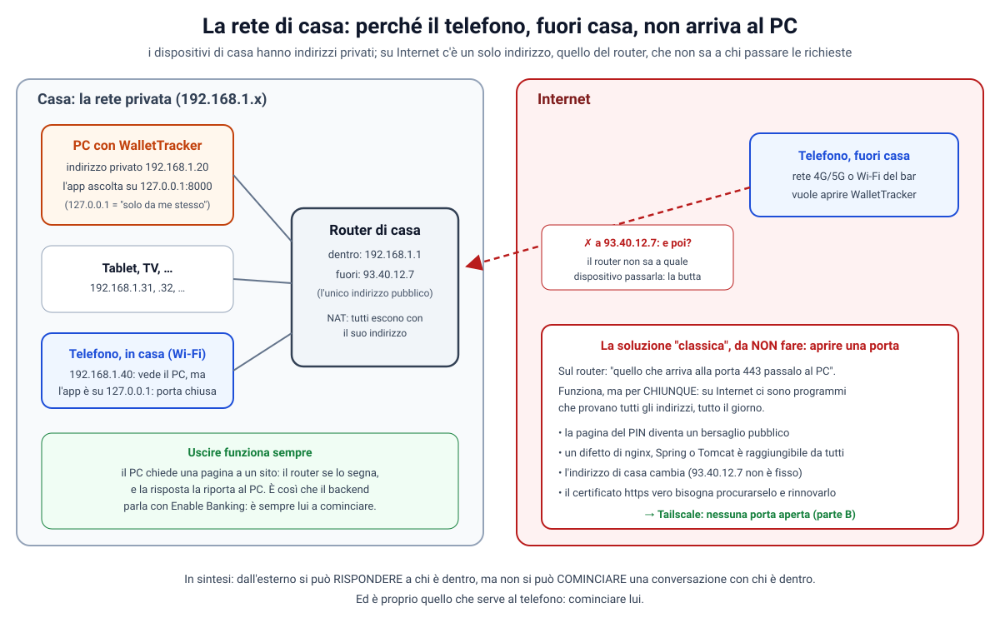
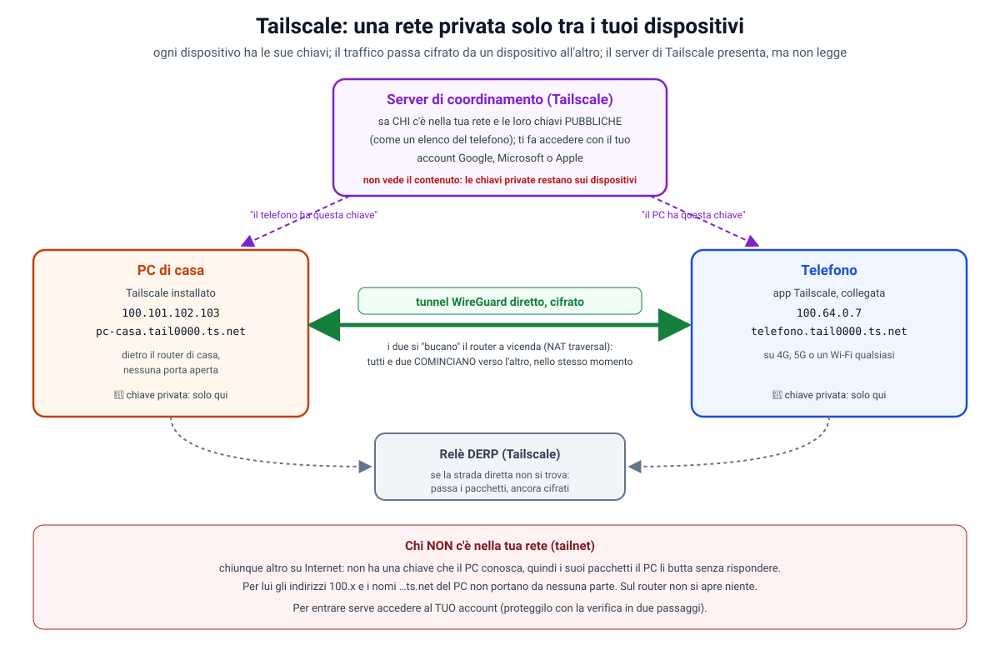
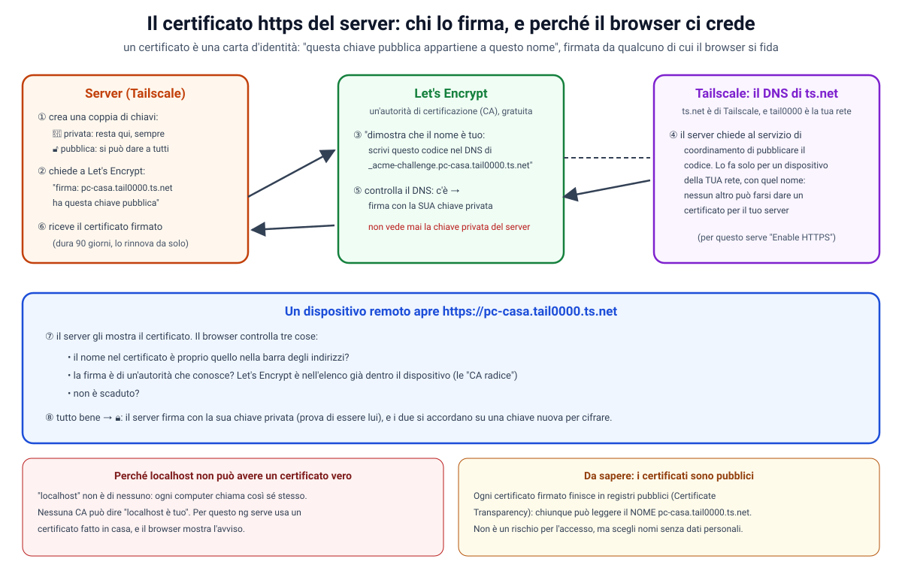
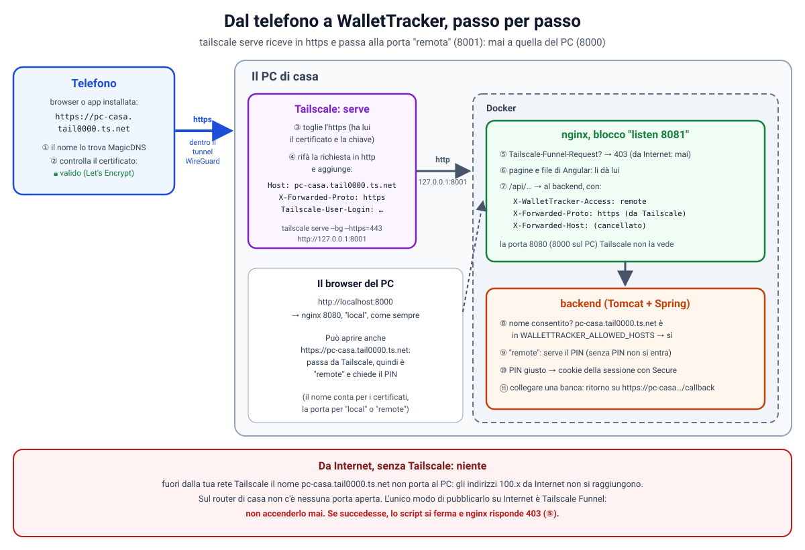

# 47. Fase 4, passo 4: Tailscale, l'app dal telefono con https vero

**Obiettivo di questo passo:** aprire WalletTracker **dal telefono**, da casa e da fuori casa, **senza aprire
nessuna porta sul router** e con un **https vero** (il lucchetto, senza avvisi). Serve anche perché l'app si possa
**installare** sul telefono (`docs/42`, parte F) e perché si possa **collegare una banca** dal telefono.
- Sul PC e sul telefono si installa **Tailscale**: una rete privata, cifrata, solo tra i tuoi dispositivi.
- Sul PC, `./installa.sh --tailscale` (o `installa.ps1 -Tailscale`) fa il resto: chiede a Tailscale di ricevere il
  telefono in https e di passarlo alla porta "remota" dell'app (8001, dove serve sempre il PIN), e scrive nel `.env`
  il nome del PC e l'indirizzo di ritorno di Enable Banking.
- Dal telefono si apre `https://<nome-del-pc>.<la-tua-rete>.ts.net`, si mette il PIN e si entra.

Questa guida parte dalle basi delle reti (indirizzi, router, porte, VPN, certificati): niente è dato per scontato.

| Passo | Che cosa | Stato |
|---|---|---|
| 1 | tre container + Ollama facoltativo, nginx (`docs/44`) | fatto |
| 2 | lo script di installazione, la password del database (`docs/45`) | fatto |
| 3 | entrare nell'app: PIN facoltativo, codice di recupero (`docs/46`) | fatto |
| **4** | **Tailscale: l'app dal telefono con https vero, redirect di Enable Banking** | **questa guida** |
| 5 | backup e ripristino, provato davvero | da fare |
| 6 | aggiornamenti, la guida per chi non è informatico, il doppio clic | da fare |

> Prerequisiti: i passi 1, 2 e 3, e `git pull`. Nessuna migrazione nuova del database. Se l'app è **senza PIN**,
> prima di tutto crea un PIN dal PC (Impostazioni → Accesso): dal telefono senza PIN non si entra (`docs/46`, parte D).

**Che cosa è cambiato nel codice, in breve:**

| Dove | Che cosa |
|---|---|
| `installa.sh`, `installa.ps1` | l'opzione `--tailscale` / `-Tailscale` (parte E3) |
| `frontend/nginx/default.conf` | sulla porta di Tailscale: il protocollo detto da Tailscale (parte G) e Funnel rifiutato (parte F5) |
| `frontend/nginx/wallettracker.conf` | `X-Forwarded-Host` e `X-Forwarded-Port` cancellati: un **difetto di sicurezza** trovato e corretto (parte H) |
| backend: `EnableBankingProperties`, `BankLinkService`, `ConnectionController`, `SetupService` | più indirizzi di ritorno di Enable Banking, scelto quello con il nome giusto (parte I) |
| frontend: Impostazioni | mostra tutti gli indirizzi di ritorno da registrare (parte I4) |
| `.github/workflows/ci.yml`, `.github/ci/tailscale` | le prove nuove, con un finto `tailscale` (parte L) |

**Indice**
- Parte A: le basi delle reti (perché il telefono non arriva al PC)
- Parte B: Tailscale dalle basi
- Parte C: installare Tailscale sul PC
- Parte D: installare Tailscale sul telefono
- Parte E: https vero: certificati, `tailscale serve` e lo script
- Parte F: la sicurezza con Tailscale
- Parte G: il cookie `Secure`, finalmente
- Parte H: il difetto trovato: `X-Forwarded-Host`
- Parte I: collegare una banca dal telefono (più indirizzi di ritorno)
- Parte J: installare l'app sul telefono
- Parte K: usare l'app da fuori casa, giorno per giorno
- Parte L: i test e la CI
- Parte M: verifiche fatte e difetti trovati
- Parte N: la sicurezza di questo passo, e i limiti
- Parte O: prova
- Parte P: problemi comuni
- Esercizi guidati

---

## Parte A: le basi delle reti (perché il telefono non arriva al PC)



### A1. L'indirizzo IP: il numero di telefono di un dispositivo

Perché due dispositivi si parlino, ognuno deve avere un **indirizzo**: l'**indirizzo IP**. È fatto di quattro numeri
da 0 a 255, per esempio `192.168.1.20`. Ogni pacchetto di dati che viaggia in rete ha scritto sopra l'indirizzo di
chi lo manda e quello di chi lo deve ricevere, come una busta.

Sullo stesso indirizzo girano molti programmi: per sapere a quale è destinato il pacchetto c'è anche la **porta**
(`docs/46`, parte C0.1). Indirizzo e porta insieme: `192.168.1.20:8000`.

Un indirizzo speciale è **`127.0.0.1`** (o il suo nome, `localhost`): vuol dire "**me stesso**". Un programma che
ascolta su `127.0.0.1` riceve solo dalle connessioni partite dallo stesso computer. È per questo che le porte di
WalletTracker sono pubblicate su `127.0.0.1` (`docker-compose.yml`): dalla rete di casa non si raggiungono.

### A2. Indirizzi privati e pubblici: il router di casa

Su Internet ogni indirizzo deve essere unico al mondo, come un numero di telefono. Ma gli indirizzi a quattro
numeri sono circa 4 miliardi, meno dei dispositivi esistenti. La soluzione è questa:

- **a casa** i dispositivi usano indirizzi **privati**, che non esistono su Internet e che ogni casa può riusare:
  `192.168.x.x`, `10.x.x.x`, `172.16-31.x.x` (gli stessi di `docs/46`, parte G3.7). Il PC è `192.168.1.20`, il
  telefono sul Wi-Fi `192.168.1.40`, e i tuoi vicini hanno gli stessi numeri a casa loro;
- **il router** è il confine tra casa e Internet. Dentro ha un indirizzo privato (`192.168.1.1`), fuori ha l'**unico
  indirizzo pubblico** della casa, assegnato dal fornitore di Internet (per esempio `93.40.12.7`). Spesso cambia
  nel tempo, e alcuni fornitori lo condividono addirittura tra più case.

### A3. Uscire sì, entrare no: il NAT

Quando il PC chiede una pagina a un sito, il router fa un trucco che si chiama **NAT** (*Network Address
Translation*, traduzione degli indirizzi):
1. riceve il pacchetto del PC (da `192.168.1.20`);
2. sostituisce il mittente con il **suo** indirizzo pubblico (`93.40.12.7`) e si segna: "questa conversazione è del
   PC";
3. quando arriva la risposta, guarda il suo appunto e la passa al PC.

Così **uscire** funziona sempre. È anche il modo in cui il backend parla con Enable Banking: è sempre lui a
cominciare, e le risposte tornano indietro grazie all'appunto del router (`docs/44`, parte A).

Ma se è qualcuno **da fuori** a cominciare? Il telefono, sulla rete 4G, manda un pacchetto a `93.40.12.7`. Il
router non ha nessun appunto per quel pacchetto: non sa a quale dei dispositivi di casa passarlo, e **lo butta**.

> In una frase: dall'esterno si può **rispondere** a chi è dentro, ma non si può **cominciare** una conversazione
> con chi è dentro. Ed è proprio quello che serve al telefono: cominciare lui.

E in casa, sul Wi-Fi? Il telefono (`192.168.1.40`) vede il PC (`192.168.1.20`), ma l'app ascolta solo su
`127.0.0.1`: anche lì, porta chiusa. Lo abbiamo voluto noi, per sicurezza.

### A4. La soluzione "classica", da non fare: aprire una porta sul router

Il router si può configurare così: "quello che arriva da Internet alla porta 443, passalo al PC". Si chiama
**port forwarding** (inoltro di una porta). Funziona, ma per **chiunque**:
- su Internet ci sono programmi che provano **tutti** gli indirizzi, tutto il giorno, in cerca di porte aperte: in
  poche ore qualcuno troverebbe la pagina del PIN e comincerebbe a provare;
- un difetto di nginx, di Tomcat o di Spring, anche uno scoperto domani, sarebbe raggiungibile da tutto il mondo;
- l'indirizzo pubblico cambia: servirebbe anche un servizio che tenga aggiornato un nome;
- per l'https vero servirebbe un certificato da procurarsi e rinnovare (parte E1).

Per un'app con i tuoi conti in banca è un rischio che non vale la pena correre.

### A5. E Cloudflare Tunnel?

Ne abbiamo parlato all'inizio della Fase 4 (`docs/44`, parte A): un tunnel come quello di Cloudflare evita di
aprire porte, ma l'https lo **toglie Cloudflare**, sui suoi server. Quindi Cloudflare vedrebbe in chiaro ogni pagina
e ogni dato che passa: i movimenti, i saldi, il PIN. Con Tailscale (parte B6) i dati viaggiano cifrati da un tuo
dispositivo all'altro, e nessuno in mezzo li può leggere.

### A6. La VPN: un cavo virtuale

Una **VPN** (*Virtual Private Network*, rete privata virtuale) è un "cavo" fatto di software: due dispositivi lontani,
ognuno su una rete qualsiasi, si comportano come se fossero sulla stessa rete privata. Quello che passa nel cavo è
**cifrato**: chi sta in mezzo (il Wi-Fi del bar, il fornitore di Internet) vede passare dati, ma non li può leggere né
modificare.

Le VPN "classiche" hanno un server centrale: tutti si collegano a lui, e il server deve avere una porta aperta su
Internet. Tailscale fa diversamente.

---

## Parte B: Tailscale dalle basi



### B1. Che cos'è

Tailscale è una VPN **a maglia** (*mesh*): non c'è un server centrale da cui passa tutto, ma ogni dispositivo parla
**direttamente** con gli altri. L'insieme dei tuoi dispositivi si chiama **tailnet** (la tua rete Tailscale). Ci
entrano solo i dispositivi su cui hai fatto l'accesso con il **tuo** account.

### B2. WireGuard: la cifratura

Sotto, Tailscale usa **WireGuard**, un protocollo VPN moderno, piccolo e molto studiato. L'idea è quella delle
**chiavi** (le stesse di `docs/45`, parte H, e della chiave di Enable Banking):
- ogni dispositivo crea una **coppia di chiavi**: una **privata**, che non lascia mai il dispositivo, e una
  **pubblica**, che si può dare a tutti;
- quello che si cifra con la chiave pubblica di un dispositivo lo può decifrare solo lui, con la sua privata;
- PC e telefono, conoscendo ognuno la chiave pubblica dell'altro, si costruiscono un canale cifrato che solo loro
  due possono leggere.

### B3. Il server di coordinamento: l'elenco del telefono

Resta un problema: come fa il telefono a sapere la chiave pubblica del PC, e dove si trova? Qui entra il **server di
coordinamento** di Tailscale:
- quando accedi con il tuo account (Google, Microsoft, Apple, GitHub…), il dispositivo gli manda la sua **chiave
  pubblica**;
- il server tiene l'elenco: "nella rete di questo account ci sono il PC, con questa chiave, e il telefono, con
  quest'altra";
- e lo distribuisce ai tuoi dispositivi.

Il server presenta i dispositivi tra loro, ma **non vede il contenuto**: le chiavi private restano sui dispositivi,
e il traffico non passa da lui (quasi mai: vedi B4).

### B4. Come passa il traffico, anche dietro due router

Il PC è dietro il router di casa, il telefono dietro la rete del suo operatore: tutti e due "possono solo uscire"
(parte A3). Il trucco di Tailscale si chiama **NAT traversal** ("attraversare il NAT"): PC e telefono, avvisati dal
server di coordinamento, **cominciano tutti e due**, nello stesso momento, a mandarsi pacchetti. Ognuno dei due
router vede una conversazione "cominciata da dentro", si segna l'appunto, e lascia passare le risposte. Così si apre
una strada diretta, senza toccare la configurazione di nessun router.

Se proprio la strada diretta non si trova (alcune reti aziendali o di albergo), il traffico passa da un **relè**
di Tailscale (si chiama **DERP**), che inoltra i pacchetti **ancora cifrati**: non li può leggere, come un postino
con una busta chiusa. È un po' più lento, ma funziona.

### B5. Gli indirizzi 100.x e i nomi: MagicDNS

Ogni dispositivo della tailnet riceve un indirizzo fisso del tipo **`100.x.y.z`** (per esempio `100.101.102.103`),
che vale solo dentro la tailnet. Gli indirizzi `100.64.0.0`-`100.127.255.255` sono riservati a usi come questo e non
esistono su Internet.

Ricordare numeri è scomodo, quindi Tailscale dà anche dei **nomi**, con **MagicDNS**:
`<nome-del-dispositivo>.<nome-della-tailnet>.ts.net`, per esempio **`pc-casa.tail0000.ts.net`**.
- `pc-casa` è il nome del computer (lo scegli tu, parte C4);
- `tail0000` è il nome della tua tailnet (Tailscale ne assegna uno a caso, del tipo `tail` più numeri e lettere);
- `ts.net` è un dominio di Tailscale.

Il telefono, collegato a Tailscale, scrive quel nome nel browser, e MagicDNS lo traduce nell'indirizzo `100.x` del PC.

### B6. Che cosa vede Tailscale, e di chi ti fidi

Con Tailscale ti fidi di due cose:
1. **del tuo account** (Google, Microsoft, Apple…): chi entra nel tuo account può aggiungere un dispositivo alla tua
   tailnet. Proteggilo con la **verifica in due passaggi**;
2. **del server di coordinamento**: è lui a dire "questa è la chiave del PC". In teoria un server di coordinamento
   malevolo potrebbe presentare una chiave falsa. Tailscale offre una difesa anche contro questo (il **Tailnet
   Lock**, parte N), ma per un uso personale di solito non serve.

**Non** vede il contenuto del traffico, che è cifrato da dispositivo a dispositivo. In più, per WalletTracker c'è
sempre il **PIN**: anche un dispositivo entrato nella tailnet senza permesso troverebbe la pagina del PIN.

### B7. Quanto costa

Per l'uso personale Tailscale ha un piano **gratuito** ("Personal"), con un numero di dispositivi molto più alto di
quello di una famiglia. I limiti cambiano nel tempo: controllali su `tailscale.com/pricing`. A WalletTracker serve
solo il piano gratuito.

---

## Parte C: installare Tailscale sul PC

I nomi dei menu possono cambiare un po' tra una versione e l'altra: qui c'è quello che si vede oggi.

### C1. L'account

1. Apri **tailscale.com** e premi **Get started** (o **Sign up**).
2. Scegli con che cosa accedere: **Google**, **Microsoft**, **Apple** o **GitHub**. Tailscale non ha password sue:
   usa quella dell'account che scegli. Usa lo **stesso** account su tutti i tuoi dispositivi.
3. Alla prima volta Tailscale fa un paio di domande (a che cosa ti serve): rispondi come vuoi, non cambia niente.

### C2. Windows

1. Da **tailscale.com/download** scarica la versione per **Windows** e avvia il file scaricato. Conferma quando
   Windows chiede il permesso di fare modifiche.
2. Alla fine, in basso a destra (vicino all'orologio, a volte sotto la freccina `^`), compare l'**icona di
   Tailscale**. Cliccala e scegli **Log in…**: si apre il browser, accedi con l'account del punto C1 e conferma
   **Connect**.
3. L'icona diventa "attiva". Cliccandola vedi il nome del PC e il suo indirizzo `100.x`.
4. **Importante, perché il PC resta acceso:** nel menu dell'icona apri **Preferences** (o **Settings**) e accendi
   **Run unattended**. Senza, Tailscale si scollega quando esci dal tuo utente di Windows (anche solo con "Esci"), e
   il telefono non troverebbe più il PC.
5. Prova il comando: apri **PowerShell** e scrivi `tailscale status`. Deve mostrare il PC (e, dopo la parte D, il
   telefono). Se dice che il comando non esiste, chiudi e riapri PowerShell.

### C3. macOS e Linux

- **macOS**: da **tailscale.com/download** scarica l'app per Mac (o installala dall'**App Store**), aprila, premi
  **Log in** nell'icona nella barra in alto e accedi. Lo script trova il comando `tailscale` da solo, anche dentro
  l'app (`/Applications/Tailscale.app/...`).
- **Linux**: nel terminale `curl -fsSL https://tailscale.com/install.sh | sh` e poi `sudo tailscale up`, che scrive un
  indirizzo da aprire nel browser per accedere. Perché lo script possa configurare Tailscale senza `sudo`:
  `sudo tailscale set --operator=$USER` (una volta sola).

### C4. Il nome del PC

Il nome del PC nella tailnet è quello del computer (su Windows: Impostazioni → Sistema → Informazioni → **Nome del
dispositivo**). Si cambia anche dalla console di Tailscale (**login.tailscale.com/admin/machines** → i tre puntini
accanto al PC → **Edit machine name…**).

Scegli un nome **neutro**, senza nomi di persona: per esempio `pc-casa`. Il motivo è nella parte E1: il nome del PC
finirà in un registro pubblico dei certificati.

---

## Parte D: installare Tailscale sul telefono

### D1. Android

1. Apri il **Play Store**, cerca **Tailscale** e installala.
2. Aprila, premi **Get started** / **Log in** e accedi con lo **stesso** account del PC.
3. Android chiede il permesso di creare una **connessione VPN**: conferma (**OK**). Tailscale è una VPN, e Android
   lo chiede per qualsiasi VPN.
4. Nell'app vedi l'interruttore acceso e l'elenco dei tuoi dispositivi: c'è anche il PC.

### D2. iPhone

1. Apri l'**App Store**, cerca **Tailscale** e installala.
2. Aprila, premi **Get started** / **Log in** e accedi con lo **stesso** account del PC.
3. iOS chiede di **aggiungere una configurazione VPN**: conferma (**Consenti**) e, se lo chiede, usa il Face ID o il
   codice del telefono.
4. Nell'app l'interruttore è acceso e vedi il PC nell'elenco.

### D3. Controllare che si vedano

Dal PC, in PowerShell o nel terminale:

```
tailscale status
```

Deve mostrare due righe (o più): il PC e il telefono, ciascuno con il suo indirizzo `100.x`. Lo stesso elenco è
nella console, su **login.tailscale.com/admin/machines**.

A questo punto il telefono "vede" il PC, ma l'app non ancora: WalletTracker ascolta solo su `127.0.0.1` (parte A3).
Serve l'ultimo pezzo: `tailscale serve`.

---

## Parte E: https vero: certificati, `tailscale serve` e lo script

### E1. Che cos'è un certificato, dalle basi

Quando il browser apre un indirizzo `https://`, deve essere sicuro di due cose: che la conversazione sia **cifrata**,
e che dall'altra parte ci sia **davvero** il sito che ha chiesto, e non qualcuno che si spaccia per lui. Per la
seconda serve un **certificato**.



Un certificato è una **carta d'identità digitale**: "questa chiave pubblica appartiene a questo nome
(`pc-casa.tail0000.ts.net`)", **firmata** da un'**autorità di certificazione** (CA, *Certificate Authority*). Il
browser non conosce il PC, ma conosce le autorità: nel telefono c'è già un elenco di **CA radice** di cui fidarsi.

Ecco come il PC ottiene il suo (i numeri sono quelli dell'immagine):
1. Tailscale, sul PC, crea una coppia di chiavi: la **privata** resta sul PC, sempre;
2. chiede a **Let's Encrypt**, un'autorità gratuita usata da gran parte di Internet: "firmami un certificato per
   `pc-casa.tail0000.ts.net`, con questa chiave pubblica";
3. Let's Encrypt risponde: "dimostra che il nome è tuo: pubblica questo codice nel DNS, sotto
   `_acme-challenge.pc-casa.tail0000.ts.net`" (si chiama **sfida DNS-01**);
4. il nome `ts.net` è di Tailscale: il PC chiede al server di coordinamento di pubblicare il codice. Lo fa solo per un
   dispositivo della **tua** tailnet, con quel nome: nessun altro può farsi dare un certificato per il tuo PC;
5. Let's Encrypt controlla il DNS, trova il codice e firma;
6. il PC riceve il certificato. Dura 90 giorni, e Tailscale lo rinnova da solo.

Poi, quando il telefono apre l'indirizzo (7-8), il browser controlla che il nome sia quello della barra degli
indirizzi, che la firma sia di un'autorità che conosce e che il certificato non sia scaduto. Se è tutto a posto
mostra il **lucchetto**. Il PC dimostra di essere lui firmando con la sua chiave privata, e i due si accordano su una
chiave nuova per cifrare la conversazione.

**Perché `localhost` non può avere un certificato vero.** `localhost` non è di nessuno: ogni computer chiama così sé
stesso. Nessuna autorità può dire "localhost è tuo". Per questo `ng serve` usava un certificato fatto in casa, con
l'avviso del browser (`docs/42`, parte F), e per questo sul PC l'app è in `http://localhost`.

**Perché all'app serve l'https.** Il browser accende alcune funzioni solo nei "contesti sicuri" (*secure context*):
`https`, oppure `localhost`. Il **service worker** (la copia dei dati e l'installazione, `docs/42`) è una di queste.
Dal telefono l'indirizzo non è `localhost`, quindi senza https l'app non si potrebbe installare, e il cookie della
sessione viaggerebbe senza `Secure` (parte G).

**Da sapere: i certificati sono pubblici.** Ogni certificato firmato da un'autorità finisce in registri pubblici
(*Certificate Transparency*), che servono a scoprire certificati falsi. Chiunque può quindi leggere il **nome**
`pc-casa.tail0000.ts.net`. Non è un rischio per l'accesso (il nome non apre niente, parte F), ma è il motivo per cui
nella parte C4 abbiamo scelto un nome senza dati personali. Tailscale lo spiega anche quando si attiva l'https.

### E2. Attivare MagicDNS e HTTPS nella console

Una volta sola, dalla console di Tailscale:
1. apri **login.tailscale.com/admin/dns**;
2. controlla che **MagicDNS** sia acceso (nelle tailnet nuove lo è già; altrimenti premi **Enable MagicDNS**);
3. più in basso, alla voce **HTTPS Certificates**, premi **Enable HTTPS** e conferma. Qui vedi anche il nome della
   tua tailnet (`tail0000.ts.net` o simile).

Se te ne dimentichi, nessun problema: la prima volta che lo script lancia `tailscale serve`, Tailscale scrive un
indirizzo da aprire per attivare l'https, e aspetta che tu lo faccia.

### E3. Lo script: `--tailscale`



Sul PC, nella cartella del progetto:

```
./installa.sh --tailscale                                         # macOS e Linux
powershell -ExecutionPolicy Bypass -File installa.ps1 -Tailscale  # Windows
```

Lo script fa tutto quello di sempre (`docs/45`) e, prima di avviare l'app, la parte **4c** (`installa.sh`, cerca
`--- 4c.`). Riga per riga:

1. **Trova il comando `tailscale`**: di solito è nel `PATH` (i programmi che si lanciano scrivendo solo il nome);
   altrimenti lo cerca dove lo mette l'installazione (`C:\Program Files\Tailscale\tailscale.exe` su Windows, dentro
   l'app su macOS).
2. **Chiede lo stato** con `tailscale status --json`, cioè in JSON, un formato fatto per i programmi. Due valori:
   - `BackendState` deve essere `"Running"`, cioè collegato. Altrimenti si ferma: "Tailscale è installato ma non
     collegato";
   - `Self.DNSName` è il nome del PC (`Self` = "questo dispositivo"), per esempio `pc-casa.tail0000.ts.net.`, con
     un punto finale che lo script toglie. In PowerShell il JSON diventa un oggetto con `ConvertFrom-Json`; in bash
     lo legge `awk`, che cerca il primo `"DNSName"` dopo `"Self"`.
3. **Controlla che Funnel sia spento** (`tailscale serve status --json`): se no, si ferma. Il perché è nella parte F5.
4. **Lancia `tailscale serve`**:

   ```
   tailscale serve --bg --https=443 http://127.0.0.1:8001
   ```

   - `serve`: "ricevi le connessioni dei miei dispositivi e passale a un programma su questo PC";
   - `--https=443`: ricevile in **https**, sulla porta normale dell'https (443), con il certificato della parte E1:
     così l'indirizzo è `https://pc-casa.tail0000.ts.net`, senza `:numero`;
   - `--bg` (*background*, sullo sfondo): resta acceso da solo, anche dopo un riavvio del PC; non serve una finestra
     aperta;
   - `http://127.0.0.1:8001`: dove passarle. È la porta **"remota"** di nginx (`REMOTE_PORT` nel `.env`, di serie
     8001), dove serve sempre il PIN. **Mai** la 8000, quella "del PC" (parte F1).

   Che cosa fa `tailscale serve` a ogni richiesta (③-④ nell'immagine): toglie l'https, la rifà in **http** verso
   `127.0.0.1:8001` e aggiunge alcune intestazioni. Lo abbiamo verificato nel codice di Tailscale
   (`ipn/ipnlocal/serve.go`): conserva l'intestazione `Host` (il nome `pc-casa.tail0000.ts.net`) e aggiunge
   `X-Forwarded-Proto: https`, `X-Forwarded-For` (l'indirizzo `100.x` del telefono) e `Tailscale-User-Login` (il tuo
   account). Quelle con lo stesso nome mandate dal browser le cancella prima.
5. **Scrive nel `.env`**, solo se mancano:
   - `WALLETTRACKER_ALLOWED_HOSTS=localhost,127.0.0.1,pc-casa.tail0000.ts.net`: i nomi consentiti dal
     "buttafuori" del backend (`LocalOnlyRequestFilter`, `docs/17` n. 3). Senza, ogni richiesta dal telefono
     riceverebbe 403 "indirizzo non consentito";
   - `ENABLE_BANKING_REDIRECT_URL=...,https://pc-casa.tail0000.ts.net/callback`: l'indirizzo di ritorno della banca
     per il telefono (parte I).
6. Poi l'avvio di sempre (`docker compose up -d --build`): il backend riparte con il `.env` nuovo.

Alla fine scrive l'indirizzo da aprire sul telefono e quello da registrare su Enable Banking. Si può rilanciare
quante volte si vuole: se è già tutto pronto, non cambia niente.

### E4. A mano, senza lo script

Le stesse cose, una per una:

```
tailscale status                                         # il nome del PC è nella prima riga
tailscale serve --bg --https=443 http://127.0.0.1:8001   # l'https verso la porta "remota"
tailscale serve status                                   # che cosa sta servendo, per controllare
```

Poi nel `.env` aggiungi il nome a `WALLETTRACKER_ALLOWED_HOSTS` e l'indirizzo di ritorno a
`ENABLE_BANKING_REDIRECT_URL`, e rilancia lo script (o `docker compose up -d`).

Per **spegnere** l'accesso dal telefono: `tailscale serve --https=443 off`. L'app sul PC continua a funzionare.

---

## Parte F: la sicurezza con Tailscale

### F1. Solo la porta "remota": perché non la 8000

Al passo 3 abbiamo diviso l'app su due porte (`docs/46`, parte C): **8000** "dal PC" (dove si può scegliere "senza
PIN" e creare il PIN) e **8001** "da un altro dispositivo" (dove serve sempre il PIN). La differenza la fa **da quale
porta entra la richiesta**, e il browser non la può falsificare.

`tailscale serve` deve quindi puntare **solo** alla 8001. Se puntasse alla 8000, il telefono entrerebbe "come il PC":
con "senza PIN" entrerebbe senza niente, e potrebbe creare lui il PIN. Lo script usa sempre `REMOTE_PORT`, e la CI
controlla che dalla porta 8001 risulti `local:false` (parte L).

### F2. Il PIN dal telefono

Dalla porta 8001 l'app chiede sempre il PIN. Se sul PC hai scelto "senza PIN", dal telefono compare la pagina "Da
qui non si entra" con le istruzioni: crea un PIN dal PC (Impostazioni → Accesso). Tutto il resto del passo 3 vale
uguale: blocco dopo 5 errori, sessione di 12 ore, codice di recupero, "Esci" (`docs/46`).

### F3. Chi entra nella tailnet

Nella tailnet entrano solo i dispositivi su cui hai fatto l'accesso con il tuo account. Tre cose da sapere:
- **non condividere il PC** con altri account (nella console c'è **Share…**): chi lo riceve entrerebbe nella tua
  rete, fino alla pagina del PIN;
- un dispositivo **perso o venduto**: toglilo dalla console (**Machines** → i tre puntini → **Remove…**). Da quel
  momento la sua chiave non vale più. Poi, per sicurezza, cambia il PIN dal PC: le sessioni aperte si chiudono
  (`docs/46`, parte G6);
- le chiavi dei dispositivi **scadono** (di serie dopo 180 giorni): Tailscale chiede di rifare l'accesso. Sul PC, che
  deve restare raggiungibile, puoi disattivare la scadenza (**Machines** → i tre puntini → **Disable key expiry**):
  è comodo, ma vuol dire che quel dispositivo resta nella rete finché non lo togli tu. Sul telefono lasciala accesa.

### F4. Le regole d'accesso (ACL)

Di serie, nella tailnet personale, ogni tuo dispositivo vede tutti gli altri. Tailscale permette di scrivere
regole più strette (**Access controls** nella console): per esempio "il telefono può raggiungere solo la porta 443
del PC". Per una tailnet con soli dispositivi tuoi non serve; diventa utile se un giorno aggiungi dispositivi di
altre persone (esercizio 5).

### F5. Funnel: mai

Tailscale ha anche **Funnel**, che fa il contrario di quello che vogliamo: **pubblica** un servizio su Internet, per
chiunque, senza Tailscale. Per WalletTracker non va **mai** acceso. Le difese sono due, una sopra l'altra:
1. **lo script si ferma** se trova Funnel acceso (`tailscale serve status --json` con `"AllowFunnel"` a `true`) e
   scrive come spegnerlo: `tailscale funnel --https=443 off`;
2. **nginx rifiuta tutto quello che arriva da Funnel.** Dal codice di Tailscale sappiamo che alle richieste arrivate
   da Internet attraverso Funnel aggiunge l'intestazione `Tailscale-Funnel-Request` (dopo aver cancellato quella che
   avesse mandato il browser). Dalla tailnet, invece, quell'intestazione non c'è mai. In `default.conf`, nel blocco
   della porta 8081:

   ```nginx
   if ($http_tailscale_funnel_request) {
       return 403 "WalletTracker non si apre da Internet: spegni Tailscale Funnel: tailscale funnel --https=443 off.\n";
   }
   ```

   - `$http_tailscale_funnel_request` è il modo di nginx di leggere un'intestazione della richiesta: `$http_` più il
     nome in minuscolo, con `_` al posto di `-`;
   - `if (...)` è vero se l'intestazione c'è e non è vuota;
   - `return 403 "..."` risponde subito, prima di qualsiasi `location`: non passano né le pagine né le API.

   Sulla porta 8080 non serve: Tailscale non ci arriva.

### F6. Che cosa resta come prima

- **nessuna porta aperta sul router**: Tailscale non ne ha bisogno (parte B4);
- **porte su `127.0.0.1`**: dalla rete di casa l'app non si raggiunge (il telefono di casa passa anche lui da
  Tailscale);
- **il backend e il database** restano senza porte (`docs/44`).

---

## Parte G: il cookie `Secure`, finalmente

Nella `docs/46` (parte G3.9) avevamo lasciato un conto in sospeso: dal telefono il cookie della sessione doveva
diventare `Secure`, ma il "biglietto" di nginx avrebbe detto `http`.


Il motivo, in breve: `tailscale serve` toglie l'https **prima** di nginx (tratto A → B nell'immagine). nginx vede
http, e `$scheme` vale `http`. Ma ora sappiamo, dal codice di Tailscale, che `tailscale serve` aggiunge
`X-Forwarded-Proto: https`. Quindi sulla porta di Tailscale nginx può credere a Tailscale.

### G1. Il codice

In `default.conf`, fuori dai blocchi `server`:

```nginx
map $http_x_forwarded_proto $tailscale_proto {
    https   https;
    default http;
}
```

Un **`map`** è una tabella: prende un valore (`$http_x_forwarded_proto`, l'intestazione `X-Forwarded-Proto` arrivata
a nginx) e ne calcola un altro (`$tailscale_proto`):
- se è esattamente `https` → `https`;
- qualsiasi altra cosa, o niente (`default`) → `http`.

Così al backend arriva sempre uno dei due valori, mai un testo inventato.

Poi ogni blocco `server` sceglie il suo protocollo, nella variabile `$wallettracker_proto`:

```nginx
server {
    listen 8080;
    set $wallettracker_access local;
    set $wallettracker_proto $scheme;           # porta del PC: il protocollo vero, visto da nginx
    ...
}

server {
    listen 8081;
    set $wallettracker_access remote;
    set $wallettracker_proto $tailscale_proto;  # porta di Tailscale: quello che dice Tailscale
    ...
}
```

e la parte comune (`wallettracker.conf`) lo scrive al backend:

```nginx
proxy_set_header X-Forwarded-Proto $wallettracker_proto;
```

### G2. Perché è sicuro

| Chi | Porta | Che cosa scrive | Che cosa arriva a Tomcat | Cookie |
|---|---|---|---|---|
| browser del PC | 8000 | `X-Forwarded-Proto: https` (finto) | `http` (`$scheme`: il finto non conta) | senza `Secure` |
| `tailscale serve` (il telefono) | 8001 | `X-Forwarded-Proto: https` (vero) | `https` | **`Secure`** |
| browser del PC su `localhost:8001` | 8001 | niente | `http` | senza `Secure` |
| browser del PC su `localhost:8001` | 8001 | `https` scritto a mano | `https` | `Secure`, ma solo per lui |

L'ultima riga è il caso "peggiore", e non fa danni: alla porta 8001 arriva solo chi è già sul PC, e scrivendo
`https` ottiene solo un cookie `Secure` per sé stesso. Non tocca la sessione di nessun altro.

Perché non abbiamo scritto semplicemente `https` fisso sulla porta 8081? Perché la 8001 la usano anche le prove dal
PC e la CI, in http: con un cookie sempre `Secure`, lì non si entrerebbe più (`docs/46`, parte G3.3).

Il resto lo fa Tomcat, come spiegato nella `docs/46` (parte G3.8): crede a `X-Forwarded-Proto` perché arriva da
nginx, un indirizzo della rete di Docker, e con `https` scrive il cookie con `Secure`. Lo abbiamo verificato con il
browser, come un telefono (parte M): `secure = true`.

---

## Parte H: il difetto trovato: `X-Forwarded-Host`

Preparando questo passo ho trovato un difetto di sicurezza che c'era già dal passo 1. Lo raccontiamo per intero,
perché è un ottimo esempio di come si sbaglia con i proxy.

### H1. Il controllo del nome, in breve

Il "buttafuori" del backend (`LocalOnlyRequestFilter`, `docs/17` n. 3) rifiuta ogni richiesta il cui nome (header
`Host`) non sia nell'elenco: `localhost`, `127.0.0.1` e, da questo passo, il nome Tailscale. Serve contro il **DNS
rebinding**: un sito malevolo fa puntare un suo nome (`evil.example`) a `127.0.0.1`; per il browser la sua pagina e
WalletTracker diventano "lo stesso sito", e la pagina potrebbe leggere le risposte. Ma le richieste partono con
`Host: evil.example`, e il buttafuori le rifiuta.

Il nome il buttafuori lo legge con `request.getServerName()`.

### H2. Il difetto

Con `forward-headers-strategy: native` (`docs/46`, parte G3.6) Tomcat legge i "biglietti" dei proxy. Non solo
`X-Forwarded-Proto`: di serie Spring Boot gli fa leggere anche **`X-Forwarded-Host`** e **`X-Forwarded-Port`**
(`server.tomcat.remoteip.host-header` e `port-header`, lo abbiamo controllato nei metadati di Spring Boot 4.1.1). E
se una richiesta arriva da nginx (un indirizzo interno) con `X-Forwarded-Host: localhost`, Tomcat usa **quel** nome
come `getServerName()`.

Il punto è che **nginx, di suo, inoltra tutte le intestazioni del browser**. Noi sostituivamo `Host`,
`X-WalletTracker-Access`, `X-Forwarded-For` e `X-Forwarded-Proto`, ma non `X-Forwarded-Host`. Quindi una pagina con il
DNS rebinding (che, essendo "lo stesso sito", può aggiungere le intestazioni che vuole) poteva scrivere
`X-Forwarded-Host: localhost` e passare il buttafuori. La prova, sull'app vera in Docker, prima della correzione:

```
$ curl -H 'Host: evil.example' http://127.0.0.1:8000/api/auth/status
{"title":"Forbidden","status":403,"detail":"Richiesta rifiutata: indirizzo evil.example non consentito."}

$ curl -H 'Host: evil.example' -H 'X-Forwarded-Host: localhost' http://127.0.0.1:8000/api/auth/status
{"pinSet":false,"withoutPin":false,"authenticated":false,"local":true}
```

**Quanto era grave?** Con il PIN, poco: la pagina malevola non avrebbe avuto il cookie della sessione (il browser lo
manda solo a `localhost`, non a `evil.example`), quindi avrebbe ricevuto 401. Ma con **"senza PIN"** si entra dalla
porta del PC senza cookie (`docs/46`, parte G4.8, caso ⑤): una pagina così avrebbe potuto leggere i tuoi dati. Il
DNS rebinding non è un attacco facile (bisogna visitare una pagina preparata apposta, e i browser hanno qualche difesa
in più), ma era una porta lasciata aperta.

### H3. La correzione

In `wallettracker.conf`, accanto alle altre intestazioni:

```nginx
proxy_set_header X-Forwarded-Host "";
proxy_set_header X-Forwarded-Port "";
```

Per nginx, un valore **vuoto** in `proxy_set_header` vuol dire "**non mandare** questa intestazione": quella del
browser non arriva più al backend. Dopo la correzione, su tutte e due le porte:

```
$ curl -H 'Host: evil.example' -H 'X-Forwarded-Host: localhost' http://127.0.0.1:8000/api/auth/status
{"title":"Forbidden","status":403,"detail":"Richiesta rifiutata: indirizzo evil.example non consentito."}
```

E con Tailscale? `tailscale serve` manda `X-Forwarded-Host` (uguale a `Host`), ma conserva anche `Host`: nginx
cancella la prima e il nome arriva comunque, giusto, nella seconda.

### H4. La lezione

Un proxy davanti a un'applicazione deve decidere, intestazione per intestazione, **che cosa lascia passare**.
Ogni intestazione di cui il backend si fida (`X-Forwarded-*`, `X-WalletTracker-Access`) deve essere **scritta** dal
proxy, mai inoltrata così come arriva dal browser. È lo stesso confine di fiducia della `docs/46` (parte C4): solo
che qui ce n'era una che non avevamo visto. La CI ora lo prova a ogni push (parte L).

---

## Parte I: collegare una banca dal telefono (più indirizzi di ritorno)

### I1. Il problema

Quando colleghi una banca (`docs/13`), l'app ti manda sulla pagina della banca, e alla fine la banca rimanda il
browser all'**indirizzo di ritorno** (*redirect URL*), con un `code`. Quell'indirizzo:
- deve essere **registrato**, uguale carattere per carattere, nella tua applicazione su Enable Banking;
- deve portare **dove è partito il browser**. Se parti dal telefono e la banca ti rimanda a `http://localhost:8000`,
  sul telefono `localhost` è il telefono stesso: pagina non trovata.

Fino a oggi l'indirizzo era **uno solo** (`ENABLE_BANKING_REDIRECT_URL`).

### I2. La soluzione: un elenco, e si sceglie per nome

Ora `ENABLE_BANKING_REDIRECT_URL` può contenere **più indirizzi, separati da virgole**:

```
ENABLE_BANKING_REDIRECT_URL=http://localhost:8000/callback,https://pc-casa.tail0000.ts.net/callback
```

Quando avvii il collegamento, il backend sceglie quello con **lo stesso nome** dell'indirizzo che hai nel browser:
dal PC (`localhost`) il primo, dal telefono (`pc-casa.tail0000.ts.net`) il secondo. Se nessuno coincide, il primo,
come prima.

In `EnableBankingProperties`:

```java
public List<String> redirectUrls() {
    return Arrays.stream(redirectUrl.split(",")).map(String::trim).filter(url -> !url.isEmpty()).toList();
}

public String redirectUrlFor(String host) {
    List<String> urls = redirectUrls();
    return urls.stream().filter(url -> sameHost(url, host)).findFirst().orElse(urls.getFirst());
}
```

- `split(",")` divide il testo alle virgole; `trim()` toglie gli spazi; il `filter` scarta i pezzi vuoti (per
  esempio dopo una virgola finale);
- `sameHost` prende il nome dall'indirizzo con `URI.create(url).getHost()` e lo confronta senza badare a
  maiuscole e minuscole;
- `orElse(urls.getFirst())`: se nessuno coincide, il primo.

E in `ConnectionController` il nome arriva dalla richiesta:

```java
@PostMapping("/connections")
public StartedLink start(@Valid @RequestBody StartLink request, HttpServletRequest httpRequest) {
    return new StartedLink(bankLinkService.start(request.bank(), request.country().toUpperCase(),
            httpRequest.getServerName()));
}
```

`getServerName()` è lo stesso nome già controllato dal buttafuori (parte H): può essere solo uno di quelli consentiti.
E l'indirizzo scelto è sempre uno **dell'elenco nel `.env`**: dal browser non arriva nessun indirizzo, quindi nessuno
può far tornare la banca (con il `code`) su un sito suo.

Il `state` (`docs/13`) resta com'è: è salvato nel backend, non nella sessione, e il collegamento comincia e finisce
sullo stesso dispositivo.

### I3. Che cosa registrare su Enable Banking

Lo script (`--tailscale`) aggiunge da solo l'indirizzo del telefono al `.env`. Su Enable Banking, invece, lo devi
aggiungere tu. Il pannello accetta più indirizzi per la stessa applicazione, e si possono cambiare anche dopo la
registrazione:
1. su **enablebanking.com/cp** apri **API applications** e la tua applicazione (il pulsante per modificarla porta
   alla pagina **Editing application …**);
2. nel riquadro **Allowed redirect URLs (one per line)** scrivi **un indirizzo per riga**: "one per line" vuol dire
   proprio questo. Dopo ogni indirizzo premi **Invio**, e il successivo va sulla riga sotto. Niente virgole, niente
   spazi prima o dopo:

   ```
   https://localhost:8443/callback
   http://localhost:8000/callback
   https://pc-casa.tail0000.ts.net/callback
   ```

   (con il nome vero del tuo PC al posto di `pc-casa.tail0000.ts.net`);
3. premi **Save**.

> **Attenzione:** il riquadro contiene **tutto** l'elenco. Se quando lo apri è vuoto (o mostra solo la scritta
> grigia "Allowed redirect URLs…", che è un suggerimento e non un valore), scrivi **tutti** gli indirizzi che usi,
> anche quelli che avevi già registrato: salvando un riquadro con un indirizzo solo, gli altri smetterebbero di
> valere.

Nel pannello gli indirizzi sono uno per riga, nel `.env` sono separati da virgole: sono lo stesso elenco scritto in
due modi. Conta solo che ogni indirizzo del `.env` sia anche nel pannello, carattere per carattere.

**E l'indirizzo del PC?** Il valore di serie è ancora `https://localhost:8443/callback`, quello di `ng serve` dei passi
precedenti. Con l'app in Docker, dal PC l'indirizzo giusto è `http://localhost:8000/callback` (`docs/44`, parte H):
se Enable Banking lo accetta, registralo e mettilo al posto del primo nel `.env`. Lo script non lo cambia da solo, per
non toccare quello che hai già registrato.

### I4. La pagina Impostazioni

La pagina Impostazioni (sezione Enable Banking) mostra **tutti** gli indirizzi da registrare, uno per riga, ognuno
con il suo pulsante **copia**. Il backend li manda in un campo nuovo, `redirectUrls` (`SetupService.SetupStatus`);
`redirectUrl` resta, con il primo, per compatibilità. Nel template:

```html
@for (url of status.redirectUrls; track url) {
  <span class="redirect-url">
    <code>{{ url }}</code>
    <button type="button" class="link" (click)="copyRedirectUrl(url)">
      {{ copied() === url ? 'copiato ✓' : 'copia' }}
    </button>
  </span>
}
```

`copied` ora ricorda **quale** indirizzo è stato copiato (un testo, non più vero/falso), così "copiato ✓" compare
accanto a quello giusto.

---

## Parte J: installare l'app sul telefono

Con l'https vero l'app si installa come un'app vera (`docs/42`, parte F): icona sulla schermata, si apre a tutto
schermo, e mostra gli ultimi dati anche senza rete.

**Android (Chrome):**
1. con Tailscale acceso, apri `https://pc-casa.tail0000.ts.net` ed entra con il PIN;
2. menu **⋮** in alto a destra → **Installa app** (o **Aggiungi a schermata Home** → **Installa**).

**iPhone (Safari):** l'installazione su iPhone si fa solo da Safari.
1. con Tailscale acceso, apri l'indirizzo in **Safari** ed entra con il PIN;
2. pulsante **Condividi** (il quadrato con la freccia in su) → **Aggiungi alla schermata Home** → **Aggiungi**.

L'app installata usa lo stesso indirizzo: Tailscale deve essere acceso anche per lei. Senza rete, o con il PC spento,
mostra gli ultimi dati scaricati, se li hai visti nelle ultime 12 ore (`docs/46`, parte J).

---

## Parte K: usare l'app da fuori casa, giorno per giorno

- **Tailscale acceso sul telefono.** Se l'app dice che il PC non risponde, guarda prima l'app Tailscale:
  l'interruttore deve essere acceso. Su Android puoi renderlo permanente (Impostazioni di Android → Rete → VPN →
  Tailscale → **VPN sempre attiva**); su iPhone, nell'app Tailscale, c'è l'opzione **VPN On Demand**.
- **Anche a casa passa da Tailscale.** Sul Wi-Fi di casa il telefono usa lo stesso indirizzo `…ts.net`: Tailscale
  trova da solo la strada più corta (diretta, in casa).
- **La batteria.** Tailscale consuma poco: manda pacchetti solo quando li usi.
- **Il PC deve essere acceso, con Docker e Tailscale avviati.** Con "Run unattended" (parte C2) Tailscale riparte
  da solo; `tailscale serve --bg` si ricorda la configurazione anche dopo un riavvio; Docker Desktop va impostato per
  partire all'avvio (Impostazioni di Docker Desktop → **General** → **Start Docker Desktop when you sign in**).

---

## Parte L: i test e la CI

### L1. Backend

- `EnableBankingPropertiesTest` (nuovo, 2 test): un indirizzo solo funziona come prima; con più indirizzi si sceglie
  quello con lo stesso nome (anche con le maiuscole), e se il nome non c'è (o manca) il primo.
- `BankLinkServiceTest`: `start(...)` riceve il nome; l'indirizzo mandato a Enable Banking è quello giusto.
- `SetupControllerTest`: `GET /api/setup` restituisce anche `redirectUrls`.

### L2. Frontend

- `settings-page.spec.ts`: un test nuovo, con due indirizzi (PC e Tailscale): li mostra tutti e due, ognuno con il
  suo "copia", e la frase al plurale.

### L3. La CI: le intestazioni

Nel job "Installazione con Docker" c'è un passo nuovo, **Intestazioni di Tailscale e intestazioni false**, sull'app
vera in Docker:
1. `Host: evil.example` con `X-Forwarded-Host: localhost`, sulla 8000 e sulla 8001: **403** (parte H);
2. entrare con il PIN dalla 8001 con `X-Forwarded-Proto: https` (come `tailscale serve`): il cookie ha `Secure`;
3. dalla 8000 con un `https` scritto a mano: **niente** `Secure`; dalla 8001 in http: niente `Secure` (parte G2);
4. `Tailscale-Funnel-Request: ?1` sulla 8001, anche per la pagina principale: **403** (parte F5).

Un dettaglio di bash che vale la pena conoscere: per controllare "non c'è `Secure`" non si può scrivere
`! grep -q Secure`. Con `set -e` (che la CI usa sempre) una riga che comincia con `!` **non fa mai fallire** lo
script, nemmeno quando il controllo non va: il test sarebbe sempre verde. Si scrive invece
`if echo "$cookie" | grep -q 'Secure'; then exit 1; fi`.

### L4. La CI: lo script con un finto `tailscale`

Nella CI non c'è un account Tailscale. Per provare lo script c'è un **finto** `tailscale`, `.github/ci/tailscale`: un
piccolo script bash che risponde a `status --json` e a `serve status --json` con dati inventati, **nella stessa forma**
del JSON vero, e si segna la chiamata `serve --bg`. Il passo **Installazione con --tailscale** lo mette per primo nel
`PATH` e lancia `./installa.sh --tailscale`, poi controlla:
- che `tailscale serve` sia stato chiamato con `--bg --https=443 http://127.0.0.1:8001`;
- che nel `.env` ci siano il nome del PC e l'indirizzo di ritorno;
- che il backend, ripartito, accetti il nome Tailscale (`local:false`, dalla 8001).

Il finto `tailscale` prova **il nostro script**, non Tailscale: che Tailscale faccia davvero quello che diciamo
l'abbiamo controllato nel suo codice (parte E3), e lo proverai tu dal telefono (parte O).

---

## Parte M: verifiche fatte e difetti trovati

**Fatto, qui nel cloud:**
- **backend**: 345 test, 1 saltato come prima, nessun errore;
- **frontend**: 212 test, `ng build`, `prettier --check`;
- **i comandi della CI** del job Docker, eseguiti qui uno per uno su un'installazione da zero: tutti passati;
- **un finto `tailscale serve`**: un piccolo proxy https (Node.js) che fa quello che fa `tailscale serve` secondo il
  suo codice (conserva `Host`, aggiunge `X-Forwarded-Proto: https`, `X-Forwarded-For`, `Tailscale-User-Login`; su una
  seconda porta anche `Tailscale-Funnel-Request`), con un certificato fatto in casa per `pc-casa.tail0000.ts.net`;
- **Chromium come un telefono** (Pixel 7) su `https://pc-casa.tail0000.ts.net`, attraverso il finto `tailscale serve`:
  pagina del PIN, accesso, riepilogo; cookie della sessione `secure = true`, `httpOnly = true`, `sameSite = Strict`;
  service worker registrato (`isSecureContext = true`), quindi l'app è installabile; Impostazioni con i due indirizzi
  di ritorno; nessun errore nella console;
- **Funnel**: pagine e API rispondono 403 con il messaggio;
- **gli script**: `installa.sh` e `installa.ps1` (con PowerShell) con il finto `tailscale`: nome trovato, `.env`
  aggiornato, rilanciati non aggiungono niente due volte; i tre casi d'errore (Tailscale assente, non collegato,
  Funnel acceso) danno il messaggio giusto.

**Non fatto, e lo devi provare tu (parte O):** il vero Tailscale. Qui non c'è un account, né un telefono. Le parti
che dipendono da lui (l'accesso, l'https con il certificato vero, `tailscale serve` sul tuo sistema operativo, il
pannello di Enable Banking) le ho preparate leggendo il codice di Tailscale, ma la prova vera è la tua.

**Difetti trovati provando:**
1. **`X-Forwarded-Host` lasciato passare da nginx**: il buttafuori si poteva aggirare. Era così dal passo 1. Corretto
   (parte H), con la prova nella CI.
2. **Il passo della CI scritto con `! grep`** non avrebbe mai fallito: riscritto con `if` (parte L3). L'ho trovato
   rileggendolo prima di eseguirlo.
3. **Il messaggio di Funnel in nginx** suggeriva `tailscale funnel reset`, che cancella anche la configurazione di
   `serve`: ora dice `tailscale funnel --https=443 off`, come lo script.
4. **Una frase sbagliata nella `docs/46`** (corretta già prima di questo passo, parte G3.9): il cookie non sarebbe
   diventato `Secure` "senza toccare niente".
5. Nelle mie prove: `curl` passava dal proxy del cloud e il finto `tailscale serve` non riceveva niente; e un `pkill`
   con il nome del file nel comando ha fermato la mia stessa shell. Niente a che vedere con l'app, ma è il tipo di
   cosa che fa perdere tempo: se una prova "non risponde", controlla prima la strada.

---

## Parte N: la sicurezza di questo passo, e i limiti

| Protezione | Contro che cosa | Dove |
|---|---|---|
| nessuna porta sul router, solo Tailscale | chiunque su Internet | parte B |
| `tailscale serve` solo verso la porta "remota" | il telefono che entra "come il PC" | script, parte F1 |
| Funnel rifiutato (script e nginx) | l'app pubblicata su Internet per sbaglio | parte F5 |
| `X-Forwarded-Host` e `-Port` cancellati | DNS rebinding verso l'app "senza PIN" | parte H |
| `X-Forwarded-Proto` da Tailscale solo sulla 8001, solo `https`/`http` | cookie senza `Secure` dal telefono | parte G |
| indirizzo di ritorno solo dall'elenco del `.env` | la banca che rimanda il `code` a un altro sito | parte I |

Sono le righe **39-43** della tabella della sicurezza (`docs/17`).

**I limiti, detti chiari:**
- **Ti fidi di Tailscale** per due cose: l'accesso al tuo account e il server di coordinamento (parte B6). Il
  contenuto non lo vede. Se vuoi togliere anche la seconda fiducia, Tailscale ha il **Tailnet Lock**: i nuovi
  dispositivi devono essere firmati da uno dei tuoi (si attiva dalla console, **Settings** → **Tailnet lock**).
  Per un uso personale è facoltativo.
- **Un dispositivo della tailnet arriva fino alla pagina del PIN.** Il PIN, il blocco dopo 5 errori e la sessione di
  12 ore restano la difesa (`docs/46`).
- **Il nome del PC è pubblico** (Certificate Transparency, parte E1). Il nome non apre niente; scegli un nome neutro.
- **L'identità di Tailscale non la usiamo.** `tailscale serve` dice anche **chi** è (`Tailscale-User-Login`). Si
  potrebbe usare per entrare senza PIN dai tuoi dispositivi, ma vorrebbe dire fidarsi di un'intestazione che sulla
  porta 8001 può scrivere anche chi è sul PC: abbiamo preferito il PIN (esercizio 4).

---

## Parte O: prova

Sul PC:
1. `git pull`, poi Tailscale installato e collegato (parte C), e MagicDNS e HTTPS attivati (parte E2).
2. Se l'app è "senza PIN", crea un PIN: Impostazioni → Accesso → **Proteggi con un PIN**.
3. Lancia lo script con l'opzione nuova:
   - Windows: `powershell -ExecutionPolicy Bypass -File installa.ps1 -Tailscale`
   - macOS/Linux: `./installa.sh --tailscale`

   Alla fine scrive: `Dai tuoi dispositivi con Tailscale:  https://<nome>.<rete>.ts.net`.
4. Controlla: `tailscale serve status` deve mostrare `https://<nome>.<rete>.ts.net` → `http://127.0.0.1:8001`.

Sul telefono:
5. Tailscale installato, collegato con lo stesso account (parte D).
6. Apri `https://<nome>.<rete>.ts.net`: deve comparire il **lucchetto**, senza avvisi, e la pagina **Inserisci il
   PIN**. Metti il PIN: sei dentro.
7. **Fuori casa**: spegni il Wi-Fi del telefono (solo rete mobile) e ricarica: deve funzionare uguale.
8. **Senza Tailscale**: spegni l'interruttore di Tailscale e ricarica: l'indirizzo non deve aprirsi. Riaccendilo.
9. Installa l'app (parte J) e aprila dall'icona.
10. Facoltativo: aggiungi l'indirizzo di ritorno su Enable Banking (parte I3) e prova **Collega una banca** (o
    **Ricollega**) dal telefono: alla fine devi tornare sull'app, sul telefono.

Se va tutto, scrivimi "Funziona, passiamo al passo 5". Se qualcosa non va, la parte P ha i casi più comuni; mandami
il messaggio esatto (senza dati personali).

---

## Parte P: problemi comuni

| Che cosa vedi | Perché | Che cosa fare |
|---|---|---|
| lo script: "Non trovo Tailscale" | non installato, o non nel `PATH` | installalo (parte C); su Windows chiudi e riapri PowerShell |
| lo script: "installato ma non collegato" | non hai fatto l'accesso, o è in pausa | apri Tailscale → **Log in** / **Connect** |
| lo script: "Non trovo il nome del PC" | MagicDNS spento | console → **DNS** → **Enable MagicDNS** (parte E2) |
| lo script resta fermo dopo "Chiedo a Tailscale…" e mostra un indirizzo | l'https non è ancora attivo nella tailnet | apri l'indirizzo, attiva, e lo script prosegue |
| Linux: `tailscale serve` "access denied" | serve il permesso di configurare Tailscale | `sudo tailscale set --operator=$USER` e rilancia |
| lo script: "Funnel è acceso" | Funnel pubblicherebbe l'app su Internet | `tailscale funnel --https=443 off` e rilancia |
| telefono: la pagina non si apre | Tailscale spento sul telefono, o il PC spento/scollegato | accendi l'interruttore; sul PC `tailscale status`; "Run unattended" (parte C2) |
| telefono: avviso sul certificato | stai usando l'indirizzo `100.x` invece del nome | usa `https://<nome>.<rete>.ts.net`: il certificato vale per il nome |
| telefono: 403 "indirizzo … non consentito" | il nome non è in `WALLETTRACKER_ALLOWED_HOSTS` | rilancia lo script con `--tailscale` (o aggiungilo a mano e riavvia) |
| telefono: 403 "non si apre da Internet" | stai passando da Funnel | spegni Funnel (sopra) |
| telefono: "Da qui non si entra" | l'app è "senza PIN" | crea un PIN dal PC (Impostazioni → Accesso) |
| 502 Bad Gateway sull'indirizzo `…ts.net` | `tailscale serve` punta a una porta dove non c'è nessuno | `docker compose ps`: l'app è avviata? `REMOTE_PORT` è quella giusta? |
| dopo la banca: errore sul `redirect_url` | l'indirizzo non è registrato su Enable Banking | aggiungilo nel pannello, uguale (parte I3) |
| dopo la banca, sul telefono: "pagina non trovata" su `localhost` | è stato scelto l'indirizzo del PC | nel `.env` manca quello Tailscale: rilancia lo script con `--tailscale` |

---

## Esercizi guidati

1. **Leggere lo stato di Tailscale.** Lancia `tailscale status --json` e trova `BackendState`, `Self.DNSName`,
   `Self.TailscaleIPs` e l'elenco `Peer`. Poi apri `installa.sh` (parte `4c.`) e segui come `awk` arriva al nome.
   Che cosa succederebbe se cercasse il **primo** `"DNSName"` senza guardare `"Self"`?
2. **Il `map` di nginx.** Dal PC, con l'app avviata, prova:
   `curl -s -D - -o /dev/null -H 'X-Forwarded-Proto: HTTPS' http://localhost:8001/api/auth/status`. Il cookie
   `XSRF-TOKEN` è `Secure`? (Sì: nel `map` nginx confronta i testi senza badare a maiuscole e minuscole, lo dice la
   sua documentazione, e anche Tomcat accetta `HTTPS`.) Prova poi `-H 'X-Forwarded-Proto: ftp'`: che cosa arriva al
   backend, e perché? Infine la stessa prova sulla porta 8000: che cosa cambia?
3. **Il difetto della parte H, da te.** Con l'app avviata, prova i due `curl` della parte H2 sulla 8000. Poi, in una
   copia del progetto, togli le due righe `proxy_set_header X-Forwarded-...  "";`, ricostruisci `web`
   (`docker compose build web && docker compose up -d web`) e riprova. Rimetti le righe.
4. **L'identità di Tailscale.** `tailscale serve` aggiunge `Tailscale-User-Login`. Perché non possiamo usarla per far
   entrare senza PIN dai tuoi dispositivi? (Suggerimento: chi può scrivere quell'intestazione sulla porta 8001, oltre
   a Tailscale? E se un giorno qualcuno mettesse un altro proxy davanti alla 8001?)
5. **Le ACL.** Nella console di Tailscale apri **Access controls** e leggi la regola di serie. Scrivi (senza salvarla,
   se non sei sicuro) una regola che permetta al telefono di raggiungere **solo** la porta 443 del PC.
6. **Un dispositivo perso.** Simula: dal PC togli il telefono dalla console (**Remove…**). Che cosa vede il telefono
   aprendo l'indirizzo? Poi ricollegalo con l'app Tailscale. Che cosa dovresti fare, in più, se il telefono fosse
   davvero perso? (Suggerimento: `docs/46`, parte G6.)
7. **Più indirizzi di ritorno.** Leggi `EnableBankingPropertiesTest` e aggiungi un test: con
   `ENABLE_BANKING_REDIRECT_URL` vuoto dopo una virgola (`"https://a.example/callback,"`) l'elenco ha un solo
   indirizzo. Poi pensa: che cosa succede se l'elenco è **tutto** vuoto? (Suggerimento: `@NotBlank`.)
