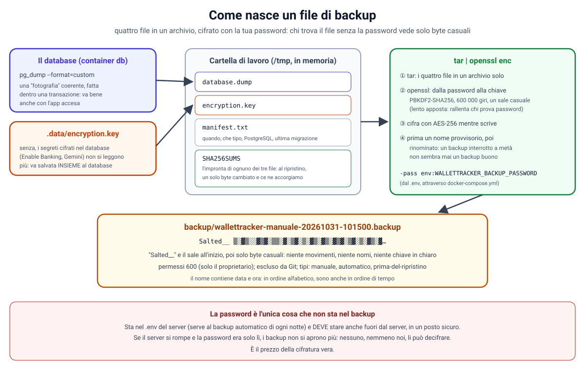
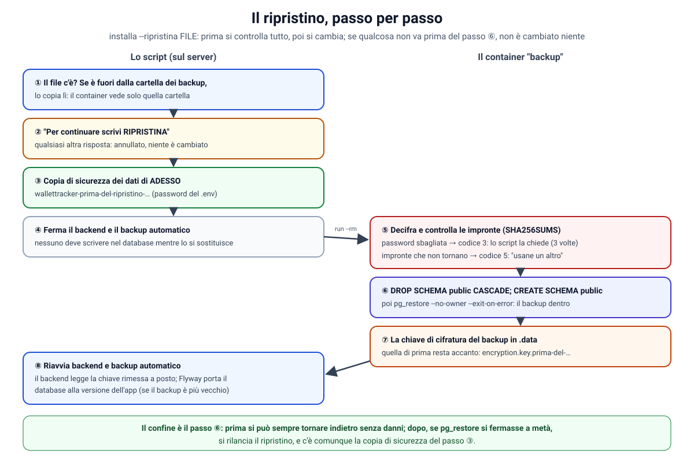
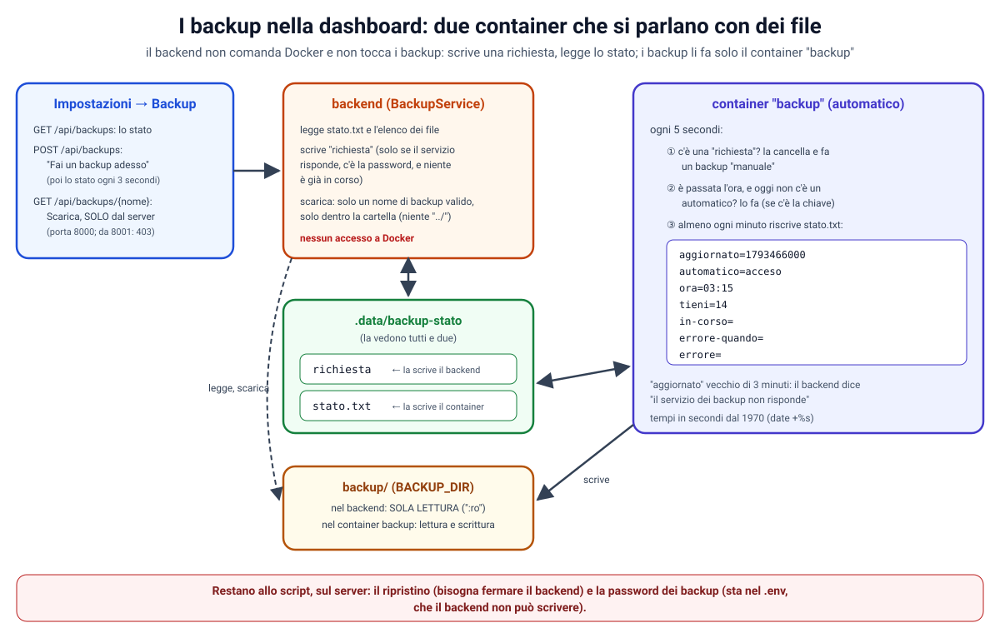

# 48. Fase 4, passo 5: backup e ripristino (provato davvero)

**Obiettivo di questo passo:** non perdere mai i dati di WalletTracker, e saperli rimettere a posto.
- **Un comando** fa un backup: `installa -Backup` (Windows) o `./installa.sh --backup` (macOS, Linux). La prima volta
  chiede la **password dei backup**.
- **Ogni notte** un container fa un backup da solo, e tiene gli ultimi 14.
- **Un comando** ripristina: `installa -Ripristina <file>`. Chiede conferma, fa prima una copia di sicurezza dei dati di
  adesso, e solo dopo sostituisce.
- Ogni backup è **un file cifrato** con la tua password: chi lo trova senza la password non legge niente.
- Il ripristino è **provato davvero**, a ogni push, nella CI: si cancella tutto e si ripristina.
- Nella **dashboard**, Impostazioni → Backup: lo stato dei backup, "Fai un backup adesso", e "Scarica" (solo dal
  server); un avviso in cima all'app se c'è qualcosa da sistemare (parte Q).

Le parole sono quelle della `docs/47`: il **server** è la macchina su cui gira Docker con WalletTracker.

| Passo | Che cosa | Stato |
|---|---|---|
| 1 | tre container + Ollama facoltativo, nginx (`docs/44`) | fatto |
| 2 | lo script di installazione, la password del database (`docs/45`) | fatto |
| 3 | entrare nell'app: PIN facoltativo, codice di recupero (`docs/46`) | fatto |
| 4 | Tailscale: l'app dai dispositivi remoti con https vero (`docs/47`) | fatto |
| **5** | **backup e ripristino, provato davvero** | **questa guida** |
| 6 | aggiornamenti, la guida per chi non è informatico | da fare |

> Prerequisiti: i passi 1-4 e `git pull`. Nessuna migrazione nuova del database. Lo script costruisce un'immagine
> in più (`backup`) e avvia un container in più.

**Le scelte fatte insieme:**

| Domanda | Scelta |
|---|---|
| il file di backup è protetto? | sì: **cifrato con una password tua** |
| backup automatico? | sì: **ogni notte**, tiene gli ultimi 14 |
| dove vanno i backup? | la cartella `backup/` del progetto, oppure un'altra scritta nel `.env` (`BACKUP_DIR`) |
| come si lanciano? | **opzioni dello script** di sempre: `-Backup`, `-Ripristina <file>` |

**Che cosa è cambiato:**

| Dove | Che cosa |
|---|---|
| `docker/backup/Dockerfile`, `docker/backup/wallettracker-backup.sh` | il container `backup` e il suo script: `crea`, `verifica`, `ripristina`, `automatico` |
| `docker-compose.yml` | il servizio `backup` |
| `installa.sh`, `installa.ps1` | `--backup` / `-Backup`, `--ripristina` / `-Ripristina`, la password dei backup |
| `.env.example` | `WALLETTRACKER_BACKUP_PASSWORD`, `BACKUP_DIR`, `BACKUP_TIME`, `BACKUP_KEEP` |
| `.gitignore` | `/backup/` e `*.backup`: i backup non vanno mai su Git |
| `.github/workflows/ci.yml` | quattro prove nuove: backup, ripristino dopo aver cancellato tutto, backup automatico, backup dalla dashboard |
| backend: `backup/BackupService`, `BackupController`, `BackupProperties` | le API dei backup per la dashboard (parte Q) |
| frontend: `settings/backup-section.ts`, `api/backup-store.ts`, `app.html` | la sezione Backup delle Impostazioni, e l'avviso in cima all'app |
| `frontend/nginx/wallettracker.conf` | `location ^~ /api/`: un difetto trovato provando lo scaricamento (parte Q6) |

**Indice**
- Parte A: i backup, dalle basi
- Parte B: che cosa si salva, e che cosa no
- Parte C: salvare un database: `pg_dump`
- Parte D: la cifratura del backup, dalle basi
- Parte E: il container `backup`
- Parte F: dove tenere i backup
- Parte G: il backup automatico
- Parte H: fare un backup: `-Backup`
- Parte I: il ripristino, passo per passo
- Parte J: spostare WalletTracker su un altro computer (il server vero)
- Parte K: backup e versioni dell'app
- Parte L: i test e la CI
- Parte M: verifiche fatte e difetti trovati
- Parte N: la sicurezza di questo passo, e i limiti
- Parte O: prova
- Parte P: problemi comuni
- Parte Q: i backup nella dashboard
- Esercizi guidati

---

## Parte A: i backup, dalle basi

### A1. Che cosa può andare storto

Un **backup** è una copia dei dati, fatta per poterli rimettere com'erano. Serve quando succede una di queste cose:
- il **disco si rompe**, o il computer viene rubato, o cade;
- **cancelli qualcosa per sbaglio** (un conto, una categoria con tutte le sue regole);
- un **aggiornamento** va storto (una migrazione nuova che rovina i dati);
- un **virus** cifra i file del computer e chiede un riscatto;
- **cambi computer**, per esempio passi dal PC di sviluppo al server vero (parte J).

### A2. Una copia sincronizzata non è un backup

Una cartella sincronizzata (OneDrive, Google Drive, Dropbox) **copia anche gli errori**: se cancelli un file, sparisce
anche dall'altra parte; se un virus lo cifra, si sincronizza la versione cifrata. Un backup vero è una **fotografia
datata**: quella di ieri resta com'era ieri, qualunque cosa succeda oggi. Per questo i backup hanno la data nel nome e
se ne tengono **parecchi** (gli ultimi 14 automatici, più quelli fatti a mano).

Mettere i **file di backup** in una cartella sincronizzata invece va benissimo (parte F): è un modo comodo di
portarli fuori dal server.

### A3. La regola del 3-2-1

È la regola classica di chi si occupa di backup:
- **3** copie dei dati: i dati veri più due backup;
- su **2** supporti diversi: per esempio il disco del server e un disco esterno;
- **1** copia fuori casa: per esempio nel cloud, o il disco esterno a casa di un parente.

Un backup che sta solo sul disco del server non ti salva se il disco si rompe. Per questo la cartella dei backup si
può spostare (parte F).

### A4. Un backup mai ripristinato è solo una speranza

Un backup serve solo se **si ripristina**. Molti scoprono che i loro backup erano vuoti, o incompleti, o senza la
password, proprio il giorno in cui servono. Per questo:
- il ripristino è **provato nella CI** a ogni push: si fa un backup, si cancellano database e chiave, si ripristina,
  e si controlla che il PIN e un segreto cifrato funzionino ancora (parte L);
- l'esercizio 1 ti chiede di provarlo anche tu.

---

## Parte B: che cosa si salva, e che cosa no

| Che cosa | Dove sta | Nel backup? | Perché |
|---|---|---|---|
| **il database** | volume Docker `wallettracker_db-data` | **sì** | tutto: conti, movimenti, categorie, regole, budget, impostazioni, l'hash del PIN, i segreti cifrati |
| **la chiave di cifratura** | `.data/encryption.key` | **sì** | i segreti nel database (la chiave privata di Enable Banking, quella di Gemini) sono cifrati con lei (`docs/17` n. 5): un database senza la sua chiave è un database con i segreti illeggibili |
| il `.env` | cartella del progetto | no | la password del database non serve per ripristinare (il backup si carica nel database di adesso, con la password di adesso); il resto (indirizzi di ritorno, nomi consentiti, password dei backup) lo rifanno lo script e `--tailscale` |
| `secrets/*.pem` | cartella del progetto | no | solo se le credenziali di Enable Banking sono nel `.env` invece che in Impostazioni: in quel caso, copia il file tu |
| il modello di Ollama | volume `ollama-data` | no | si riscarica da Impostazioni |

**Perché la chiave sta nel backup, se l'avevamo tenuta separata dal database?** La `docs/17` diceva: chi ottiene solo
il database non legge i segreti, perché la chiave sta altrove. Mettendole insieme in un file, quella protezione si
perde. È proprio per questo che il backup è **cifrato**: la protezione passa dalla chiave tenuta separata alla
**password** tenuta separata (parte D). Senza la chiave nel backup, invece, un server rotto vorrebbe dire segreti
persi per sempre.

---

## Parte C: salvare un database: `pg_dump`

### C1. Perché non copiare i file del volume

PostgreSQL tiene i dati in tanti file, e li scrive continuamente, un pezzo alla volta. Copiare quei file mentre il
database lavora dà una copia **incoerente**: metà scritta prima di una modifica, metà dopo. Ripristinata, potrebbe non
partire, o avere dati a metà. Si potrebbe fermare tutto e copiare, ma c'è un modo migliore.

### C2. La fotografia coerente

**`pg_dump`** è il programma di PostgreSQL che fa un backup "logico": legge le tabelle e scrive un file con tutto
quello che serve per ricrearle. Lo fa dentro **una sola transazione**, con un'**istantanea** (*snapshot*) del database
presa all'inizio: vede i dati esattamente come erano in quel momento, anche se nel frattempo il backend scrive. Per
questo il backup si fa **con l'app accesa**, anche di notte durante una sincronizzazione.

### C3. Il formato "custom" e `pg_restore`

```bash
pg_dump --format=custom --file="$lavoro/database.dump"
```

- `--format=custom`: un file **compresso**, che si ricarica con **`pg_restore`** (con il formato di testo si userebbe
  `psql`). Ha due vantaggi: è piccolo, e `pg_restore` lo legge in modo intelligente (prima le tabelle, poi i dati,
  poi gli indici e i vincoli);
- l'indirizzo del database, l'utente e la password non sono scritti qui: `pg_dump` li legge dalle variabili
  d'ambiente `PGHOST`, `PGDATABASE`, `PGUSER` e `PGPASSWORD`, che arrivano da `docker-compose.yml` (parte E2).

### C4. Stessa versione del database

`pg_dump` deve essere della stessa versione del server PostgreSQL, o più nuovo: un `pg_dump` più vecchio si rifiuta
di lavorare. Per questo il container `backup` parte dalla **stessa immagine** del database (`postgres:18-alpine`): il
server PostgreSQL che contiene non si avvia mai, ci servono solo i suoi programmi.

---

## Parte D: la cifratura del backup, dalle basi



### D1. Perché cifrare

Il file di backup contiene **tutto**: i tuoi movimenti, e la chiave che apre i segreti (parte B). E un backup, per
servire, deve finire **fuori dal server** (parte A3): un disco esterno che si può perdere, una cartella nel cloud che
qualcuno potrebbe leggere. Cifrandolo con una password che non sta nel file, chi lo trova vede solo byte casuali.

### D2. AES-256: la stessa chiave chiude e apre

La cifratura che usiamo è **simmetrica**: la stessa chiave cifra e decifra (come la cifratura dei segreti nel database,
`SecretCipher`). L'algoritmo è **AES** con una chiave da **256 bit**: lo standard usato ovunque, dalle banche ai
telefoni. Il programma che lo fa è **OpenSSL**, che nel container cifra mentre scrive:

```bash
tar -C "$lavoro" -cf - database.dump encryption.key manifest.txt SHA256SUMS |
  openssl enc -aes-256-cbc -pbkdf2 -iter "$ITERAZIONI" -md sha256 -salt \
    -pass env:WALLETTRACKER_BACKUP_PASSWORD -out "$CARTELLA/.$nome.in-corso"
```

- `tar ... -cf -`: mette i quattro file in un **archivio**, e lo scrive sull'uscita (`-`) invece che in un file;
- `|`: l'uscita di `tar` diventa l'entrata di `openssl`. L'archivio in chiaro **non tocca mai il disco**;
- `-aes-256-cbc`: AES-256 in modalità CBC (parte D4);
- `-pass env:WALLETTRACKER_BACKUP_PASSWORD`: la password la prende da una variabile d'ambiente. Non è scritta nel
  comando, quindi non compare nell'elenco dei processi.

### D3. Dalla password alla chiave: PBKDF2, sale, giri

AES vuole una chiave di 256 bit esatti, cioè 32 byte casuali. Una password come `Prova-backup-2026!` non lo è. Il
passaggio si chiama **derivazione della chiave**, e lo fa **PBKDF2** (`-pbkdf2`):
- **il sale** (`-salt`): 8 byte casuali, nuovi a ogni backup, mescolati alla password. Due backup con la stessa password
  hanno chiavi diverse, e chi attacca non può preparare in anticipo un "dizionario" di password già trasformate. Il
  sale non è segreto: sta all'inizio del file, dopo la scritta `Salted__`;
- **i giri** (`-iter 600000`): PBKDF2 ripete il calcolo (con SHA-256, `-md sha256`) 600 000 volte. Per te è una
  frazione di secondo, una volta; per chi prova milioni di password a caso, è 600 000 volte più lento. 600 000 è il
  valore consigliato oggi da OWASP per PBKDF2 con SHA-256.

Per questo la password deve essere **lunga**: i giri rallentano chi prova, ma una password corta si indovina lo
stesso. Lo script chiede almeno 12 caratteri.

### D4. L'integrità: le impronte SHA-256

La modalità **CBC** nasconde il contenuto, ma da sola non si accorge se qualcuno ha **cambiato** dei byte del file
cifrato (le modalità che lo fanno, come la GCM di `SecretCipher`, OpenSSL non le offre da riga di comando). Per questo,
**prima** di cifrare, il backup si scrive le impronte dei suoi file:

```bash
(cd "$lavoro" && sha256sum database.dump encryption.key manifest.txt >SHA256SUMS)
```

Un'**impronta** (*hash*) SHA-256 è un numero di 256 bit calcolato da tutto il contenuto di un file: se cambia anche un
solo byte, l'impronta cambia completamente. Al ripristino, dopo aver decifrato, si ricalcolano e si confrontano
(`sha256sum -c`). Così ci si accorge di un file rovinato (un disco che perde dati, una copia interrotta).

Detto chiaro, il limite: chi **non** ha la password non può fabbricare un backup "buono", perché senza la chiave non sa
che cosa scrivere per ottenere un contenuto sensato. Le impronte stanno dentro la parte cifrata. È una protezione
sufficiente per un backup personale, ma non è l'autenticazione rigorosa della GCM.

### D5. La password: dove sta, e perché

- **Nel `.env` del server** (`WALLETTRACKER_BACKUP_PASSWORD`): il backup automatico di ogni notte la deve usare, e di
  notte non c'è nessuno a scriverla. Quindi la cifratura **non** protegge dal furto del server intero (chi ha il
  server ha anche il `.env`). Protegge le **copie portate altrove**, che è quello che serve.
- **Anche fuori dal server**, in un posto sicuro: un gestore di password (Bitwarden, 1Password, quello del browser), o
  un foglio in un cassetto. Se il server si rompe e la password era solo lì, **i backup non si aprono più**: nessuno può
  decifrarli, è il prezzo della cifratura vera.
- **Quali caratteri.** Almeno 12; niente `'`, `"`, `$`, `\`, `` ` `` e `#`, né spazi all'inizio o alla fine. Il
  motivo: nel `.env` quei caratteri hanno un significato speciale (`$NOME` è una variabile, `#` un commento). Gli spazi
  in mezzo vanno bene. Una frase lunga, come `il gatto dorme sul divano rosso`, è un'ottima password.
- **Cambiarla.** Si cambia scrivendo la nuova nel `.env`. I backup già fatti restano con la vecchia: tienila finché
  li conservi.

---

## Parte E: il container `backup`

### E1. Il Dockerfile

```dockerfile
FROM postgres:18-alpine
RUN apk add --no-cache openssl
COPY wallettracker-backup.sh /usr/local/bin/wallettracker-backup
RUN chmod 755 /usr/local/bin/wallettracker-backup
USER 1000:1000
ENTRYPOINT ["wallettracker-backup"]
CMD ["automatico"]
```

- `FROM postgres:18-alpine`: i programmi di PostgreSQL della stessa versione del database (parte C4);
- `apk add --no-cache openssl`: **apk** è il gestore di pacchetti di Alpine (come le app di un telefono, ma per
  programmi). OpenSSL è l'unica cosa che manca. `--no-cache`: non tenere l'elenco dei pacchetti nell'immagine;
- `USER 1000:1000`: lo stesso utente del backend (`docs/44`, parte B2, "che cos'è l'id 1000"). Così legge la chiave di cifratura, che il
  backend ha creato con i permessi "solo il proprietario"; e non è root;
- `ENTRYPOINT` e `CMD`: il comando fisso è lo script; l'argomento di serie è `automatico`. Con
  `docker compose run --rm backup crea manuale` l'argomento diventa `crea manuale` (parte H).

### E2. Il servizio in `docker-compose.yml`

```yaml
backup:
  build: ./docker/backup
  restart: unless-stopped
  depends_on:
    db:
      condition: service_healthy
  environment:
    PGHOST: db
    PGDATABASE: ${POSTGRES_DB}
    PGUSER: ${POSTGRES_USER}
    PGPASSWORD: ${POSTGRES_PASSWORD:?...}
    WALLETTRACKER_BACKUP_PASSWORD: ${WALLETTRACKER_BACKUP_PASSWORD:-}
    BACKUP_TIME: ${BACKUP_TIME:-03:15}
    BACKUP_KEEP: ${BACKUP_KEEP:-14}
  volumes:
    - ./.data:/data
    - ${BACKUP_DIR:-./backup}:/backup
  read_only: true
  tmpfs:
    - /tmp
  cap_drop:
    - ALL
```

- `depends_on` con `service_healthy`: parte solo quando il database risponde;
- `PGHOST: db`: il database è il servizio `db`, raggiunto per nome nella rete interna di Docker (`docs/44`);
- `WALLETTRACKER_BACKUP_PASSWORD: ${...:-}`: dal `.env`, vuota se manca;
- i **due volumi**: `.data` (la chiave) su `/data`, la cartella dei backup su `/backup`;
- `read_only`, `tmpfs`, `cap_drop`: le stesse protezioni del backend (`docs/17` n. 28). L'archivio si prepara in `/tmp`,
  che è **in memoria**: il database in chiaro non tocca mai il disco.

Il container non ha porte: nessuno lo può raggiungere, è lui che va dal database.

### E3. Lo script del container

`docker/backup/wallettracker-backup.sh` ha quattro comandi:

| Comando | Che cosa fa |
|---|---|
| `automatico` | resta acceso, e fa il backup del giorno (parte G) |
| `crea [tipo]` | un backup adesso. Tipo: `manuale`, `automatico`, `prima-del-ripristino` |
| `verifica <file>` | apre il backup e controlla le impronte, senza toccare niente |
| `ripristina <file>` | sostituisce database e chiave con quelli del backup (parte I) |

E risponde con un **codice d'uscita** che lo script di installazione sa leggere: `0` tutto bene, `2` errore, `3`
password sbagliata (o file che non è un backup), `4` manca la password, `5` backup che si apre ma con il contenuto
rovinato.

Due dettagli del `crea`:
- `umask 077` all'inizio: ogni file creato è leggibile **solo dal proprietario** (permessi 600);
- prima si scrive `.nome.in-corso`, poi si **rinomina**. Se la corrente salta a metà, resta un file con un nome
  provvisorio (e nascosto), mai un backup "buono" a metà.

---

## Parte F: dove tenere i backup

Di serie i backup vanno nella cartella **`backup/`** del progetto, esclusa da Git (`.gitignore`). Per la regola del
3-2-1 (parte A3) è meglio portarli **fuori dal disco del server**:
- **a mano**: copia ogni tanto i file della cartella su un disco esterno o una chiavetta;
- **da soli**: scrivi nel `.env` un'altra cartella, per esempio una sincronizzata con il cloud o un disco esterno
  sempre collegato:

  ```
  BACKUP_DIR=D:/Backup/WalletTracker
  ```

  Su Windows si scrive con `/` (non `\`). Poi rilancia lo script: Docker monta quella cartella su `/backup`.

I file sono cifrati, quindi metterli nel cloud va bene: chi li trovasse, senza la password, non legge niente.

**Su Linux**, i file appartengono all'utente 1000 (quello dei container) con permessi 600. Se il tuo utente è un altro,
per copiarli serve `sudo cp`. Lo script controlla anche che la cartella sia dell'utente 1000, come fa con `.data`.

---

## Parte G: il backup automatico

### G1. Il ciclo

Il container `backup`, acceso, esegue `automatico`:

```bash
while true; do
  adesso=$((10#$(date +%H%M)))
  oggi=$(date +%Y%m%d)
  if [ "$adesso" -ge "$soglia" ] &&
    [ -z "$(find "$CARTELLA" -maxdepth 1 -name "wallettracker-automatico-$oggi-*.backup" | head -n 1)" ]; then
    (crea automatico) || ...
  fi
  sleep 60 &
  wait $!
done
```

Ogni minuto si chiede: **è passata l'ora del backup** (`BACKUP_TIME`, di serie 03:15), **e oggi non ce n'è ancora uno
automatico?** Se sì, lo fa. Questa regola, invece di "alle 03:15 in punto", ha un vantaggio: se alle 03:15 il computer
era spento (il PC di sviluppo, la notte), il backup del giorno si fa **appena si riaccende**. Per lo stesso motivo,
la prima volta che imposti la password, il primo backup automatico parte subito.

Tre dettagli:
- `10#`: `0315` diventa il numero 315. Senza, bash leggerebbe un numero che comincia con 0 come **ottale** (in base 8),
  e `0815` sarebbe un errore;
- `(crea automatico)`, tra parentesi: in un **sotto-processo**. Se il backup fallisce, lo script del backup "esce", ma
  esce solo il sotto-processo, e il ciclo continua (riprova dopo mezz'ora);
- `sleep 60 &` e `wait $!`: quando Docker ferma il container, manda il segnale **TERM**. Con un `sleep` normale, bash
  lo vedrebbe solo alla fine dell'attesa, e Docker dopo 10 secondi lo chiuderebbe a forza. Così il segnale arriva
  subito (`trap 'exit 0' TERM`): il container si ferma in una frazione di secondo.

### G2. Quanti se ne tengono

Dopo ogni backup automatico, `sfoltisci` tiene i **14 più nuovi** (`BACKUP_KEEP`) e cancella gli altri. I nomi
contengono data e ora (`wallettracker-automatico-20261031-031500.backup`), quindi in ordine alfabetico inverso i più
nuovi vengono prima. I backup **manuali** e quelli **prima-del-ripristino** non si toccano mai: li cancelli tu.

### G3. Senza password

Se nel `.env` non c'è la password, il container resta acceso ma non fa niente, e lo scrive nei suoi log:

```
docker compose logs backup
```

Lo script di installazione, alla fine, ricorda che il backup automatico è spento.

---

## Parte H: fare un backup: `-Backup`

```
powershell -ExecutionPolicy Bypass -File installa.ps1 -Backup   # Windows
./installa.sh --backup                                          # macOS e Linux
```

1. **La password**, se nel `.env` non c'è ancora: lo script la chiede **due volte** (senza mostrarla), controlla le
   regole (parte D5) e la scrive nel `.env`. In PowerShell la legge con `Read-Host -AsSecureString`, in bash con
   `read -s`.
2. **L'avvio di sempre** (`docker compose up -d --build`): costruisce l'immagine `backup` e avvia il container. Con la
   password appena scritta, anche il backup automatico si accende.
3. **Il backup:**

   ```bash
   docker compose run --rm -T backup crea manuale </dev/null
   ```

   - `docker compose run`: crea un container **usa e getta** dal servizio `backup`, con il comando scritto dopo
     (`crea manuale`) al posto di quello di serie;
   - `--rm`: lo cancella alla fine;
   - `-T` e `</dev/null`: il container non legge niente dalla tastiera.

Alla fine scrive il nome del file: per esempio `wallettracker-manuale-20261031-101500.backup`.

Per controllare un backup senza toccare niente:

```
docker compose run --rm backup verifica wallettracker-manuale-20261031-101500.backup
```

Risponde con il contenuto del manifesto (quando è stato fatto, la versione di PostgreSQL, l'ultima migrazione).

---

## Parte I: il ripristino, passo per passo



```
powershell -ExecutionPolicy Bypass -File installa.ps1 -Ripristina backup\wallettracker-manuale-20261031-101500.backup
./installa.sh --ripristina backup/wallettracker-manuale-20261031-101500.backup
```

I numeri sono quelli dell'immagine.

**① Il file.** Il container vede solo la cartella dei backup (`/backup`). Se il file è altrove (per esempio su una
chiavetta), lo script lo copia lì.

**② La conferma.** Il ripristino **sostituisce tutto**: conti, movimenti, regole, impostazioni, e anche il PIN (torna
quello di allora). Per questo lo script chiede di scrivere `RIPRISTINA`. Qualsiasi altra risposta annulla.

**③ La copia di sicurezza.** Prima di cambiare, un backup dei dati di **adesso** (`wallettracker-prima-del-ripristino-…`),
con la password del `.env`. Se hai sbagliato file, puoi tornare indietro ripristinando questo.

**④ Fermi il backend e il backup automatico** (`docker compose stop backend backup`): nessuno deve scrivere nel database
mentre lo si sostituisce.

**⑤ Decifra e controlla** (nel container). Se la password del `.env` non apre il backup (codice 3, per esempio un
backup fatto su un altro computer con un'altra password), lo script chiede **la password di quel backup**, fino a tre
volte. Invio vuoto annulla. La password scritta arriva al container così:

```bash
export WALLETTRACKER_BACKUP_PASSWORD="$password_inserita"
```

Docker Compose, per i `${...}` di `docker-compose.yml`, **preferisce le variabili dell'ambiente a quelle del `.env`**:
il container riceve quella appena scritta, senza toccare il `.env`.

**⑥ Il database** (nel container):

```bash
psql -q -v ON_ERROR_STOP=1 -c 'DROP SCHEMA public CASCADE' -c 'CREATE SCHEMA public'
pg_restore --no-owner --exit-on-error --dbname="$PGDATABASE" "$lavoro/database.dump"
```

- uno **schema** è il "contenitore" delle tabelle; `public` è quello di serie, e contiene tutto WalletTracker,
  compresa la storia di Flyway (`flyway_schema_history`). `DROP SCHEMA public CASCADE` lo butta con tutto quello che
  c'è dentro; `CREATE SCHEMA public` lo ricrea vuoto;
- `pg_restore` ricarica il backup. `--no-owner`: le tabelle appartengono all'utente che ripristina, anche se il backup
  viene da un'installazione con un nome utente diverso. `--exit-on-error`: al primo errore si ferma, invece di andare
  avanti a metà.

**⑦ La chiave.** Quella del backup va in `.data/encryption.key`, perché i segreti del database appena caricato sono
cifrati con lei. Se era diversa, quella di prima resta accanto (`encryption.key.prima-del-ripristino-…`): una chiave
non si butta mai.

**⑧ Si riparte.** Il backend legge la chiave, Flyway controlla le migrazioni (parte K), e l'app ha i dati del backup.

**Il confine è il passo ⑥.** Fino al ⑤ niente è cambiato: qualunque cosa vada storta (password sbagliata, file rovinato,
conferma mancata), lo script fa ripartire il backend com'era. Dopo il ⑥, se `pg_restore` si fermasse a metà, il database
sarebbe incompleto: si rilancia il ripristino, e c'è comunque la copia del passo ③.

**Su un computer nuovo** (senza password nel `.env`): lo script chiede la password del backup e, se il ripristino
riesce, la scrive nel `.env`. Così da quella notte parte il backup automatico, con la stessa password di prima.

---

## Parte J: spostare WalletTracker su un altro computer (il server vero)

È il caso che ti servirà presto: oggi WalletTracker gira sul PC di sviluppo, domani sul server sempre acceso. Con il
backup è facile:

1. **Sul PC di sviluppo:** `installa -Backup` (o `--backup`). Copia il file appena creato su una chiavetta, o in una
   cartella condivisa.
2. **Sul server:** scarica il progetto (`git clone`), installa Docker Desktop, e lancia lo script **una prima volta**
   senza opzioni: crea il `.env`, un database vuoto e una chiave nuova.
3. **Sul server:** `installa -Ripristina <percorso del file>`, conferma con `RIPRISTINA`, scrivi la password del backup
   quando la chiede. Fatto: stessi dati, stesso PIN, stessi segreti. La password resta nel `.env` del server, e da
   quella notte partono i backup automatici.
4. **Sul server:** Tailscale (`docs/47`): installalo e lancia `installa -Tailscale`. Il server ha un nome Tailscale
   suo: aggiungi su Enable Banking il suo indirizzo di ritorno.
5. **Sul PC di sviluppo:** spegni l'app (`docker compose down`) e l'accesso remoto (`tailscale serve --https=443 off`),
   così non ci sono due WalletTracker che si aggiornano dalla banca, ognuno con i suoi dati.

---

## Parte K: backup e versioni dell'app

Il manifesto ricorda l'**ultima migrazione** di Flyway del backup (`migrazione=30`).
- **Backup più vecchio dell'app** (il caso normale: un backup di un mese fa, l'app aggiornata nel frattempo): al
  riavvio Flyway trova le migrazioni mancanti e le applica. Tutto a posto.
- **Backup più nuovo dell'app** (un backup fatto con una versione più nuova, ripristinato su una più vecchia): Flyway
  trova nel database migrazioni che l'app non conosce, e il backend **non parte** (è una protezione: un'app vecchia
  potrebbe rovinare dati di formato nuovo). Si risolve aggiornando l'app (`git pull` e lo script) e riavviando.

---

## Parte L: i test e la CI

Nel job "Installazione con Docker" ci sono tre prove nuove, sull'app vera.

**Backup.**
1. dati inventati: un PIN (`135792`) e una chiave di Gemini finta (`chiave-finta-WXYZ`), che il backend salva
   **cifrata** con la chiave di `.data`;
2. l'impronta SHA-256 della chiave di cifratura, per dopo;
3. `./installa.sh --backup`, con la password già nel `.env`;
4. il file è cifrato davvero: comincia con `Salted__`, e `strings` (che estrae il testo leggibile da un file) non trova
   né `flyway` né `WXYZ`.

**Ripristino, dopo aver cancellato il database e la chiave.**
1. `docker compose down -v` (il `-v` cancella anche il volume del database) e la chiave cancellata;
2. lo script, di nuovo: database vuoto, chiave nuova (`pinSet:false`);
3. ripristino con la **password sbagliata** (e poi Invio vuoto): deve fallire, e il database deve restare com'era;
4. ripristino con la **password giusta**: la copia "prima-del-ripristino" c'è; la chiave ha di nuovo l'impronta di
   prima; il PIN di prima funziona; e la chiave di Gemini si legge (`"keyHint":"…WXYZ"`). L'ultima prova è la più
   importante: dimostra che database e chiave sono tornati **insieme**.

**Backup automatico.** Cancellati i backup automatici, con `BACKUP_TIME=00:00` il container deve farne uno entro due
minuti.

I file di backup appartengono all'utente 1000 con permessi 600; la macchina della CI usa un altro utente, quindi per
leggerli serve `sudo`.

---

## Parte M: verifiche fatte e difetti trovati

**Fatto, qui nel cloud:**
- **tutti i comandi della CI** del job Docker, uno per uno, su un'installazione da zero: tutti passati, compresi i tre
  nuovi;
- **la password chiesta da `--backup`**, con un terminale simulato: una troppo corta (rifiutata), due diverse
  (rifiutate), poi giusta (salvata nel `.env`); senza terminale lo script si ferma e spiega come fare;
- **le regole della password**: rifiutati `$`, `#`, `'`, `"`, `\`, `` ` ``, gli spazi all'inizio e alla fine, meno di
  12 caratteri; accettati gli spazi in mezzo;
- **il file**: comincia con `Salted__`, nessun testo in chiaro, permessi 600; `verifica` mostra il manifesto; con la
  password sbagliata, codice d'uscita 3;
- **il ripristino**: dopo aver cancellato database e chiave; annullato (risposta diversa da `RIPRISTINA`); con la password
  sbagliata e poi Invio vuoto (non cambia niente); con la password sbagliata nell'ambiente e poi quella giusta scritta
  a mano (riesce). Dopo: PIN di prima (login 204), chiave di Gemini leggibile, chiave di cifratura identica, la vecchia
  accanto;
- **lo sfoltimento**: con `BACKUP_KEEP=2`, tolti i tre automatici più vecchi, lasciati i manuali e i
  "prima-del-ripristino";
- **lo stop del container**: in un quarto di secondo (il segnale TERM arriva subito).

**Non fatto: `installa.ps1`.** In questo ambiente non ho potuto scaricare PowerShell, quindi lo script per Windows
l'ho scritto e riletto riga per riga, ma **non eseguito**. La prova su Windows è la tua (parte O): se qualcosa non va,
mandami il messaggio.

**Difetti trovati provando:**
1. **Il `.gitignore`**: la regola `backup/` escludeva anche la cartella `docker/backup`, cioè il codice del container.
   Corretta in `/backup/` (solo la cartella in cima al progetto).
2. **Dopo un ripristino annullato** lo script usciva mentre il backend stava ancora ripartendo: per qualche secondo
   nginx rispondeva 502. Ora aspetta che il backend sia pronto (`riparti`).
3. **Il primo backup automatico** parte subito, appena si imposta la password (è passata l'ora, e oggi non ce n'è uno):
   non è un difetto, è la regola della parte G1, ma sorprende. Ora la guida lo dice.
4. **Alla prima installazione** il primo backup automatico falliva: il container dei backup parte insieme al backend,
   che crea la chiave di cifratura solo quando è avviato; il backup non trovava la chiave, e riprovava dopo mezz'ora.
   Ora il ciclo aspetta la chiave (trovato provando la parte Q).
5. **nginx e le API con un punto nel nome**: vedi la parte Q6.
6. Nelle mie prove: questo ambiente cloud non raggiunge il repository dei pacchetti di Alpine, quindi per costruire
   l'immagine qui ho preso OpenSSL da un'altra immagine. Il `Dockerfile` vero usa `apk add`, che sul tuo PC e nella CI
   di GitHub funziona.

---

## Parte N: la sicurezza di questo passo, e i limiti

| Protezione | Contro che cosa | Dove |
|---|---|---|
| backup cifrato (AES-256, PBKDF2 600 000 giri, sale), permessi 600, fuori da Git | chi trova un backup portato altrove | parte D |
| impronte SHA-256 controllate prima di ripristinare | ripristinare un backup rovinato senza accorgersene | parte D4 |
| conferma, copia di sicurezza, backend fermo, controllo prima del cambio | perdere i dati di adesso, un database a metà | parte I |
| container senza privilegi, sola lettura, nessuna porta | un difetto nel container del backup | parte E2 |
| backup automatico che recupera il giorno perso | dimenticarsi i backup | parte G |

Sono le righe **44-47** della tabella della sicurezza (`docs/17`).

**I limiti, detti chiari:**
- **La password sta anche nel `.env`** (per il backup di notte): chi ruba il server intero ha anche quella. La cifratura
  protegge le copie portate fuori, non il server stesso.
- **Password persa = backup persi.** Nessuna porta sul retro: tienila in un posto sicuro fuori dal server.
- **I backup nella cartella di serie stanno sullo stesso disco del server.** Finché non li copi fuori (o non cambi
  `BACKUP_DIR`), un disco rotto si porta via dati e backup insieme.
- **L'avviso lo vedi solo aprendo l'app** (parte Q): se il backup notturno fallisce e non apri WalletTracker per
  giorni, nessuno te lo dice. Un'email o una notifica sul telefono sarebbero un'altra storia (servirebbe un servizio
  esterno).
- **CBC senza autenticazione** (parte D4): le impronte dentro la parte cifrata bastano per un uso personale, ma non sono
  la GCM.

---

## Parte O: prova

Sul server (il PC di sviluppo va benissimo):
1. `git pull`, poi lo script con `-Backup`:

   ```
   powershell -ExecutionPolicy Bypass -File installa.ps1 -Backup
   ```

   Scegli la password (due volte) e **scrivila subito anche nel tuo gestore di password**. Alla fine lo script scrive il
   nome del backup.
2. Guarda nella cartella `backup`: ci sono un backup `manuale` e uno `automatico` (il primo automatico parte subito,
   parte G1).
3. `docker compose logs backup`: dice "Backup automatico: uno al giorno, dalle 03:15…" e "Backup creato…".
4. Controlla il backup:

   ```
   docker compose run --rm backup verifica <nome del file>
   ```

5. **Il ripristino, davvero.** Fai una modifica che vedi subito (per esempio rinomina una categoria), poi:

   ```
   powershell -ExecutionPolicy Bypass -File installa.ps1 -Ripristina backup\<nome del file manuale>
   ```

   Scrivi `RIPRISTINA`. Alla fine apri l'app: la categoria ha di nuovo il nome di prima, il PIN è lo stesso.
6. Facoltativo: guarda la cartella `backup`: c'è anche il backup "prima-del-ripristino", con la categoria rinominata.

Se va tutto, scrivimi "Funziona, passiamo al passo 6". Se qualcosa non va (soprattutto lo script PowerShell, che qui non
ho potuto eseguire), mandami il messaggio esatto.

---

## Parte P: problemi comuni

| Che cosa vedi | Perché | Che cosa fare |
|---|---|---|
| "Manca la password dei backup" | lo script non è in un terminale (o la password non è nel `.env`) | lancialo da PowerShell o dal terminale; oppure scrivi la password nel `.env` |
| "Non va bene: almeno 12 caratteri…" | password corta, o con un carattere non ammesso | parte D5 |
| il container `backup` si riavvia di continuo | di solito l'immagine non si è costruita, o manca `POSTGRES_PASSWORD` | `docker compose logs backup` |
| Linux: "La cartella ./backup è dell'utente …" | i container sono l'utente 1000 | `sudo chown 1000:1000 backup` |
| "Password sbagliata, oppure il file non è un backup…" | la password non è quella di quel backup | scrivi quella giusta quando la chiede; se l'hai cambiata nel tempo, prova le vecchie |
| "il suo contenuto non corrisponde alle impronte" | il file è rovinato | usa un altro backup (per questo se ne tengono tanti) |
| dopo il ripristino il backend non parte | backup fatto con una versione più nuova dell'app | parte K: aggiorna l'app |
| i segreti dicono "illeggibile: inseriscila di nuovo" | il database è stato ripristinato senza la sua chiave (per esempio a mano, solo il database) | ripristina con lo script, che rimette anche la chiave; oppure reinserisci le chiavi in Impostazioni |
| nessun backup automatico | password mancante, o il computer spento | `docker compose logs backup` |

---

## Parte Q: i backup nella dashboard



### Q1. Che cosa c'è, e che cosa resta allo script

In **Impostazioni → Backup**:
- lo **stato**: backup automatico acceso o spento (e a che ora), quando è stato fatto l'ultimo backup, l'ultimo errore;
- **"Fai un backup adesso"**: il pulsante è disattivato mentre un backup è in corso, se manca la password o se il
  servizio dei backup non risponde;
- l'**elenco** dei backup, dal più nuovo (tipo, data, dimensione), con **"Scarica"** solo dal server.

In cima all'app, un **avviso** quando c'è qualcosa da sistemare, con il motivo: il servizio dei backup non risponde, il
backup automatico è spento, l'ultimo backup non è riuscito, o nessun backup negli ultimi due giorni. Il link porta
alla sezione Backup (`/impostazioni#backup`).

Restano allo **script**, sul server:
- il **ripristino**: sostituisce tutto, e il backend deve essere **fermo** mentre lo si fa. Il backend non può
  ripristinare il database mentre lo sta usando;
- la **password dei backup**: sta nel `.env`, e il backend (per sicurezza) non può scrivere i file del progetto.

### Q2. Il vincolo: il backend non comanda Docker

I backup li fa il container `backup`. Il modo "facile" per farli partire dalla dashboard sarebbe dare al backend il
**socket di Docker** (il "telecomando" di Docker, `/var/run/docker.sock`). Ma chi comanda Docker può avviare un
container con dentro tutto il disco del server: in pratica è **amministratore del server**. Un difetto nel backend
diventerebbe il controllo di tutto il computer. Escluso.

I due container si parlano invece con **due file**, in `.data/backup-stato` (la cartella `.data` la vedono già tutti e
due: nel backend è `/app/.data`, nel container dei backup `/data`):

| File | Chi lo scrive | Che cosa dice |
|---|---|---|
| `richiesta` | il backend | "fai un backup adesso" (il file è vuoto: conta che ci sia) |
| `stato.txt` | il container | righe `nome=valore`: `aggiornato`, `automatico`, `ora`, `tieni`, `in-corso`, `errore-quando`, `errore` |

### Q3. Il container: richieste e stato

Il ciclo `automatico` (parte G1) ora gira ogni **5 secondi** invece che ogni minuto, e a ogni giro:
1. se c'è il file `richiesta`, lo cancella e fa un backup **manuale**;
2. controlla il backup automatico, come prima (e, se manca ancora la chiave di cifratura, aspetta);
3. almeno **ogni minuto** riscrive `stato.txt`.

```bash
scrivi_stato() {
  ...
  {
    echo "aggiornato=$(date +%s)"
    echo "automatico=$automatico"
    ...
  } >"$STATO/.stato.provvisorio"
  mv "$STATO/.stato.provvisorio" "$STATO/stato.txt"
}
```

- `date +%s`: i **secondi dal 1° gennaio 1970** (il "tempo Unix"). Un numero solo, facile da confrontare: il backend
  lo trasforma con `Instant.ofEpochSecond`;
- prima un file provvisorio, poi `mv`: rinominare un file è un'operazione **atomica** (succede tutta o niente), quindi
  il backend non legge mai uno stato scritto a metà;
- `aggiornato` è il **battito del cuore** del container. Se è più vecchio di tre minuti (`BackupService.ALIVE`), il
  container è spento o bloccato: "il servizio dei backup non risponde";
- gli errori per la dashboard li scrive `esegui()`, e sono **frasi scelte da noi** ("Backup non riuscito: dal server,
  guarda i log…"), mai il testo di un programma, che potrebbe contenere dettagli interni.

### Q4. Il backend: `BackupService` e `BackupController`

Le cartelle arrivano da `application.yml` (`wallettracker.backup.directory` e `state-directory`). In
`docker-compose.yml` sono `/app/backups`, montata in **sola lettura** (`:ro`), e `/app/.data/backup-stato`. In sviluppo
(`./mvnw`) la cartella dello stato di solito non c'è, e la dashboard dice soltanto che i backup li fa l'app installata
con Docker (`available: false`, e nessun avviso).

| API | Che cosa fa |
|---|---|
| `GET /api/backups` | lo stato (`BackupService.Status`) e gli ultimi 30 backup; `canDownload` dice se la richiesta arriva dal server |
| `POST /api/backups` | scrive `richiesta` e risponde **202 Accepted** ("ricevuto, lo faccio": il backup non è ancora finito). 503 se il servizio non risponde, 409 se manca la password o se un backup è già in corso |
| `GET /api/backups/{nome}` | scarica un backup: **solo dal server** (403 da un dispositivo remoto), e solo un nome di backup valido (404 per tutto il resto) |

Tre dettagli:
- **`Files.createFile`** per la richiesta: fallisce se il file c'è già. Due clic nello stesso istante scrivono **una**
  richiesta sola;
- **il nome da scaricare** deve corrispondere all'espressione regolare `BackupService.NAME`
  (`wallettracker-(manuale|automatico|prima-del-ripristino)-\d{8}-\d{6}\.backup`), e il file deve stare **dentro** la
  cartella dei backup. Un nome come `../.env` non apre niente: è la difesa dal *path traversal* ("attraversare i
  percorsi"), cioè uscire dalla cartella con `../`;
- **`Content-Disposition: attachment`**: il browser salva il file con quel nome invece di provare ad aprirlo.

**Solo dal server** si decide con lo stesso header di sempre, `X-WalletTracker-Access` (`docs/46`, parte C): per questo
`RequestOrigin` ora è pubblica, e la usano sia il PIN sia i backup.

### Q5. Il frontend: `BackupStore` e `BackupSection`

`BackupStore` è condiviso come `SetupStore`: lo leggono l'avviso in cima all'app e la sezione delle Impostazioni.
"Fai un backup adesso" non aspetta il backup: il backend risponde subito (202), e lo store **richiede lo stato ogni 3
secondi** finché `inProgress` non torna `false` (al massimo 60 volte, cioè 3 minuti). Di solito bastano 4-5 secondi.

Lo scaricamento è un normale link (`<a [href]="..." download>`), non una chiamata di `HttpClient`: così è il browser a
salvare il file. Il **service worker** non lo tiene in memoria: `/api/backups` non è tra le risposte che conserva
(`ngsw-config.json`), e le navigazioni verso `/api/` sono escluse.

L'avviso in cima all'app è un `computed`: legge lo stato e sceglie la frase giusta. Il link porta a
`/impostazioni#backup`; perché il router scorra fino al titolo con `id="backup"`, in `app.config.ts` c'è
`withInMemoryScrolling({ anchorScrolling: 'enabled' })`.

### Q6. Il difetto trovato: nginx e le API con un punto nel nome

Provando lo scaricamento dall'app vera, la risposta era un **404 di nginx**, non del backend. Il motivo è l'ordine in
cui nginx sceglie il blocco `location`:
1. un blocco `location =` (indirizzo esatto) vince su tutto;
2. poi nginx cerca il blocco per **prefisso** più lungo (`location /api/`), e **se lo trova se lo ricorda soltanto**;
3. poi prova i blocchi con le **espressioni regolari** (`location ~`), nell'ordine in cui sono scritti: se uno
   corrisponde, **vince lui**;
4. solo se nessuna espressione regolare corrisponde, usa il prefisso del punto 2.

`/api/backups/wallettracker-manuale-20261031-101500.backup` finisce con `.backup`: corrisponde all'espressione regolare
dei file della build (`location ~ "\.[A-Za-z0-9]+$"`, "ha un'estensione"), che cerca il file nella build, non lo trova,
e risponde 404. Finora nessuna API aveva un punto nel nome, per questo non era mai successo.

La correzione è un modificatore:

```nginx
location ^~ /api/ {
```

**`^~`** vuol dire: "se questo prefisso è il più lungo che corrisponde, usa me, e **non provare** le espressioni
regolari". Così tutto quello che comincia con `/api/` va al backend, con o senza punti nel nome. I file della build
(`manifest.webmanifest`, `ngsw.json`, un `.js` che non c'è → 404) funzionano come prima: l'abbiamo ricontrollato.

### Q7. I test

- `BackupServiceTest` (5 test, senza Spring, con cartelle temporanee e un orologio fermo): senza container niente
  avvisi; un backup recente con il servizio acceso va bene; l'avviso nei quattro casi; una richiesta sola, e solo se il
  servizio può farla; scaricabile solo un backup vero dentro la cartella (rifiutati `../segreto.txt`, nomi quasi giusti,
  il file provvisorio).
- `BackupControllerTest` (3 test, con l'app vera): lo stato con `canDownload` dal server e da remoto; lo scaricamento
  (200 con il nome del file dal server, 403 da remoto o senza l'header, 404 con un nome sbagliato); la richiesta (202,
  il file `richiesta` scritto, poi 409).
- frontend: `backup-section.spec.ts` (5 test: lo stato e l'elenco con "Scarica"; da remoto niente link e la spiegazione;
  senza password il pulsante disattivato; il pulsante, "Backup in corso…" e il controllo ogni 3 secondi con un orologio
  finto; senza Docker) e `app.spec.ts` (l'avviso solo quando serve, con il motivo giusto).
- CI, **"Backup dalla dashboard"**: entra dal server e da remoto, chiede un backup e aspetta che compaia, lo scarica dal
  server e lo confronta con il file vero (`cmp`), e da remoto riceve 403.

Prove fatte qui, sull'app vera in Docker e con il browser: il pulsante ("Backup in corso…", poi il backup nuovo in
cima all'elenco in 4 secondi); lo scaricamento dal server (il file comincia con `Salted__` ed è identico a quello sul
server); da remoto nessun link "Scarica" e 403 sull'API; l'avviso "il servizio dei backup non risponde" con il container
spento, e il link che porta alla sezione; nessun errore nella console.

---

## Esercizi guidati

1. **Il ripristino, da te.** Fai la parte O. Poi ripristina anche il backup "prima-del-ripristino": torna la
   categoria rinominata?
2. **Dentro un backup.** Con la password, apri un backup a mano, in una cartella temporanea, con gli stessi comandi del
   container:
   `docker compose run --rm --entrypoint sh backup -c "cd /tmp && openssl enc -d -aes-256-cbc -pbkdf2 -iter 600000 -md sha256 -pass env:WALLETTRACKER_BACKUP_PASSWORD -in /backup/<file> | tar -tvf -"`.
   Che file vedi? Che cosa fa `-t` al posto di `-x`?
3. **Il sale.** Fai due backup di fila, senza cambiare niente. I due file sono uguali? (Confronta le impronte con
   `Get-FileHash` su Windows o `sha256sum`.) Perché no?
4. **Il ciclo del backup automatico.** Leggi la funzione `automatico` dello script. Che cosa succede se il computer
   resta spento due giorni? E se lo accendi alle 02:00?
5. **Il 10#.** In bash, prova `echo $((0815))` e poi `echo $((10#0815))`. Perché il primo dà errore?
6. **Il file di stato.** Con l'app avviata, guarda `.data/backup-stato/stato.txt` sul server. Poi ferma il container
   (`docker compose stop backup`), aspetta tre minuti e ricarica l'app: che avviso compare, e perché proprio dopo tre
   minuti (`BackupService.ALIVE`)? Riaccendilo con `docker compose start backup`.
7. **La regola 3-2-1.** Scrivi dove terrai le tre copie dei tuoi dati, e quale delle tre sta fuori casa.
8. **Il `^~` di nginx.** Togli `^~` da `location ^~ /api/` in una copia del progetto, ricostruisci `web` e prova a
   scaricare un backup: che cosa risponde, e chi (nginx o il backend)? Rimetti `^~`.
