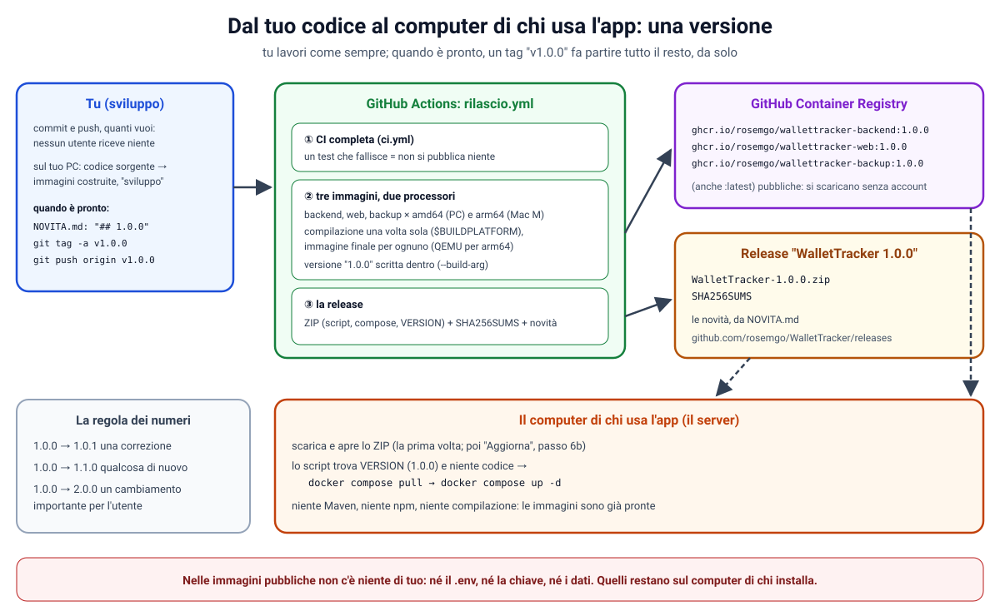
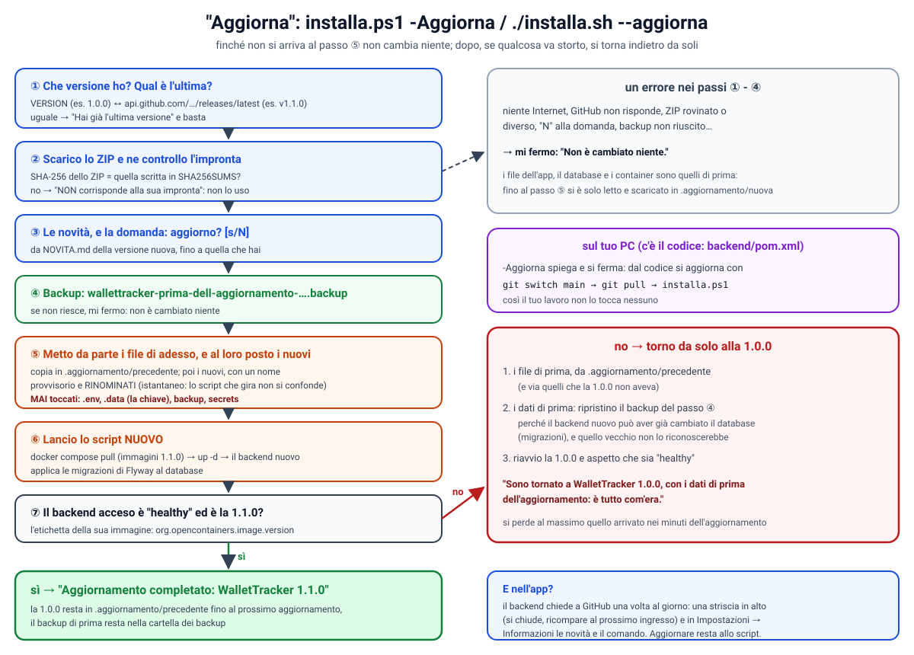
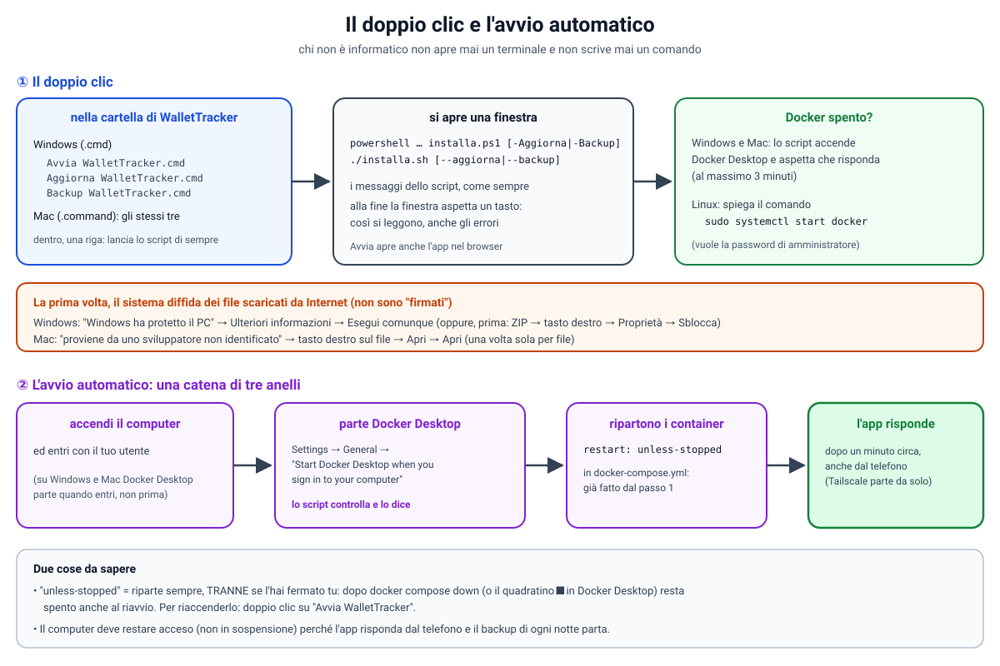

# 50. Fase 4, passo 6: versioni, immagini già pronte, aggiornamenti e la guida per chi non è informatico

**Obiettivo di questo passo:** che WalletTracker lo possa installare e aggiornare **chiunque**, senza Git, senza
compilare niente e senza aprire un terminale. Il passo è diviso in quattro parti:

| Parte | Che cosa | Stato |
|---|---|---|
| **6a** | **il numero di versione e le immagini già pronte** (GitHub Container Registry, release con lo ZIP) | **fatto: parti A-H** |
| **6b** | **"Aggiorna": passare alla versione nuova con un comando, backup prima, ritorno da solo se va male; l'avviso nell'app** | **fatto: parti I-M** |
| **6c** | **il doppio clic (Windows e Mac), Docker acceso dallo script, l'avvio automatico controllato** | **fatto: parti N-R** |
| **6d** | **la guida per chi non è informatico (`GUIDA.md`, `LEGGIMI.txt` nello ZIP) e la prova vera su Windows** | **in corso: parti S-U** |

Le parole sono quelle della `docs/47`: il **server** è la macchina su cui gira Docker con WalletTracker.

**Le scelte fatte insieme:**

| Domanda | Scelta |
|---|---|
| come arriva l'app all'utente? | **immagini già pronte**, costruite dalla CI e pubblicate su GitHub Container Registry |
| come arrivano gli aggiornamenti? | **versioni numerate** (release di GitHub): "Aggiorna" scarica l'ultima, senza Git |
| dove sta la guida per chi non è informatico? | nel repository (`GUIDA.md`), con le schermate |
| per quali sistemi il doppio clic? | Windows e Mac (Linux resta con lo script da terminale) |

**Che cosa è cambiato nel 6a:**

| Dove | Che cosa |
|---|---|
| `backend/Dockerfile`, `frontend/Dockerfile`, `docker/backup/Dockerfile` | la versione (`ARG`), le etichette standard, la compilazione sul processore di chi costruisce (`--platform=$BUILDPLATFORM`) |
| backend: `about/VersionController`, `application.yml` | `GET /api/version` |
| frontend: Impostazioni | "Informazioni": la versione installata |
| `docker-compose.yml` | `image: ghcr.io/rosemgo/wallettracker-…:${WALLETTRACKER_VERSION}` al posto di `build:` |
| `docker-compose.build.yml` (nuovo) | per costruire le immagini dal codice (sviluppo) |
| `installa.sh`, `installa.ps1` | riconoscono da soli "codice sorgente" o "versione scaricata" |
| `.github/workflows/rilascio.yml` (nuovo), `.github/ci/prepara-zip.sh` (nuovo), `ci.yml` | pubblicare una versione: test, immagini, release |
| `NOVITA.md` (nuovo) | le novità di ogni versione |

**Indice**
- Parte A: le idee di base (immagine, registro, tag, versione, release)
- Parte B: il numero di versione nell'app
- Parte C: immagini già pronte o costruite dal codice
- Parte D: pubblicare una versione: `rilascio.yml`
- Parte E: la prima versione, passo per passo
- Parte F: la sicurezza di questo passo
- Parte G: verifiche fatte e difetti trovati
- Parte H: problemi comuni
- Esercizi guidati (6a)
- Parte I: "Aggiorna", passo per passo (6b)
- Parte J: l'avviso della versione nuova nell'app
- Parte K: la sicurezza di "Aggiorna"
- Parte L: verifiche fatte e difetti trovati (6b)
- Parte M: problemi comuni ed esercizi (6b)
- Parte N: i file da doppio clic (6c)
- Parte O: Docker spento? Lo accende lo script
- Parte P: l'avvio automatico all'accensione
- Parte Q: la prima volta, Windows e il Mac diffidano
- Parte R: verifiche, difetti trovati, problemi comuni ed esercizi (6c)
- Parte S: pubblicare una versione nuova, e vedere quelle già pubblicate
- Parte T: la guida per chi non è informatico (6d)
- Parte U: la prova vera su Windows, passo per passo
- Parte V: quando il servizio API di GitHub non risponde (la seconda strada, dalla 1.2.1)

---

## Parte A: le idee di base



### A1. Perché immagini già pronte

Fino al passo 5, chi installava WalletTracker **compilava** l'app sul suo computer: lo script lanciava
`docker compose up --build`, e Docker eseguiva i Dockerfile. Maven scaricava le dipendenze di Java e compilava il
backend, npm quelle di Angular e costruiva la dashboard. Funziona, ma:
- ci vogliono **minuti**, e centinaia di MB di download;
- ogni installazione è una compilazione diversa, e **può andare storta** (una dipendenza non raggiungibile, poca memoria);
- per aggiornare bisogna avere **Git** e ricompilare.

Il risultato di quella compilazione, però, è sempre lo stesso: un'**immagine** Docker (`docs/44`, parte B). Allora la si
costruisce **una volta sola**, sulla CI di GitHub, e la si **pubblica**. Chi installa la scarica già pronta, come
scarica `postgres:18-alpine`.

### A2. Il registro: GitHub Container Registry

Un **registro** è un "negozio" di immagini Docker: ci si pubblica (*push*) e ci si scarica (*pull*). Docker Hub è il
più famoso (da lì arrivano `postgres` e `nginx`). GitHub ne ha uno suo, **GitHub Container Registry**, all'indirizzo
`ghcr.io`. È gratuito per i repository pubblici, e la CI ci può pubblicare senza password in più (con il gettone
`GITHUB_TOKEN`, parte D4).

Il nome completo di un'immagine ha tre parti:

```
ghcr.io / rosemgo/wallettracker-backend : 1.0.0
registro   nome (proprietario/immagine)    tag
```

Il **tag** dell'immagine è la sua etichetta di versione: `1.0.0`, `1.1.0`… e `latest`, "l'ultima", che si sposta a ogni
versione nuova. Noi nel `docker-compose.yml` usiamo sempre il numero preciso, mai `latest`: così si sa sempre che cosa
gira, e un aggiornamento avviene solo quando lo si chiede.

### A3. Il numero di versione: MAGGIORE.MINORE.CORREZIONE

Si usa la regola più diffusa, il **versionamento semantico** (*semantic versioning*):
- `1.0.0` → `1.0.1`: una **correzione**, niente di nuovo;
- `1.0.0` → `1.1.0`: **qualcosa di nuovo**, e tutto quello che c'era funziona come prima;
- `1.0.0` → `2.0.0`: un **cambiamento importante** per chi usa l'app (per esempio qualcosa da fare a mano
  nell'aggiornamento).

### A4. Il tag di Git e la release di GitHub

Due cose con nomi simili, da non confondere con il tag dell'immagine:
- un **tag di Git** è un'etichetta messa su un commit: "questo commit è la versione 1.0.0". Si scrive `v1.0.0`;
- una **release di GitHub** è una pagina del repository legata a un tag, con un titolo, una descrizione (le novità) e
  dei file da scaricare. La nostra contiene lo **ZIP** per chi installa e la sua **impronta** (`SHA256SUMS`).

Il gesto per pubblicare una versione è uno solo: **creare il tag di Git**. Il resto lo fa la CI (parte D).

### A5. Sviluppare e pubblicare sono due cose separate

Dopo questo passo puoi fare tutti i commit e i push che vuoi: **nessun utente riceve niente**. Solo quando crei un tag
nasce una versione, e solo allora "Aggiorna" (passo 6b) la propone. Se una versione ha un problema, se ne pubblica
un'altra (`1.0.1`) con la correzione.

---

## Parte B: il numero di versione nell'app

### B1. Dal Dockerfile al backend

Nel Dockerfile del backend, nell'immagine finale:

```dockerfile
ARG WALLETTRACKER_VERSION=sviluppo
ENV WALLETTRACKER_VERSION=$WALLETTRACKER_VERSION
```

- **`ARG`** è un valore che si passa **mentre si costruisce** l'immagine (`docker build --build-arg
  WALLETTRACKER_VERSION=1.0.0`). Se nessuno lo passa, vale `sviluppo`;
- **`ENV`** lo trasforma in una **variabile d'ambiente** dell'immagine: c'è ogni volta che il container parte.

In `application.yml`:

```yaml
wallettracker:
  version: ${WALLETTRACKER_VERSION:sviluppo}
```

e `VersionController` la restituisce:

```java
@GetMapping("/api/version")
public Version version() {
    return version; // {"version": "1.0.0"}, oppure "sviluppo"
}
```

La pagina **Impostazioni**, in fondo, alla voce **Informazioni**, la mostra: "WalletTracker, versione 1.0.0", oppure
"versione di sviluppo" per un'app costruita dal codice. Serve per sapere che cosa hai installato, e per chiedere aiuto.

### B2. Le etichette dell'immagine

```dockerfile
LABEL org.opencontainers.image.title="WalletTracker backend" \
      org.opencontainers.image.version="$WALLETTRACKER_VERSION" \
      org.opencontainers.image.source="https://github.com/rosemgo/WalletTracker"
```

Le **etichette** (*label*) sono informazioni scritte nell'immagine. Queste sono quelle **standard** (OCI, *Open Container
Initiative*): il titolo, la versione e il repository del codice. GitHub usa `source` per collegare l'immagine al
repository. Per leggerle: `docker inspect ghcr.io/rosemgo/wallettracker-backend:1.0.0`.

---

## Parte C: immagini già pronte o costruite dal codice

### C1. Un solo `docker-compose.yml`, due modi

In `docker-compose.yml`, al posto di `build: ./backend`, ora c'è:

```yaml
image: ghcr.io/rosemgo/wallettracker-backend:${WALLETTRACKER_VERSION:-sviluppo}
```

e lo stesso per `web` e `backup`. Il file nuovo **`docker-compose.build.yml`** aggiunge solo i `build:`:

```yaml
services:
  backend:
    build: ./backend
  web:
    build: ./frontend
  backup:
    build: ./docker/backup
```

Docker Compose **unisce** i file che gli si danno con `-f` (come con `docker-compose.dev.yml`, `docs/44` parte E):
- **solo `docker-compose.yml`**: le immagini si **scaricano** dal registro (`docker compose pull`);
- **`-f docker-compose.yml -f docker-compose.build.yml`**: c'è `build` accanto a `image`, e Compose **costruisce**
  l'immagine dal codice e le dà quel nome (`ghcr.io/rosemgo/wallettracker-backend:sviluppo`). Resta sul tuo computer:
  non si pubblica mai.

### C2. Lo script riconosce da solo dove si trova

All'inizio di `installa.sh` (parte `0.`) e di `installa.ps1`:

```bash
if [ -f backend/pom.xml ]; then
  DAL_CODICE=true
  WALLETTRACKER_VERSION=sviluppo
else
  DAL_CODICE=false
  WALLETTRACKER_VERSION=$(tr -d ' \r\n' <VERSION 2>/dev/null || true)
  ...
fi
export WALLETTRACKER_VERSION
```

- **c'è il codice** (`backend/pom.xml`): è il progetto clonato con Git, il **tuo** caso. Si costruisce dal codice, come
  prima;
- **non c'è il codice**: è lo ZIP di una versione, che contiene il file **`VERSION`** (per esempio `1.0.0`). Si
  scaricano le immagini di quella versione;
- **`export`**: la variabile deve arrivare a `docker compose`, che la usa nei nomi delle immagini.

Poi, all'avvio:

| Caso | Comando |
|---|---|
| dal codice | `docker compose -f docker-compose.yml -f docker-compose.build.yml up -d --build` |
| versione scaricata | `docker compose pull`, poi `docker compose up -d` |

**Senza Internet.** Se `docker compose pull` non riesce (niente rete), ma le immagini di quella versione ci sono già
sul computer (le ha scaricate un avvio precedente), lo script va avanti con quelle e lo dice ("non ho potuto
controllare le immagini su Internet"). L'app non ha bisogno di Internet per partire; solo per leggere le banche.

### C3. Che cosa cambia per te

Niente, se usi lo script: sul tuo PC trova il codice e costruisce come sempre. Cambia solo un comando scritto a mano:
per costruire dal codice senza lo script, ora serve anche `-f docker-compose.build.yml` (il README è aggiornato). Un
`docker compose up -d --build` da solo proverebbe a **scaricare** l'immagine `…:sviluppo`, che non esiste nel registro.

---

## Parte D: pubblicare una versione: `rilascio.yml`

### D1. Quando parte

```yaml
on:
  push:
    tags: ['v[0-9]+.[0-9]+.[0-9]+']
    branches: ['**']
    paths:
      - 'backend/Dockerfile'
      - 'frontend/Dockerfile'
      - 'docker/backup/**'
      - '.github/workflows/rilascio.yml'
```

- **un tag** come `v1.0.0`: si pubblica una versione. Le parentesi `[0-9]+` vogliono dire "una o più cifre": `v1.0`
  o `v1.0.0-prova` non fanno partire niente;
- **un push su un branch che cambia un Dockerfile** (o questo file): le immagini si **costruiscono** per provarle,
  ma non si pubblicano. Così un Dockerfile rotto si scopre subito, non il giorno della versione.

E in `ci.yml` due righe nuove: `branches: ['**']` (la CI normale non parte per i tag: ci pensa `rilascio.yml`) e
`workflow_call:`, che permette a `rilascio.yml` di **chiamarla**.

### D2. Primo: tutti i test

```yaml
ci:
  if: startsWith(github.ref, 'refs/tags/v')
  uses: ./.github/workflows/ci.yml
```

Con `uses:` un job esegue un altro workflow intero: la CI di sempre (backend, frontend, installazione con Docker). Se un
test fallisce, i job dopo non partono: **non si pubblica niente**.

### D3. Le immagini, per due processori

Il job `immagini` è una **matrix**: lo stesso job tre volte, in parallelo, una per immagine:

```yaml
strategy:
  matrix:
    include:
      - { nome: backend, cartella: backend }
      - { nome: web, cartella: frontend }
      - { nome: backup, cartella: docker/backup }
```

I computer hanno due famiglie di processori: **amd64** (quasi tutti i PC Windows e Linux) e **arm64** (i Mac con chip
Apple M1, M2…, e i Raspberry Pi). Un'immagine è fatta per una famiglia; ne facciamo due, sotto lo stesso nome, e Docker
sceglie da solo quella giusta per il computer che la scarica.

- **`docker/setup-qemu-action`**: QEMU è un **emulatore**, fa finta di essere un processore arm64 sulla macchina della
  CI (amd64). Serve per i `RUN` dell'immagine finale (creare l'utente, installare OpenSSL);
- **`--platform=$BUILDPLATFORM`** nei Dockerfile: la **compilazione** (Maven, npm) gira invece sul processore vero della
  macchina, perché il jar e i file di Angular sono uguali per tutti. Emulare Maven sarebbe lentissimo;
- **`docker/build-push-action`**: costruisce per `linux/amd64,linux/arm64`, passa `WALLETTRACKER_VERSION` e, con il tag,
  pubblica `…:1.0.0` e `…:latest`;
- **la cache** (`type=gha`): la volta dopo le dipendenze già scaricate si riusano.

### D4. Il permesso di pubblicare

```yaml
permissions:
  contents: read
  packages: write
```

La CI ha di serie solo il permesso di leggere (`ci.yml`). Questo job chiede **in più** di scrivere i "pacchetti"
(le immagini), solo per sé. La password è `secrets.GITHUB_TOKEN`: un gettone che GitHub crea per ogni esecuzione e che
scade alla fine. Nessuna password da salvare.

### D5. La release

Il job `release` (solo con il tag, e solo se le tre immagini sono pubblicate) chiede `contents: write` e:
1. lancia **`.github/ci/prepara-zip.sh 1.0.0`**, che:
   - prende da `NOVITA.md` la sezione `## 1.0.0` (se manca, si ferma: niente versione senza novità);
   - prepara la cartella `WalletTracker-1.0.0/` con gli script, `.env.example`, `NOVITA.md`, il file `VERSION` e
     `docker-compose.yml`, in cui `:-sviluppo}` diventa `:-1.0.0}` (così anche un `docker compose up -d` scritto a mano
     prende le immagini giuste);
   - la comprime nello ZIP e ne scrive l'impronta SHA-256 in `SHA256SUMS`;
2. crea la release con **`gh release create`** (il programma di GitHub, già installato sulle macchine della CI): lo ZIP,
   `SHA256SUMS`, e le novità come descrizione.

Lo ZIP **non contiene codice**: solo quello che serve a installare. Lo script si può provare anche a mano (esercizio 2).

---

## Parte E: la prima versione, passo per passo

Quando sei pronto a pubblicare la 1.0.0 (dopo aver provato l'app):

1. **Le novità.** Controlla la sezione `## 1.0.0` di `NOVITA.md` (c'è già una prima stesura).
2. **Il tag**, dal tuo PC, sul branch che vuoi pubblicare (il codice deve essere quello giusto, e la CI verde):

   ```
   git tag -a v1.0.0 -m "WalletTracker 1.0.0"
   git push origin v1.0.0
   ```

   `-a` crea un tag "annotato", con un messaggio, l'autore e la data.
3. **GitHub, scheda Actions:** parte "Rilascio". Dura 15-25 minuti (la CI completa, poi le immagini per due
   processori). Alla fine tutti i job devono essere verdi.
4. **Le immagini devono essere pubbliche.** La prima volta che si pubblica un'immagine, GitHub può crearla **privata**,
   anche se il repository è pubblico. Controlla: sul tuo profilo GitHub → **Packages** → `wallettracker-backend` →
   **Package settings** → in fondo, **Change visibility** → **Public**. Lo stesso per `wallettracker-web` e
   `wallettracker-backup`. Basta farlo una volta: le versioni dopo restano pubbliche.
5. **La release:** nella pagina del repository, **Releases** → "WalletTracker 1.0.0", con lo ZIP e `SHA256SUMS`.
6. **La prova vera:** in una cartella nuova, apri lo ZIP e lancia lo script. Deve dire "Avvio di WalletTracker 1.0.0"
   e scaricare le immagini; in Impostazioni → Informazioni, "versione 1.0.0".

> Il tag lo puoi creare tu, oppure lo creo io quando me lo dici: pubblicare una versione è un gesto "verso fuori"
> (chiunque la vede e la può scaricare), per questo non lo faccio da solo.

---

## Parte F: la sicurezza di questo passo

| Protezione | Contro che cosa |
|---|---|
| le immagini le costruisce **solo la CI**, dal codice del tag, e **solo dopo tutti i test** | un'immagine costruita a mano, da codice diverso o non provato |
| nelle immagini **niente di personale**: si costruiscono dalle cartelle `backend`, `frontend`, `docker/backup`, dove non ci sono né il `.env`, né la chiave, né i dati | segreti pubblicati su Internet per sbaglio |
| `GITHUB_TOKEN` con i **permessi minimi**, per job (`packages: write` solo per le immagini, `contents: write` solo per la release) | un passo della CI compromesso che fa più di quello che deve |
| lo ZIP con la sua **impronta SHA-256** | uno ZIP rovinato o sostituito: "Aggiorna" (6b) la controllerà prima di usarlo |
| nel `docker-compose.yml` sempre il **numero preciso** della versione, mai `latest` | un aggiornamento che arriva da solo, senza che tu lo sappia |

È la riga **48** della tabella della sicurezza (`docs/17`).

**Un consiglio per dopo:** nelle impostazioni del repository, **Rules** → **Rulesets**, si può dire che i tag `v*` li
possa creare solo tu. Con un solo sviluppatore non cambia niente; con altri, impedisce che qualcuno pubblichi una
versione al posto tuo.

---

## Parte G: verifiche fatte e difetti trovati

**Fatto, qui nel cloud:**
- **test**: backend (con `VersionControllerTest`) e frontend (256, con la versione nelle Impostazioni); Prettier e build;
- **dal codice**: tutti i comandi della CI del job Docker, da zero: lo script dice "Avvio di WalletTracker dal codice", le
  immagini si chiamano `ghcr.io/rosemgo/wallettracker-…:sviluppo`, `GET /api/version` risponde `sviluppo`; tutti i passi
  passano;
- **da una versione scaricata**: ho costruito le tre immagini `1.0.0` come la CI (con `--build-arg`), preparato lo ZIP
  con `prepara-zip.sh`, e installato da una cartella con **solo** lo ZIP aperto. Lo script ha detto "Avvio di
  WalletTracker 1.0.0"; non potendo scaricare le immagini (la versione 1.0.0 non esiste ancora su GitHub) ha usato quelle
  presenti, con l'avviso; l'app è partita con le immagini `1.0.0`, e le Impostazioni dicono "versione 1.0.0";
- le **etichette** delle immagini (versione e repository), e i due file della CI letti come YAML validi.

**Non fatto, perché qui non si può:**
- `rilascio.yml` **sulla CI vera**: lo vedrai partire al primo push di questi file (le immagini si costruiscono, senza
  pubblicarle), e davvero con il primo tag (parte E). Da questa sessione non posso leggere i risultati di GitHub Actions:
  controllali nella scheda Actions;
- le immagini **arm64**: qui ho costruito solo quelle amd64;
- `installa.ps1`: come nel passo 5, qui non posso eseguire PowerShell. Lo proverai nel 6d.

**Difetti trovati (e corretti):**
- `prepara-zip.sh` lanciato a mano con una cartella di uscita **che non esisteva** si fermava con "No such file or
  directory"; e una cartella **relativa** (`prova`) finiva nella radice del progetto invece che accanto a chi l'aveva
  lanciato. Nella CI non succedeva (la cartella è `.`), ma l'esercizio 2 l'avrebbe incontrato. Ora lo script crea la
  cartella e la rende assoluta prima di spostarsi.

---

## Parte H: problemi comuni

| Che cosa vedi | Perché | Che cosa fare |
|---|---|---|
| "Manca il file VERSION" | lo script è stato lanciato in una cartella senza codice e senza VERSION | scarica lo ZIP dalla pagina delle release e lancialo da lì |
| `docker compose up -d --build` scritto a mano: "pull access denied … :sviluppo" | senza `docker-compose.build.yml` Compose cerca l'immagine nel registro | `docker compose -f docker-compose.yml -f docker-compose.build.yml up -d --build`, o lo script |
| "Non riesco a scaricare le immagini della versione …" | niente Internet, e le immagini non ci sono ancora | collegati a Internet e rilancia |
| dallo ZIP: "denied" o "unauthorized" scaricando le immagini | le immagini su GitHub sono ancora private | parte E, punto 4 |
| "Rilascio" rosso nella scheda Actions | un test, o un'immagine, non è andato | apri il job rosso e leggi il primo errore: niente è stato pubblicato |
| "In NOVITA.md manca la sezione ## 1.0.0" | si è creato il tag senza scrivere le novità | aggiungi la sezione, poi crea un tag nuovo (per esempio `v1.0.1`) |

---

## Esercizi guidati (6a)

1. **Leggere un'immagine.** Dopo aver lanciato lo script dal codice: `docker inspect ghcr.io/rosemgo/wallettracker-backend:sviluppo`.
   Trova le etichette (`Labels`) e la variabile `WALLETTRACKER_VERSION` (`Env`). Che valore ha, e perché?
2. **Lo ZIP a mano.** Lancia `.github/ci/prepara-zip.sh 9.9.9 /tmp/prova`. Che errore dà, e perché? Poi aggiungi in
   `NOVITA.md` una sezione `## 9.9.9`, rilancialo, e guarda dentro lo ZIP: che cosa è cambiato in `docker-compose.yml`?
   (Ricordati di togliere la sezione.)
3. **Unire i file di Compose.** Confronta `docker compose config` con
   `docker compose -f docker-compose.yml -f docker-compose.build.yml config`: che cosa compare nel secondo?
4. **Il processore.** Su un Mac con chip Apple, `docker image inspect --format '{{.Architecture}}' postgres:18-alpine`
   dice `arm64`; su un PC Windows `amd64`. Perché lo stesso nome dà due immagini diverse?
5. **Versione semantica.** Per ognuna, scegli il numero dopo la `1.4.2`: una correzione a un grafico; una pagina nuova;
   un cambiamento che obbliga a rifare la configurazione di Tailscale.

---

# 6b. "Aggiorna"

**Le scelte fatte insieme:**

| Domanda | Scelta |
|---|---|
| se dopo l'aggiornamento l'app nuova non parte? | lo script **torna indietro da solo**: i file di prima e i dati del backup appena fatto |
| un avviso nell'app quando esce una versione? | **sì**: una striscia in alto che **si chiude** e ricompare a ogni nuovo ingresso, e i dettagli in Impostazioni → Informazioni |
| `-Aggiorna` sul tuo PC, con il codice? | **spiega e si ferma**: dal codice si aggiorna con Git |

**Che cosa è cambiato nel 6b:**

| Dove | Che cosa |
|---|---|
| `installa.sh` (parte `5b`), `installa.ps1` | `--aggiorna` / `-Aggiorna` |
| `docker/backup/wallettracker-backup.sh`, `BackupService` | il tipo di backup nuovo `prima-dell-aggiornamento` |
| backend: `about/UpdateCheckService`, `UpdateProperties`, `VersionController` | una volta al giorno: c'è una versione nuova? `GET /api/version/update` |
| frontend: `api/update-store.ts`, la striscia in `app.html`, Impostazioni → Informazioni | l'avviso, le novità e il comando |
| `docker-compose.yml`, `.env.example` | `WALLETTRACKER_UPDATE_CHECK` (per spegnere l'avviso) |
| `.github/ci/prova-aggiornamento.sh` (nuovo), `ci.yml` (job "Aggiornamento") | la prova di tutto il percorso, con un finto GitHub |
| `.gitignore` | `/.aggiornamento/` |

## Parte I: "Aggiorna", passo per passo



Sul **server**, nella cartella di WalletTracker (quella dello ZIP):

```
powershell -ExecutionPolicy Bypass -File installa.ps1 -Aggiorna     # Windows
./installa.sh --aggiorna                                           # Mac e Linux
```

Si può aggiungere `-Ia` / `--ia`, se usi Ollama; le altre opzioni no (`--aggiorna` va da solo: le altre operazioni
falle prima o dopo).

Lo script, prima di tutto, fa quello che fa sempre: controlla Docker, il `.env`, le cartelle, avvia la versione di
**adesso** e aspetta che il backend sia pronto. Serve perché il backup del passo ④ lo fa il container dei backup,
con il database acceso. Poi, la parte nuova (`5b` in `installa.sh`):

### I1. Che versione ho? Qual è l'ultima?

La versione installata è nel file `VERSION`. L'ultima pubblicata la dice GitHub, a chiunque, senza account, a un
indirizzo fisso: `https://api.github.com/repos/rosemgo/WalletTracker/releases/latest`. La risposta è un testo in
**JSON** (un formato di dati con nomi e valori: `"tag_name": "v1.1.0"`); servono tre cose:
- `tag_name`, il nome del tag (`v1.1.0`): deve essere fatto proprio così, `v` e tre numeri, altrimenti lo script si ferma;
- i due `browser_download_url`, gli indirizzi dello ZIP e di `SHA256SUMS`.

`installa.sh` legge il JSON con `sed`, per non chiedere programmi in più; `installa.ps1` con `Invoke-RestMethod`, che
lo capisce da solo. Le versioni si confrontano **come numeri, uno per uno**: `1.10.0` è più nuova di `1.9.0` (come
testo sarebbe il contrario, perché "1" viene prima di "9"). Se l'ultima non è più nuova: "Hai già l'ultima versione",
e finisce lì.

### I2. Lo ZIP e la sua impronta

Lo script scarica lo ZIP e `SHA256SUMS` in `.aggiornamento/nuova`. Poi calcola l'**impronta** SHA-256 dello ZIP
(`sha256sum` su Linux, `shasum -a 256` sul Mac, `Get-FileHash` su Windows) e la confronta con quella scritta in
`SHA256SUMS`.

Un'impronta è un numero di 64 cifre calcolato da **tutti** i byte del file: se cambia anche un solo byte, cambia tutta.
Se non corrispondono, lo ZIP è arrivato rovinato (uno scaricamento interrotto) o non è quello pubblicato: lo script
non lo apre nemmeno.

Poi lo apre (`unzip`, `Expand-Archive`) e controlla che dentro ci siano gli script, `docker-compose.yml` e un `VERSION`
con il numero giusto.

### I3. Le novità, e la domanda

Mostra le sezioni di `NOVITA.md` (quello **nuovo**) dalla più nuova fino a quella che hai: se salti delle versioni, le
vedi tutte. Poi chiede: `Aggiorno WalletTracker alla 1.1.0? Prima faccio un backup dei dati. [s/N]`. `[s/N]` vuol dire
"scrivi s per sì; Invio da solo vale no".

### I4. Il backup

`docker compose run --rm -T backup crea prima-dell-aggiornamento`: un backup come quelli della `docs/48`, con il nome
`wallettracker-prima-dell-aggiornamento-AAAAMMGG-HHMMSS.backup`. Senza la password dei backup nel `.env`, lo script la
chiede (come `--backup`): **senza backup non si aggiorna**, perché è quello che permette di tornare indietro. Nella
dashboard, nell'elenco dei backup, compare come "Prima di un aggiornamento".

**Fino a qui non è cambiato niente.** Qualsiasi errore nei passi I1-I4 (niente Internet, ZIP rovinato, "N", backup
non riuscito) ferma lo script con "Non è cambiato niente".

### I5. I file nuovi al posto dei vecchi

1. Una copia dei file di adesso che lo ZIP sostituisce va in `.aggiornamento/precedente`. Quelli che lo ZIP aggiunge
   (che prima non c'erano) si annotano in `.aggiornamento/precedente/.aggiunti`, per toglierli se si torna indietro.
2. I file nuovi vanno al loro posto: ognuno prima con un nome provvisorio (`installa.sh.nuovo`), poi **rinominato**.

Perché così? Uno script che sostituisce **sé stesso** mentre gira è pericoloso: bash legge il file un pezzo alla volta,
mentre lo esegue. Se il file cambiasse sotto i suoi piedi, continuerebbe a leggere da metà del file **nuovo**, cioè
righe a caso. Rinominare invece non tocca il file vecchio: il nome passa a un file diverso, e lo script che gira
continua a leggere il **suo** file, intero (il sistema lo tiene finché non ha finito). PowerShell legge tutto lo
script prima di cominciare, quindi lì il problema non c'è, ma si fa lo stesso.

**Non si toccano mai** `.env`, `.data` (la chiave di cifratura), la cartella dei backup e `secrets`: lo ZIP non li
contiene, e lo script li salta anche se un giorno li contenesse.

### I6. Lo script nuovo avvia la versione nuova

Lo script vecchio lancia quello **nuovo** (`./installa.sh --senza-browser`), come un avvio normale: legge il `VERSION`
nuovo, scarica le immagini nuove (`docker compose pull`), ricrea i container che cambiano (`up -d`) e aspetta il
backend. Il backend nuovo, partendo, applica con Flyway le migrazioni nuove al database. Il volume del database resta
lo stesso: i dati non si spostano.

Perché lo script nuovo e non quello vecchio? Perché una versione nuova può avviare l'app in modo diverso (una
variabile in più, un controllo nuovo): lo sa solo il suo script.

### I7. È andata?

Due controlli: lo script nuovo è finito senza errori, e il backend acceso è **proprio** la versione nuova. La seconda
cosa si legge dall'etichetta dell'immagine del container (parte B2):

```
docker inspect --format '{{index .Config.Labels "org.opencontainers.image.version"}}' wallettracker-backend
```

Se sì: "Aggiornamento completato". Lo ZIP scaricato si cancella; la versione di prima resta in
`.aggiornamento/precedente` fino al prossimo aggiornamento, e il backup nella sua cartella.

### I8. Se non è andata: il ritorno, da solo

1. **I file di prima** tornano al loro posto (allo stesso modo: nome provvisorio e rinomina), e via quelli aggiunti.
2. **I dati di prima**: si ripristina il backup del passo I4, con il container dei backup della versione **di prima**.
   Perché anche i dati? Perché il backend nuovo può aver già fatto le sue migrazioni: il database sarebbe "più nuovo"
   del backend vecchio, che si rifiuterebbe di partire (Flyway trova migrazioni che non conosce). Il backup è di
   pochi minuti prima: si perde al massimo quello che è arrivato in quei minuti.
3. **Si riavvia** la versione di prima e si aspetta che il backend sia pronto.

Alla fine: "Sono tornato a WalletTracker 1.0.0, con i dati di prima dell'aggiornamento: è tutto com'era". Lo script
finisce **con un errore** (codice 1) lo stesso: l'aggiornamento non c'è stato, e il motivo è nei messaggi sopra. Lo ZIP
resta in `.aggiornamento/nuova`, per guardarci dentro.

### I9. Sul tuo PC

Con il codice sorgente (`backend/pom.xml`), `--aggiorna` scrive che lì si aggiorna con Git (`git switch main`, `git
pull`, e rilanciare lo script) e si ferma, senza toccare niente: le tue modifiche non salvate restano tue.

### I10. Per le prove

Due variabili, solo per le prove (la CI): `WALLETTRACKER_RELEASES_URL` cambia l'indirizzo dell'ultima versione (un
finto GitHub), `WALLETTRACKER_ATTESA_BACKEND` quanti secondi aspettare il backend (di serie 240). Con
`WALLETTRACKER_RELEASES_URL` impostata, lo script non controlla che gli indirizzi dei file siano quelli di GitHub.

## Parte J: l'avviso della versione nuova nell'app

### J1. Il backend chiede a GitHub, una volta al giorno

`UpdateCheckService`, due minuti dopo l'avvio e poi ogni 24 ore (`@Scheduled`, come la sincronizzazione della
`docs/08`), chiede a GitHub lo stesso indirizzo dello script. Della risposta tiene tre cose: il numero, la pagina
della versione e le novità (il testo della release, che viene da `NOVITA.md`). Le tiene **in memoria**: non le scrive
nel database. Con il backend riavviato, le richiede.

- **Non chiede niente** se l'app è costruita dal codice ("sviluppo": lì si aggiorna con Git) o se nel `.env` c'è
  `WALLETTRACKER_UPDATE_CHECK=false`.
- **Senza Internet**, o se GitHub non risponde, scrive una riga nel log e resta valida la risposta di prima: l'app
  funziona come sempre.
- **Che cosa sa GitHub?** Solo che dal tuo indirizzo IP qualcuno ha chiesto l'ultima versione di WalletTracker. Nessun
  dato dell'app esce.

`GET /api/version/update` restituisce quello che il backend sa, senza chiedere niente a GitHub in quel momento:

```json
{
  "currentVersion": "1.0.0", "checkEnabled": true, "available": true, "latestVersion": "1.1.0",
  "releaseUrl": "https://github.com/rosemgo/WalletTracker/releases/tag/v1.1.0",
  "notes": "- ...", "checkedAt": "2026-11-05T10:02:00Z"
}
```

### J2. La striscia in alto

Se `available` è vero, sotto la barra in alto compare: **"È disponibile WalletTracker 1.1.0. Che cosa cambia e come
aggiornare"**. Il collegamento porta a Impostazioni → Informazioni. La **×** a destra la chiude.

"Chiusa" è scritto solo **in memoria** (un `signal` in `UpdateStore`), apposta: non nel browser e non nel server. Così,
a ogni nuovo ingresso nell'app (la pagina riaperta o ricaricata, l'app del telefono rilanciata), la memoria riparte
vuota e la striscia ricompare, finché non aggiorni.

Da non confondere con l'altra striscia, "È pronta una nuova versione di WalletTracker. Aggiorna" (`docs/42`, parte E):
quella dice che il **browser** ha scaricato i file nuovi della dashboard, dopo un aggiornamento già fatto sul server,
e basta ricaricare la pagina.

### J3. Impostazioni → Informazioni

Sotto la versione installata:
- **c'è una versione nuova**: il numero, le novità, la pagina su GitHub, e il comando da lanciare **sul server**
  (Windows e Mac/Linux);
- **sei all'ultima**: "È l'ultima versione pubblicata (controllato il …)";
- **controllo spento**: lo dice, con la riga del `.env`.

Il pulsante "Aggiorna" nell'app non c'è, ed è una scelta: per aggiornare bisogna sostituire file sul server e
comandare Docker, e il backend apposta non ha il controllo di Docker (`docs/17`, riga 47). Chi lo avesse, se un giorno
il backend avesse un difetto, avrebbe il controllo del server.

## Parte K: la sicurezza di "Aggiorna"

| Protezione | Contro che cosa |
|---|---|
| l'**impronta SHA-256** dello ZIP controllata **prima** di aprirlo | uno ZIP rovinato (scaricamento interrotto) o sostituito per strada |
| gli indirizzi dei file accettati solo se sono della pagina delle versioni di WalletTracker (`github.com/rosemgo/WalletTracker/releases/download/<tag>/`) | una risposta che manda a scaricare da un altro sito |
| il numero di versione accettato solo se è `vX.Y.Z` | una risposta strana che finisce nei nomi dei file e dei comandi |
| **il backup prima**, e senza backup non si aggiorna | perdere i dati per un aggiornamento andato male |
| il **ritorno da solo**: file e dati di prima | un'app che dopo l'aggiornamento non parte più |
| `.env`, `.data`, backup e `secrets` **mai** toccati | perdere la configurazione, la chiave di cifratura, i backup |
| nell'app solo un **avviso**: le novità come **testo** (mai HTML), la pagina aperta solo se è di WalletTracker su GitHub | una release con contenuti strani che diventa codice nella dashboard |
| il backend senza il controllo di Docker | (come prima) un difetto del backend che diventa il controllo del server |

**Quello che l'impronta non fa.** Lo ZIP e `SHA256SUMS` arrivano dallo stesso posto, la release su GitHub. Chi
riuscisse a entrare nel tuo account GitHub potrebbe pubblicare uno ZIP falso **con la sua impronta**, e lo script lo
accetterebbe. Contro questo c'è la protezione del tuo account: password robusta e verifica in due passaggi (2FA).
Esiste anche la **firma** delle release (con una chiave che solo tu hai, fuori da GitHub): per ora non la usiamo, la
segno tra le cose da valutare.

È la riga **49** della tabella della sicurezza (`docs/17`).

## Parte L: verifiche fatte e difetti trovati (6b)

**Fatto, qui nel cloud:**
- **test**: backend (`UpdateCheckServiceTest`: versione nuova, uguale, più vecchia, numeri confrontati come numeri,
  spento e "sviluppo" senza nessuna chiamata, pagina di un altro sito non collegata, risposta strana ignorata, GitHub
  in errore e senza Internet; `VersionControllerTest`); frontend (la striscia che si chiude e ricompare al nuovo
  ingresso; le Impostazioni con le novità come testo, il collegamento con `noopener`, i comandi; "ultima versione" e
  "controllo spento");
- **la prova completa** `.github/ci/prova-aggiornamento.sh`, la stessa del job "Aggiornamento" della CI. Costruisce tre
  versioni finte dal codice (0.9.0, 0.9.1 e una 0.9.2 **rotta apposta**: il backend riceve una porta che non è un numero
  e non parte), prepara i loro ZIP con `prepara-zip.sh`, accende un finto GitHub e installa la 0.9.0 da uno ZIP, con
  un dato "tuo" nel database. Poi quattro casi:
  1. l'ultima è già quella installata → "Hai già l'ultima versione";
  2. `SHA256SUMS` sbagliato → rifiutato, niente toccato, nessun backup;
  3. 0.9.0 → 0.9.1 → riuscito: `VERSION`, `docker-compose.yml` e il backend nuovi, il backup c'è, il `.env` e i dati sono
     quelli di prima;
  4. 0.9.1 → 0.9.2 → fallito → lo script torna alla 0.9.1 da solo: file, backend acceso e dati di prima.

**Non fatto, perché qui non si può:**
- `installa.ps1 -Aggiorna`: scritto con gli stessi passi, ma qui non posso eseguire PowerShell. Lo proverai nel 6d;
- un aggiornamento da GitHub **vero**: serve una versione pubblicata (la 1.0.0) e poi una seconda (la 1.0.1).

- **nel browser** (Chromium, larghezza di un telefono), sull'app vera accesa dalla prova (la 0.9.1), con la sola risposta
  di `/api/version/update` finta ("c'è la 1.0.0"): la striscia compare, la × la chiude, ricaricando la pagina ricompare;
  il collegamento porta a Informazioni con le novità e i comandi; nessun errore nella console, la pagina non si
  allarga oltre lo schermo.

**Difetti trovati (e corretti):**
- **i comandi spezzati sul telefono**: in Informazioni, `powershell -ExecutionPolicy …` andava a capo dopo il `-`, e
  `--aggiorna` dopo `--`: copiandoli si sarebbe sbagliato. Ora ogni comando sta su una riga intera, che si fa scorrere
  se è più larga dello schermo;
- **un `VERSION` rovinato**, in `installa.ps1`: il confronto `[version]` avrebbe dato errore e, con
  `$ErrorActionPreference = 'Continue'`, lo script sarebbe potuto andare avanti come se ci fosse una versione nuova.
  Ora tutti e due gli script controllano prima che `VERSION` sia `X.Y.Z`;
- nella prova stessa: costruire le immagini con `docker compose build` voleva il `.env` (la password del database
  anche solo per costruire): ora la prova usa `docker build`, una immagine alla volta.

## Parte M: problemi comuni ed esercizi (6b)

| Che cosa vedi | Perché | Che cosa fare |
|---|---|---|
| "Questa è la cartella del CODICE SORGENTE" | lanciato sul tuo PC, nel progetto clonato | `git switch main`, `git pull`, rilancia lo script |
| "Non riesco a chiedere a GitHub l'ultima versione" | niente Internet, un proxy o un antivirus che blocca, o il **limite di richieste** di GitHub (60 all'ora per indirizzo, senza account: codice 403 o 429) | il messaggio dice il motivo (dalla 1.2.1; prima diceva sempre "controlla la connessione"). Con 403/429 riprova dopo un'ora; non è cambiato niente |
| "GitHub non risponde in questo momento (codice 503)" | GitHub momentaneamente non disponibile, o una VPN, un proxy o un antivirus in mezzo | lo script ha già riprovato 3 volte, a 5 secondi di distanza (dalla 1.2.1): riprova tra qualche minuto; se continua, prova ad aprire nel browser l'indirizzo delle versioni (`api.github.com/repos/rosemgo/WalletTracker/releases/latest`) |
| "Manca il programma unzip" (Linux) | il Linux non ha `unzip` | `sudo apt install unzip` (o il comando della tua distribuzione) |
| "NON corrisponde alla sua impronta" | lo ZIP è arrivato rovinato | riprova; se succede ancora, non usarlo e guarda la pagina della versione su GitHub |
| "Il backup non è riuscito" | per esempio, disco pieno o cartella dei backup non scrivibile | sistema il problema (`docs/48`, parte H), poi riprova |
| "Sono tornato a WalletTracker …" | la versione nuova non è partita | sei com'eri prima; leggi il motivo nei messaggi e segnalalo; lo ZIP è in `.aggiornamento/nuova` |
| "Non sono riuscito a rimettere i dati di prima" | anche il ritorno ha avuto un problema (molto raro) | i file sono già quelli di prima: ripristina a mano il backup indicato, con `--ripristina` (`docs/48`) |
| la striscia della versione nuova non compare | il backend chiede a GitHub 2 minuti dopo l'avvio, poi ogni giorno; o il controllo è spento | aspetta, o guarda Impostazioni → Informazioni |

**Esercizi**
1. **Il JSON di GitHub.** Apri nel browser `https://api.github.com/repos/rosemgo/WalletTracker/releases/latest` (dopo
   la prima versione). Trova `tag_name`, `html_url`, `body` e i due `browser_download_url`.
2. **L'impronta.** Scarica uno ZIP e `SHA256SUMS` dalla pagina di una versione e calcola l'impronta: su Windows
   `Get-FileHash WalletTracker-1.0.0.zip`, su Linux `sha256sum WalletTracker-1.0.0.zip`. È uguale? Ora cambia un
   carattere di un file dentro lo ZIP, ricomprimilo e ricalcola: che cosa succede all'impronta?
3. **Rinominare o sovrascrivere.** Perché `cp nuovo installa.sh` mentre `installa.sh` sta girando è pericoloso, e
   `cp nuovo installa.sh.nuovo && mv installa.sh.nuovo installa.sh` no? (Parte I5.)
4. **Perché anche i dati.** Nel ritorno (I8), che cosa succederebbe se si rimettessero solo i file della versione di
   prima, senza il backup, dopo che il backend nuovo ha applicato una migrazione V40?
5. **La prova.** Leggi `.github/ci/prova-aggiornamento.sh`: come fa la 0.9.2 a essere "rotta"? E come fa la prova a
   sapere che il backend acceso alla fine è proprio la 0.9.1?

---

# 6c. Il doppio clic e l'avvio automatico

**Le scelte fatte insieme:**

| Domanda | Scelta |
|---|---|
| quali file da doppio clic? | **Avvia, Aggiorna, Backup**, per Windows e per il Mac. Il ripristino resta dal terminale, apposta: sostituisce i dati e vuole il nome del file |
| Docker Desktop spento? | lo script **lo accende e aspetta** (Windows e Mac); su Linux spiega il comando |
| l'avvio automatico? | lo script **controlla e lo dice**, senza toccare le impostazioni di Docker Desktop |

**Che cosa è cambiato nel 6c:**

| Dove | Che cosa |
|---|---|
| `Avvia WalletTracker.cmd`, `Aggiorna WalletTracker.cmd`, `Backup WalletTracker.cmd` (nuovi) | il doppio clic su Windows |
| `Avvia WalletTracker.command`, `Aggiorna WalletTracker.command`, `Backup WalletTracker.command` (nuovi) | il doppio clic sul Mac |
| `.gitattributes` | le fini riga giuste per i `.cmd` (Windows) e i `.command` (Unix) |
| `installa.sh`, `installa.ps1` | Docker Desktop acceso da soli se è spento; alla fine, se all'accensione WalletTracker ripartirà da solo |
| `.github/ci/prepara-zip.sh` | i sei file nello ZIP di ogni versione (e quindi anche negli aggiornamenti) |
| `ci.yml` (job "Installazione con Docker") | il passo "I file da doppio clic" |
| fuori dal 6c: la scheda di un movimento | in "Nessuna categoria: sceglila tu, o crea una regola", **crea una regola** ora è un collegamento alle Regole, con l'esercente e il tipo già scritti |



## Parte N: i file da doppio clic

### N1. Che cosa sono

Sono **file di testo con dentro dei comandi**, che il sistema esegue quando li apri con un doppio clic. Non fanno niente
di nuovo: lanciano lo script di sempre, con l'opzione giusta, dalla cartella in cui si trovano.

| File | Lancia |
|---|---|
| `Avvia WalletTracker` | lo script senza opzioni: prepara quello che manca, avvia e apre l'app nel browser |
| `Aggiorna WalletTracker` | lo script con `-Aggiorna` / `--aggiorna` (parte I) |
| `Backup WalletTracker` | lo script con `-Backup` / `--backup` (`docs/48`) |

### N2. Windows: i file `.cmd`

Un file `.cmd` è uno script per **cmd.exe**, il vecchio "Prompt dei comandi" di Windows: con un doppio clic Windows apre
una finestra nera e lo esegue riga per riga.

```bat
@echo off
cd /d "%~dp0"
powershell -NoProfile -ExecutionPolicy Bypass -File "%~dp0installa.ps1" -Aggiorna %*
set codice=%errorlevel%
echo.
pause
exit /b %codice%
```

Riga per riga:
- `@echo off`: non ripetere ogni comando prima di eseguirlo (la finestra mostra solo i messaggi dello script);
- `%~dp0` è **la cartella di questo file** ("d" = disco, "p" = percorso, "0" = il file stesso). `cd /d "%~dp0"` ci entra,
  anche su un altro disco (`/d`): così lo script trova i suoi file, da qualunque posto si faccia il doppio clic;
- `powershell … -File installa.ps1`: il comando della `docs/45`. `-NoProfile`: senza le personalizzazioni di PowerShell
  di chi usa il computer, che potrebbero cambiare qualcosa; `%*`: le eventuali opzioni in più, passate allo script;
- `set codice=%errorlevel%`: si ricorda com'è andata (0 = bene);
- `pause`: "Premere un tasto per continuare…". Senza, la finestra si chiuderebbe appena finito lo script, e un errore
  sparirebbe prima di poterlo leggere;
- `exit /b %codice%`: il file finisce con il risultato dello script, non con quello della pausa.

Due attenzioni:
- **solo caratteri senza accenti.** cmd.exe legge i `.cmd` con una codifica vecchia (quella di MS-DOS): una "è" diventerebbe
  un simbolo strano. Per questo nei `.cmd` c'è "e stata" invece di "è stata". I messaggi con gli accenti li scrive
  PowerShell, che non ha questo problema;
- **le fini riga di Windows** (CRLF, `\r\n`). Con quelle di Unix, cmd.exe in certi casi salta dei pezzi. Il file
  `.gitattributes` dice a Git di scriverli sempre con CRLF, anche quando il progetto è scaricato su Linux o sul Mac.

### N3. Il Mac: i file `.command`

Un file `.command` è uno script per il **Terminale** del Mac: con un doppio clic il Mac apre il Terminale e lo esegue.

```bash
#!/bin/bash
cd "$(dirname "$0")" || exit 1
./installa.sh --aggiorna "$@"
codice=$?
echo "Premi Invio per chiudere questa finestra."
read -r _
exit "$codice"
```

- `#!/bin/bash`: con quale programma eseguirlo;
- `cd "$(dirname "$0")"`: entra nella cartella di questo file (come `%~dp0` su Windows);
- `read -r _`: aspetta Invio, per lo stesso motivo della `pause` di Windows;
- il file deve essere **eseguibile** (il permesso "x" della `docs/45`): Git lo ricorda, e lo ZIP lo conserva.

Su Linux i `.command` funzionano da terminale (`"./Avvia WalletTracker.command"`), ma i file manager di solito non li
eseguono con un doppio clic: lì resta lo script, come avevamo deciso.

### N4. Dove sono

Nella cartella dello ZIP di ogni versione, accanto agli script (`prepara-zip.sh` ce li mette, e controlla che siano
sei), e nella cartella del progetto. "Aggiorna" li sostituisce come gli altri file dell'app: anche loro migliorano
con le versioni.

## Parte O: Docker spento? Lo accende lo script

Prima, se Docker Desktop era spento, lo script si fermava: "Docker non risponde: avvia Docker Desktop…". Ora:

| Sistema | Che cosa fa |
|---|---|
| **Windows** | avvia `C:\Program Files\Docker\Docker\Docker Desktop.exe` e chiede a Docker ogni 3 secondi se risponde (`docker info`), al massimo 3 minuti |
| **Mac** | `open -a Docker`, poi la stessa attesa |
| **Linux** | spiega il comando (`sudo systemctl start docker`, o aprire Docker Desktop), perché accendere un servizio del sistema vuole la password di amministratore, e uno script non deve chiederla da solo |

Se dopo 3 minuti Docker non risponde, lo script si ferma e lo dice: di solito Docker Desktop sta mostrando una finestra
(un aggiornamento, le condizioni d'uso da accettare) che aspetta te.

## Parte P: l'avvio automatico all'accensione

### P1. È una catena di tre anelli

1. **accendi il computer** ed entri con il tuo utente;
2. **parte Docker Desktop**, se nelle sue impostazioni c'è "Start Docker Desktop when you sign in to your computer"
   (Settings, l'ingranaggio → General);
3. **ripartono i container**, perché in `docker-compose.yml` hanno `restart: unless-stopped` (dal passo 1, `docs/44`).

Quando il terzo anello ha finito (un minuto circa), l'app risponde, anche dal telefono: Tailscale, sul server, parte da
solo con il sistema.

Il terzo anello c'è già. Il secondo dipende da un'impostazione di Docker Desktop.

### P2. Che cosa fa lo script

Alla fine di ogni avvio **legge** l'impostazione di Docker Desktop, senza cambiarla:
- Windows: nel file `%APPDATA%\Docker\settings-store.json` (o `settings.json` nelle versioni vecchie);
- Mac: in `~/Library/Group Containers/group.com.docker/settings-store.json` (o `settings.json`);
- Linux: chiede a systemd se il servizio `docker` (o `docker-desktop` dell'utente) parte da solo.

E dice una di tre cose:
- "All'accensione del computer WalletTracker riparte da solo";
- "**AVVIO AUTOMATICO SPENTO**", con dove cliccare per accenderlo;
- se non riesce a capirlo (un formato nuovo di Docker Desktop), dove controllare.

Perché solo leggere? Perché quel file è di Docker Desktop: il suo formato cambia tra le versioni, e una modifica
sbagliata potrebbe rovinare le sue impostazioni. Cliccare una casella, una volta, è più sicuro.

### P3. Due cose da sapere

- **"unless-stopped"** vuol dire "riparti sempre, **tranne** se ti ha fermato qualcuno". Dopo `docker compose down`, o il
  quadratino ■ in Docker Desktop, WalletTracker resta spento anche al riavvio del computer. Per riaccenderlo: doppio clic
  su "Avvia WalletTracker".
- **Il server deve restare acceso**, non in sospensione: un computer che dorme non risponde al telefono, e il backup di
  ogni notte aspetta che si svegli (`docs/48`). Su Windows: Impostazioni → Sistema → Alimentazione → "Sospensione":
  "Mai" con l'alimentatore collegato.

## Parte Q: la prima volta, Windows e il Mac diffidano

I file scaricati da Internet ricevono un **"segno"** dal sistema: su Windows il *Mark of the Web*, sul Mac la
*quarantena*. Quando apri un programma con quel segno, il sistema controlla se è **firmato**, cioè se dentro c'è una firma
digitale di uno sviluppatore che il sistema conosce. I nostri file non lo sono, e allora:

| Sistema | Che cosa vedi | Che cosa fare |
|---|---|---|
| Windows | "Windows ha protetto il PC" (SmartScreen) | **Ulteriori informazioni** → **Esegui comunque**. Oppure, **prima** di aprire lo ZIP: tasto destro sullo ZIP → **Proprietà** → spunta **Annulla blocco** (**Sblocca** su Windows 10) → OK: tutti i file dentro nascono senza segno |
| Windows | "Avviso di sicurezza: l'autore non può essere verificato" | **Esegui** |
| Mac | "non può essere aperto perché proviene da uno sviluppatore non identificato" | **tasto destro** sul file → **Apri** → **Apri**. Una volta per file: poi il Mac se lo ricorda |
| Mac (versioni nuove) | il tasto destro non basta | **Impostazioni di Sistema** → **Privacy e sicurezza** → in fondo, "Apri comunque" |

**Perché non firmarli?** La firma si compra: un certificato per Windows costa qualche centinaio di euro all'anno, quello
di Apple 99 dollari all'anno (il programma per sviluppatori). Per un'app che ognuno installa a casa propria, una volta,
spiegare il clic in più è la scelta ragionevole. Le schermate saranno nella `GUIDA.md` (6d).

**È sicuro dire "Esegui comunque"?** Sì, se lo ZIP è quello della pagina delle versioni di WalletTracker: lì c'è anche la
sua impronta (`SHA256SUMS`, parte I2) per controllarlo. Il segno serve proprio a farti fermare un attimo a pensare da
dove arriva un file.

## Parte R: verifiche, difetti trovati, problemi comuni ed esercizi (6c)

**Fatto, qui nel cloud:**
- i **`.cmd`**: fini riga di Windows in ogni riga, solo caratteri ASCII; i **`.command`**: eseguibili, fini riga di Unix.
  Lo controlla anche la CI, a ogni push;
- **`Avvia WalletTracker.command` lanciato davvero** (su Linux, come farebbe il Terminale del Mac), dal codice: l'app
  parte e la finestra aspetta Invio. Anche questo lo rifà la CI;
- **lo ZIP** di una versione contiene i sei file, con il permesso di esecuzione dei `.command`; la prova dell'aggiornamento
  (parte L) li sostituisce, nomi con gli spazi compresi;
- **Docker spento su Linux**, con un finto `docker` che non risponde: lo script spiega il comando e si ferma;
- dashboard: il collegamento **crea una regola**, con i test e nel browser, sull'app vera con un movimento finto senza
  categoria (un finanziamento): il link apre le Regole con l'esercente, "solo uscite" e "Spesa" già scritti, e la
  categoria da scegliere.

**Non fatto, perché qui non si può:** i `.cmd` e `installa.ps1` su Windows, i `.command` su un Mac vero, l'accensione di
Docker Desktop e la lettura delle sue impostazioni. È la prova del 6d, sul tuo PC.

**Difetti trovati (e corretti):**
- i file da doppio clic finivano sempre "bene" (codice 0), anche con lo script fallito: l'ultima cosa che facevano era
  aspettare un tasto. Ora tengono il risultato dello script;
- sul Mac la domanda "Premi Invio…" era scritta con `read -p`, che la mostra solo se si scrive dalla tastiera: nella
  prova automatica non compariva. Ora è un `echo`, e poi l'attesa.
- nella pagina Regole, arrivando da "crea una regola" di un movimento senza categoria, il messaggio diceva "Modulo compilato
  dalla tua correzione", ma non c'era stata nessuna correzione. Ora dice "Modulo compilato dal movimento: scegli la
  categoria…";
- nella prova dell'aggiornamento, la copia del progetto da cui si preparano gli ZIP non aveva i file da doppio clic, e
  `prepara-zip.sh` (giustamente) si fermava. Ora la prova li copia, e controlla che dopo l'aggiornamento ci siano.

| Che cosa vedi | Perché | Che cosa fare |
|---|---|---|
| doppio clic su un `.cmd`: la finestra si apre e si chiude subito | lo hai aperto da dentro lo ZIP, senza estrarlo | estrai lo ZIP (tasto destro → Estrai tutto) e apri il file dalla cartella estratta |
| Mac: "permesso negato" / il `.command` si apre in un editor | lo ZIP è stato estratto da un programma che non conserva i permessi | estrailo con il doppio clic del Finder (Utility Archivio), oppure nel Terminale: `chmod +x *.command` nella cartella |
| "Docker Desktop non risponde dopo 3 minuti" | Docker Desktop sta mostrando una sua finestra (un aggiornamento, le condizioni d'uso) | guarda la sua finestra, rispondi, e rifai il doppio clic |
| "AVVIO AUTOMATICO SPENTO" | Docker Desktop non parte quando entri nel computer | Settings → General → "Start Docker Desktop when you sign in to your computer" → Apply |
| dopo il riavvio l'app non risponde, ma l'avvio automatico è acceso | l'avevi fermata tu (`docker compose down`, o ■) | doppio clic su "Avvia WalletTracker" |

**Esercizi**
1. Apri `Avvia WalletTracker.cmd` con il Blocco note (tasto destro → Modifica): trova `%~dp0`. Che cosa succederebbe
   senza `cd /d "%~dp0"`, facendo il doppio clic su un collegamento al file messo sul Desktop?
2. Togli per prova la riga `pause` (in una copia del file) e fai il doppio clic: che cosa vedi? Perché serve?
3. Sul Mac, nel Terminale: `ls -l *.command`. Trova la "x" del permesso di esecuzione (`docs/45`).
4. In Docker Desktop spegni "Start Docker Desktop when you sign in", fai il doppio clic su "Avvia WalletTracker" e leggi
   l'ultima riga. Poi riaccendilo e rifallo.
5. Ferma l'app con ■ in Docker Desktop, riavvia il computer: l'app risponde? Perché? (Parte P3.)

---

## Parte S: pubblicare una versione nuova, e vedere quelle già pubblicate

### S1. Le versioni pubblicate finora

| Versione | Pubblicata | Dal commit | Che cosa contiene |
|---|---|---|---|
| **1.0.0** | 5 novembre 2026 | `2bee13c` (la pull request n. 14) | l'app fino al passo **6a**: niente "Aggiorna", niente doppio clic, niente avviso delle versioni nuove |
| **1.1.0** | 5 novembre 2026 | `77663f6` (la pull request n. 18) | 6b e 6c: "Aggiorna", il doppio clic, l'avviso delle versioni nuove; `GUIDA.md` e `LEGGIMI.txt`. **Difetto**: l'indirizzo di ritorno di serie era quello di `ng serve` (`docs/47`, parte Q), e dallo ZIP le banche non si collegavano |

Le tre immagini della 1.0.0 su GitHub Container Registry sono **pubbliche** (controllato: si scaricano senza account).

**Attenzione, la 1.0.0 non sa aggiornarsi.** "Aggiorna" è arrivato dopo (6b), quindi chi ha la 1.0.0 passa alla
versione dopo **a mano, una volta sola** (S4). Da lì in poi basta il doppio clic.

### S2. Pubblicare una versione nuova, passo per passo

1. **Tutto in `main`**: le pull request unite, la CI verde sull'ultimo commit di `main` (scheda Actions, o la ✓ accanto
   al commit).
2. **Il numero** (parte A3): `1.0.0` → `1.0.1` se corregge e basta, `1.1.0` se aggiunge qualcosa, `2.0.0` se chi
   aggiorna deve fare qualcosa a mano.
3. **Le novità**: in `NOVITA.md`, in cima, una sezione `## 1.1.0` scritta per chi usa l'app (che cosa cambia per lui,
   non i nomi dei file). Anche questa entra in `main` con una pull request. Senza la sezione, il rilascio si ferma (D5).
4. **Il tag**, dal tuo PC, su `main` aggiornato:

   ```
   git switch main
   git pull
   git tag -a v1.1.0 -m "WalletTracker 1.1.0"
   git push origin v1.1.0
   ```

   Il tag si può mettere anche dal sito: **Releases** → **Draft a new release** → **Choose a tag** → scrivi `v1.1.0` →
   "Create new tag on publish", target `main`. Ma allora GitHub crea **lui** la release, e `rilascio.yml` troverebbe la
   release già esistente: meglio il tag da Git, e la release la crea la CI.
5. **Aspetta "Rilascio"** nella scheda Actions (15-25 minuti): CI completa, poi le tre immagini, poi la release. Tutto
   verde = pubblicata.
6. **Controlla** (S3): la release c'è, con lo ZIP e `SHA256SUMS`.
7. **Da quel momento**: gli utenti la vedono arrivare da soli (la striscia nell'app compare entro un giorno, J1), e
   l'aggiornamento è "Aggiorna WalletTracker".

**Se "Rilascio" diventa rosso**: non è stato pubblicato niente, oppure solo una parte (per esempio le immagini, ma non
la release). Si corregge in `main` e si pubblica un **numero nuovo** (`v1.1.1`): un tag già usato non si riusa, perché
qualcuno potrebbe aver già scaricato quella versione.

### S3. Dove si vedono le versioni

| Dove | Che cosa vedi |
|---|---|
| **la pagina delle versioni**: nel repository, a destra, **Releases** (oppure `github.com/rosemgo/WalletTracker/releases`) | ogni versione, dalla più nuova: il titolo, le novità, e sotto **Assets** lo ZIP, `SHA256SUMS` e il codice sorgente (quei due li aggiunge GitHub da solo). "Latest" segna l'ultima |
| **i tag**: nella stessa pagina, la scheda **Tags** | il tag e il commit su cui è stato messo |
| **le immagini**: sul tuo profilo GitHub, **Packages** (o, nel repository, a destra, **Packages**) | `wallettracker-backend`, `-web`, `-backup`: per ognuna le versioni pubblicate (`1.0.0`, `latest`…), quante volte sono state scaricate, e se sono pubbliche |
| **il rilascio**: la scheda **Actions** → "Rilascio" | com'è andata la pubblicazione di ogni tag, job per job |
| **dal tuo PC**: `git tag` (o `git tag -n` con il messaggio) | i tag che conosce la tua copia del progetto (dopo `git fetch --tags`) |
| **nell'app**: Impostazioni → Informazioni | la versione installata sul server, e se ce n'è una nuova |
| **per un programma**: `https://api.github.com/repos/rosemgo/WalletTracker/releases/latest` | l'ultima, in JSON: è quello che leggono "Aggiorna" e il backend |

### S4. Dalla 1.0.0 alla versione dopo, a mano (una volta sola)

1. **Prima il backup**, con la versione di adesso: nell'app, **Impostazioni → Backup → Fai un backup adesso** (c'è già
   nella 1.0.0), e aspetta "Backup creato".
2. Dalla pagina delle versioni scarica lo ZIP della versione nuova (per esempio `WalletTracker-1.1.0.zip`) e aprilo.
3. Copia **tutti i file** che ci sono dentro nella cartella di WalletTracker di adesso, sostituendo quelli che ci sono
   già. Nello ZIP non ci sono `.env`, `.data`, i backup né `secrets`: i tuoi dati e la tua configurazione non si
   toccano.
4. Doppio clic su **"Avvia WalletTracker"** (arriva proprio con questi file): scarica le immagini nuove e riavvia
   l'app.
5. In Impostazioni → Informazioni ora c'è la versione nuova. Le prossime volte: "Aggiorna WalletTracker", che il backup
   lo fa da solo, e **prima** di cambiare qualcosa.

Perché il backup al punto 1 e non con "Backup WalletTracker" dopo aver copiato i file? Perché lo script, prima di fare
il backup, avvia l'app: con i file nuovi avvierebbe già la versione nuova, e il backup sarebbe dei dati **dopo**
l'aggiornamento.

---

# 6d. La guida per chi non è informatico, e la prova vera

**Le scelte fatte insieme:**

| Domanda | Scelta |
|---|---|
| quando pubblicare la versione nuova? | **alla fine del 6d**: un solo rilascio, la **1.1.0**, con dentro anche la guida |
| dove fare la prova vera? | **sul tuo PC, con i tuoi dati** |
| dove va la guida? | **`GUIDA.md` nel repository**, e nello ZIP un **`LEGGIMI.txt`** corto con il collegamento |

## Parte T: la guida per chi non è informatico

### T1. Che cosa c'è

- **`GUIDA.md`**, nella radice del progetto. GitHub la mostra già impaginata, con le immagini. Undici capitoli, nell'ordine
  in cui servono: che cosa serve, Docker Desktop, scaricare, il primo avvio, il PIN, le banche, i backup, il telefono,
  aggiornare, tenerlo acceso, i problemi comuni. Niente comandi da scrivere, tranne due operazioni rare (preparare
  Tailscale, una volta; il ripristino di un backup), che rimandano alle guide tecniche.
- **`LEGGIMI.txt`**, nello ZIP di ogni versione (`prepara-zip.sh` lo aggiunge): i tre passi per cominciare e
  l'indirizzo della guida. È un file di testo semplice, perché chi apre lo ZIP non ha ancora niente di installato:
  lo legge con il Blocco note. Per questo ha le fini riga di Windows e solo caratteri senza accenti ("cosi'"): un
  Blocco note vecchio leggerebbe male le lettere accentate.
- **Le schermate dell'app** (`docs/img/guida/`), fatte con dati inventati ("Banca Alfa", "ACME SRL", esercenti
  inventati), alla larghezza di un telefono.

### T2. Le schermate che mancano

Quelle di **Windows** e di **Docker Desktop** si possono fare solo su un PC Windows. Fatte durante la prova (parte U):

| N. | Che cosa | Capitolo della guida | Com'è andata |
|---|---|---|---|
| 1 | Docker Desktop con "Engine running" | 2 | `docker-engine-running.png` |
| 2 | Settings → General, con "Start Docker Desktop when you sign in" spuntato | 2 | `docker-avvio-automatico.png` |
| 3 | le Proprietà dello ZIP, con "Annulla blocco" ("Sblocca" su Windows 10) | 3 | `zip-annulla-blocco.png`, con il nome utente del percorso sostituito |
| 4 | la finestra alla fine di "Avvia WalletTracker" | 4 | `fine-avvio.png`, senza le due righe sulla password d'esempio (venivano dal `.env` di sviluppo: chi installa dallo ZIP non le vede) |

Due non ci sono, apposta: l'**installazione di Docker Desktop** (la spiega bene il sito di Docker, e cambia a ogni
versione) e l'**avviso "Windows ha protetto il PC"**, che con lo ZIP sbloccato non compare: nella guida c'è solo il
testo, con i pulsanti da premere.

Prima di metterle nel repository, guarda che non ci siano dati tuoi: nomi, indirizzi, il nome del computer nella rete
Tailscale, importi veri.

## Parte U: la prova vera su Windows, passo per passo

Finora `installa.ps1` e i `.cmd` non sono mai stati eseguiti su Windows (qui nel cloud non si può). La prova ha due
tempi.

### U1. Adesso, dalla cartella del progetto (il codice)

Con Git aggiornato (`git switch main`, `git pull`):

1. **Avvia**: doppio clic su `Avvia WalletTracker.cmd`. Deve: costruire l'app dal codice come `installa.ps1`, aprire il
   browser, scrivere la riga sull'avvio automatico, e aspettare un tasto. Controlla le lettere accentate nei messaggi
   ("è avviato").
2. **Docker spento**: chiudi Docker Desktop (l'icona della balena vicino all'orologio → **Quit Docker Desktop**), poi
   doppio clic su `Avvia WalletTracker.cmd`. Deve dire "Docker Desktop era spento: lo sto accendendo" e andare avanti
   da solo.
3. **L'avvio automatico**: in Docker Desktop togli la spunta a "Start Docker Desktop when you sign in", rifai il doppio
   clic su Avvia e leggi l'ultima riga ("AVVIO AUTOMATICO SPENTO"); rimetti la spunta e rifallo ("riparte da solo").
4. **Backup**: doppio clic su `Backup WalletTracker.cmd`: "Backup creato", e in Impostazioni → Backup c'è.
5. **Aggiorna**: doppio clic su `Aggiorna WalletTracker.cmd`: dice che questa è la cartella del codice e di usare Git.
6. Mandami le schermate della parte T2 (2, 3 e 6 si fanno già qui) e quello che non va.

### U2. Alla fine, con lo ZIP della 1.1.0 e i tuoi dati

Dopo la pubblicazione della 1.1.0 (parte S2):

1. **Backup**, dalla dashboard: Impostazioni → Backup → **Fai un backup adesso**.
2. Scarica `WalletTracker-1.1.0.zip` dalla pagina delle versioni: **Sblocca** (tasto destro → Proprietà), **Estrai tutto**
   in una cartella nuova, per esempio `Documenti\WalletTracker`.
3. **Copia** dalla cartella del progetto in quella nuova: il file **`.env`** e le cartelle **`.data`**, **`secrets`** e
   **`backup`**. Sono la configurazione, la chiave di cifratura, la chiave di Enable Banking e i backup: con loro, la
   versione scaricata usa gli stessi dati.
4. Doppio clic su **Avvia WalletTracker** nella cartella nuova. La prima volta: l'avviso di Windows (parte Q). Deve
   dire "Avvio di WalletTracker 1.1.0", **scaricare** le immagini (non costruirle), e aprire l'app con i tuoi conti.
   In Impostazioni → Informazioni: "versione 1.1.0".
5. Dal telefono (se usi Tailscale): l'app si apre come prima. `tailscale serve` punta alla porta 8001 del server, che
   è la stessa.

**Perché non serve fermare niente?** Le due cartelle usano lo stesso nome di progetto per Docker (`name:
wallettracker`, in `docker-compose.yml`): gli stessi container e lo stesso volume del database. La versione scaricata
**sostituisce** i container costruiti dal codice, e trova il database di sempre. Per tornare a sviluppare, lancia
`installa.ps1` (o `Avvia WalletTracker.cmd`) nella cartella del progetto: ricostruisce dal codice, sugli stessi dati.

**Attenzione al `.env`**: da qui in poi ce ne sono due, uno per cartella. Se ne cambi uno (per esempio con
`-Tailscale`), copia la modifica anche nell'altro.

### U3. La prova di "Aggiorna" da GitHub vero

Arriverà con la versione dopo la 1.1.0 (per esempio una 1.1.1): doppio clic su **Aggiorna WalletTracker** nella
cartella della 1.1.0, e deve passare alla nuova da solo (parte I), con il backup prima.

---

## Parte V: quando il servizio API di GitHub non risponde

**Che cosa è successo.** La prima prova vera di "Aggiorna" (dalla 1.1.1 alla 1.2.0) si è fermata con "Non riesco a
chiedere a GitHub l'ultima versione". Lo script della 1.1.1 nascondeva il motivo; chiesto a mano con PowerShell, era
**503 "Server non disponibile"**, e nel browser l'unicorno di GitHub ("We couldn't respond to your request in time").
Dalla stessa zona, però, la pagina normale `github.com/rosemgo/WalletTracker/releases/latest` funzionava. Il problema
era solo il **servizio API** (`api.github.com`), l'indirizzo da cui lo script legge qual è l'ultima versione.

GitHub è fatto di più servizi: il sito, i file delle release (gli "asset"), l'API. Possono smettere di rispondere uno
alla volta, anche solo per una zona, e di solito per poco. Lo script dipendeva da uno solo.

**Che cosa fa ora lo script (dalla 1.2.1), in ordine.**

1. Chiede l'ultima versione al **servizio API**, come prima. Se l'errore è passeggero (nessuna risposta, un 5xx, 429)
   riprova da solo **3 volte, a 5 secondi** di distanza (`Con-Tentativi` in PowerShell, `curl --retry` in bash).
2. Se l'API proprio non risponde, scrive "Il servizio di GitHub per le versioni non risponde: provo dalla pagina delle
   versioni", e chiede la **pagina normale** `…/releases/latest`. GitHub la **rinvia** a quella dell'ultima versione,
   `…/releases/tag/v1.2.0`: il numero si legge in fondo all'indirizzo d'arrivo (in bash `curl -w '%{url_effective}'`; in
   PowerShell l'indirizzo d'arrivo della risposta). Un rinvio, in HTTP, è la risposta 302 "vai a quest'altro
   indirizzo": il programma lo segue da solo, come il browser.
3. Gli indirizzi dei due file non servono dall'API: si ricavano dal numero, perché su GitHub sono sempre
   `…/releases/download/v1.2.0/WalletTracker-1.2.0.zip` e `…/SHA256SUMS`.
4. Da qui è tutto come prima: lo ZIP si controlla con la sua impronta, le novità si leggono da `NOVITA.md` **dentro lo
   ZIP** (già prima non si leggevano dall'API), poi la conferma, il backup e il ritorno da solo se la versione nuova
   non parte.
5. Se non risponde neanche la pagina, l'errore dice tutti e due i motivi, e non cambia niente.

**La sicurezza non cambia.** Lo ZIP arriva sempre dalla pagina delle versioni di WalletTracker su GitHub, il numero
deve essere `vX.Y.Z`, e lo ZIP si usa solo se corrisponde all'impronta di `SHA256SUMS`. Come prima, chi entrasse
nell'account GitHub potrebbe pubblicare uno ZIP e la sua impronta insieme (`docs/17`, riga 49): la seconda strada non
lo rende né più facile né più difficile.

**Gli errori, con il motivo.** Prima lo script diceva sempre "controlla la connessione a Internet". Ora dice il
codice e che cosa vuol dire: 403/429 il limite di richieste di GitHub senza account (60 all'ora per indirizzo, che si
azzera da solo), 5xx GitHub che non risponde in quel momento, oppure il messaggio di Windows (nome non trovato,
connessione rifiutata, proxy).

**La prova.** In `.github/ci/prova-aggiornamento.sh` il finto GitHub è ora un piccolo server, `finto-github.py`, che
fa le tre parti di GitHub: l'API (`latest.json`, che risponde 503 se c'è il file `api-rotta`), la pagina che rinvia
(`/releases/latest` → `/releases/tag/vX.Y.Z`) e i file. Il **caso 2b**: con l'API rotta, lo script trova la 0.9.1
dalla pagina, scarica lo ZIP dall'indirizzo ricavato e lo rifiuta per l'impronta sbagliata (la stessa del caso 2):
così si vede che la seconda strada arriva fino in fondo, senza aggiornare davvero. E senza API né pagina: l'errore con
tutti e due i motivi. Su GitHub vero, a mano: il rinvio arriva a `…/releases/tag/v1.2.0`, e dagli indirizzi ricavati
`SHA256SUMS` e lo ZIP si scaricano.

La parte per Windows (`installa.ps1`) non si è potuta eseguire nell'ambiente di sviluppo (lì PowerShell non c'è): va
provata su Windows, la prima volta che il servizio API non risponde, o con `WALLETTRACKER_RELEASES_URL` puntato a un
indirizzo che non esiste.

**Una cosa da sapere.** La seconda strada vale dalla versione che la contiene: "Aggiorna" usa lo script della versione
installata. Chi ha la 1.1.1 o la 1.2.0, la prima volta, ha ancora bisogno che l'API risponda.

