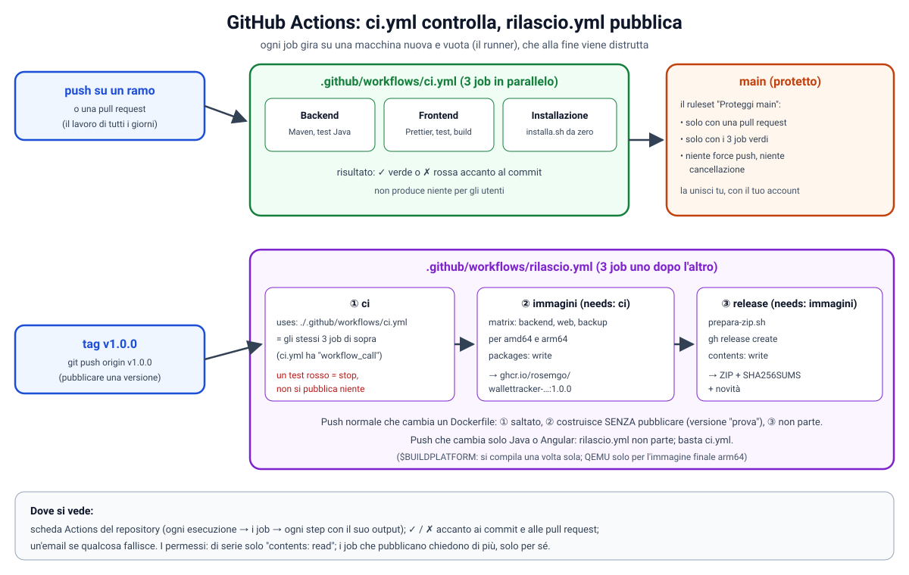

# La CI su GitHub: ci.yml, rilascio.yml e il ramo main protetto

Fuori dalla numerazione: come funziona GitHub Actions dalle basi, che rapporto c'è tra `ci.yml` e `rilascio.yml`, e
come si protegge `main`. I dettagli del rilascio sono nella `docs/50`, parte D.



## 1. Dove stanno i file

```
WalletTracker/
  .github/
    workflows/
      ci.yml          ← i test, a ogni push
      rilascio.yml    ← pubblicare una versione (con un tag v1.0.0)
    ci/
      prepara-zip.sh  ← lo script che rilascio.yml usa per preparare lo ZIP
      tailscale       ← il finto Tailscale usato nei test
    dependabot.yml
```

Il punto davanti a `.github` la rende una cartella **nascosta** su Linux e Mac (su Windows e in IntelliJ si vede).
GitHub legge **solo** questa cartella, con questo nome preciso.

## 2. Come funziona la CI, dalle basi

**CI** (*Continuous Integration*, integrazione continua): ogni volta che spedisci del codice, qualcuno lo controlla
**in automatico**. Su GitHub questo "qualcuno" si chiama **GitHub Actions**.

### 2.1 Il workflow

Ogni file `.yml` in `.github/workflows/` è un **workflow**, una ricetta in tre parti:

```yaml
name: CI                 # il nome che vedi nella scheda Actions

on:                      # QUANDO parte
  push:
    branches: ['**']     # a ogni push, su qualsiasi ramo

jobs:                    # CHE COSA fa
  backend:
    runs-on: ubuntu-latest      # SU QUALE macchina
    steps:                      # i passi, in ordine
      - uses: actions/checkout@v7        # un'"azione" già pronta: scarica il codice
      - run: ./mvnw test                 # un comando, come nel tuo terminale
```

### 2.2 Quando parte: `on`

GitHub ascolta gli **eventi** del repository (un push, una pull request, un tag): se l'evento corrisponde a quello
scritto in `on:`, il workflow parte.

### 2.3 Dove gira: il runner

Per ogni **job** GitHub accende una **macchina virtuale nuova e vuota**, il *runner* (`ubuntu-latest`: un Linux con
Docker, Java, Node e Git). Non ha niente di tuo: né il `.env`, né i dati. Alla fine del job viene **distrutta**. Così
ogni prova parte da zero, come sul computer di un utente nuovo. Per un repository pubblico è gratuito.

### 2.4 Job e step

- un **job** è un gruppo di passi sulla stessa macchina. I job di un workflow girano **in parallelo**, a meno che uno
  dica `needs: [altro]` ("parti dopo quello");
- uno **step** è un passo: `uses:` usa un'**azione** già pronta scritta da altri (per esempio `actions/setup-java`), `run:`
  esegue un **comando**.

Se un comando finisce con un errore, lo step diventa rosso, il job si ferma e il workflow è **fallito**.

### 2.5 I tre job di `ci.yml`

| Job (il nome che vedi su GitHub) | Che cosa fa |
|---|---|
| `Backend (build e test)` | compila con Maven ed esegue tutti i test Java (con il database vero di Testcontainers) |
| `Frontend (build e test)` | installa le dipendenze, controlla la formattazione con Prettier, esegue i test e fa la build di Angular |
| `Installazione con Docker (installa.sh)` | lancia lo script come un utente, da zero, e prova davvero l'app: PIN, Tailscale finto, backup, ripristino |

### 2.6 Dove si vede il risultato

- nella **scheda Actions** del repository: ogni esecuzione → i suoi job → ogni step con l'output, come in un terminale;
- accanto a ogni **commit** e **pull request**: ✓ verde, ✗ rossa, o un pallino giallo se sta ancora girando;
- un'**email** di GitHub se qualcosa fallisce.

### 2.7 I permessi

Il workflow riceve un **gettone** (`GITHUB_TOKEN`) che vale solo per quell'esecuzione. Noi gli diamo il minimo:
`permissions: contents: read` (solo leggere il codice). Solo i job di `rilascio.yml` che pubblicano chiedono di più, e
solo per sé.

### 2.8 Perché serve

Sul tuo PC può funzionare "per caso" (una libreria già scaricata, un file che hai solo tu). La CI prova il codice su
una macchina pulita, a ogni push: se diventa rossa sai **subito** quale commit ha rotto qualcosa. Ed è il controllo che
decide se una versione si può pubblicare e se una pull request può entrare in `main`.

---

## 3. `rilascio.yml` e il suo rapporto con `ci.yml`

- **`ci.yml` controlla**: esegue i test e dice "funziona / non funziona". Non produce niente per gli utenti.
- **`rilascio.yml` pubblica**: costruisce le immagini e crea la release con lo ZIP. Ma prima **chiama `ci.yml`**: se i test
  non passano, non pubblica niente.

### 3.1 Quando parte

```yaml
on:
  push:
    tags: ['v[0-9]+.[0-9]+.[0-9]+']      # un tag come v1.0.0 → PUBBLICA
    branches: ['**']                     # un push su un ramo…
    paths:                               # …solo se cambia uno di questi file → solo PROVA
      - 'backend/Dockerfile'
      - 'frontend/Dockerfile'
      - 'docker/backup/**'
      - '.github/workflows/rilascio.yml'
```

- **un tag** `vX.Y.Z`: versione vera, si pubblica;
- **un push che cambia un Dockerfile**: si costruiscono le immagini solo per vedere se riescono, **senza pubblicarle**;
- **un push che cambia solo Java o Angular**: `rilascio.yml` non parte; basta `ci.yml`.

### 3.2 Job 1, `ci`: tutti i test

```yaml
ci:
  if: startsWith(github.ref, 'refs/tags/v')   # solo con il tag
  uses: ./.github/workflows/ci.yml            # esegue TUTTO ci.yml
```

È il legame tra i due file: `uses:` esegue un altro workflow intero. Per permetterlo, `ci.yml` ha `workflow_call:` tra
gli eventi di `on:` ("si può chiamare da un altro workflow"). Senza tag il job è **saltato**: per una prova delle
immagini ci pensa già il `ci.yml` partito per lo stesso push.

### 3.3 Job 2, `immagini`: una per pezzo dell'app

```yaml
immagini:
  needs: [ci]
  if: always() && (needs.ci.result == 'success' || needs.ci.result == 'skipped')
  permissions:
    packages: write
  strategy:
    matrix:
      include:
        - { nome: backend, cartella: backend }
        - { nome: web,     cartella: frontend }
        - { nome: backup,  cartella: docker/backup }
```

- **`needs: [ci]`**: aspetta i test; **`if:`**: va avanti se sono passati (`success`) o saltati perché non c'è un tag
  (`skipped`). Se falliscono, si ferma;
- **`matrix`**: lo stesso job **tre volte in parallelo**, una per immagine.

| Passo | Che cosa fa |
|---|---|
| Scarica il codice | `actions/checkout` |
| La versione | dal tag `v1.0.0` ricava `1.0.0` e "pubblica"; senza tag `prova` e "non pubblicare" |
| Emulatore per arm64 | QEMU, per l'immagine dei Mac con chip Apple |
| Costruttore di immagini | buildx, che sa fare immagini per più processori insieme |
| Accesso al registro | login su `ghcr.io` con `GITHUB_TOKEN` (solo con il tag) |
| Costruisci (e pubblica) | per `linux/amd64` e `linux/arm64`, con la versione dentro; con il tag pubblica `…:1.0.0` e `…:latest` |

### 3.4 Job 3, `release`: la pagina della versione

```yaml
release:
  needs: [immagini]
  if: startsWith(github.ref, 'refs/tags/v')
  permissions:
    contents: write
  steps:
    - uses: actions/checkout@v7
    - run: .github/ci/prepara-zip.sh "${GITHUB_REF_NAME#v}" .
    - run: gh release create ...
```

1. `prepara-zip.sh` crea lo ZIP per chi installa (script, `docker-compose.yml` con la versione giusta, `VERSION`,
   novità) e accanto `SHA256SUMS`, l'impronta per controllarlo;
2. `gh release create` crea la pagina "WalletTracker 1.0.0" con lo ZIP, l'impronta e le novità di `NOVITA.md`.

### 3.5 Riassunto

| | push normale (cambia un Dockerfile) | tag `v1.0.0` |
|---|---|---|
| `ci.yml` | parte da solo | parte, **chiamato** da `rilascio.yml` |
| job `ci` di rilascio | saltato | tutti i test |
| job `immagini` | costruisce, **non pubblica** | costruisce e **pubblica** su `ghcr.io` |
| job `release` | non parte | crea la release con lo ZIP |
| arriva qualcosa agli utenti? | no | sì: la versione 1.0.0 |

---

## 4. Proteggere `main`: il ruleset

Un **ruleset** è un insieme di regole che GitHub fa rispettare su certi rami. Con quello giusto, in `main` entra solo
quello che **unisci tu** con una pull request, e solo con la CI verde. Né le sessioni di Claude né un push sbagliato
possono scriverci direttamente.

Si crea da **Settings → Rules → Rulesets → New ruleset → New branch ruleset**:

| Campo | Che cosa mettere | Perché |
|---|---|---|
| **Ruleset Name** | `Proteggi main` | un nome qualsiasi, serve a te per riconoscerlo |
| **Enforcement status** | **Active** | con *Disabled* la regola esiste ma non vale |
| **Bypass list** | **vuota** | nessuno salta le regole, nemmeno tu: anche tu passi da una pull request con la CI verde |
| **Target branches** | **Add target → Include default branch** (oppure *Include by pattern*: `main`) | la regola vale per il ramo principale |
| **Restrict deletions** | ✓ | `main` non si può cancellare |
| **Require a pull request before merging** | ✓, **Required approvals: 0** | sei l'unico sviluppatore, e GitHub non ti lascia approvare una tua pull request: con 1 ti bloccheresti |
| **Require status checks to pass** | ✓, con i tre job (sotto) | si unisce solo con la CI verde |
| **Require branches to be up to date** | senza spunta | con più sessioni in parallelo ti obbligherebbe ad aggiornare ogni pull request a ogni cambio di `main` |
| **Block force pushes** | ✓ | nessuno può riscrivere la storia di `main` |

Il resto lascialo com'è, poi **Create**.

### 4.1 Aggiungere i job della CI

1. nel riquadro **Required status checks** clicca **+ Add checks**;
2. nella casella di ricerca scrivi l'inizio del nome di un job (per esempio `Backend`): GitHub propone i controlli che ha
   visto girare di recente nel repository;
3. scegli i tre job di `ci.yml`:
   - `Backend (build e test)`
   - `Frontend (build e test)`
   - `Installazione con Docker (installa.sh)`
4. se chiede da quale *source*, **GitHub Actions**.

Se non propone niente, scrivi il nome **esatto** (con spazi e parentesi) e premi Invio. I nomi sono quelli scritti in
`name:` di ogni job in `ci.yml`: se un giorno li cambi, vanno cambiati anche qui, altrimenti GitHub aspetta per sempre
un controllo che non arriva più.

### 4.2 Come si lavora dopo

1. le modifiche si fanno su un altro ramo (le sessioni di Claude usano i loro rami `claude/…`);
2. su GitHub: **Pull requests → New pull request**, base `main`, compare il ramo con le modifiche;
3. la CI parte da sola sulla pull request; quando i tre job sono verdi, il pulsante **Merge** si sblocca;
4. clicchi **Merge**: le modifiche entrano in `main`, con il tuo account;
5. sul tuo PC: `git switch main` e `git pull`.
