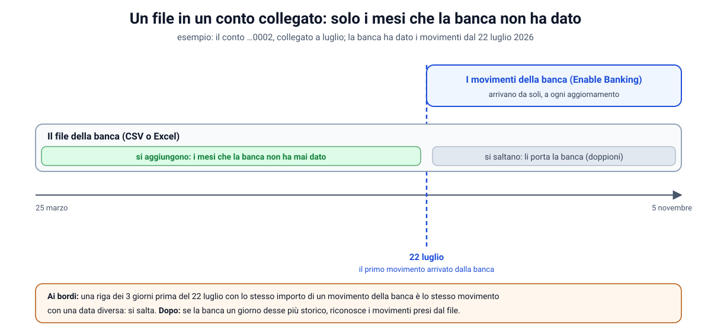

# Importa da un file: Excel, conti collegati e manuali

Fuori dalla numerazione, dopo la 1.2.7. Allarga l'importazione di `docs/25` (i CSV dei conti manuali) e il
completamento di `docs/31` (solo Trade Republic): ora la pagina **Importa** accetta anche i file **Excel**, trova da
sola la tabella sotto le note della banca, e funziona anche con i **conti collegati**, dove aggiunge solo i mesi che la
banca non ha mai dato.

---

## Parte A: il problema, con i movimenti veri

**Lo storico che dà la banca è limitato.** Quando si collega un conto con Enable Banking, la banca manda i movimenti
solo da un certo giorno: con PSD2 spesso pochi mesi. Tutto quello che è successo prima, nell'app, non arriva mai.

Il caso vero: il secondo conto Fineco (…0002) è stato collegato a luglio, e nell'app ha movimenti **dal 22 luglio
2026**. L'esportazione della banca ne ha **dal 25 marzo**: 43 movimenti in più. Non erano solo spese piccole:

| Movimenti | Che cosa sono |
|---|---|
| 5 dividendi + 5 ritenute, 3 cedole + 3 ritenute, 3 interessi + 3 ritenute | **rendite che mancavano** in Investimenti |
| 7 "Ritenuta Fiscale … Qta/Val.nom." | gli accrediti del giro titoli di marzo e aprile: l'altra metà degli addebiti sul conto …0001 (`docs/investimenti.md`, parte W) |
| 9 bonifici | giroconti con gli altri conti, senza l'altra metà |
| bollo, canone | piccole spese del conto |

Fino alla 1.2.7 l'app non permetteva di aggiungerli: la pagina Importa accettava **solo i conti manuali**, e "Completa i
movimenti" leggeva **solo il file di Trade Republic**. In più Fineco esporta in **Excel**, con **dodici righe di note**
sopra la tabella: anche salvato come CSV, il file non si sarebbe letto.

## Parte B: leggere un file Excel

**Che cos'è un `.xlsx`.** Un archivio **ZIP** con dentro dei file **XML** (il formato si chiama *Office Open XML*). Si
può provare: rinominando `movimenti.xlsx` in `movimenti.zip` e aprendolo, dentro c'è:

| File | Che cosa contiene |
|---|---|
| `xl/workbook.xml` | l'elenco dei fogli |
| `xl/_rels/workbook.xml.rels` | in quale file sta ogni foglio (di solito `xl/worksheets/sheet1.xml`) |
| `xl/worksheets/sheet1.xml` | le righe: `<row>` con le celle `<c r="B14" t="s" s="3"><v>7</v></c>` |
| `xl/sharedStrings.xml` | i **testi**, scritti una volta sola: una cella con `t="s"` contiene il *numero* del testo, non il testo |
| `xl/styles.xml` | i **formati** delle celle |

**Le date sono numeri.** In Excel il 5 novembre 2026 è il numero **46331**: i giorni passati dal 30 dicembre 1899. Solo
il formato della cella (`s="3"`, che in `styles.xml` porta a un formato di data come `dd/mm/yyyy`) dice che va letto
come una data. Il lettore guarda i formati predefiniti di Excel per le date (14–22, 45–47) e quelli scritti apposta che
contengono giorni, mesi o anni.

**Il lettore** (`csvimport/SpreadsheetReader`) trasforma il primo foglio in righe di testo, come fa `CsvReader` con un
CSV. Così tutto il resto (la mappatura, l'anteprima, i controlli) non cambia:

- le date escono come `05/11/2026`;
- i numeri con il **punto**, senza i resti del calcolo binario (Excel salva 0,15 come `0.15000000000000002`: si
  arrotonda a dieci decimali);
- le celle vuote, che Excel non scrive, tornano al loro posto (dal riferimento `B14` si ricava la colonna);
- le righe completamente vuote si saltano.

Il file Excel si riconosce dai **primi byte**, non dal nome: ogni ZIP comincia con `PK` (`50 4B 03 04`). Un vecchio
`.xls` (il formato binario di Excel 97–2003, che comincia con `D0 CF 11 E0`) non si legge: l'app chiede di salvarlo
come `.xlsx` o CSV.

**Perché un lettore nostro e non una libreria** (Apache POI). POI fa molto di più, ma è grande e ha avuto problemi di
sicurezza proprio nella lettura dell'XML. Qui serve poco, e con gli strumenti di Java (`java.util.zip` e il lettore XML
"a flusso" StAX) si fa in sicurezza:

| Rischio | Che cosa è | Difesa |
|---|---|---|
| **XXE** (*XML External Entity*) | un XML che dichiara un'"entità" che punta a un file del server (`<!ENTITY x SYSTEM "file:///etc/…">`) e la usa nel testo: leggendo il file, il server ne rivelerebbe il contenuto | il lettore XML non accetta DTD né entità esterne (`SUPPORT_DTD` e `IS_SUPPORTING_EXTERNAL_ENTITIES` a `false`) |
| **bomba ZIP** | pochi kilobyte di ZIP che, decompressi, diventano gigabyte e riempiono la memoria | al massimo 30 MB per file e 60 MB in tutto una volta decompressi, e 2.000 file; il limite si conta mentre si legge (la dimensione dichiarata nello ZIP può mentire) |

Una riga in più nella tabella della sicurezza (`docs/17`, n. 53).

## Parte C: la tabella sotto le note

Il file di Fineco comincia così:

```
Conto Corrente: 0000002
Intestazione Conto Corrente: …
Periodo Dal: 10/11/2024 Al: 10/11/2026
Saldo Finale: …
Nota: Il saldo finale del periodo …
…
Risultati Ricerca
Data_Operazione | Data_Valuta | Entrate | Uscite | Descrizione | Descrizione_Completa | Stato
05/11/2026      | 31/10/2026  | 3,95    |        | Sconto Canone Mensile | Sconto Canone Mensile Ottobre 2026 | Contabilizzato
```

**L'intestazione si trova da sola** (`ColumnGuesser.headerRow`): è la prima riga, tra le prime 30, con almeno tre celle
piene, una colonna della data e una dell'importo (o delle entrate e delle uscite). Le righe sopra si saltano. Se non c'è
una riga così, è la prima, come prima.

**Il separatore di un CSV** si cercava solo nella prima riga, e "Conto Corrente: 0000002" non ne ha. Ora si guarda il
numero massimo di separatori in una stessa riga, nelle prime 30 (`CsvReader.detectDelimiter`): vince la riga
dell'intestazione.

**La proposta delle colonne** per Fineco (`ColumnGuesser`):

| Campo | Colonna | Perché |
|---|---|---|
| data | `Data_Operazione` | è quella che usa Enable Banking (verificato: gli accrediti del giro titoli di ottobre hanno operazione 26/10 e valuta 23/10, e nell'app hanno il 26/10) |
| importo | `Entrate` e `Uscite` | due colonne, una sola piena per riga |
| descrizione | `Descrizione_Completa` | è il testo che manda Enable Banking ("Ritenuta Fiscale BTP-1OT53 4,5% Qta/Val.nom. …", non solo "Ritenuta Fiscale"); le regole lo riconoscono |
| decimali | il punto | da un file Excel i numeri escono sempre con il punto: indovinarlo sarebbe pericoloso (con i primi importi interi si sceglierebbe la virgola, e "3.95" diventerebbe 395) |

I nomi si confrontano con il trattino basso come uno spazio (`Data_Operazione` = "data operazione").

## Parte D: i conti collegati, solo i mesi più vecchi



**La regola** (`CsvImportService.plan`). In un **conto manuale** si aggiungono tutte le righe nuove, come sempre. In un
**conto collegato**:

1. si cerca il **primo giorno** dei movimenti arrivati dalla banca (`findFirstBankDate`, senza quelli presi da un
   file). Se non ce n'è ancora nessuno, l'importazione si ferma: prima si aggiorna il conto, così si sa da quando la banca
   porta i movimenti;
2. le righe **da quel giorno in poi** non si aggiungono: le porta la banca, e aggiungerle farebbe doppioni;
3. le righe dei **3 giorni prima** possono essere lo stesso movimento con una data appena diversa (la banca può usare la
   data dell'operazione o quella della contabilizzazione): se c'è un movimento della banca con **lo stesso importo e la
   stessa valuta** a pochi giorni, la riga non si aggiunge;
4. tutte le altre, **più vecchie**, si aggiungono.

**L'impronta dei movimenti presi da un file.** Le righe aggiunte a un conto collegato hanno l'impronta che comincia con
`trcsv:` (`BankTransaction.FILE_KEY_PREFIX`, nata per Trade Republic in `docs/31`), seguita da un hash della riga. Serve
a due cose:

- **ricaricando lo stesso file** (o uno che si sovrappone) le righe già aggiunte si riconoscono e si saltano;
- **se un giorno la banca desse uno storico più lungo** (per esempio dopo un nuovo collegamento), la sincronizzazione,
  per ogni movimento in arrivo, cerca prima un movimento con quel prefisso con lo stesso importo, la stessa valuta e una
  data vicina (`TransactionImportService.fileMovementFor`): se c'è, lo **adotta** invece di aggiungerne un altro.

Dopo l'aggiunta, i movimenti si **classificano** come quelli della banca: dividendi e cedole con le loro ritenute
(`docs/investimenti.md`, parte U), il giro titoli come trasferimento interno (parte W), i bonifici tra i tuoi conti
abbinati.

**Trade Republic.** Per i suoi conti collegati resta anche "Completa i movimenti" (`docs/31`), che in più aggiunge le
causali ai movimenti arrivati senza testo: la pagina Importa, quando scegli un conto Trade Republic collegato, lo
ricorda con un link.

## Parte E: una pagina sola, che dice che cosa farà

**La scelta.** Due pagine separate ("Importa" per i conti manuali, "Completa" per i collegati) costringerebbero a
sapere prima quale usare. Ma chi ha un file in mano pensa "è il file del conto X", non "devo completare uno storico".
Allora la pagina è **una sola**, e il comportamento lo decide **il conto scelto**, dicendolo chiaramente **prima** di
caricare il file:

- il menu del conto ha **due gruppi**: "Conti manuali (non collegati a una banca)" e "Conti collegati con Enable
  Banking";
- sotto, un riquadro spiega che cosa succederà:
  - conto manuale: "**Importa i movimenti di un conto manuale**… Aggiungo tutte le righe del file; quelle già importate
    si saltano";
  - conto collegato: "**Completa lo storico di un conto collegato**… Dal file aggiungo solo i movimenti più vecchi del
    primo arrivato dalla banca (il 22 luglio 2026); gli altri li porta la banca, e aggiungerli farebbe doppioni";
- caricato il file, un **riepilogo** dice esattamente che cosa succede: "Il file ha 75 righe: 43 movimenti più vecchi
  del 22 luglio 2026 si aggiungono; 32 sono nel periodo che porta la banca.";
- le righe mostrate nell'anteprima sono **quelle che si aggiungono**;
- il pulsante dice "**Aggiungi 43 movimenti**" (collegato) o "**Importa 75 righe**" (manuale); se non c'è niente da
  aggiungere, è spento e la pagina dice perché;
- con un file Excel il menu del **separatore** non compare: le colonne sono già separate;
- alla fine, per un conto collegato non si chiede il saldo: lo dà la banca.

## Parte F: le prove

- `SpreadsheetReaderTest`: un file come quello di Fineco (note, intestazione, date, celle vuote); numeri, date, testi
  di ogni tipo (testi condivisi a pezzi, testi nella cella, formule, valori veri/falsi, un formato di data scritto
  apposta, la colonna AA); i formati; un file che non è un Excel e un vecchio `.xls`; l'**XXE** rifiutato; la **bomba
  ZIP** fermata.
- `ColumnGuesserTest`: l'intestazione sotto le note; le colonne di Fineco e il punto per un file Excel.
- `CsvReaderTest`: il separatore trovato anche con le note sopra.
- `CsvImportControllerTest`:
  - un conto collegato con i movimenti della banca dal 22 luglio: dal file si aggiungono solo le righe più vecchie, una
    riga di due giorni prima con lo stesso importo di un movimento della banca si salta, le righe aggiunte hanno
    l'impronta `trcsv:` e si classificano; ricaricando, niente di nuovo;
  - un conto collegato senza movimenti della banca: si aspetta;
  - un file Excel in un conto manuale; un vecchio `.xls` rifiutato con il consiglio.
- `import-page.spec.ts`: i due gruppi del menu, il riquadro che cambia con il conto, il riepilogo e il pulsante di un
  conto collegato, niente da aggiungere, niente separatore per un Excel, il link a "Completa i movimenti" per Trade
  Republic.
- I **due file veri** di Fineco, letti in locale (non vanno nel repository): 75 e 70 movimenti, tutti letti senza
  errori, con la proposta giusta (`Data_Operazione`, entrate e uscite, `Descrizione_Completa`, il punto).
- Nel browser: un file Excel come quello di Fineco (dati inventati) in un conto collegato e in uno manuale, PC e
  telefono, tema scuro.

## Parte G: i limiti

- **Il primo foglio** del file Excel: se la banca mettesse i movimenti in un altro foglio, va spostato.
- **L'intestazione** si cerca nelle prime 30 righe. Se non si trova, si usa la prima riga: l'anteprima lo mostra
  subito (le colonne avrebbero nomi strani).
- **Un movimento del file più vecchio della banca, ma presente anche nella banca con una data lontana più di 3 giorni**
  verrebbe aggiunto due volte. Non succede con Fineco (la data è la stessa, `Data_Operazione`); con un'altra banca
  l'anteprima mostra le righe che si aggiungono, da controllare prima.
- **Lo stato** ("Contabilizzato") non si legge: le righe più vecchie della banca sono comunque contabilizzate.

## Parte H: il file di Trade Republic nella pagina Importa

**Il problema.** Il file "Esportazione transazioni" di Trade Republic caricato in Importa dava errori come "Riga 80:
manca l'importo". Le righe con l'errore erano le **operazioni sui titoli**: azioni trasferite (`DELIVERY` /
`FREE_RECEIPT`), diritti di un aumento di capitale assegnati, esercitati o scaduti (`CORPORATE_ACTION`). Hanno
importo, commissione, tassa e valuta vuoti, perché sul conto non si muove denaro. Il file è giusto: è la mappatura
generica che vuole un importo su ogni riga. E anche le righe che si leggevano erano sbagliate, perché `amount` è
**lordo** (`docs/31`, parte B2): gli interessi entravano senza le tasse, l'imposta di bollo a 0,00 €, gli acquisti
senza commissione e tassa.

**La soluzione.** Il lettore giusto c'era già, `TradeRepublicCsv`, ma lo usava solo "Completa i movimenti", e solo per
un conto Trade Republic collegato. Ora `CsvImportService` riconosce il file dalle colonne
(`TradeRepublicCsv.recognizes`, come `CompletionService`) e lo legge con quello, **in qualunque conto**, manuale o
collegato:

- la mappatura non conta: il browser la manda come sempre, il backend la ignora;
- le righe senza denaro si **contano e si saltano** (`Preview.skippedRows`); tutte le altre diventano movimenti con
  l'importo **netto** `amount + fee + tax`, la causale (`description`) e la controparte (chi manda o riceve il
  bonifico; per dividendi e acquisti, il titolo);
- l'impronta usa il `transaction_id` di Trade Republic: `csv:tr:<id>` in un conto manuale, `trcsv:<id>` in un conto
  collegato. Quest'ultima è la stessa di "Completa i movimenti" (`CompletionService.fileKeys`): caricare il file da una
  pagina e poi dall'altra non fa doppioni;
- in un conto collegato fa anche quello che fa "Completa i movimenti": parte I;
- gli errori riportano la riga del file, come prima;
- una data `01/07/2026` si legge anche: è come la scrive `SpreadsheetReader` se il CSV è stato aperto con Excel e
  salvato come `.xlsx`.

**La pagina.** Con `preview.tradeRepublic` al posto dei menu della mappatura c'è il riquadro "2. File di Trade
Republic", che dice come si legge e quante righe dei titoli si saltano. Il riepilogo lo ripete ("85 righe nuove; 7 sono
operazioni sui titoli senza denaro, che si saltano.") e il pulsante conta solo le righe che si importano.

**Le prove.** `CsvImportControllerTest` (conto manuale: importi netti, impronte, raw_json, il secondo caricamento non
aggiunge niente; conto collegato: solo i mesi prima della banca, con l'impronta `trcsv:`; una cella sbagliata con la sua
riga), `TradeRepublicCsvTest` (numeri di riga con l'intestazione più in basso, la data di Excel), `import-page.spec.ts`
(il riquadro al posto della mappatura, il riepilogo, il pulsante). Un file vero di 92 righe, letto in locale (non va
nel repository): 85 movimenti, 7 operazioni sui titoli saltate, nessun errore.

**Il limite.** Le operazioni sui titoli non diventano movimenti: non muovono denaro, e i movimenti del conto sono
solo denaro.

## Parte I: il file di Trade Republic in un conto collegato completa anche le causali

**La domanda vera.** Caricato in Importa il file di Trade Republic su un conto collegato, in Movimenti restavano
movimenti "(nessuna descrizione)". Erano quelli arrivati dalla banca: Trade Republic, con Enable Banking, manda solo
data e importo. Importa aggiungeva solo i mesi più vecchi della banca e **saltava** le righe del periodo della banca,
senza toccare i movimenti corrispondenti. Per dar loro causale e controparte bisognava caricare lo stesso file anche in
"Completa i movimenti" (`docs/31`). Due pagine per lo stesso file, con risultati diversi.

**La soluzione.** Con il file di Trade Republic in un conto **collegato**, `CsvImportService` usa il piano di
`CompletionService`, lo stesso di "Completa i movimenti":

- le righe che corrispondono a un movimento della banca (stesso importo e valuta, al massimo 3 giorni) gli danno
  **controparte e causale**; data, importo e i testi che la banca avesse già mandato non cambiano;
- le righe senza abbinamento più vecchie del primo giorno della banca diventano movimenti, con l'impronta
  `trcsv:<transaction_id>` (senza margine: `docs/31`, parte M);
- le righe già fatte (aggiunte o completate prima) si contano e basta;
- le righe del periodo della banca senza un movimento non si aggiungono: si dice quante sono.

`CompletionService` ora ha `plan(Account, TradeRepublicCsv.Reading)`, `preview(Plan)` e `complete(Plan)`, usati dalle
due pagine. La pagina "Completa i movimenti" resta: mostra anche le anomalie (righe senza movimento, movimenti senza
riga) una per una. Un conto collegato senza movimenti della banca aspetta, come per gli altri file.

**L'anteprima** ha un campo in più, `completeRows` (i movimenti che ricevono i testi). Il riepilogo: "Il file ha 92
righe: nessun movimento più vecchio del 9 luglio 2026 da aggiungere; 4 movimenti arrivati dalla banca ricevono
controparte e causale; 81 erano già fatte; 7 sono operazioni sui titoli senza denaro, che si saltano." Il pulsante dice
"Completa 4 movimenti" (o "Aggiungi 3 e completa 4 movimenti"), le righe mostrate sono quelle che cambiano.

**Le prove.** `CsvImportControllerTest`: un conto collegato con un movimento della banca senza testo; l'anteprima conta
righe aggiunte, completate e senza movimento; l'importazione completa il movimento (importo invariato) e aggiunge le
righe vecchie; ricaricando, tutto già fatto; senza movimenti della banca si aspetta. `import-page.spec.ts`: riepilogo,
pulsante e messaggio finale. Il file vero (92 righe) con un conto simulato come quello reale (banca dal 9 luglio, tutto
completato tranne gli ultimi 4 movimenti): 4 da completare, 81 già fatte, nessuna da aggiungere, come "Completa i
movimenti".

**Il limite che resta.** Ogni movimento nuovo di Trade Republic arriva dalla banca senza testo: per completarlo va
ricaricato il file, da Importa o da Completa.

## Parte J: una pagina sola, "Completa i movimenti" unita a Importa

**Perché.** Dopo la parte I le due pagine, con il file di Trade Republic in un conto collegato, facevano la stessa cosa
con lo stesso motore. Restava solo da capire quale usare, e un caricamento poteva sembrare "non aver importato niente"
quando in realtà aveva completato i movimenti. Una pagina sola è più semplice: chi ha un file lo carica in Importa, e
l'app riconosce il caso.

**Che cosa resta, e dove.**

| Prima, in "Completa i movimenti" | Ora, in Importa |
|---|---|
| la spiegazione e "Come esportare il file da Trade Republic" | il riquadro apribile "Trade Republic: esportazione delle transazioni", sotto il titolo |
| il riepilogo e le tabelle dei movimenti da completare e da aggiungere | il riepilogo e le righe che cambiano (le prime 10) |
| le righe del file senza movimento, una per una | la sezione "Da verificare" → "Righe del file senza un movimento della banca" |
| i movimenti della banca senza riga (solo contati) | "Da verificare" → "Movimenti della banca assenti dal file", uno per uno |
| il link "Completa con il file" nella pagina Conti | lo stesso link, che apre Importa con il conto già scelto |
| l'indirizzo `/importa/completa` | porta a Importa (con `?conto=` se c'era) |

**I testi**, con il tono di un intermediario, dicono le due cose che fa il file di Trade Republic:

- **in ogni caso carica** i movimenti non ancora presenti: in un conto manuale tutti, in un conto collegato quelli
  precedenti allo storico trasmesso dalla banca;
- **se il conto è collegato, completa** con causale e controparte i movimenti già ricevuti dalla banca, che tramite il
  collegamento arrivano con soli data e importo. Date e importi della banca non cambiano.

Lo dicono il riquadro del conto (prima di caricare il file), il riquadro "2. Esportazione Trade Republic riconosciuta",
il riepilogo ("Il file contiene 92 righe: 4 movimenti ricevuti dalla banca verranno completati con causale e
controparte; nessun movimento precedente al 9 luglio 2026 da caricare; 81 righe sono già presenti; 7 operazioni su
titoli senza movimento di denaro non vengono registrate.") e il messaggio finale ("4 movimenti completati con causale e
controparte; nessun movimento caricato; 81 righe erano già presenti.").

**Il backend.** Le API `POST /api/imports/completion/preview` e `POST /api/imports/completion` non ci sono più. L'anteprima
di Importa ha due campi in più, `rowsWithoutMovement` e `movementsWithoutRow` (vuoti negli altri casi). `CompletionService`
resta come motore, senza più il controllo sul nome della banca: decide l'utente scegliendo il conto, come per ogni file.
I test della vecchia pagina sono diventati `TradeRepublicCompletionTest`, sull'API di Importa, con gli stessi casi.

**Le prove.** `TradeRepublicCompletionTest` (8 casi: anteprima con le anomalie, completamento e riclassificazione, righe
più vecchie, data spostata, conto senza movimenti della banca, testi della banca mai sovrascritti, file con errori, API
vecchie sparite); `import-page.spec.ts` (i testi prima e dopo il file, il riepilogo, il pulsante, il messaggio finale,
le due liste delle anomalie); `app.routes.spec.ts` (il vecchio indirizzo porta a Importa con il conto). Nel browser, con
dati finti come il caso vero: PC e telefono, tema scuro, nessuna pagina più larga dello schermo.
