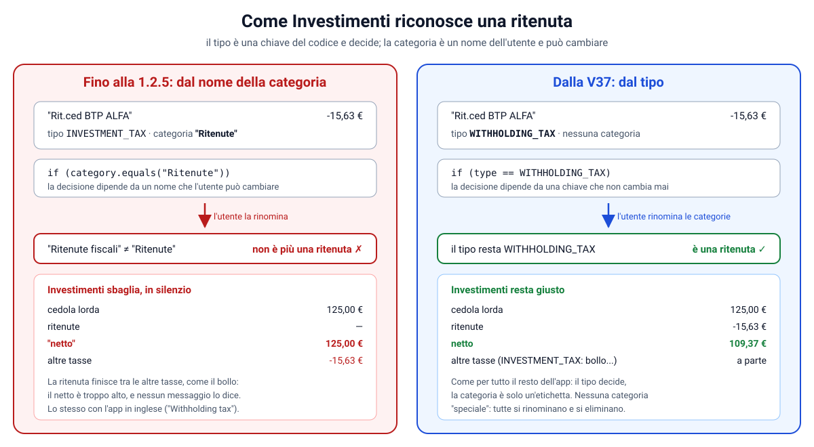
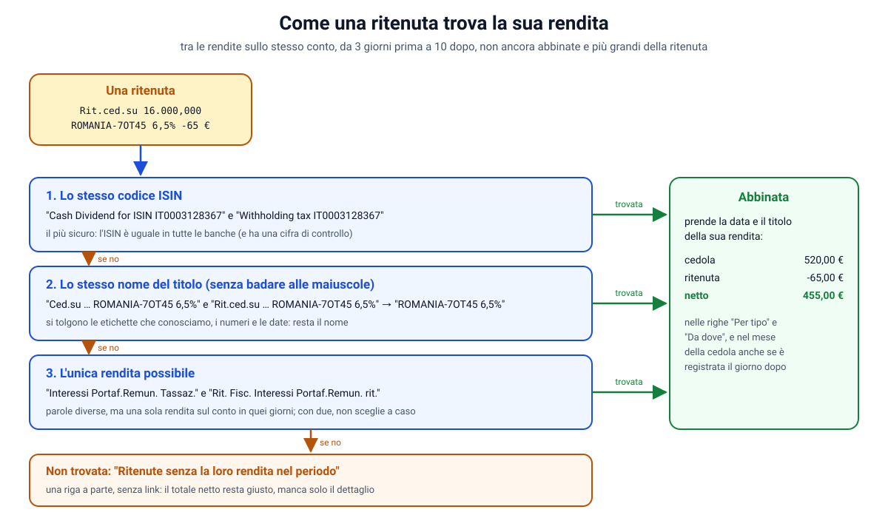

# Investimenti: quanto hai investito, quanto hai spostato, e quanto ti hanno reso

**Obiettivo:** una scheda **"Investito"** nel Riepilogo e una pagina **Investimenti** con tre grafici:
- quanto hai investito in titoli: acquisti meno vendite (un ETF su Trade Republic, il robo advisor di Tinaba, un
  BTP comprato dalla banca);
- i bonifici che hai fatto verso i conti di investimento;
- quanto ti hanno reso: cedole, dividendi, interessi.

> **Da leggere per prima la Parte I.** La prima versione (parti B-D) contava un solo "versato" che mescolava bonifici
> e acquisti. La Parte I lo divide in due grandezze, ognuna con il suo nome: dove le parti B-D dicono "versato",
> vale quello che dice la Parte I.

> Questa guida non ha un numero: è stata scritta mentre un'altra sessione lavorava alla Fase 4 (le guide 44-48 e
> le successive). Senza numero non si scontra con le loro. Il lavoro parte dalla Fase 4 al passo 5 (PIN, nginx,
> backup) e la usa: l'API è protetta dal PIN come tutte le altre.

| Parte | Cosa |
|---|---|
| A | prima di tutto: i movimenti devono avere il tipo giusto |
| B | i calcoli: contare una volta sola |
| C | l'API e la scheda del Riepilogo |
| D | la pagina e i suoi grafici |
| E | che cosa **non** è: il valore di oggi |
| F | i test, e la prova nel browser |
| G | esercizi guidati |
| H | aggiunta: la prova delle regole dice chi vince, e altri due ritocchi |
| I | **due grandezze, non una**: l'investito in titoli e i bonifici verso i conti di investimento |
| J | barre che dicono le cifre; rendite lorde, ritenute e nette; i nomi dei titoli in "Da dove" |
| K | le barre delle rendite sono il netto |
| L | "Da dove": il nome intero del titolo, anche con le cifre |
| M | solo il netto: niente lordo e ritenute, anche negli elenchi |
| N | il periodo "Quest'anno" (YTD) |
| O | la ritenuta sta nel giorno della sua cedola, anche a cavallo di due mesi |
| P | le righe di "Per tipo", "Da dove" e "Altre tasse" portano ai movimenti (`docs/collegamenti.md`) |

---

## Parte A: prima di tutto, il tipo giusto

L'app conosce già i tipi degli investimenti (`docs/03`). Nessuno conta come spesa o come entrata: sono "tenuti a
parte".

| Tipo | Esempio |
|---|---|
| Versamento investimenti | il bonifico mensile verso il conto del PAC, o verso il broker |
| Prelievo investimenti | soldi che tornano dal conto investimenti al conto corrente |
| Acquisto / Vendita titoli | un ETF comprato su Trade Republic; un BTP comprato dal dossier titoli della banca |
| Cedole, dividendi e interessi (`INVESTMENT_INCOME`) | categorie Cedole, Dividendi, Interessi; le regole per ING ("Ced.su", "Div.su") e Trade Republic ci sono già |
| Tasse investimenti | ritenute, imposta di bollo |

Perché un bonifico verso il conto del PAC conti, deve avere il tipo **Versamento investimenti**. Tre modi:

1. **Il conto con il ruolo Investimenti.** In Conti, quello del broker (collegato), oppure un **conto manuale** con il
   suo IBAN se la banca non si può collegare, come Tinaba. Il bonifico che cita quell'IBAN diventa da solo un
   versamento (`ClassificationService`, passo 5: "il movimento cita l'IBAN di un altro tuo conto").
2. **Una regola**: "se il testo contiene TINABA, allora il tipo è Versamento investimenti". Vale per tutti i
   bonifici, passati e futuri, qualunque sia l'importo. **Attenzione alla priorità** (Parte H): se la causale finisce
   con "Note: Trasferimento a mio conto", la regola di partenza a priorità 40 viene prima.
3. **Per un movimento solo**: nella sua scheda, "Conta come".

Se non c'è ancora niente, la pagina Investimenti mostra proprio questi tre modi.

---

## Parte B: i calcoli, contare una volta sola

> **Superata dalla Parte I.** Il problema dei "tre movimenti" resta vero, ma la soluzione qui sotto (`contribution`,
> un "versato" solo) mescolava bonifici e acquisti, e non esiste più. Resta come storia del ragionamento.

**Il problema.** 200 € che vanno da ING a Trade Republic e poi in un ETF compaiono **tre volte**:

1. l'uscita da ING (versamento, −200);
2. l'entrata su Trade Republic, l'altra metà dello stesso trasferimento (anche lei "versamento", +200);
3. l'acquisto dell'ETF su Trade Republic (−200).

Sommare tutto darebbe 0, o 400, o 600, secondo come si contano i segni. Sono sempre gli stessi 200 €.

**La regola.** Contano solo i movimenti dei **conti normali**, cioè non quelli con il ruolo Investimenti:

```java
public static BigDecimal contribution(Movement m) {
    if (m.onInvestmentAccount()) {
        return BigDecimal.ZERO;
    }
    return switch (m.type()) {
        case INVESTMENT_DEPOSIT, INVESTMENT_WITHDRAWAL, SECURITIES_BUY, SECURITIES_SELL -> m.amount().negate();
        default -> BigDecimal.ZERO;
    };
}
```

- Un'uscita di −200 verso gli investimenti è **+200** di versato (`negate()`); un rientro di +50 è −50.
- Di quei tre movimenti conta solo il primo: gli altri due sono su un conto di investimento.
- Funziona anche per un conto che **non si può collegare** (Tinaba): lì esiste solo l'uscita da ING, ed è
  esattamente quella che si conta.
- Un BTP comprato **direttamente dal conto corrente** (il dossier titoli della banca) conta anche lui: sono soldi
  che escono dal conto normale verso un investimento.

Il risultato si chiama **versato netto**: quello che è andato, meno quello che è tornato.

**Le rendite** sono più semplici: cedole, dividendi e interessi si sommano così come sono, su qualsiasi conto (un
dividendo annullato è negativo e si toglie da solo). Le tasse sugli investimenti si sommano a parte.

**La linea parte dalla storia.** Il grafico mostra il versato **in tutto** mese per mese, non solo nel periodo
guardato. Il primo mese della linea comprende tutto quello che hai versato prima:

```java
BigDecimal cumulative = movements.stream()
        .filter(m -> m.date().isBefore(first.atDay(1)))
        .map(Investments::contribution)
        .reduce(BigDecimal.ZERO, BigDecimal::add);
```

`reduce` è la "somma" degli stream: parte da zero e aggiunge ogni valore. È lo stesso schema di `Explorer` per
Analisi (`docs/38`): i calcoli in una classe di funzioni pure (`Investments`), che ricevono i movimenti e
restituiscono i numeri. Si provano con test semplici, senza database.

---

## Parte C: l'API e la scheda del Riepilogo

> I campi dell'API e le cifre della scheda sono cambiati con la Parte I ("Investito in titoli quest'anno" al posto di
> "Versato quest'anno"). Il resto di questa parte vale ancora.

```
GET /api/investments?period=YEAR          (YEAR = 12 mesi, TWO_YEARS = 24, ALL = tutta la storia, max 10 anni)
```

Risponde con:
- il versato: in tutto, quest'anno, questo mese, nel periodo;
- le rendite: quest'anno e nel periodo, più le tasse del periodo;
- un elemento per mese: `contributed`, `cumulative`, `income`, `taxes`;
- le rendite raggruppate per tipo (Cedole, Dividendi…) e per titolo;
- gli ultimi 8 versamenti.

I movimenti di investimento sono pochi (uno o due al mese), quindi la query li legge **tutti**, con conto e categoria
già caricati (`JOIN FETCH`): una query sola, niente query per ogni movimento.

Come per le altre API dalla Fase 4 (`docs/46`), serve la sessione del PIN. Nei test di MockMvc la dà
`IntegrationTestConfiguration`, che parte "come chi ha già inserito il PIN".

**La scheda "Investito"** (`InvestmentsCard`) sta nel Riepilogo, sotto "In arrivo":
- **Versato quest'anno** e **Rendite quest'anno**;
- un piccolo grafico del versato degli ultimi 12 mesi;
- tutta la scheda è un link alla pagina.

Si carica da sola, perché parla dell'anno e non del mese che stai guardando. **Non compare** se non c'è niente: chi
non investe non deve vedere una scheda vuota. Se la richiesta fallisce, il Riepilogo funziona lo stesso senza la
scheda.

Il piccolo grafico usa la stessa curva del grafico grande (`smoothPath`). Due dettagli SVG:
- `preserveAspectRatio="none"` lo stira su tutta la larghezza della scheda;
- `vector-effect: non-scaling-stroke` tiene la linea dello stesso spessore anche se il disegno è stirato.

---

## Parte D: la pagina e i suoi grafici

> La pagina di oggi è descritta nella Parte I: la linea è l'investito in titoli, i bonifici hanno le loro barre, e
> gli elenchi sotto sono due. Questa parte vale ancora per i dettagli dei grafici, della modalità discreta e delle
> sigle.

La pagina `/investimenti` si apre dalla scheda, e anche dall'elenco "Altro" (sul PC, dalla colonna).

**In alto**: 12 mesi · 2 anni · Tutto.

**La scheda grande: il versato.**
- La cifra grande dice il **versato in totale**, con "3.000 € quest'anno · 200 € questo mese".
- Sotto, la **linea** che cresce mese per mese (`TrendChart`). È la sorella del grafico del Riepilogo (`docs/41`,
  parte G): stessa curva, stessa sfumatura, stessa linea che si disegna, stesso scorrimento con il dito, il mouse o
  le frecce. Scorrendo, la cifra grande diventa "Versato fino a febbraio 2026".
- Cambia la scala: un punto per **mese** invece che per giorno, e sotto cinque mesi distribuiti ("nov … ott").
- Gli stili sono gli stessi (le classi `month-chart…`): nessuno stile nuovo per la linea.

**La scheda delle rendite.**
- La cifra del periodo, e le tasse dello stesso periodo.
- Le **barre** mese per mese, con il componente di Analisi (`BarChart`). In evidenza c'è l'**ultima rendita
  incassata**, non il mese in corso: quasi sempre il mese in corso è a zero, e nessuna barra risaltava.
- Due elenchi: **per tipo** (Cedole, Dividendi, Interessi) e **da dove** (il titolo o l'emittente).

**Gli ultimi versamenti**, con la stessa riga dei Movimenti (iniziale colorata, nome leggibile), e il link al
dettaglio.

**La modalità discreta** (`docs/42`) vale anche qui: le cifre passano dalla pipe `money` e da `privacy.hide()`, e
anche le scritte sull'asse della linea sono nascoste.

Un dettaglio trovato provando: "CED.SU BTP ITALIA" diventava "Ced.su Btp Italia". Ora `readable` tiene maiuscole
anche le sigle dei titoli: BTP, BOT, CCT, CTZ, ETF, ETC.

---

## Parte E: che cosa **non** è, il valore di oggi

L'investito sono **i soldi messi nei titoli**, non quanto valgono adesso. Se il PAC è salito del 10%, la pagina non lo sa:
- per saperlo servirebbero le **quotazioni** dei titoli (un servizio di prezzi);
- e le **quantità** possedute (le posizioni del conto titoli).

L'app non ha né le une né le altre. La pagina lo dice sotto il grafico: "Non è quanto valgono oggi". Un grafico che
sembrasse un rendimento sarebbe un dato falso. È un possibile progetto futuro, non un difetto.

---

## Parte F: i test, e la prova nel browser

Backend, 363 test (compresi quelli della Fase 4):

- `InvestmentsTest` (puri):
  - i tre movimenti di un versamento verso il broker contano **una volta**;
  - un prelievo toglie; un acquisto dal conto corrente conta; una spesa e una cedola non sono versamenti;
  - la linea parte dalla storia prima del periodo;
  - le rendite raggruppate dalla più alta, con "Altre rendite" per quelle senza categoria.
- `InvestmentServiceTest` (database vero):
  - un PAC su un conto non collegato, un versamento verso il broker con le sue due metà e l'acquisto dell'ETF, un
    prelievo, cedole, un dividendo, il bollo;
  - il totale (3.100 €), l'anno, il mese, i 12 punti della linea, i periodi "Tutto" e "2 anni";
  - l'API che rifiuta una valuta o un periodo sbagliati.

Frontend, 217 test: la pagina (cifre, linea, barre, elenchi, l'ultimo versamento che porta al dettaglio), i
periodi, lo scorrimento della linea con la tastiera, la pagina vuota che spiega che cosa fare, la modalità discreta,
la scheda del Riepilogo che compare e che sparisce.

Nel browser (telefono, PC, notte), con un PAC inventato da 200 € al mese per 20 mesi, un ETF da 1.000 € comprato
dal conto corrente, due cedole di un BTP, un dividendo e il bollo:

- **i numeri, controllati anche a mano**: versato 5.000 € (20 × 200 + 1.000), quest'anno 3.000 €, rendite
  dell'anno 49,65 € (31,25 + 18,40);
- la scheda nel Riepilogo porta alla pagina; scorrendo la linea, "Versato fino a febbraio 2026: 3.400 €";
- nessuna pagina più larga dello schermo.

Tre ritocchi trovati così:
1. l'etichetta "Cedole, dividendi, interessi" nella scheda andava su due righe e disallineava le cifre: ora è
   "Rendite quest'anno";
2. la barra in evidenza era quella del mese in corso, a zero: ora è l'ultima rendita;
3. le sigle dei titoli (Parte D).

---

## Parte G: esercizi guidati

1. **Il PAC di Tinaba.** Crea il conto manuale "Tinaba" con il ruolo Investimenti e il suo IBAN, e importa il suo
   CSV (`docs/tinaba.md`). Apri un bonifico verso Tinaba: che tipo ha adesso? In quale grafico della pagina conta? E
   il "Nuovo versamento Robo advisor"?
2. **Senza contare due volte.** In `Investments.transferred`, togli il controllo `onInvestmentAccount()`. Quali
   righe della tabella di `InvestmentsTest` falliscono, e con quale numero? Perché?
3. **Il rendimento delle cedole.** Aggiungi alla pagina "rendite / investito" in percentuale, per l'anno. Perché non
   è il rendimento vero del portafoglio (pensa ai titoli comprati a dicembre)?
4. **L'avviso.** Crea un conto manuale con ruolo Investimenti e mettigli solo un versamento (con "Conta come"). Che
   cosa dice la pagina? Che cosa succede quando gli aggiungi un acquisto?

---

## Parte H: la prova delle regole dice chi vince, e altri due ritocchi

### Il problema, trovato usando l'app

Una regola per i bonifici verso il PAC ("contiene" l'IBAN del conto, "allora il tipo è Versamento investimenti",
priorità 100). "Prova" diceva: "corrisponde a 4 movimenti". Salvata, i 4 bonifici restavano "Trasferimento interno".

Il motivo: le causali finivano con "Note: Trasferimento a mio conto", e c'è una **regola di partenza**,
"Trasferimento a un proprio conto", con **priorità 40**, che scatta su quelle parole. Le regole si provano dalla
priorità più bassa (`docs/07`): vinceva lei, sempre. La soluzione per l'utente era semplice (priorità 10), ma la
pagina non lo diceva: "corrisponde a 4" sembrava "vale per 4".

### La prova ora dice quanti ne classificherebbe davvero, e chi vince sugli altri

```
Il testo di questa regola corrisponde a 4 movimenti. La regola ne classificherebbe 0.
• 4 movimenti: vince la regola «Trasferimento a un proprio conto», che ha priorità 40.
  Per far valere questa, dalle una priorità più bassa di 40.
```

Nel backend (`RuleService.preview`) ogni movimento che corrisponde passa da `blockerOf`, che legge la **classificazione
attuale** del movimento. Quella è il risultato dell'ordine della classificazione, quindi dice chi vince oggi:

| Il movimento ha… | Chi vince | Il messaggio |
|---|---|---|
| un tipo scelto a mano | la scelta a mano (passo 2) | "una scelta a mano vince sempre sulle regole" |
| nessuna regola, e un tipo da trasferimento | un trasferimento tra i tuoi conti (passi 4 e 5) | "dagli il ruolo Investimenti in Conti" |
| una regola che viene prima | quella regola | il nome, la priorità, "dalle una priorità più bassa" |
| una regola che viene dopo, o nessuna | la regola provata | (conta in "ne classificherebbe") |

"Viene prima" vuol dire priorità più bassa; a parità di priorità, la regola creata prima (id più piccolo). Una regola
**in modifica** non deve bloccare sé stessa: la pagina manda il suo id (`POST /api/rules/preview?id=7`). Una regola
nuova non ha ancora un id, e a parità di priorità arriva dopo tutte.

La risposta ha due campi in più, `applies` e `blockers`: chi usava solo `matches` e `examples` continua a funzionare.

### Anche dopo "Salva"

Non tutti premono "Prova". Dopo il salvataggio la pagina rifà la prova da sola, per la regola appena salvata. Se su
qualche movimento vince qualcun altro, compare un avviso sopra il modulo: "la regola «PAC» è salvata, ma per alcuni
movimenti che corrispondono al suo testo non vince lei", con lo stesso elenco. L'elenco è scritto una volta sola, in
un `ng-template` usato in tutti e due i posti, come la tabella delle regole (`docs/39`, parte F).

### "Modifica" porta il modulo in vista

Con molte regole il pulsante "Modifica" è in fondo alla pagina e il modulo in cima: il modulo si riempiva senza che
si vedesse. Ora la pagina sale al modulo (`scrollIntoView`), come nel Budget (`docs/39`, parte B).

### "Tutti i movimenti di questo esercente": al massimo 10 parole

La ricerca accetta al massimo 10 parole (`docs/32`, `TransactionSearch.MAX_WORDS`). La chiave di un bonifico
istantaneo ne ha di più ("bonifico istantaneo da voi disposto n a favore di …"), e il link apriva Movimenti con
"Troppe parole da cercare" e nessun risultato. Ora cerca le **prime 10 parole intere** (`merchantSearch`). Ogni parola
deve esserci, quindi togliere le ultime allarga soltanto un poco la ricerca, e i movimenti dell'esercente ci sono
tutti.

### I test, e la prova nel browser

- `RuleControllerTest`: tre bonifici inventati con "Note: Trasferimento a mio conto", uno scelto a mano. A priorità 100
  la regola ne classificherebbe 0: 2 li prende la regola di partenza (priorità 40), 1 la scelta a mano. A priorità
  10, 2. Salvata e riprovata come regola in modifica, non blocca sé stessa.
- `rules-page.spec.ts`: il messaggio della prova; l'avviso dopo il salvataggio; "Modifica" porta in vista il modulo.
- `transaction-detail.spec.ts`: le 10 parole intere.
- Nel browser, con quattro bonifici inventati:
  - la prova e l'avviso dicono che vince la regola a 40;
  - "Modifica" riporta in cima; con priorità 10 la regola classifica i 4 bonifici e l'avviso sparisce;
  - "Tutti i movimenti di questo esercente" trova i 4 movimenti, senza errore.

### Un limite che resta

I bonifici istantanei di ING verso **te stesso** ("A favore di NOME COGNOME IBAN beneficiario …") hanno tutti la stessa
chiave dell'esercente, qualunque sia il conto di arrivo: il PAC, il broker, un altro tuo conto. "Lo stesso esercente"
li mette insieme. Per separarli servirebbe una regola nuova in `MerchantKey`: il nome dopo "A favore di", e l'IBAN
quando il nome è il tuo. Cambiando la chiave serve anche una migrazione che ricalcoli le chiavi salvate (`docs/40`).
È da fare quando la Fase 4 sarà finita, per non scontrarsi con le sue migrazioni.


---

## Parte I: due grandezze, non una

### Il problema, trovato usando l'app

La pagina aveva un solo numero, il **versato**, con sotto la frase "Sono i soldi che hai messo negli investimenti,
meno quelli che hai ripreso". Ma quel numero contava soprattutto i **bonifici** verso i conti di investimento, e un
bonifico non è un investimento: i soldi arrivati sul conto del broker possono restare lì fermi, essere spesi con la
carta del broker, tornare indietro. Investire vuol dire **comprare** titoli; quello che torna da un investimento è
una **vendita** (o una cedola, un dividendo).

Erano due domande diverse sotto una parola sola:

| Grandezza | Che domanda risolve | Come si calcola |
|---|---|---|
| **Investito in titoli** | quanto ho comprato, meno quanto mi è tornato vendendo? | su **tutti** i conti: −importo di Acquisto titoli e Vendita titoli |
| **Bonifici verso i conti di investimento** | quanti soldi ho spostato dai conti di tutti i giorni verso broker e wallet? | solo sui conti che **non** hanno il ruolo Investimenti: −importo di Versamento e Prelievo investimenti |

### Le parole

- **Conto di investimento**: un conto con il ruolo **Investimenti** in Conti (Trade Republic, Tinaba, un conto
  titoli). Tutti gli altri (Principale, Spese, Carta di credito…) sono i **conti di tutti i giorni**.
- **Il deposito titoli della banca**: molte banche permettono di comprare azioni o BTP direttamente dal conto
  corrente. L'acquisto compare tra i movimenti del conto corrente come "Compravendita Titoli", e la regola di
  partenza di `V4` lo fa diventare Acquisto titoli. È un investimento vero anche se il conto non è di investimento:
  per questo l'investito si conta su tutti i conti.

### Il calcolo

In `Investments`, al posto di `contribution` ci sono quattro funzioni, ognuna con un nome che dice che cosa conta:

```java
/** Quanto il movimento ha comprato di titoli: un acquisto di -200 è 200. */
public static BigDecimal bought(Movement m) {
    return m.type() == TransactionType.SECURITIES_BUY ? m.amount().negate() : BigDecimal.ZERO;
}

/** Quanto è rientrato vendendo titoli: una vendita di +150 è 150. */
public static BigDecimal sold(Movement m) {
    return m.type() == TransactionType.SECURITIES_SELL ? m.amount() : BigDecimal.ZERO;
}

/** L'investito netto in titoli: acquisti meno vendite. */
public static BigDecimal invested(Movement m) {
    return bought(m).subtract(sold(m));
}

/** Quanto il movimento aggiunge ai bonifici verso i conti di investimento. */
public static BigDecimal transferred(Movement m) {
    if (m.onInvestmentAccount()) {
        return BigDecimal.ZERO;                     // l'altra metà dello stesso bonifico
    }
    return switch (m.type()) {
        case INVESTMENT_DEPOSIT, INVESTMENT_WITHDRAWAL -> m.amount().negate();
        default -> BigDecimal.ZERO;
    };
}
```

**Perché il segno si gira** (`negate()`): dal punto di vista del conto, un acquisto o un bonifico verso il broker è
un'uscita (−200); per gli investimenti sono +200.

**Perché l'investito non conta mai due volte.** Un acquisto è un movimento solo, su un conto solo. Il bonifico
invece ha due metà (l'uscita da ING e l'entrata sul broker, tutte e due "Versamento investimenti"): si conta solo
quella sul conto di tutti i giorni. È anche l'unica che c'è quando il broker non è nell'app.

### I casi, uno per uno

È la tabella di `InvestmentsTest.eachCaseCountsInTheRightPlace`: un caso per riga, provato davvero.

| # | Storia | Investito | Bonifici |
|---|---|---|---|
| 1 | bonifico di 200 da ING al broker (le due metà) | 0 | +200 |
| 2 | il broker compra un ETF da 200 | +200 | 0 |
| 3 | acquisto di 200 nel deposito titoli del conto corrente | +200 | 0 |
| 4 | vendita di titoli per 150 sul broker | −150 | 0 |
| 5 | 150 tornano dal broker a ING (le due metà) | 0 | −150 |
| 6 | dividendo di 10 sul broker | 0 (va nelle rendite) | 0 |
| 7 | spesa di 30 con la carta del broker | 0 | 0 |
| 8 | prelievo di 50 al bancomat dal conto del broker | 0 | 0 |
| 9 | 200 dal broker a un altro conto di investimento | 0 | 0 |
| 10 | Tinaba: il bonifico da ING, poi "Nuovo versamento Robo advisor" | +200 | +200 |

Che cosa si impara:

- **I casi 7 e 8** (soldi del broker spesi o prelevati) non toccano niente: sono **spese normali**, e si vedono già in
  Riepilogo, Budget e Analisi. Il grafico dei bonifici dice "ho spostato 200 €", e resta vero.
- **Il caso 1 senza il caso 2**: i soldi sono arrivati al broker ma non sono stati investiti. I bonifici dicono
  200, l'investito 0. La differenza tra le due cifre è la liquidità ferma sui conti di investimento: per mostrarla
  davvero servono i **saldi dei conti**: ci sono da `V34`, e la pagina ha la scheda "Liquidità sui conti di
  investimento" (`docs/saldi.md`, parte D).
- **Il caso 10**: per Tinaba la regola di `V31` fa del "versamento Robo advisor" un Acquisto titoli. Non sono i
  singoli ETF comprati dal robo, ma è il momento in cui i soldi entrano nel portafoglio.

### Le vendite non sono rendite

Una **cedola** o un **dividendo** è un guadagno: soldi in più. Una **vendita** restituisce soprattutto il
**capitale** che c'era dentro, più (o meno) un guadagno. Quanto sia guadagno l'app non lo sa: servirebbe il prezzo
di carico di ogni titolo, che i movimenti bancari non danno. Per questo le vendite fanno **scendere** l'investito, si
vedono a parte ("Rientrato dalle vendite") e non si sommano mai alle rendite.

### L'API

`GET /api/investments` ora risponde con nomi che dicono la verità:

| Campo | Che cosa |
|---|---|
| `investedTotal`, `investedThisYear`, `investedThisMonth` | l'investito netto: in tutto, dal 1° gennaio, nel mese |
| `boughtInPeriod`, `soldInPeriod` | acquistato e rientrato dalle vendite nel periodo, separati |
| `transferredTotal`, `transferredInPeriod` | i bonifici netti verso i conti di investimento |
| `incomeThisYear`, `incomeInPeriod`, `taxesInPeriod` | rendite e tasse, come prima |
| `months[]` | per mese: `bought`, `sold`, `investedCumulative` (la linea), `transferred` (le barre), `income`, `taxes` |
| `trades`, `transfers` | **tutti** i movimenti del periodo che fanno i due grafici, dal più recente |
| `onlyTransfers` | i conti di investimento con bonifici ma, in tutta la storia, nessun acquisto né vendita |

API e frontend stanno nello stesso repository e si cambiano insieme: nessun campo vecchio da tenere.

### L'avviso "si vedono solo i bonifici"

Un broker di cui hai creato il conto (per far riconoscere i bonifici) ma di cui non importi i movimenti: i bonifici
si vedono, gli acquisti no, e l'investito è più basso del vero. `InvestmentService.onlyTransfers` trova questi
conti: ruolo Investimenti, almeno un versamento o un prelievo, nessun acquisto né vendita. La pagina lo dice in cima:
"Per <conto> si vedono solo i bonifici, nessun acquisto: quello che hai comprato lì non è nell'investito. Importa i
movimenti del conto in Importa per vederlo."

Un limite: un bonifico verso un broker che **non** è nell'app (classificato con una regola o con "Conta come") non ha
un conto da nominare, e l'avviso non lo vede. Il rimedio è creare il conto manuale con il suo IBAN.

### La pagina

Dall'alto, prima per il telefono:

1. **Investito in titoli**: la cifra grande (scorrendo la linea, "Investito fino a <mese>"), "… quest'anno · …
   questo mese", la linea del cumulato, e sotto due cifre del periodo, **Acquistato** e **Rientrato dalle
   vendite**. La frase: "Acquisti di titoli meno vendite, da tutti i conti. Non è quanto valgono oggi: per quello
   servirebbero le quotazioni."
2. **Bonifici verso i conti di investimento**: la cifra del periodo e le **barre** mese per mese. Sono un flusso, non
   un accumulo: le barre mostrano quando hai spostato soldi. Con `diverging` del grafico di Analisi, un mese in cui
   sono tornati più soldi di quanti ne sono andati scende sotto lo zero. La frase: "Non dicono quanti ne hai
   investiti: quello è l'investito in titoli."
3. **Cedole, dividendi e interessi**, come prima, con in fondo: "Le vendite non sono qui".
4. Due elenchi: **Acquisti e vendite** e **Bonifici verso i conti di investimento** del periodo. Sono gli stessi
   movimenti dei due grafici: si vedono i primi 8, gli altri con "Mostra tutti (N)" (`InvestmentMovements`, con un
   `linkedSignal` che richiude l'elenco quando cambia il periodo). Ogni riga porta al dettaglio del movimento.

Sul PC, a sinistra investito e bonifici, a destra le rendite.

La pagina vuota spiega come far riconoscere anche gli **acquisti** (le regole di partenza, "Conta come"), non solo i
bonifici.

**La scheda del Riepilogo**: "Investito in titoli quest'anno" e "Rendite quest'anno", con la piccola linea
dell'investito a 12 mesi.

### I test, e la prova nel browser

Backend:

- `InvestmentsTest`: la tabella dei casi (14 righe, con le due metà dei bonifici), acquisti e vendite separati e mai
  rendite, la linea che parte dalla storia prima del periodo, le barre dei bonifici con un mese negativo;
- `InvestmentServiceTest`, con un database vero: un PAC verso un conto che non è nell'app, un bonifico al conto
  titoli con l'acquisto di un ETF, un acquisto nel deposito titoli del conto corrente, una vendita, un prelievo, una
  spesa con la carta del conto titoli (che non conta), un secondo conto di investimento con un solo versamento
  (l'avviso), cedole, un dividendo, il bollo.

Frontend: la pagina (le tre schede, acquistato e rientrato, le barre in su e in giù, la frase vera), i due elenchi
con "Mostra tutti", l'avviso, lo scorrimento della linea, la pagina vuota, la modalità discreta, la scheda del
Riepilogo.

Nel browser (telefono e PC), con un anno inventato: 200 € al mese da ING a Tinaba e nel robo advisor, 1.000 € a
Trade Republic in un ETF, un BTP da 500 € dal deposito titoli, una vendita da 300 €, 100 € tornati a ING, una spesa
con la carta di Trade Republic, un conto "Fondo Beta" con un solo versamento. I numeri, controllati a mano:

| Cifra | Conto | Pagina |
|---|---|---|
| investito in totale | 12 × 200 + 1.000 + 500 − 300 | 3.600 € |
| acquistato negli ultimi 12 mesi (da dicembre) | 11 × 200 + 1.000 + 500 | 3.700 € |
| bonifici negli ultimi 12 mesi | 11 × 200 + 1.000 + 200 (Fondo Beta) − 100 | 3.300 € |
| avviso | | "Per Fondo Beta · PAC si vedono solo i bonifici" |

La spesa con la carta non compare da nessuna parte nella pagina, come deciso.

---

## Parte J: le cifre delle barre, lordo e netto, i nomi dei titoli

Tre cose emerse usando l'app con i movimenti veri.

### Le barre dicono le cifre

**Il problema.** I due grafici a barre (bonifici e rendite) non avevano numeri: niente cifra per mese, niente
riferimento sull'asse, barre che non si toccavano. Una barra era colorata (l'ultimo mese con un valore) senza dire
perché.

**La soluzione**, con quello che il grafico di Analisi sapeva già fare (`BarChart`):

- `[interactive]="true"`: ogni barra si tocca (o con Tab e Invio). La barra toccata si accende;
- sopra il grafico una riga (`.bar-pick`) dice **il mese in evidenza e la sua cifra**: "marzo 2026: 1.200,00 €". Prima
  di toccare, il mese in evidenza è l'ultimo con un valore: è quello che era colorato, ora con il suo perché;
- `[average]`: una **linea tratteggiata della media al mese**, con l'etichetta "media 275 € al mese". È il riferimento
  per leggere le altezze delle altre barre, senza un asse pieno di numeri (che sul telefono non ci sta).

Cambiando periodo, la barra toccata si dimentica (`incomePick` e `transferPick` tornano `null`).

### Rendite: lordo, ritenute, netto

**Come pagano le banche.** Fineco accredita la cedola o il dividendo **lordo**, e trattiene la ritenuta con un
**movimento a parte** ("Rit.ced …", "Rit.div …"). Le regole di partenza di `V4` danno a quei movimenti il tipo Tasse
investimenti e la categoria **Ritenute**. Trade Republic invece accredita già il **netto**: non c'è niente da togliere.

**Prima** la pagina mostrava le rendite lorde e, sotto, "Tasse sugli investimenti" tutte insieme: ritenute, bollo,
capital gain. Il netto non si vedeva, e il bollo sembrava una tassa sulle cedole.

**Ora** le tasse sono divise in due, per categoria (`Investments.withholding` e `otherTaxes`):

| | Che cosa | Dove si vede |
|---|---|---|
| **Ritenute** | le tasse con la categoria "Ritenute": quelle sulle rendite | si tolgono dal lordo: **lordo + ritenute = netto** |
| **Altre tasse** | bollo, capital gain, Tobin tax, tasse senza categoria | elencate a parte, per categoria; **non** si tolgono dal netto |

La scheda delle rendite mostra in grande il **netto**, sotto **Lordo** e **Ritenute**, e toccando una barra
"ottobre 2026: lordo 125,00 € · ritenute -15,63 € · netto 109,37 €". Le barre restano le rendite lorde (come le paga
la banca): una ritenuta pagata in un mese diverso dalla sua cedola non fa scendere una barra sotto lo zero.

Per Trade Republic lordo e netto coincidono, e la pagina lo dice. Una ritenuta che finisce tra le "Altre tasse" ha la
categoria sbagliata: la nota sotto l'elenco lo dice.

Nell'API: `withholdingInPeriod`, `otherTaxesInPeriod`, `otherTaxesByType`, e in ogni mese `withholding` e
`otherTaxes` al posto di `taxes`. Il Riepilogo non cambia: le sue "rendite nette degli investimenti" erano già rendite
più tutte le tasse.

### "Da dove": il nome del titolo

**Il problema.** Una voce "Ced.su" con 5 movimenti non dice niente. Il nome si ricavava con
`MerchantKey.displayName`, che toglie tutte le parole con cifre: per un BTP che Fineco indica solo con il codice ISIN
("Ced.su 50.000 IT0005436693") restava solo l'etichetta "Ced.su".

**La soluzione**, `Investments.securityName`:

- si toglie l'**etichetta iniziale** ("Ced.su", "Div.su", "Rit.ced", "Rit.div", "Cash Dividend"…): che sia una
  cedola lo dice già "Per tipo";
- si tolgono le parole con cifre (quantità, date), **tranne i codici ISIN**, che a volte sono l'unico nome del titolo.

| Causale | Prima | Ora |
|---|---|---|
| `Ced.su 50.000 IT0005436693` | Ced.su | IT0005436693 |
| `Ced.su BTP CUM 15/09/2032` | Ced.su BTP CUM | BTP CUM |
| `Div.su 100 ENI` | Div.su ENI | ENI |

Anche il filtro `readable` tiene maiuscolo un ISIN (prima diventava "It0005436693"). Il nome per esteso di un titolo
indicato solo dall'ISIN l'app non lo sa: i movimenti della banca non lo danno, e servirebbe un servizio esterno.

### I test, e la prova nel browser

- `InvestmentsTest`: ritenute e altre tasse separate; il nome del titolo (ISIN tenuto, etichetta tolta);
- `InvestmentServiceTest`: una cedola lorda con la sua ritenuta: lordo, ritenute, mese per mese, e l'ISIN in "Da
  dove";
- `investments.spec.ts`: netto, lordo e ritenute; le altre tasse; toccando una barra il mese e le sue cifre; la linea
  della media; `readable.spec.ts`: l'ISIN maiuscolo.

Nel browser (telefono e PC, tema scuro), con una cedola inventata "Ced.su 50.000 IT0005436693" da 125 € e la sua
"Rit.ced" da −15,63 €, classificate dalle regole di partenza: "ottobre 2026: lordo 125,00 € · ritenute -15,63 € ·
netto 109,37 €"; "marzo 2026: 1.200,00 €" toccando la barra dei bonifici; "IT0005436693" in "Da dove"; il bollo tra
le altre tasse.

---

## Parte K: le barre delle rendite sono il netto

**Il problema, trovato con i movimenti veri.** Con la parte J le barre erano le rendite **lorde**, e toccandone una si
leggeva "lordo · ritenute · netto" solo nei mesi con una ritenuta. Ma le banche pagano in due modi:

- Fineco paga il lordo e trattiene la ritenuta a parte: lì il mese mostrava lordo, ritenute e netto;
- Trade Republic accredita già il netto: lì il mese mostrava solo "lordo", che in realtà era un netto.

Due mesi uguali si leggevano in due modi diversi.

**La scelta: il netto, sempre.** Ogni barra è il netto del mese, `income + withholding` (le ritenute sono negative),
e toccandola si legge "maggio 2026: 1.233,79 € netti", per ogni mese e ogni banca. Anche la linea della media è sul
netto. Lordo e ritenute restano, per tutto il periodo, nelle cifre sopra il grafico.

Il calcolo sta tutto nel frontend (`investments-page.ts`, `income`): l'API dava già, per ogni mese, `income` e
`withholding`. Una ritenuta pagata in un mese diverso dalla sua cedola farebbe scendere quella barra sotto lo zero:
con Fineco non succede, perché cedola e ritenuta hanno lo stesso giorno.

Gli elenchi "Per tipo" e "Da dove" restano sul lordo: sono le rendite come le ha pagate la banca, titolo per titolo.

**I test.** `investments.spec.ts`: il mese in evidenza "giugno 2026: 12,50 € netti"; aprile, con una cedola di 30 € e
la ritenuta di 3,90 €, "26,10 € netti". Nel browser: ottobre con la cedola lorda di 125 € e la ritenuta di 15,63 €,
"109,37 € netti"; giugno e aprile la cifra accreditata.

---

## Parte L: "Da dove", il nome intero del titolo

**Il problema, trovato con i movimenti veri.** Dopo la parte J in "Da dove" è comparsa una voce "Senza nome del
titolo" da 3.663,10 € (6 movimenti). Una delle cedole:

```
Ced.su 16.000,000 ROMANIA-7OT45 6,5%
```

La regola della parte J toglieva l'etichetta e poi **tutte le parole con cifre**, tranne i codici ISIN. Qui le hanno
tutte: "16.000,000" è la quantità, ma "ROMANIA-7OT45" e "6,5%" sono il nome del bond. Non restava niente. L'errore era
nella regola: nel nome di un titolo le cifre ci sono (la scadenza, la cedola, un codice).

**La regola nuova** (`Investments.securityName`): si toglie solo quello che sicuramente non è il nome, e il resto
resta.

| Si toglie | Esempio |
|---|---|
| l'etichetta iniziale | `Ced.su`, `Div.su`, `Rit.ced`, `Cash Dividend`, `Interest payment for payout collection` |
| i numeri da soli, senza lettere | `16.000,000` (la quantità), `0,25` (un importo per azione) |
| le date | `15/09/2032`, `2026-10-31`, `2026-10` |
| i codici dei pagamenti (UUID) | `019e8191-0af0-76fc-a8ac-1d6ee06c92c0` |

| Causale | Parte J | Ora |
|---|---|---|
| `Ced.su 16.000,000 ROMANIA-7OT45 6,5%` | (niente: "Senza nome del titolo") | ROMANIA-7OT45 6,5% |
| `Ced.su 50.000 IT0005436693` | IT0005436693 | IT0005436693 |
| `Div.su 100 ENI` | ENI | ENI |
| `Interest payment for payout collection 019e…` | payout collection | (niente: il nome del conto) |

Un "6,5%" resta perché ha il segno di percentuale: non è un numero da solo, è la cedola del bond.

**Quando non resta niente**, al posto di "Senza nome del titolo" si usa il **nome del conto** (`InvestmentService`,
`movementOf`): gli interessi di Trade Republic, con un codice diverso ogni mese, stanno tutti insieme sotto "Trade
Republic ··9511", che almeno dice da dove arrivano.

**La visualizzazione.** Il filtro `readable` rende leggibili i testi tutti maiuscoli ("BTP ITALIA" → "BTP Italia").
Una parola che mescola lettere e cifre è un codice, e resta maiuscola: "ROMANIA-7OT45" diventa "Romania-7OT45", non
"Romania-7ot45". È la stessa regola che teneva maiuscoli gli ISIN, resa generale.

**I test.** `InvestmentsTest.theNameOfTheSecurityKeepsItsDigitsAndDropsLabelQuantitiesDatesAndCodes` (la tabella qui
sopra); `InvestmentServiceTest.fromWhereUsesTheWholeNameOfTheBondOrTheAccount` (il bond rumeno, e due interessi di
Trade Republic sotto il nome del conto); `readable.spec.ts`. Nel browser, con dati inventati: "Romania-7OT45 6,5%",
"IT0005436693", "BTP Italia", "Trade Republic · Conto titoli · 2 movimenti".

---

## Parte M: solo il netto, anche negli elenchi

**Il problema.** Le cifre "Lordo" e "Ritenute" sopra il grafico mescolavano due banche diverse. Le ritenute erano solo
quelle registrate come movimento a parte (Fineco); per Trade Republic, che accredita già il netto, non c'era niente da
sommare, e il suo netto finiva nel "Lordo". Calcolare le ritenute mancanti con una percentuale darebbe un numero
inventato: l'aliquota cambia (26%, 12,5% sui titoli di Stato, le ritenute dei Paesi esteri sui dividendi...).

Il CSV di Trade Republic una colonna `tax` ce l'ha (`docs/31`, parte B2), ma usarla vorrebbe dire dover caricare il file
solo per le tasse, anche il giorno in cui Trade Republic manderà i movimenti completi con Enable Banking (che dà
l'importo accreditato, non la ritenuta). Non ne vale la pena.

**La scelta: il netto, l'unico dato certo per tutte le banche.**

- in grande il netto del periodo, "quello che è arrivato sul conto"; le cifre "Lordo" e "Ritenute" non ci sono più;
- le barre erano già nette (parte K);
- **anche "Per tipo" e "Da dove" sono netti** (`Investments.netIncomeBy`): ogni ritenuta si toglie dalla rendita dello
  stesso titolo, riconosciuto dal nome ("Rit.ced 16.000,000 ROMANIA-7OT45 6,5%" e "Ced.su 16.000,000 ROMANIA-7OT45
  6,5%" danno lo stesso `securityName`). Per tipo, la ritenuta va nel tipo della sua rendita (Cedole, Dividendi). Una
  ritenuta senza la sua rendita nel periodo va nella riga "Ritenute non abbinate a una rendita": così la somma degli
  elenchi è sempre il netto in grande. Il numero dei movimenti conta le rendite, non le ritenute.

Le altre tasse (bollo, capital gain) restano a parte, come prima.

L'API dà ancora `incomeInPeriod` (lordo) e `withholdingInPeriod`: servono al netto, e il Riepilogo usa le rendite più
tutte le tasse.

**I test.** `InvestmentsTest.theListsAreNetEachWithholdingGoesToTheIncomeOfTheSameSecurity` (una cedola di 520 € con
la ritenuta di 65 € dà 455 € netti, per titolo e per tipo; una ritenuta senza rendita nella sua riga; la somma è il
netto); `InvestmentServiceTest` (il BTP con l'ISIN: 109,37 € netti); `investments.spec.ts` (niente "Lordo").

---

## Parte N: il periodo "Quest'anno" (YTD)

Accanto a 12 mesi, 2 anni e Tutto, il pulsante **"Quest'anno"**: da gennaio al mese di oggi (`Period.YEAR_TO_DATE`,
`InvestmentService.firstMonth` dà gennaio dell'anno in corso). Le schede dicono "da inizio anno". La linea
dell'investito partiva, allora, da tutta la storia prima del periodo (oggi parte da zero: parte S); le barre, le rendite e gli elenchi contano
solo i mesi dell'anno. La scheda del Riepilogo diceva già "quest'anno" e non cambia.

Lo stesso periodo c'è in Analisi (`docs/38`, aggiunta "Quest'anno").

**I test.** `InvestmentServiceTest.theYearToDateStartsInJanuary` (dieci mesi a metà ottobre, i bonifici del 2025
fuori); `investments.spec.ts` (il pulsante chiede `YEAR_TO_DATE`, "da inizio anno").

---

## Parte O: la ritenuta sta nel giorno della sua cedola

**Il problema, visto dall'utente.** Con la parte M ritenute e rendite si abbinavano solo **dentro** il periodo guardato.
Fineco a volte registra la ritenuta il giorno dopo la cedola: una cedola il 30 ottobre e la sua ritenuta il 1°
novembre. Guardando novembre, la ritenuta restava "non abbinata" a niente; guardando ottobre, la cedola sembrava più
alta del vero.

**Il ragionamento: competenza, non cassa.** La ritenuta non è un fatto a sé: è una parte della cedola, che la banca
registra un po' dopo. Allora conta **nel giorno della sua cedola**, qualunque periodo si guardi.

**Come** (`Investments.withholdingsOnTheirIncome`, chiamata da `InvestmentService` prima di qualsiasi conto):

1. l'abbinamento si fa su **tutta la storia**, prima di scegliere il periodo;
2. per ogni ritenuta si cerca la rendita dello **stesso titolo** (`securityName`: "Rit.ced 16.000,000 ROMANIA-7OT45
   6,5%" e "Ced.su 16.000,000 ROMANIA-7OT45 6,5%"), registrata da **3 giorni prima a 10 giorni dopo**, la più vicina,
   non ancora abbinata a un'altra ritenuta, e **grande almeno quanto la ritenuta** (una ritenuta più grande della
   cedola non è la sua);
3. trovata, la ritenuta prende la **data della cedola**: da lì in avanti stanno sempre insieme, nelle barre, nel netto e
   negli elenchi;
4. non trovata (la cedola è più vecchia della storia nell'app), la ritenuta tiene la sua data, e solo allora può finire
   in "Ritenute non abbinate a una rendita".

Il Riepilogo resta "di cassa": conta i soldi nel giorno in cui sono usciti dal conto, come tutto il resto.

**I test.** `InvestmentsTest.aWithholdingTakesTheDateOfItsIncomeEvenAcrossTwoMonths` (l'esempio dell'utente: novembre
senza la ritenuta, ottobre con la cedola netta di 455 €; una ritenuta lontana tiene la sua data; il bollo non si
sposta); `InvestmentsTest.twoCouponsOfTheSameBondEachGetTheirOwnWithholding` (due cedole dello stesso BTP, ognuna con
la sua; una ritenuta più grande della cedola resta sola). Nel browser, con una cedola inventata del 30 settembre e la
ritenuta del 1° ottobre: settembre 300 € e −37,50 €, nessuna ritenuta non abbinata.

---

## Parte P: le righe portano ai movimenti

Le righe di "Per tipo", "Da dove" e "Altre tasse" ora sono link a Movimenti, con il periodo guardato. Il perché e il
come sono in `docs/collegamenti.md`; qui l'unica cosa nuova dell'API: `Group` ha `accountId` e `search` per le righe che
sono un conto (le rendite senza il nome di un titolo), così il link trova proprio quei movimenti.

## Parte Q: elenchi corti e colonne alla stessa altezza

**Il difetto.** Con tanti titoli, l'elenco "Da dove" della scheda "Cedole, dividendi e interessi" aveva una riga per
titolo: una trentina. La colonna di destra diventava lunghissima, quella di sinistra finiva molto prima, e sotto
restava un grande spazio vuoto prima di arrivare agli acquisti e vendite.

**La correzione, in due parti.**

1. **Gli elenchi lunghi si accorciano.** Ogni elenco della colonna (Per tipo, Da dove, Altre tasse, Liquidità) mostra
   le **prime 5 righe**, che sono le più importanti (gli elenchi sono già in ordine di importo), e sotto **"Mostra tutti
   (21)"**, con il numero. Aperto diventa **"Mostra meno"**, e richiudendo la pagina torna al titolo dell'elenco, se
   era uscito dallo schermo. Un elenco di 7 righe o meno resta intero: nascondere una o due righe dietro un pulsante
   sarebbe solo un clic in più. Cambiando periodo (12 mesi, Quest'anno…) gli elenchi tornano chiusi. Lo stesso
   "Mostra meno" ora c'è anche negli elenchi degli acquisti e vendite e dei bonifici.
2. **La Liquidità passa nella colonna di sinistra**, sotto i bonifici: si leggono vicini (quanto hai mandato ai conti
   di investimento, e quanto ci è ancora fermo), e le due colonne finiscono alla stessa altezza. Sul telefono le
   schede restano una sotto l'altra, come prima.

**Nel codice.** In `investments-page.ts`: `rows(elenco, righe)` dà le righe da mostrare, `shortened(righe)` dice se
serve il pulsante, `toggle(elenco, titolo)` apre o richiude. Gli elenchi aperti sono in `openLists`, un
`linkedSignal` che riparte vuoto quando arrivano dati nuovi (un altro periodo): è il modo di Angular per dire "un
valore che si può cambiare, ma che si azzera quando cambia un altro". Il pulsante ha `aria-expanded`, così chi usa un
lettore di schermo sa se l'elenco è aperto.

**Prova nel browser**, con 21 titoli inventati: a computer, "Acquisti e vendite" da 2733 a 1513 pixel dall'inizio
della pagina, e le due colonne che finiscono a 24 pixel l'una dall'altra; sul telefono, la pagina larga quanto lo
schermo; nessun errore nella console.

**I colori del grafico dei bonifici.** Prima le barre erano verdi sopra lo zero e rosse sotto (`diverging`, lo stesso
del "netto" di Analisi, dove sopra vuol dire "hai risparmiato" e sotto "hai speso più di quanto è entrato"). Per i
bonifici non c'è niente da giudicare: un mese con meno bonifici non è "andato male". Ora hanno il colore di sempre,
come il grafico delle rendite; un mese con più soldi tornati indietro che partiti resta una barra verso il basso, dello
stesso colore (la linea dello zero c'è sempre). Il verde e il rosso restano dove c'è un riferimento: il netto di
Analisi, e "sopra o sotto il solito" del Riepilogo.

---

## Parte R: le rendite del Riepilogo al netto, e "Quest'anno" di serie

**Il difetto.** La scheda "Investito" del Riepilogo diceva "Rendite quest'anno: 6.993 €", la pagina Investimenti, con
"Quest'anno", "5.811 €". Le due cifre parlavano dello stesso periodo, ma la scheda prendeva le rendite **lorde**
(`incomeThisYear` sommava solo `Investments::income`), la pagina le **nette** (parte M): la differenza erano le ritenute
dell'anno. Ora `incomeThisYear` è rendite più ritenute dal 1° gennaio, come tutte le cifre della pagina. Il test:
`InvestmentServiceTest.theGrossIncomeTheWithholdingAndTheNetAreSeenApart` (151,87 €: 12,50 + 30 + 125 − 15,63).

"Investito in titoli quest'anno" invece tornava già: nella pagina è la riga sotto la cifra grande ("76.656 €
quest'anno"); la cifra grande è l'investito di tutta la storia.

**Il periodo di serie.** La pagina si apre su **"Quest'anno"**, e il pulsante è il primo: Quest'anno · 12 mesi · 2 anni ·
Tutto. Tutte le barre dei periodi cominciano così, con "Quest'anno" e "12 mesi". Lo stesso in Analisi e nel grafico della pagina di una categoria (`docs/38`, aggiunta "Quest'anno di serie"). I link salvati con
`?periodo=anno` aprono ancora i 12 mesi. Il filtro dei Movimenti non cambia: lì "Tutto" resta la scelta giusta per
cercare un movimento.

**Perché 5.811 € e 5.812 €.** Sono due periodi diversi: "12 mesi" comincia a dicembre dell'anno prima, "Quest'anno" a
gennaio. La differenza è dicembre (toccando la barra "D" si legge la sua cifra). E le cifre grandi sono arrotondate
all'euro (vedi sotto): due somme come 5.811,40 € e 5.811,60 € diventano 5.811 € e 5.812 €.

**Le cifre grandi senza centesimi.** È una scelta della Fase grafica (`docs/36`, "Gli importi sono senza
decimali"): la cifra grande si legge d'un colpo, e i centesimi su migliaia di euro non cambiano il senso. Le cifre
precise, con i centesimi, sono negli elenchi e nei movimenti.

---

## Parte S: l'investito del periodo, non "da sempre"

**La segnalazione.** La cifra grande della pagina era l'investito di tutta la storia (`investedTotal`, 80.330 €), qualunque
periodo si scegliesse; e la linea partiva da quella storia. Ma l'app conosce solo i movimenti che la banca le ha dato
(di solito qualche anno, a volte meno) e quelli importati: se lo storico è più corto della vita del conto, il "totale"
sembra vero e non lo è.

**Ora tutto dipende dal periodo scelto.**

| | Prima | Ora |
|---|---|---|
| la cifra grande | l'investito di tutta la storia | l'investito **nel periodo**: acquisti meno vendite (`boughtInPeriod - soldInPeriod`), con il periodo scritto accanto: "Investito in titoli · da inizio anno" |
| la linea | il cumulato di tutta la storia | parte da **zero** all'inizio del periodo e somma mese per mese |
| scorrendo il grafico | "Investito fino a marzo 2026" | "Investito da dicembre 2024 a marzo 2026" (il primo mese: "Investito a dicembre 2024") |
| la riga sotto | "76.656 € quest'anno · 200 € questo mese" | uguale; con "Quest'anno" solo "200 € questo mese" (l'anno è già la cifra grande) |
| la nota | "Acquisti di titoli meno vendite…" | in più: "Contano i movimenti che WalletTracker conosce: se lo storico della banca è più corto, i più vecchi non ci sono" |

"Tutto" resta: è l'investito di tutti i movimenti conosciuti, scelto apposta, e la nota dice che cosa vuol dire.

**Nel codice, solo la dashboard.** I dati c'erano già: `investments-page.ts` calcola `investedInPeriod` dagli
acquisti e dalle vendite del periodo, e la linea togliendo a ogni mese il cumulato di prima del periodo (il cumulato del
primo mese meno quello che è successo nel primo mese). La cifra grande e l'ultimo punto della linea coincidono, perché
il backend calcola le due cose dagli stessi movimenti e dalle stesse date. `investedTotal` resta nell'API: serve a
dire se c'è qualcosa da mostrare.

**Le prove.** `investments.spec.ts`: la cifra grande è il periodo (3.300 €, non i 3.700 € della storia), la riga sotto
con e senza l'anno, la nota; il grafico parte dal primo mese (200 €, non 600 €) e finisce con la somma dei mesi. Nel
browser, con un acquisto inventato del 2025: "Quest'anno" e "12 mesi" 3.500 €, "2 anni" e "Tutto" 4.500 €; per ogni
periodo la cifra grande uguale alla fine della linea, sul PC e sul telefono, senza errori.


---


## Parte T: le ritenute diventano un tipo di movimento

**Il difetto, trovato pensando all'app in inglese.** Fino alla 1.2.5 una ritenuta era un movimento di tipo **Tasse
investimenti** (`INVESTMENT_TAX`) con la categoria **"Ritenute"**, e la pagina la riconosceva così:

```java
static final String WITHHOLDING = "Ritenute";
...
return m.type() == TransactionType.INVESTMENT_TAX && WITHHOLDING.equalsIgnoreCase(m.category());
```

cioè dal **nome** della categoria. Ma il nome è dell'utente: la pagina Categorie lo lascia cambiare, ed è giusto così.
Rinominando "Ritenute" in "Ritenute fiscali" (o, domani, con le categorie in inglese: "Withholding tax") il codice non
la trovava più, e:

- le ritenute finivano tra le **Altre tasse**, come il bollo;
- il **netto** delle rendite diventava uguale al lordo, quindi troppo alto;
- **nessun messaggio** lo diceva: le cifre sembravano giuste.



### La teoria: il tipo decide, la categoria è un'etichetta

Ogni movimento ha due informazioni (`docs/categorie-e-tipi.md`):

| | Che cos'è | Chi lo sceglie | Può cambiare nome? |
|---|---|---|---|
| **tipo** (`TransactionType`) | *che cosa* è il movimento; decide in quali totali conta | il codice: una lista fissa | no: è una chiave del codice |
| **categoria** | *per che cosa*, più nel dettaglio | l'utente | sì, quando vuole |

Il codice deve prendere le sue decisioni **solo sulle chiavi**. Un `if` su un nome dell'utente smette di funzionare
appena l'utente lo cambia.

**Perché il problema c'era con "Ritenute" e non con "Cedole" o "Dividendi".** Una categoria è un problema solo se il
codice la usa in una decisione:

| | Tipo | Il codice li tratta in modo diverso? | La categoria decide qualcosa? |
|---|---|---|---|
| Cedole, Dividendi, Interessi | tutti `INVESTMENT_INCOME` | no: li somma tutti | no: è solo il nome della riga in "Per tipo" |
| Ritenute e Bollo, Capital gain, Tobin tax | tutti `INVESTMENT_TAX` | **sì**: la ritenuta si toglie dalla rendita, il bollo no | **sì**: era l'unica cosa che le distingueva |

Rinominando "Cedole" in "Coupon" cambiava solo la scritta della riga; rinominando "Ritenute" cambiavano i conti. Mancava
un'informazione nel **tipo**, e la categoria la sostituiva.

### La soluzione: il tipo `WITHHOLDING_TAX`

Le tasse sugli investimenti ora sono **due tipi**:

| Tipo | Nella dashboard | Che cosa fa Investimenti | Categoria |
|---|---|---|---|
| `WITHHOLDING_TAX` (nuovo) | **Ritenute sulle rendite** | le toglie dalle rendite: lordo + ritenute = **netto** | non serve: il tipo dice già tutto |
| `INVESTMENT_TAX` | **Altre tasse investimenti** | elenco "Altre tasse", non toccano il netto | sì: quale tassa (Imposta di bollo, Capital gain, Tobin tax) |

Così la regola dell'app vale ovunque, senza eccezioni: il **tipo** decide, la **categoria** è solo un'etichetta. Si
può rinominare o eliminare qualunque categoria senza cambiare nessun conto.

**Prima di questa scelta** c'era stata un'altra strada: una colonna `role` sulla categoria, con la categoria delle
ritenute che non si poteva eliminare. Funzionava, ma lasciava l'eccezione: una categoria "speciale", diversa dalle
altre. Il tipo nuovo è la soluzione coerente con il resto dell'app, e quella strada non è mai stata pubblicata.

### La migrazione `V37__tipo_ritenute.sql`

Le colonne dei tipi sono testo (`VARCHAR(30)`, `V4`) senza un elenco nel database: un tipo nuovo non cambia le tabelle.
La migrazione cambia i **dati**, in cinque passi, dentro una transazione (se un passo fallisse, il database tornerebbe
com'era):

1. **Trova la categoria delle ritenute**, una volta sola: quella che si chiama "Ritenute" (maiuscole e minuscole non
   contano) o, se è stata rinominata, quella che danno le regole di partenza `Rit.ced`, `Rit.div`... È l'ultima volta
   che si guarda un nome. La tiene in una tabella temporanea (`CREATE TEMPORARY TABLE ... ON COMMIT DROP`: sparisce
   da sola alla fine della transazione).
2. **Le regole** che davano "tassa + categoria delle ritenute" (le quattro di partenza: `Rit.ced`, `Rit.div`,
   `Ritenuta Fiscale`, `Rit. Fisc`, e quelle create dall'utente) danno il tipo nuovo, senza categoria.
3. **Le scelte fatte a mano**: un tipo "tassa" scelto a mano su un movimento con la categoria delle ritenute voleva dire
   "è una ritenuta": diventa il tipo nuovo.
4. **I movimenti** già classificati come ritenute: il tipo nuovo, senza categoria. Così la pagina è giusta subito.
5. **La categoria si elimina**. Non se c'è un budget su di lei: un budget non si perde senza che l'utente lo decida
   (la pagina Categorie fa lo stesso). Un movimento di un altro tipo che la usasse ancora resta senza categoria
   (`ON DELETE SET NULL` di `V13`).

Il bollo, il capital gain e la Tobin tax restano `INVESTMENT_TAX`, con le loro categorie.

### Nel codice

| Dove | Che cosa cambia |
|---|---|
| `TransactionType` | il tipo `WITHHOLDING_TAX`; non è in `WITH_CATEGORY` (non serve una categoria) |
| `Investments` | `withholding` guarda il tipo; `otherTaxes` è solo `INVESTMENT_TAX`; sparisce il nome "Ritenute" |
| `CategoryKind`, `SummaryService`, `BankTransactionRepository` | il caso in più: gruppo "investimenti", rendite nette del Riepilogo, la query degli investimenti |
| `labels.ts` | il nome "Ritenute sulle rendite"; "Tasse investimenti" diventa "Altre tasse investimenti" |
| `transaction-detail.ts` | la spiegazione sotto il tipo; "Per una ritenuta non serve una categoria" (`category-groups.ts`) |
| `investments-page` | la riga "Ritenute non abbinate a una rendita" porta a Movimenti filtrando per **tipo** (prima cercava la parola "ritenute" nella categoria); le note dicono "tipo Ritenute sulle rendite" |

Il menu dei tipi (Movimenti, Regole, "Conta come") si costruisce da `TYPE_LABELS`: il tipo nuovo compare da solo. E
siccome `TYPE_LABELS` è un `Record<TransactionType, string>`, dimenticare il suo nome avrebbe fatto fallire la
compilazione.

### Come si vedono le ritenute pagate

Come prima, anzi più semplice:

- **Investimenti**: la scheda delle rendite mostra lordo, **ritenute** e netto del periodo; toccando una barra, le
  cifre del mese; "Da dove" toglie da ogni titolo le sue ritenute;
- **Movimenti**: il filtro **Tipo → Ritenute sulle rendite** elenca tutte le ritenute, con quante sono e i totali dei
  giorni (prima si filtrava per la categoria "Ritenute");
- una ritenuta che le regole non riconoscono si sistema con **"Conta come" → Ritenute sulle rendite**, come si fa per
  un acquisto di titoli.

### Le prove

- `V37TipoRitenuteTest`: un database vero alla V36, poi la V37. Su un database nuovo le quattro regole danno il tipo
  nuovo e la categoria non c'è; con i dati: un movimento classificato da una regola, uno con tipo e categoria scelti a
  mano, uno con solo il tipo scelto a mano, una regola dell'utente, il bollo (che non cambia), una spesa con la
  categoria "Ritenute" per sbaglio (resta una spesa, senza categoria); la categoria rinominata, trovata dalle regole; la
  categoria con un budget, che resta.
- `InvestmentsTest`: una ritenuta resta tale qualunque categoria abbia; una tassa con una categoria che si chiama
  "Ritenute" è una tassa come le altre.
- `InvestmentServiceTest`, `ClassificationServiceTest` ("Rit.div" dà il tipo nuovo), `SummaryControllerTest`.
- `category-groups.spec.ts` (il gruppo e "non serve una categoria"), `investments.spec.ts` (il link per tipo).
- Nel browser, la prova dell'**aggiornamento vero**: un database creato dal codice della 1.2.5 (V36) con tre ritenute
  classificate alla vecchia maniera (una scelta a mano), il bollo e due rendite; poi il codice nuovo. Dopo la V37:
  le tre ritenute hanno il tipo nuovo, il bollo no, la categoria non c'è più; Investimenti mostra 165 € netti (205 €
  lordi meno 40,43 € di ritenute) con il solo bollo tra le altre tasse; la riga delle ritenute non abbinate porta a
  Movimenti con il filtro "Ritenute sulle rendite" (3 movimenti); il dettaglio dice "Per una ritenuta non serve una
  categoria"; il tipo nuovo c'è nei menu delle Regole. PC e telefono, tema scuro, nessun errore nella console, nessuna
  pagina più larga dello schermo.

### Un limite che resta

Alcuni testi del backend sono **nomi di gruppi scritti in italiano**: "Altre rendite", "Senza nome del titolo",
"Ritenute non abbinate a una rendita", "Senza categoria" (in `Investments`). Oggi non sono un difetto: sono solo
etichette, e il codice non ci prende decisioni (la dashboard le confronta solo per scegliere il link). Se un giorno
l'app avrà l'inglese, diventeranno chiavi tradotte dalla dashboard (il punto P2 dell'analisi sulla lingua).

---

## Parte U: ogni ritenuta con la sua rendita, i ratei a parte

**La segnalazione, con i movimenti veri.** Nella pagina c'era "Ritenute non abbinate a una rendita: −1.181,85 €,
37 movimenti", due volte, in "Per tipo" e in "Da dove". Il link portava a Movimenti con tutte le ritenute, anche quelle
sulle cedole. Un controllo sul database (le prime due parole del testo, quante sono e il totale) ha mostrato che
quella riga conteneva **tutte** le ritenute dell'anno:

| Testo della banca | Movimenti | Totale | Che cos'è |
|---|---|---|---|
| `Rit.ced.su …`, `Rit.div.su …` | 11 | −724,16 € | ritenute su cedole e dividendi |
| `Ritenuta Fiscale … Qta/Val.nom.` | 19 (6 +, 13 −) | −456,93 € | il **giro titoli** tra i tuoi conti (parte W; qui si pensava al rateo) |
| `Rit. Fisc. Interessi Portaf…` | 7 | −0,76 € | ritenute sugli interessi della liquidità |

Tre problemi diversi.

### 1. Fineco scrive "Rit.ced.su", non "Rit.ced"

Per abbinare una ritenuta alla sua cedola, il codice ricava il **nome del titolo** dai due testi (`securityName`,
parte L) togliendo un'etichetta iniziale che conosce. Conosceva "Rit.ced" e "Rit.div" (i test erano stati scritti
così), ma Fineco scrive **"Rit.ced.su"** e **"Rit.div.su"**, come "Ced.su" e "Div.su":

```
Ced.su     16.000,000 ROMANIA-7OT45 6,5%   →  "ROMANIA-7OT45 6,5%"
Rit.ced.su 16.000,000 ROMANIA-7OT45 6,5%   →  "su ROMANIA-7OT45 6,5%"     ← un "su" di troppo: nomi diversi
```

Nessuna ritenuta si abbinava. Il **totale** era giusto, perché somma tutte le rendite e tutte le ritenute; ma le righe
"Cedole", "Dividendi" e i titoli di "Da dove" erano **lordi**, e tutte le ritenute finivano nella riga dei non abbinati.

**Correzione:** l'etichetta accetta il ".su" (`rit\.\s*ced(\.\s*su)?`). I test ora usano i testi veri.

### 2. Un abbinamento che non dipende dalla banca

Il difetto del punto 1 mostra il limite del metodo: funziona solo con le etichette che conosciamo. Con un'altra banca
("Coupon payment XS…" e "Withholding tax XS…") non si abbinerebbe niente. Ora la ritenuta cerca la sua rendita in **tre
passate**, dalla prova più sicura alla meno sicura:



Le rendite possibili sono sempre quelle **sullo stesso conto** (la banca trattiene la ritenuta sul conto su cui paga),
da 3 giorni prima a 10 dopo, non ancora abbinate e più grandi della ritenuta (parte O). Tra queste:

1. **lo stesso codice ISIN** nei due testi. L'ISIN (*International Securities Identification Number*) è il codice di
   un titolo, uguale in tutte le banche: due lettere per il paese, nove lettere o cifre, una **cifra di controllo**.
   La cifra di controllo (`Investments.validIsin`) si calcola con il metodo di **Luhn**, lo stesso dei numeri delle
   carte di credito: ogni lettera diventa un numero (A = 10 … Z = 35), poi da destra una cifra sì e una no si raddoppia
   (togliendo 9 se supera 9) e la somma deve finire con 0. Così una parola qualsiasi di 12 caratteri non viene presa
   per un ISIN. L'ISIN si cerca nella causale **e** nella controparte: Trade Republic mette il nome nella controparte
   ("Enel") e l'ISIN nella causale;
2. **lo stesso nome del titolo**, come prima, ma **senza badare alle maiuscole**;
3. **l'unica rendita possibile**: se tra le rendite possibili ce n'è **una sola**, è quella. Serve alle banche che non
   conosciamo e agli interessi della liquidità di Fineco ("Interessi Portaf.Remun. **Tassaz.**" e "Rit. Fisc. Interessi
   Portaf.Remun. **rit.**": parole diverse, nessun ISIN). Con due rendite possibili **non si sceglie a caso**.

Perché **tre passate** e non tre controlli per ogni ritenuta: una prova debole non deve "rubare" la rendita a una
forte. Se la prima ritenuta trovasse la sua rendita con il passo 3 prima che un'altra la trovi con l'ISIN, la seconda
resterebbe senza. Prima tutte le ritenute provano l'ISIN, poi tutte il nome, poi l'unica possibile.

Una ritenuta abbinata prende **la data e il titolo della sua rendita** (`Movement.on`): così finisce nella riga giusta
di "Per tipo" e di "Da dove" in qualunque dei tre modi sia stata trovata. Prima prendeva solo la data.

**Lo stesso conto anche nelle righe.** In "Da dove" una ritenuta si toglie da un titolo solo se quel titolo ha una
rendita **sullo stesso conto** (`Investments.onAccount`). La ritenuta di Fineco su "ENEL" non si toglie dal dividendo
di Trade Republic "Enel", che è già netto.

**"ENEL" ed "Enel" sono una riga sola.** Fineco scrive "Div.su 550,000 ENEL", Trade Republic "Enel": i nomi ora si
confrontano senza badare alle maiuscole, e la riga di "Da dove" li somma (con il primo nome trovato; la pagina lo
mostra comunque come "Enel").

### 3. Le "Ritenuta Fiscale … Qta/Val.nom." escono dalle rendite

Queste righe non sono ritenute su una cedola o un dividendo: la V38 le toglie dalle rendite. **Che cosa siano davvero**
l'abbiamo capito dopo, con le contabili di Fineco: non il rateo di una compravendita (che sta dentro l'importo della
compravendita), ma il **giro titoli tra i tuoi conti**. La V38 le metteva in "Altre tasse → Ritenute sui ratei"; la
**V39** le fa trasferimenti tra i tuoi conti. Tutta la storia, con i conti, è nella **parte W**.

### La riga dei non abbinati

Ora si chiama **"Ritenute senza la loro rendita nel periodo"** e **non ha un link**: Movimenti non sa mostrare solo
quelle, e un link che mostra altro inganna. Resta in tutti e due gli elenchi, perché ognuno deve dare il netto. Con i
punti 1 e 2 dovrebbe essere vuota, o quasi: resta per i casi veri, una cedola più vecchia della storia nell'app o un
caso dubbio del passo 3.

### Se aggiungi una banca

Che cosa funziona da solo e che cosa fare:

| | Che cosa serve | Che cosa succede |
|---|---|---|
| **i tipi** | una regola nella pagina Regole per ogni testo nuovo: "contiene `Coupon payment`" → Cedole, dividendi e interessi; "contiene `Withholding tax`" → **Ritenute sulle rendite**; il bollo e simili → Altre tasse investimenti | senza regole i movimenti diventano spese ed entrate normali, e Investimenti non li vede |
| **il totale netto** | niente, appena i tipi sono giusti | rendite meno ritenute del periodo: è sempre giusto |
| **l'abbinamento** | niente nella maggior parte dei casi: ISIN, nome o unica rendita possibile | se la banca non scrive l'ISIN, usa nomi diversi **e** paga più rendite lo stesso giorno sullo stesso conto, la ritenuta resta in "senza la loro rendita": totale giusto, righe di quella banca lorde. Allora si aggiunge la sua etichetta in `Investments.LABEL`, come per Fineco e Trade Republic |
| **una banca che paga già il netto** (come Trade Republic) | niente | non ci sono ritenute da abbinare |
| **il giro titoli tra i tuoi conti** | se la banca scrive righe di ritenuta a parte, una regola per il suo testo → Trasferimento interno | i due lati si annullano; vedi la parte W |

### Le prove

- `InvestmentsTest`:
  - l'etichetta "Rit.ced.su" e "Rit.div.su";
  - l'ISIN, solo con la cifra di controllo giusta;
  - le ritenute vere di Fineco con la loro cedola e il loro dividendo, una anche il giorno dopo (nessuna riga di non
    abbinati);
  - una banca sconosciuta abbinata con l'ISIN;
  - gli interessi della liquidità, con l'unica rendita possibile;
  - due rendite possibili o un altro conto: nessuna scelta a caso, e il dividendo di Trade Republic resta netto;
  - "ENEL" ed "Enel" una riga sola.
- `InvestmentServiceTest`: con il database vero, "Rit.ced.su" il giorno dopo la sua cedola si toglie dal titolo e
  resta nel mese della cedola.
- `ClassificationServiceTest`: le ritenute su una cedola e sugli interessi restano ritenute sulle rendite (per le
  "Ritenuta Fiscale … Qta/Val.nom." vedi la parte W).
- `V38RitenuteSuiRateiTest` (database vero alla V37): la regola nuova viene prima e quella di V4 resta; i movimenti
  della regola di V4 con "Qta/Val.nom" passano, non quelli con il tipo scelto a mano né un "Ritenuta Fiscale" senza
  quantità; una categoria scelta a mano resta; una categoria con lo stesso nome si riusa.
- `investments.spec.ts`: la riga dei non abbinati non ha un link.
- Nel browser, la prova dell'**aggiornamento vero**: un database creato dal codice della 1.2.6 (V37) con movimenti come
  quelli di Fineco e Trade Republic, classificati come li lascia la 1.2.6 (importi inventati); poi il codice nuovo.
  Dopo la V38:
  - netto **712 €** (847,37 € lordi meno 135,11 € di ritenute sulle rendite);
  - Cedole 455 €, Dividendi 257,15 €, Interessi 0,11 €, tutti netti;
  - "Enel" una riga sola (3 movimenti);
  - nessuna riga di non abbinati;
  - le "Ritenuta Fiscale … Qta/Val.nom." fuori dalle rendite (con la V38 in "Altre tasse"; dalla V39 trasferimenti,
    parte W);
  - la barra di settembre è la cedola netta, anche se la ritenuta è registrata il 1° ottobre;
  - PC e telefono, tema scuro, nessun errore nella console, nessuna pagina più larga dello schermo.

---

## Parte V: le vendite sono come le registra la banca

**La domanda.** "Rientrato dalle vendite" è lordo, o è tolto il capital gain? È **lordo**: `Investments.sold` prende
l'importo della vendita così com'è. Fineco registra la tassa sulla plusvalenza come un movimento a parte ("Imposta
Sostitutiva"), che la regola di partenza mette in **Altre tasse investimenti → Capital gain**.

**Che cosa vuol dire.** "Investito in titoli" è un conto di cassa: acquisti meno vendite. Una vendita in guadagno lo fa
scendere dell'incasso intero, plusvalenza compresa; la tassa sta in "Altre tasse". Con una banca che togliesse la tassa
già dall'importo della vendita, quella vendita sarebbe netta: la cifra mescolerebbe vendite lorde e nette. Con i
movimenti veri di quest'anno la differenza è piccola (255,38 € di capital gain su 77.161 € di vendite, circa lo 0,3%).

**La scelta, per ora.** I conti restano come sono, e la nota sotto il grafico lo dice: "Le vendite sono come le
registra la banca: le tasse che paga a parte (il capital gain) sono in Altre tasse".

**Le strade per dopo**, valutate e lasciate da parte:

- **A.** Un tipo nuovo per il capital gain (`CAPITAL_GAIN_TAX`, come `WITHHOLDING_TAX` nella parte T: il codice non
  deve decidere su un nome di categoria) e le vendite nette di quella tassa. Così le vendite sarebbero nette per tutte
  le banche.
- **B.** Un tipo "Tasse sulle compravendite" per tutto quello che riguarda una compravendita (capital gain, ritenute sui
  ratei, Tobin tax), con acquisti e vendite netti; in "Altre tasse" resterebbe solo il bollo. Da decidere: la Tobin tax
  è un'uscita ma riguarda un acquisto.

---

## Parte W: il giro titoli tra i tuoi conti

**La scoperta, con le contabili di Fineco.** Nella parte U le righe "Ritenuta Fiscale <titolo> Qta/Val.nom.
<quantità>" erano state prese per le ritenute sul rateo di una compravendita, e la V38 le aveva messe in "Altre tasse →
Ritenute sui ratei". Le contabili di due operazioni vere mostrano che **non è così**: Fineco mette il rateo e la sua
ritenuta **dentro** l'importo della compravendita.

**Acquisto** di 20.000 nominali di FRANCE-25MG57 4,4% (20/03/2026):

| Voce | Importo |
|---|---|
| prezzo: 20.000 × 98,40% | 19.680,00 € |
| + rateo lordo | 730,52 € |
| − ritenuta sul rateo | −91,32 € |
| − ritenuta sul disaggio di emissione | −0,44 € |
| **totale addebitato** ("Compravendita Titoli") | **20.318,76 €** |

**Vendita** di 20.000 nominali di BTP-10OT28 VALORE SU (20/03/2026):

| Voce | Importo |
|---|---|
| prezzo: 20.000 × 103,10% | 20.620,00 € |
| + rateo lordo | 166,28 € |
| − ritenuta sul rateo | −20,78 € |
| **totale accreditato** ("Compravendita Titoli") | **20.765,50 €** |

**Che cosa sono allora.** Nascono quando un titolo **passa da un tuo dossier a un altro** (o cambia codice nello stesso
dossier). La banca tassa il rateo maturato fino a quel giorno sul conto che cede, e accredita la stessa cifra sul conto
che riceve: così, alla cedola successiva, la ritenuta intera trattenuta sul conto nuovo è compensata. Esempio dalle
schermate (25 marzo): ROMANIA-7OT45 −60,80 € sul conto che cede, +60,80 € su quello che riceve. **Per chi è titolare
di tutti e due il saldo è zero**: è un trasferimento tra i tuoi conti, come un giroconto.

**I movimenti veri lo confermano** (20 righe in tutto):

| Date | Righe | Totale | Che cos'è |
|---|---|---|---|
| 24 marzo | tre accrediti "VALORE SU" e tre addebiti uguali "VALSU CUM" | 0 | lo stesso BTP Valore con due codici: il vecchio si storna, il nuovo si accredita |
| 23 e 26 ottobre | tre addebiti e, tre giorni dopo, tre accrediti uguali | 0 | giro titoli con i due lati nell'app |
| 25 marzo e 29 aprile | sette addebiti | −456,93 € | giro titoli verso il conto …3288: **l'altro lato manca** |
| 14 novembre 2025 | un accredito | +23,68 € | un titolo entrato nel dossier: l'altro lato manca |

Perché manca l'altro lato: il conto che riceve ha movimenti nell'app **solo dal 22 luglio 2026**. Quando si collega un
conto, la banca dà uno storico limitato (con PSD2 spesso pochi mesi); gli accrediti di marzo e aprile sono prima.
Si possono recuperare esportando da Fineco i movimenti di quei mesi, salvandoli in CSV e caricandoli in **Importa**.

**La migrazione `V39__giro_titoli.sql`:**

1. la regola di partenza della V38 ("tutte le parole" `Ritenuta Fiscale Qta/Val.nom`) diventa **"Ritenuta sul rateo
   nel giro titoli tra i tuoi conti"**, tipo **Trasferimento interno**, senza categoria (solo se è ancora com'era la
   V38: se l'hai cambiata, resta la tua);
2. i movimenti classificati da quella regola diventano trasferimenti interni. **Non** quelli con il tipo scelto a mano;
   una categoria scelta a mano resta;
3. la categoria **"Ritenute sui ratei"** si elimina, ma solo se è quella creata dalla V38, se non la usa più niente e se
   non ha un budget.

**Perché un trasferimento interno** e non una tassa che si abbina all'altro lato: un trasferimento **non conta in
nessun totale** (né in Investimenti, né nel Riepilogo, né in Analisi). Così è giusto sia quando i due lati ci sono (si
annullerebbero comunque), sia quando ne manca uno, come i 456,93 € di marzo e aprile: non nasce un costo che non c'è.
Nessun abbinamento da fare, nessun caso dubbio. Il limite: se un giorno trasferissi titoli **verso un'altra banca** che
non accredita niente, l'addebito sul conto che cede sarebbe una tassa vera. In quel caso si sistema a mano con "Conta
come".

**Il capital gain, già che ci siamo.** Le schermate mostrano anche come Fineco paga la tassa sulle plusvalenze: "Imposta
Sostitutiva Capit.GAIN … Mese / Anno: 03/2026", addebitata il 5 maggio. È **una volta al mese, per tutte le vendite del
mese prima**: non si può attaccare a una vendita precisa. Se un giorno si vorranno le vendite nette (parte V, strade A e
B), andrà tolta per mese, riportandola al mese a cui si riferisce. La nota sotto "Altre tasse" ora lo dice.

### Le prove

- `V39GiroTitoliTest` (database vero alla V38): i due lati di un giro titoli e un lato solo diventano trasferimenti
  interni; il tipo scelto a mano resta, e con lui la categoria; una categoria scelta a mano resta; il bollo non cambia;
  la regola diventa trasferimento interno; la categoria della V38 si elimina se non serve, resta con un budget o se
  l'aveva creata l'utente; una regola cambiata dall'utente resta com'è.
- `ClassificationServiceTest`: i due lati di un giro titoli tra due tuoi conti sono trasferimenti interni senza
  categoria; le ritenute su cedole e interessi restano ritenute sulle rendite.
- Nel browser, la prova dell'**aggiornamento vero** V38 → V39: un database creato dal codice con la V38, con movimenti
  come quelli veri di Fineco (importi inventati): due conti, le righe del giro titoli in "Altre tasse → Ritenute sui
  ratei" (due addebiti di marzo senza l'altro lato, la coppia "VALORE SU"/"VALSU CUM" del 24 marzo, i due lati di
  ottobre), il bollo e il capital gain. Dopo la V39:
  - tutte le righe del giro titoli sono "Trasferimento interno", in Movimenti;
  - la categoria "Ritenute sui ratei" non c'è più;
  - in "Altre tasse" restano solo capital gain e bollo, con la nota nuova;
  - il netto delle rendite non cambia (561 €);
  - PC e telefono, tema scuro, nessun errore nella console, nessuna pagina più larga dello schermo.

